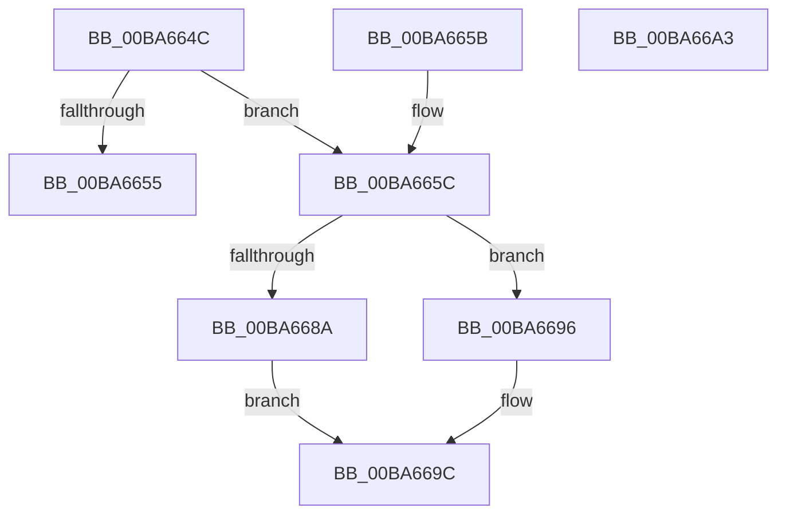

# VfFaultsIsSystemSufficientlyBooted

- RVA: `0x00BA664C`–`0x00BA66A4` (길이 `88` bytes)
- VA: `0x0000000140BA664C`
- 실행 섹션: `PAGEVRFY`
- PDB 이름 있음: `예`; PDB Function 태그: `아니요`
- unwind 정보 RVA: `0x000DB714`
- 디코드: `19`개 명령, `88/88` bytes 표시
- 미해석 바이트: `0` (있으면 어셈블리에 `.byte`로 보존)

> 이 문서는 커널 이미지의 기계어와 PDB 기호를 분석해 생성했습니다. 4번과 5번은 함수 원형과 자료형을 바이너리 사용 방식에서 추정한 C 해석이며 원본 소스 복구 결과는 아닙니다.

## 1. Dependencies

- 직접 호출 지점: **0**; 고유 호출 대상: **0**
- 직접 호출자로 확인된 함수: **4**
- RIP 상대 이미지 참조: **5**

### Outgoing calls
- 직접 디코드된 call 명령이 없습니다.

### Direct callers
- [VfFaultsInjectResourceFailure](VfFaultsInjectResourceFailure_function_00BA6558.md) at `0x00BA65B0`
- [ViRlrsMmMapLockedPages_Entry](ViRlrsMmMapLockedPages_Entry_function_00BAF760.md) at `0x00BAF773`
- [VerifierMmMapLockedPagesSpecifyCache](../BB/VerifierMmMapLockedPagesSpecifyCache_function_00BB0B30.md) at `0x00BB0B65`
- [VfHandlePoolAlloc](../BB/VfHandlePoolAlloc_function_00BB8A90.md) at `0x00BB8BD3`

### Static image references
- `0x00BA664C` → RVA `0x00FFDB00` (`PAGEVRFD`; read)
- `0x00BA6673` → RVA `0x00FC6E28` (`ALMOSTRO`; read)
- `0x00BA6681` → RVA `0x00FFDC68` (`PAGEVRFD`; read)
- `0x00BA668A` → RVA `0x00FFDB00` (`PAGEVRFD`; write)
- `0x00BA6696` → RVA `0x00FFEF8C` (`PAGEVRFD`; read/write)

## 2. Other-region calls and transfers

- 다른 실행 섹션으로 향하는 call: **0**
- 별도 외부 분기/꼬리 이동을 확인하지 못했습니다.

## 3. Assembly (complete function range)

```asm
00BA664C  83 3D AD 74 45 00 00            cmp dword ptr [rip + 0x4574ad], 0
00BA6653  74 07                           je 0x140ba665c
00BA6655  B8 01 00 00 00                  mov eax, 1
00BA665A  C3                              ret
00BA665B  CC                              int3
00BA665C  48 B9 14 00 00 00 80 F7 FF FF   movabs rcx, 0xfffff78000000014
00BA6666  48 B8 4B 59 86 38 D6 C5 6D 34   movabs rax, 0x346dc5d63886594b
00BA6670  48 8B 09                        mov rcx, qword ptr [rcx]
00BA6673  48 2B 0D AE 07 42 00            sub rcx, qword ptr [rip + 0x4207ae]
00BA667A  48 F7 E1                        mul rcx
00BA667D  48 C1 EA 0B                     shr rdx, 0xb
00BA6681  48 3B 15 E0 75 45 00            cmp rdx, qword ptr [rip + 0x4575e0]
00BA6688  76 0C                           jbe 0x140ba6696
00BA668A  C7 05 6C 74 45 00 01 00 00 00   mov dword ptr [rip + 0x45746c], 1
00BA6694  EB 06                           jmp 0x140ba669c
00BA6696  FF 05 F0 88 45 00               inc dword ptr [rip + 0x4588f0]
00BA669C  8B 05 5E 74 45 00               mov eax, dword ptr [rip + 0x45745e]
00BA66A2  C3                              ret
00BA66A3  CC                              int3
```

## 4. C-style interpretation (structured pseudocode)

```c
__int64 __fastcall VfFaultsIsSystemSufficientlyBooted(__int64 a1, __int64 a2)
{
    if ((*(unsigned int *)(v_rip + 4551853)) == 0) goto loc_00BA665C;
    return 1;
loc_00BA665C:
    a1 = (*(unsigned __int64 *)(a1)) - (*(unsigned __int64 *)(v_rip + 4327342));
    a2 = (a2) >> (11);
    if (a2 <= (*(unsigned __int64 *)(v_rip + 4552160))) goto loc_00BA6696;
    *(unsigned int *)(v_rip + 4551788) = 1;
    goto loc_00BA669C;
loc_00BA6696:
loc_00BA669C:
    return (unsigned int)(*(unsigned int *)(v_rip + 4551774));
}
```

## 5. (Beta) C Style

```c
int64_t VfFaultsIsSystemSufficientlyBooted(int64_t Arg1, int64_t Arg2)
{
    if ((*(uint32_t *)(v_rip + 0x4574AD)) == 0) goto loc_00BA665C;
    return 1;
loc_00BA665C:
    Arg1 = (*(uint64_t *)(Arg1)) - (*(uint64_t *)(v_rip + 0x4207AE));
    Arg2 = (Arg2) >> (11);
    if (Arg2 <= (*(uint64_t *)(v_rip + 0x4575E0))) goto loc_00BA6696;
    *(uint32_t *)(v_rip + 0x45746C) = 1;
    goto loc_00BA669C;
loc_00BA6696:
loc_00BA669C:
    return (uint32_t)(*(uint32_t *)(v_rip + 0x45745E));
}
```

## 6. Execution-region graph

[열기: 2D/3D 그래프와 함수 탐색 컨트롤 패널](../../../control-panel.html?section=pagevrfy&rva=0x00BA664C&view=graph)

- 2D 그래프는 위에서 아래로 흐르고, 3D 그래프는 빈 공간을 드래그해 회전합니다. Shift+드래그는 이동, 휠은 확대·축소, 함수 노드 선택은 대상 보고서 이동입니다.

### Static fallback


