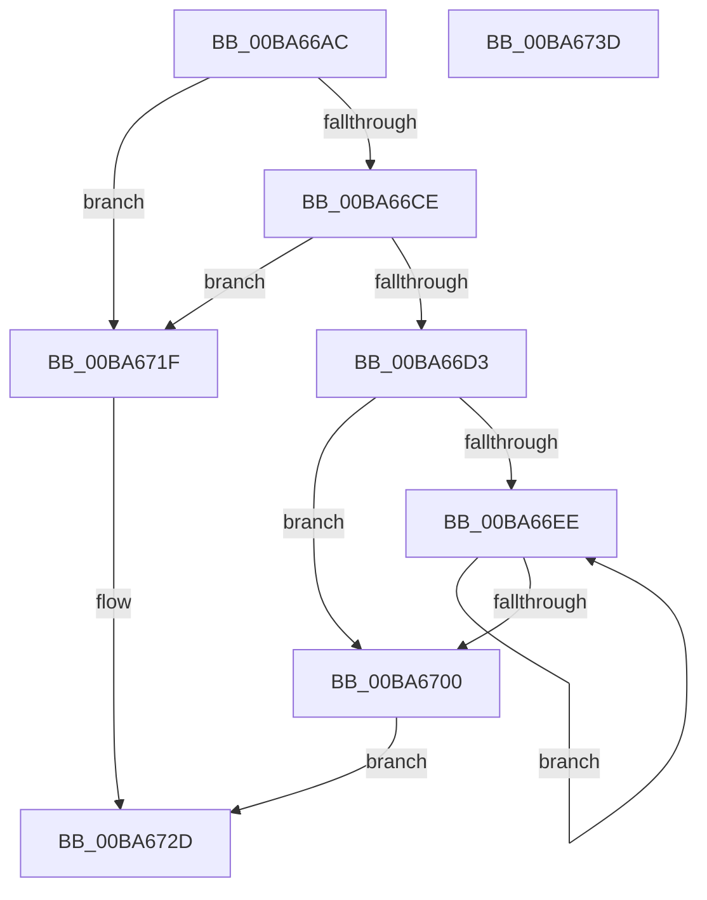

# VfFaultsRemoveAllApps

- RVA: `0x00BA66AC`–`0x00BA673E` (길이 `146` bytes)
- VA: `0x0000000140BA66AC`
- 실행 섹션: `PAGEVRFY`
- PDB 이름 있음: `예`; PDB Function 태그: `아니요`
- unwind 정보 RVA: `0x00060BC4`
- 디코드: `36`개 명령, `146/146` bytes 표시
- 미해석 바이트: `0` (있으면 어셈블리에 `.byte`로 보존)

> 이 문서는 커널 이미지의 기계어와 PDB 기호를 분석해 생성했습니다. 4번과 5번은 함수 원형과 자료형을 바이너리 사용 방식에서 추정한 C 해석이며 원본 소스 복구 결과는 아닙니다.

## 1. Dependencies

- 직접 호출 지점: **3**; 고유 호출 대상: **3**
- 직접 호출자로 확인된 함수: **3**
- RIP 상대 이미지 참조: **4**

### Outgoing calls
- `0x00BA66DA` → [KeAcquireSpinLockRaiseToDpc](../../text/20/KeAcquireSpinLockRaiseToDpc_function_00208470.md) (function, `0x00208470`)
- `0x00BA66F3` → [ExFreePoolWithTag](../../poolcode/B8/ExFreePoolWithTag_function_00B82870.md) (function, `0x00B82870`)
- `0x00BA6718` → [KeReleaseSpinLock](../../text/39/KeReleaseSpinLock_function_00392BA0.md) (function, `0x00392BA0`)

### Direct callers
- [VfRlrsVolatileConfigUpdate](../../text/61/VfRlrsVolatileConfigUpdate_function_006174C4.md) at `0x0061752E`
- [VfRlrsVolatileConfigUpdate](../../text/61/VfRlrsVolatileConfigUpdate_function_006174C4.md) at `0x00617570`
- [ViRlrsUnload](../../text/61/ViRlrsUnload_function_00617590.md) at `0x006175E6`
- [VfFaultsSetParameters](VfFaultsSetParameters_function_00BA67E4.md) at `0x00BA686D`

### Static image references
- `0x00BA66BB` → RVA `0x00F043A0` (`.data`; read)
- `0x00BA66D3` → RVA `0x00F044C8` (`.data`; read)
- `0x00BA6703` → RVA `0x00F043A8` (`.data`; write)
- `0x00BA6711` → RVA `0x00F043A0` (`.data`; write)

## 2. Other-region calls and transfers

- 다른 실행 섹션으로 향하는 call: **3**
  - `0x00BA66DA` → [KeAcquireSpinLockRaiseToDpc](../../text/20/KeAcquireSpinLockRaiseToDpc_function_00208470.md) (`PAGEVRFY` → `.text`)
  - `0x00BA66F3` → [ExFreePoolWithTag](../../poolcode/B8/ExFreePoolWithTag_function_00B82870.md) (`PAGEVRFY` → `POOLCODE`)
  - `0x00BA6718` → [KeReleaseSpinLock](../../text/39/KeReleaseSpinLock_function_00392BA0.md) (`PAGEVRFY` → `.text`)
- 별도 외부 분기/꼬리 이동을 확인하지 못했습니다.

## 3. Assembly (complete function range)

```asm
00BA66AC  48 89 5C 24 08                  mov qword ptr [rsp + 8], rbx
00BA66B1  48 89 74 24 10                  mov qword ptr [rsp + 0x10], rsi
00BA66B6  57                              push rdi
00BA66B7  48 83 EC 20                     sub rsp, 0x20
00BA66BB  48 8B 05 DE DC 35 00            mov rax, qword ptr [rip + 0x35dcde]
00BA66C2  48 8D 35 D7 DC 35 00            lea rsi, [rip + 0x35dcd7]
00BA66C9  48 85 C0                        test rax, rax
00BA66CC  74 51                           je 0x140ba671f
00BA66CE  48 3B C6                        cmp rax, rsi
00BA66D1  74 4C                           je 0x140ba671f
00BA66D3  48 8D 0D EE DD 35 00            lea rcx, [rip + 0x35ddee]
00BA66DA  E8 91 1D 66 FF                  call 0x140208470
00BA66DF  48 8B 0D BA DC 35 00            mov rcx, qword ptr [rip + 0x35dcba]
00BA66E6  40 8A F8                        mov dil, al
00BA66E9  48 3B CE                        cmp rcx, rsi
00BA66EC  74 12                           je 0x140ba6700
00BA66EE  48 8B 19                        mov rbx, qword ptr [rcx]
00BA66F1  33 D2                           xor edx, edx
00BA66F3  E8 78 C1 FD FF                  call 0x140b82870
00BA66F8  48 8B CB                        mov rcx, rbx
00BA66FB  48 3B DE                        cmp rbx, rsi
00BA66FE  75 EE                           jne 0x140ba66ee
00BA6700  40 8A D7                        mov dl, dil
00BA6703  48 89 35 9E DC 35 00            mov qword ptr [rip + 0x35dc9e], rsi
00BA670A  48 8D 0D B7 DD 35 00            lea rcx, [rip + 0x35ddb7]
00BA6711  48 89 35 88 DC 35 00            mov qword ptr [rip + 0x35dc88], rsi
00BA6718  E8 83 C4 7E FF                  call 0x140392ba0
00BA671D  EB 0E                           jmp 0x140ba672d
00BA671F  48 89 35 82 DC 35 00            mov qword ptr [rip + 0x35dc82], rsi
00BA6726  48 89 35 73 DC 35 00            mov qword ptr [rip + 0x35dc73], rsi
00BA672D  48 8B 5C 24 30                  mov rbx, qword ptr [rsp + 0x30]
00BA6732  48 8B 74 24 38                  mov rsi, qword ptr [rsp + 0x38]
00BA6737  48 83 C4 20                     add rsp, 0x20
00BA673B  5F                              pop rdi
00BA673C  C3                              ret
00BA673D  CC                              int3
```

## 4. C-style interpretation (structured pseudocode)

```c
__int64 __fastcall VfFaultsRemoveAllApps(__int64 a1, int a2)
{
    __int64 result;
    __int64 v_rsp;
    unsigned __int64 v_stack_p10;
    unsigned __int64 v_stack_p8;

    v_stack_p8 = v_rbx;
    v_stack_p10 = v_rsi;
    v_rsp = (v_rsp) - (32);
    if (*(unsigned __int64 *)(v_rip + 3529950) == 0) goto loc_00BA671F;
    if ((*(unsigned __int64 *)(v_rip + 3529950)) == (v_rip + 3529943)) goto loc_00BA671F;
    result = KeAcquireSpinLockRaiseToDpc(v_rip + 3530222, a2, a3, a4);
    if ((*(unsigned __int64 *)(v_rip + 3529914)) == (v_rip + 3529943)) goto loc_00BA6700;
loc_00BA66EE:
    a2 = 0;
    result = ExFreePoolWithTag(*(unsigned __int64 *)(v_rip + 3529914), a2, a3, a4);
    if ((*(unsigned __int64 *)(*(unsigned __int64 *)(v_rip + 3529914))) != (v_rip + 3529943)) goto loc_00BA66EE;
loc_00BA6700:
    *(unsigned __int64 *)(v_rip + 3529886) = v_rip + 3529943;
    *(unsigned __int64 *)(v_rip + 3529864) = v_rip + 3529943;
    result = KeReleaseSpinLock(v_rip + 3530167, (unsigned __int8)((unsigned __int8)(result)), a3, a4);
    goto loc_00BA672D;
loc_00BA671F:
    *(unsigned __int64 *)(v_rip + 3529858) = v_rip + 3529943;
    *(unsigned __int64 *)(v_rip + 3529843) = v_rip + 3529943;
loc_00BA672D:
    v_rsp = (v_rsp) + (32);
    return result;
}
```

## 5. (Beta) C Style

```c
int64_t VfFaultsRemoveAllApps(int64_t Arg1, int32_t Arg2)
{
    int64_t result;
    int64_t local_rsp;
    uint64_t v_stack_p10;
    uint64_t v_stack_p8;

    v_stack_p8 = local_rbx;
    v_stack_p10 = local_rsi;
    local_rsp = (local_rsp) - (32);
    if (*(uint64_t *)(v_rip + 0x35DCDE) == 0) goto loc_00BA671F;
    if ((*(uint64_t *)(v_rip + 0x35DCDE)) == (v_rip + 3529943)) goto loc_00BA671F;
    result = KeAcquireSpinLockRaiseToDpc(v_rip + 3530222, Arg2, a3, a4);
    if ((*(uint64_t *)(v_rip + 0x35DCBA)) == (v_rip + 3529943)) goto loc_00BA6700;
loc_00BA66EE:
    Arg2 = 0;
    result = ExFreePoolWithTag(*(uint64_t *)(v_rip + 0x35DCBA), Arg2, a3, a4);
    if ((*(uint64_t *)(*(uint64_t *)(v_rip + 0x35DCBA))) != (v_rip + 3529943)) goto loc_00BA66EE;
loc_00BA6700:
    *(uint64_t *)(v_rip + 0x35DC9E) = v_rip + 3529943;
    *(uint64_t *)(v_rip + 0x35DC88) = v_rip + 3529943;
    result = KeReleaseSpinLock(v_rip + 3530167, (uint8_t)((uint8_t)(result)), a3, a4);
    goto loc_00BA672D;
loc_00BA671F:
    *(uint64_t *)(v_rip + 0x35DC82) = v_rip + 3529943;
    *(uint64_t *)(v_rip + 0x35DC73) = v_rip + 3529943;
loc_00BA672D:
    local_rsp = (local_rsp) + (32);
    return result;
}
```

## 6. Execution-region graph

[열기: 2D/3D 그래프와 함수 탐색 컨트롤 패널](../../../control-panel.html?section=pagevrfy&rva=0x00BA66AC&view=graph)

- 2D 그래프는 위에서 아래로 흐르고, 3D 그래프는 빈 공간을 드래그해 회전합니다. Shift+드래그는 이동, 휠은 확대·축소, 함수 노드 선택은 대상 보고서 이동입니다.

### Static fallback


