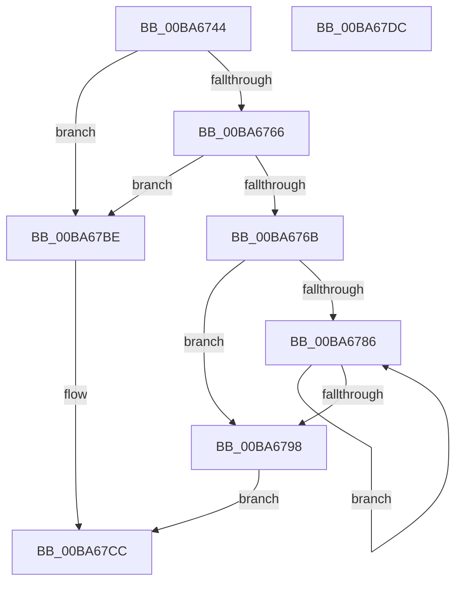

# VfFaultsRemoveAllTags

- RVA: `0x00BA6744`–`0x00BA67DD` (길이 `153` bytes)
- VA: `0x0000000140BA6744`
- 실행 섹션: `PAGEVRFY`
- PDB 이름 있음: `예`; PDB Function 태그: `아니요`
- unwind 정보 RVA: `0x00060BC4`
- 디코드: `37`개 명령, `153/153` bytes 표시
- 미해석 바이트: `0` (있으면 어셈블리에 `.byte`로 보존)

> 이 문서는 커널 이미지의 기계어와 PDB 기호를 분석해 생성했습니다. 4번과 5번은 함수 원형과 자료형을 바이너리 사용 방식에서 추정한 C 해석이며 원본 소스 복구 결과는 아닙니다.

## 1. Dependencies

- 직접 호출 지점: **3**; 고유 호출 대상: **3**
- 직접 호출자로 확인된 함수: **3**
- RIP 상대 이미지 참조: **5**

### Outgoing calls
- `0x00BA6772` → [KeAcquireSpinLockRaiseToDpc](../../text/20/KeAcquireSpinLockRaiseToDpc_function_00208470.md) (function, `0x00208470`)
- `0x00BA678B` → [ExFreePoolWithTag](../../poolcode/B8/ExFreePoolWithTag_function_00B82870.md) (function, `0x00B82870`)
- `0x00BA67B7` → [KeReleaseSpinLock](../../text/39/KeReleaseSpinLock_function_00392BA0.md) (function, `0x00392BA0`)

### Direct callers
- [VfRlrsVolatileConfigUpdate](../../text/61/VfRlrsVolatileConfigUpdate_function_006174C4.md) at `0x00617529`
- [VfRlrsVolatileConfigUpdate](../../text/61/VfRlrsVolatileConfigUpdate_function_006174C4.md) at `0x0061756B`
- [ViRlrsUnload](../../text/61/ViRlrsUnload_function_00617590.md) at `0x006175E1`
- [VfFaultsSetParameters](VfFaultsSetParameters_function_00BA67E4.md) at `0x00BA6868`

### Static image references
- `0x00BA6753` → RVA `0x00F044E0` (`.data`; read)
- `0x00BA676B` → RVA `0x00F044C8` (`.data`; read)
- `0x00BA6798` → RVA `0x00F044F0` (`.data`; read/write)
- `0x00BA67A9` → RVA `0x00F044E8` (`.data`; write)
- `0x00BA67B0` → RVA `0x00F044E0` (`.data`; write)

## 2. Other-region calls and transfers

- 다른 실행 섹션으로 향하는 call: **3**
  - `0x00BA6772` → [KeAcquireSpinLockRaiseToDpc](../../text/20/KeAcquireSpinLockRaiseToDpc_function_00208470.md) (`PAGEVRFY` → `.text`)
  - `0x00BA678B` → [ExFreePoolWithTag](../../poolcode/B8/ExFreePoolWithTag_function_00B82870.md) (`PAGEVRFY` → `POOLCODE`)
  - `0x00BA67B7` → [KeReleaseSpinLock](../../text/39/KeReleaseSpinLock_function_00392BA0.md) (`PAGEVRFY` → `.text`)
- 별도 외부 분기/꼬리 이동을 확인하지 못했습니다.

## 3. Assembly (complete function range)

```asm
00BA6744  48 89 5C 24 08                  mov qword ptr [rsp + 8], rbx
00BA6749  48 89 74 24 10                  mov qword ptr [rsp + 0x10], rsi
00BA674E  57                              push rdi
00BA674F  48 83 EC 20                     sub rsp, 0x20
00BA6753  48 8B 05 86 DD 35 00            mov rax, qword ptr [rip + 0x35dd86]
00BA675A  48 8D 35 7F DD 35 00            lea rsi, [rip + 0x35dd7f]
00BA6761  48 85 C0                        test rax, rax
00BA6764  74 58                           je 0x140ba67be
00BA6766  48 3B C6                        cmp rax, rsi
00BA6769  74 53                           je 0x140ba67be
00BA676B  48 8D 0D 56 DD 35 00            lea rcx, [rip + 0x35dd56]
00BA6772  E8 F9 1C 66 FF                  call 0x140208470
00BA6777  48 8B 0D 62 DD 35 00            mov rcx, qword ptr [rip + 0x35dd62]
00BA677E  40 8A F8                        mov dil, al
00BA6781  48 3B CE                        cmp rcx, rsi
00BA6784  74 12                           je 0x140ba6798
00BA6786  48 8B 19                        mov rbx, qword ptr [rcx]
00BA6789  33 D2                           xor edx, edx
00BA678B  E8 E0 C0 FD FF                  call 0x140b82870
00BA6790  48 8B CB                        mov rcx, rbx
00BA6793  48 3B DE                        cmp rbx, rsi
00BA6796  75 EE                           jne 0x140ba6786
00BA6798  83 25 51 DD 35 00 00            and dword ptr [rip + 0x35dd51], 0
00BA679F  48 8D 0D 22 DD 35 00            lea rcx, [rip + 0x35dd22]
00BA67A6  40 8A D7                        mov dl, dil
00BA67A9  48 89 35 38 DD 35 00            mov qword ptr [rip + 0x35dd38], rsi
00BA67B0  48 89 35 29 DD 35 00            mov qword ptr [rip + 0x35dd29], rsi
00BA67B7  E8 E4 C3 7E FF                  call 0x140392ba0
00BA67BC  EB 0E                           jmp 0x140ba67cc
00BA67BE  48 89 35 23 DD 35 00            mov qword ptr [rip + 0x35dd23], rsi
00BA67C5  48 89 35 14 DD 35 00            mov qword ptr [rip + 0x35dd14], rsi
00BA67CC  48 8B 5C 24 30                  mov rbx, qword ptr [rsp + 0x30]
00BA67D1  48 8B 74 24 38                  mov rsi, qword ptr [rsp + 0x38]
00BA67D6  48 83 C4 20                     add rsp, 0x20
00BA67DA  5F                              pop rdi
00BA67DB  C3                              ret
00BA67DC  CC                              int3
```

## 4. C-style interpretation (structured pseudocode)

```c
__int64 __fastcall VfFaultsRemoveAllTags(__int64 a1, int a2)
{
    __int64 result;
    __int64 v_rsp;
    unsigned __int64 v_stack_p10;
    unsigned __int64 v_stack_p8;

    v_stack_p8 = v_rbx;
    v_stack_p10 = v_rsi;
    v_rsp = (v_rsp) - (32);
    if (*(unsigned __int64 *)(v_rip + 3530118) == 0) goto loc_00BA67BE;
    if ((*(unsigned __int64 *)(v_rip + 3530118)) == (v_rip + 3530111)) goto loc_00BA67BE;
    result = KeAcquireSpinLockRaiseToDpc(v_rip + 3530070, a2, a3, a4);
    if ((*(unsigned __int64 *)(v_rip + 3530082)) == (v_rip + 3530111)) goto loc_00BA6798;
loc_00BA6786:
    a2 = 0;
    result = ExFreePoolWithTag(*(unsigned __int64 *)(v_rip + 3530082), a2, a3, a4);
    if ((*(unsigned __int64 *)(*(unsigned __int64 *)(v_rip + 3530082))) != (v_rip + 3530111)) goto loc_00BA6786;
loc_00BA6798:
    *(unsigned __int64 *)(v_rip + 3530040) = v_rip + 3530111;
    *(unsigned __int64 *)(v_rip + 3530025) = v_rip + 3530111;
    result = KeReleaseSpinLock(v_rip + 3530018, (unsigned __int8)((unsigned __int8)(result)), a3, a4);
    goto loc_00BA67CC;
loc_00BA67BE:
    *(unsigned __int64 *)(v_rip + 3530019) = v_rip + 3530111;
    *(unsigned __int64 *)(v_rip + 3530004) = v_rip + 3530111;
loc_00BA67CC:
    v_rsp = (v_rsp) + (32);
    return result;
}
```

## 5. (Beta) C Style

```c
int64_t VfFaultsRemoveAllTags(int64_t Arg1, int32_t Arg2)
{
    int64_t result;
    int64_t local_rsp;
    uint64_t v_stack_p10;
    uint64_t v_stack_p8;

    v_stack_p8 = local_rbx;
    v_stack_p10 = local_rsi;
    local_rsp = (local_rsp) - (32);
    if (*(uint64_t *)(v_rip + 0x35DD86) == 0) goto loc_00BA67BE;
    if ((*(uint64_t *)(v_rip + 0x35DD86)) == (v_rip + 3530111)) goto loc_00BA67BE;
    result = KeAcquireSpinLockRaiseToDpc(v_rip + 3530070, Arg2, a3, a4);
    if ((*(uint64_t *)(v_rip + 0x35DD62)) == (v_rip + 3530111)) goto loc_00BA6798;
loc_00BA6786:
    Arg2 = 0;
    result = ExFreePoolWithTag(*(uint64_t *)(v_rip + 0x35DD62), Arg2, a3, a4);
    if ((*(uint64_t *)(*(uint64_t *)(v_rip + 0x35DD62))) != (v_rip + 3530111)) goto loc_00BA6786;
loc_00BA6798:
    *(uint64_t *)(v_rip + 0x35DD38) = v_rip + 3530111;
    *(uint64_t *)(v_rip + 0x35DD29) = v_rip + 3530111;
    result = KeReleaseSpinLock(v_rip + 3530018, (uint8_t)((uint8_t)(result)), a3, a4);
    goto loc_00BA67CC;
loc_00BA67BE:
    *(uint64_t *)(v_rip + 0x35DD23) = v_rip + 3530111;
    *(uint64_t *)(v_rip + 0x35DD14) = v_rip + 3530111;
loc_00BA67CC:
    local_rsp = (local_rsp) + (32);
    return result;
}
```

## 6. Execution-region graph

[열기: 2D/3D 그래프와 함수 탐색 컨트롤 패널](../../../control-panel.html?section=pagevrfy&rva=0x00BA6744&view=graph)

- 2D 그래프는 위에서 아래로 흐르고, 3D 그래프는 빈 공간을 드래그해 회전합니다. Shift+드래그는 이동, 휠은 확대·축소, 함수 노드 선택은 대상 보고서 이동입니다.

### Static fallback


