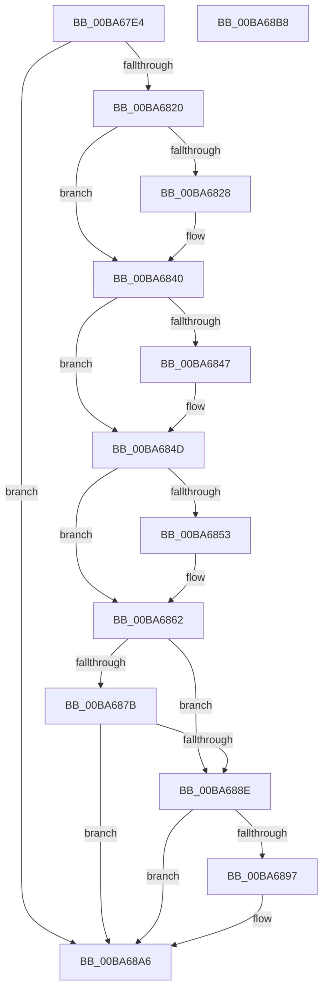

# VfFaultsSetParameters

- RVA: `0x00BA67E4`–`0x00BA68B9` (길이 `213` bytes)
- VA: `0x0000000140BA67E4`
- 실행 섹션: `PAGEVRFY`
- PDB 이름 있음: `예`; PDB Function 태그: `아니요`
- unwind 정보 RVA: `0x0008E1D0`
- 디코드: `59`개 명령, `213/213` bytes 표시
- 미해석 바이트: `0` (있으면 어셈블리에 `.byte`로 보존)

> 이 문서는 커널 이미지의 기계어와 PDB 기호를 분석해 생성했습니다. 4번과 5번은 함수 원형과 자료형을 바이너리 사용 방식에서 추정한 C 해석이며 원본 소스 복구 결과는 아닙니다.

## 1. Dependencies

- 직접 호출 지점: **6**; 고유 호출 대상: **6**
- 직접 호출자로 확인된 함수: **1**
- RIP 상대 이미지 참조: **6**

### Outgoing calls
- `0x00BA680F` → [VfSetVerifierInformation](VfSetVerifierInformation_function_00BAC4EC.md) (function, `0x00BAC4EC`)
- `0x00BA6831` → [PsSetCreateProcessNotifyRoutine](../../page/78/PsSetCreateProcessNotifyRoutine_function_00787760.md) (function, `0x00787760`)
- `0x00BA6868` → [VfFaultsRemoveAllTags](VfFaultsRemoveAllTags_function_00BA6744.md) (function, `0x00BA6744`)
- `0x00BA686D` → [VfFaultsRemoveAllApps](VfFaultsRemoveAllApps_function_00BA66AC.md) (function, `0x00BA66AC`)
- `0x00BA6883` → [VfFaultsAddAllApps](VfFaultsAddAllApps_function_00BA61D0.md) (function, `0x00BA61D0`)
- `0x00BA689F` → [VfFaultsAddAllTags](VfFaultsAddAllTags_function_00BA627C.md) (function, `0x00BA627C`)

### Direct callers
- [NtSetSystemInformation](../../page/AF/NtSetSystemInformation_function_00AF4A60.md) at `0x00AF5999`

### Static image references
- `0x00BA67F3` → RVA `0x00F04A20` (`.data`; read)
- `0x00BA6820` → RVA `0x00FFDA8C` (`PAGEVRFD`; read)
- `0x00BA682A` → RVA `0x00615F40` (`VfCreateProcessCallback`; read)
- `0x00BA6836` → RVA `0x00FFDA8C` (`PAGEVRFD`; write)
- `0x00BA6847` → RVA `0x00E0E938` (`.data`; write)
- `0x00BA6862` → RVA `0x00E0E93C` (`.data`; write)

## 2. Other-region calls and transfers

- 다른 실행 섹션으로 향하는 call: **1**
  - `0x00BA6831` → [PsSetCreateProcessNotifyRoutine](../../page/78/PsSetCreateProcessNotifyRoutine_function_00787760.md) (`PAGEVRFY` → `PAGE`)
- 별도 외부 분기/꼬리 이동을 확인하지 못했습니다.

## 3. Assembly (complete function range)

```asm
00BA67E4  48 89 5C 24 08                  mov qword ptr [rsp + 8], rbx
00BA67E9  48 89 74 24 18                  mov qword ptr [rsp + 0x18], rsi
00BA67EE  57                              push rdi
00BA67EF  48 83 EC 20                     sub rsp, 0x20
00BA67F3  8B 05 27 E2 35 00               mov eax, dword ptr [rip + 0x35e227]
00BA67F9  BA 04 00 00 00                  mov edx, 4
00BA67FE  0B C2                           or eax, edx
00BA6800  48 8B D9                        mov rbx, rcx
00BA6803  41 B0 01                        mov r8b, 1
00BA6806  89 44 24 38                     mov dword ptr [rsp + 0x38], eax
00BA680A  48 8D 4C 24 38                  lea rcx, [rsp + 0x38]
00BA680F  E8 D8 5C 00 00                  call 0x140bac4ec
00BA6814  33 F6                           xor esi, esi
00BA6816  8B F8                           mov edi, eax
00BA6818  85 C0                           test eax, eax
00BA681A  0F 88 86 00 00 00               js 0x140ba68a6
00BA6820  39 35 66 72 45 00               cmp dword ptr [rip + 0x457266], esi
00BA6826  75 18                           jne 0x140ba6840
00BA6828  33 D2                           xor edx, edx
00BA682A  48 8D 0D 0F F7 A6 FF            lea rcx, [rip - 0x5908f1]
00BA6831  E8 2A 0F BE FF                  call 0x140787760
00BA6836  C7 05 4C 72 45 00 01 00 00 00   mov dword ptr [rip + 0x45724c], 1
00BA6840  8B 43 04                        mov eax, dword ptr [rbx + 4]
00BA6843  85 C0                           test eax, eax
00BA6845  74 06                           je 0x140ba684d
00BA6847  89 05 EB 80 26 00               mov dword ptr [rip + 0x2680eb], eax
00BA684D  8B 03                           mov eax, dword ptr [rbx]
00BA684F  85 C0                           test eax, eax
00BA6851  75 0F                           jne 0x140ba6862
00BA6853  C7 05 DB 80 26 00 10 27 00 00   mov dword ptr [rip + 0x2680db], 0x2710
00BA685D  B8 58 02 00 00                  mov eax, 0x258
00BA6862  89 05 D4 80 26 00               mov dword ptr [rip + 0x2680d4], eax
00BA6868  E8 D7 FE FF FF                  call 0x140ba6744
00BA686D  E8 3A FE FF FF                  call 0x140ba66ac
00BA6872  0F B7 43 18                     movzx eax, word ptr [rbx + 0x18]
00BA6876  66 85 C0                        test ax, ax
00BA6879  74 13                           je 0x140ba688e
00BA687B  48 8B 4B 20                     mov rcx, qword ptr [rbx + 0x20]
00BA687F  8B D0                           mov edx, eax
00BA6881  D1 EA                           shr edx, 1
00BA6883  E8 48 F9 FF FF                  call 0x140ba61d0
00BA6888  8B F8                           mov edi, eax
00BA688A  85 C0                           test eax, eax
00BA688C  78 18                           js 0x140ba68a6
00BA688E  0F B7 43 08                     movzx eax, word ptr [rbx + 8]
00BA6892  66 85 C0                        test ax, ax
00BA6895  74 0F                           je 0x140ba68a6
00BA6897  48 8B 4B 10                     mov rcx, qword ptr [rbx + 0x10]
00BA689B  8B D0                           mov edx, eax
00BA689D  D1 EA                           shr edx, 1
00BA689F  E8 D8 F9 FF FF                  call 0x140ba627c
00BA68A4  8B F8                           mov edi, eax
00BA68A6  48 8B 5C 24 30                  mov rbx, qword ptr [rsp + 0x30]
00BA68AB  8B C7                           mov eax, edi
00BA68AD  48 8B 74 24 40                  mov rsi, qword ptr [rsp + 0x40]
00BA68B2  48 83 C4 20                     add rsp, 0x20
00BA68B6  5F                              pop rdi
00BA68B7  C3                              ret
00BA68B8  CC                              int3
```

## 4. C-style interpretation (structured pseudocode)

```c
__int64 __fastcall VfFaultsSetParameters(__int64 a1)
{
    __int64 result;
    __int64 v_rdi;
    __int64 v_rsi;
    __int64 v_rsp;
    unsigned int v_stack_p10;
    unsigned __int64 v_stack_p18;
    unsigned __int64 v_stack_p8;

    v_stack_p8 = v_rbx;
    v_stack_p18 = v_rsi;
    v_rsp = (v_rsp) - (32);
    result = (unsigned int)(((unsigned int)(*(unsigned int *)(v_rip + 3531303))) | (4));
    v_stack_p10 = (unsigned int)(result);
    result = VfSetVerifierInformation(v_stack_p10, 4, 1, a4);
    v_rsi = 0;
    if (sign_flag) goto loc_00BA68A6;
    if ((*(unsigned int *)(v_rip + 4551270)) == 0) {
        a2 = 0;
        a1 = v_rip - 5834993;
        result = PsSetCreateProcessNotifyRoutine(a1, a2, 1, a4);
        *(unsigned int *)(v_rip + 4551244) = 1;
    }
    if ((unsigned int)((unsigned int)(*(unsigned int *)(a1 + 4))) != 0) {
        *(unsigned int *)(v_rip + 2523371) = (unsigned int)((unsigned int)(*(unsigned int *)(a1 + 4)));
    }
    result = (unsigned int)(*(unsigned int *)(a1));
    if ((unsigned int)((unsigned int)(*(unsigned int *)(a1))) == 0) {
        *(unsigned int *)(v_rip + 2523355) = 0x2710ULL;
        result = 600;
    }
    *(unsigned int *)(v_rip + 2523348) = (unsigned int)(result);
    result = VfFaultsRemoveAllTags(a1, a2, 1, a4);
    result = VfFaultsRemoveAllApps(a1, a2, 1, a4);
    if ((unsigned __int16)(*(unsigned __int16 *)(a1 + 24)) == 0) goto loc_00BA688E;
    a2 = (unsigned int)(((unsigned int)((unsigned int)(*(unsigned __int16 *)(a1 + 24)))) >> (1));
    result = VfFaultsAddAllApps(*(unsigned __int64 *)(a1 + 32), a2, 1, a4);
    if (sign_flag) goto loc_00BA68A6;
loc_00BA688E:
    result = *(unsigned __int16 *)(a1 + 8);
    v_rdi = (unsigned int)((unsigned int)(result));
    if ((unsigned __int16)(*(unsigned __int16 *)(a1 + 8)) != 0) {
        a1 = *(unsigned __int64 *)(a1 + 16);
        a2 = (unsigned int)(*(unsigned __int16 *)(a1 + 8));
        a2 = (unsigned int)((a2) >> (1));
        result = VfFaultsAddAllTags(a1, a2, 1, a4);
        v_rdi = (unsigned int)(result);
    }
    v_rsp = (v_rsp) + (32);
    return (unsigned int)((unsigned int)(v_rdi));
}
```

## 5. (Beta) C Style

```c
int64_t VfFaultsSetParameters(void *Arg1)
{
    uint8_t *arg1 = (uint8_t *)Arg1;

    int64_t result;
    int64_t local_rdi;
    int64_t local_rsi;
    int64_t local_rsp;
    uint32_t v_stack_p10;
    uint64_t v_stack_p18;
    uint64_t v_stack_p8;

    v_stack_p8 = local_rbx;
    v_stack_p18 = local_rsi;
    local_rsp = (local_rsp) - (32);
    result = (uint32_t)(((uint32_t)(*(uint32_t *)(v_rip + 0x35E227))) | (4));
    v_stack_p10 = (uint32_t)(result);
    result = VfSetVerifierInformation(v_stack_p10, 4, 1, a4);
    local_rsi = 0;
    if (sign_flag) goto loc_00BA68A6;
    if ((*(uint32_t *)(v_rip + 0x457266)) == 0) {
        a2 = 0;
        Arg1 = v_rip - 5834993;
        result = PsSetCreateProcessNotifyRoutine(Arg1, a2, 1, a4);
        *(uint32_t *)(v_rip + 0x45724C) = 1;
    }
    if ((uint32_t)((uint32_t)(*(uint32_t *)(arg1 + 0x4))) != 0) {
        *(uint32_t *)(v_rip + 0x2680EB) = (uint32_t)((uint32_t)(*(uint32_t *)(arg1 + 0x4)));
    }
    result = (uint32_t)(*(uint32_t *)(arg1));
    if ((uint32_t)((uint32_t)(*(uint32_t *)(arg1))) == 0) {
        *(uint32_t *)(v_rip + 0x2680DB) = 0x2710ULL;
        result = 600;
    }
    *(uint32_t *)(v_rip + 0x2680D4) = (uint32_t)(result);
    result = VfFaultsRemoveAllTags(Arg1, a2, 1, a4);
    result = VfFaultsRemoveAllApps(Arg1, a2, 1, a4);
    if ((uint16_t)(*(uint16_t *)(arg1 + 0x18)) == 0) goto loc_00BA688E;
    a2 = (uint32_t)(((uint32_t)((uint32_t)(*(uint16_t *)(arg1 + 0x18)))) >> (1));
    result = VfFaultsAddAllApps(*(uint64_t *)(arg1 + 0x20), a2, 1, a4);
    if (sign_flag) goto loc_00BA68A6;
loc_00BA688E:
    result = *(uint16_t *)(arg1 + 0x8);
    local_rdi = (uint32_t)((uint32_t)(result));
    if ((uint16_t)(*(uint16_t *)(arg1 + 0x8)) != 0) {
        Arg1 = *(uint64_t *)(arg1 + 0x10);
        a2 = (uint32_t)(*(uint16_t *)(arg1 + 0x8));
        a2 = (uint32_t)((a2) >> (1));
        result = VfFaultsAddAllTags(Arg1, a2, 1, a4);
        local_rdi = (uint32_t)(result);
    }
    local_rsp = (local_rsp) + (32);
    return (uint32_t)((uint32_t)(local_rdi));
}
```

### 관측된 메모리 오프셋

구조체 형식이 확인되지 않은 접근은 인자 기준의 오프셋으로만 기록했습니다.

| 기준 인자 | 오프셋 표현 | 폭 (bit) | 접근 |
|---|---:|---:|---|
| `Arg1` | `+ 0x0` | `32` | `R` |
| `Arg1` | `+ 0x4` | `32` | `R` |
| `Arg1` | `+ 0x8` | `16` | `R` |
| `Arg1` | `+ 0x10` | `64` | `R` |
| `Arg1` | `+ 0x18` | `16` | `R` |
| `Arg1` | `+ 0x20` | `64` | `R` |

## 6. Execution-region graph

[열기: 2D/3D 그래프와 함수 탐색 컨트롤 패널](../../../control-panel.html?section=pagevrfy&rva=0x00BA67E4&view=graph)

- 2D 그래프는 위에서 아래로 흐르고, 3D 그래프는 빈 공간을 드래그해 회전합니다. Shift+드래그는 이동, 휠은 확대·축소, 함수 노드 선택은 대상 보고서 이동입니다.

### Static fallback


