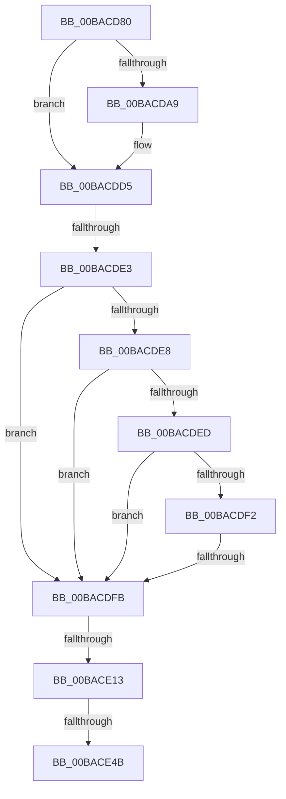

# VfFilterAttach

- RVA: `0x00BACD80`–`0x00BACE53` (길이 `211` bytes)
- VA: `0x0000000140BACD80`
- 실행 섹션: `PAGEVRFY`
- PDB 이름 있음: `예`; PDB Function 태그: `아니요`
- unwind 정보 RVA: `0x000D28A4`
- 디코드: `46`개 명령, `211/211` bytes 표시
- 미해석 바이트: `0` (있으면 어셈블리에 `.byte`로 보존)

> 이 문서는 커널 이미지의 기계어와 PDB 기호를 분석해 생성했습니다. 4번과 5번은 함수 원형과 자료형을 바이너리 사용 방식에서 추정한 C 해석이며 원본 소스 복구 결과는 아닙니다.

## 1. Dependencies

- 직접 호출 지점: **5**; 고유 호출 대상: **5**
- 직접 호출자로 확인된 함수: **2**
- RIP 상대 이미지 참조: **5**

### Outgoing calls
- `0x00BACDB5` → [RtlInitUnicodeString](../../text/42/RtlInitUnicodeString_function_0042A780.md) (function, `0x0042A780`)
- `0x00BACDC6` → [IoCreateDriver](../../page/AC/IoCreateDriver_function_00AC9D70.md) (function, `0x00AC9D70`)
- `0x00BACDFE` → [IoGetAttachedDevice](../../text/41/IoGetAttachedDevice_function_00410810.md) (function, `0x00410810`)
- `0x00BACE06` → [ViFilterIsDeviceExcluded](ViFilterIsDeviceExcluded_function_00BAD470.md) (function, `0x00BAD470`)
- `0x00BACE3E` → [IoCreateDevice](../../page/9A/IoCreateDevice_function_009A4B00.md) (function, `0x009A4B00`)

### Direct callers
- [VfDevObjPreAddDevice](../BB/VfDevObjPreAddDevice_function_00BB963C.md) at `0x00BB9670`
- [VfDevObjPostAddDevice](../BB/VfDevObjPostAddDevice_function_00BB9688.md) at `0x00BB96C3`

### Static image references
- `0x00BACD8A` → RVA `0x00FFDB74` (`PAGEVRFD`; read)
- `0x00BACDA9` → RVA `0x00B8B210` (`VerifierFilterDriverName`; read)
- `0x00BACDBA` → RVA `0x00BAD330` (`ViFilterDriverEntry`; read)
- `0x00BACDCB` → RVA `0x00FFDB74` (`PAGEVRFD`; write)
- `0x00BACDD5` → RVA `0x00F048D8` (`.data`; read)

## 2. Other-region calls and transfers

- 다른 실행 섹션으로 향하는 call: **4**
  - `0x00BACDB5` → [RtlInitUnicodeString](../../text/42/RtlInitUnicodeString_function_0042A780.md) (`PAGEVRFY` → `.text`)
  - `0x00BACDC6` → [IoCreateDriver](../../page/AC/IoCreateDriver_function_00AC9D70.md) (`PAGEVRFY` → `PAGE`)
  - `0x00BACDFE` → [IoGetAttachedDevice](../../text/41/IoGetAttachedDevice_function_00410810.md) (`PAGEVRFY` → `.text`)
  - `0x00BACE3E` → [IoCreateDevice](../../page/9A/IoCreateDevice_function_009A4B00.md) (`PAGEVRFY` → `PAGE`)
- call이 아닌 외부 분기/꼬리 이동: **4**
  - `0x00BACDDD` → [sub_00BACED2](Unknown_function_00BACED2.md) (`tail-transfer`)
  - `0x00BACDF5` → [sub_00BACED2](Unknown_function_00BACED2.md) (`tail-transfer`)
  - `0x00BACE0D` → [sub_00BACED2](Unknown_function_00BACED2.md) (`tail-transfer`)
  - `0x00BACE45` → [sub_00BACED2](Unknown_function_00BACED2.md) (`tail-transfer`)

## 3. Assembly (complete function range)

```asm
00BACD80  48 89 5C 24 10                  mov qword ptr [rsp + 0x10], rbx
00BACD85  56                              push rsi
00BACD86  48 83 EC 50                     sub rsp, 0x50
00BACD8A  83 3D E3 0D 45 00 00            cmp dword ptr [rip + 0x450de3], 0
00BACD91  0F 57 C0                        xorps xmm0, xmm0
00BACD94  0F 11 44 24 40                  movups xmmword ptr [rsp + 0x40], xmm0
00BACD99  8B DA                           mov ebx, edx
00BACD9B  48 C7 44 24 70 00 00 00 00      mov qword ptr [rsp + 0x70], 0
00BACDA4  48 8B F1                        mov rsi, rcx
00BACDA7  75 2C                           jne 0x140bacdd5
00BACDA9  48 8D 15 60 E4 FD FF            lea rdx, [rip - 0x21ba0]
00BACDB0  48 8D 4C 24 40                  lea rcx, [rsp + 0x40]
00BACDB5  E8 C6 D9 87 FF                  call 0x14042a780
00BACDBA  48 8D 15 6F 05 00 00            lea rdx, [rip + 0x56f]
00BACDC1  48 8D 4C 24 40                  lea rcx, [rsp + 0x40]
00BACDC6  E8 A5 CF F1 FF                  call 0x140ac9d70
00BACDCB  C7 05 9F 0D 45 00 01 00 00 00   mov dword ptr [rip + 0x450d9f], 1
00BACDD5  48 83 3D FB 7A 35 00 00         cmp qword ptr [rip + 0x357afb], 0
00BACDDD  0F 84 EF 00 00 00               je 0x140baced2
00BACDE3  83 EB 02                        sub ebx, 2
00BACDE6  74 13                           je 0x140bacdfb
00BACDE8  83 EB 01                        sub ebx, 1
00BACDEB  74 0E                           je 0x140bacdfb
00BACDED  83 EB 02                        sub ebx, 2
00BACDF0  74 09                           je 0x140bacdfb
00BACDF2  83 FB 01                        cmp ebx, 1
00BACDF5  0F 85 D7 00 00 00               jne 0x140baced2
00BACDFB  48 8B CE                        mov rcx, rsi
00BACDFE  E8 0D 3A 86 FF                  call 0x140410810
00BACE03  48 8B C8                        mov rcx, rax
00BACE06  E8 65 06 00 00                  call 0x140bad470
00BACE0B  85 C0                           test eax, eax
00BACE0D  0F 85 BF 00 00 00               jne 0x140baced2
00BACE13  48 8B 0D BE 7A 35 00            mov rcx, qword ptr [rip + 0x357abe]
00BACE1A  48 8D 44 24 70                  lea rax, [rsp + 0x70]
00BACE1F  48 89 44 24 30                  mov qword ptr [rsp + 0x30], rax
00BACE24  41 B9 22 00 00 00               mov r9d, 0x22
00BACE2A  C6 44 24 28 00                  mov byte ptr [rsp + 0x28], 0
00BACE2F  45 33 C0                        xor r8d, r8d
00BACE32  C7 44 24 20 00 01 00 00         mov dword ptr [rsp + 0x20], 0x100
00BACE3A  41 8D 51 46                     lea edx, [r9 + 0x46]
00BACE3E  E8 BD 7C DF FF                  call 0x1409a4b00
00BACE43  85 C0                           test eax, eax
00BACE45  0F 88 87 00 00 00               js 0x140baced2
00BACE4B  48 8B 5C 24 70                  mov rbx, qword ptr [rsp + 0x70]
00BACE50  45 33 C9                        xor r9d, r9d
```

## 4. C-style interpretation (structured pseudocode)

```c
__int64 __fastcall VfFilterAttach(__int64 a1, int a2, int a3)
{
    __int64 result;
    __int64 v_rbx;
    __int64 v_rsp;
    unsigned __int64 v_stack_m18;
    unsigned __int64 v_stack_m28;
    unsigned __int8 v_stack_m30;
    unsigned int v_stack_m38;
    unsigned __int64 v_stack_p10;
    unsigned __int64 v_stack_p18;

    v_stack_p10 = v_rbx;
    v_rsp = (v_rsp) - (80);
    v_stack_m18 = v_xmm0;
    v_stack_p18 = 0;
    if ((*(unsigned int *)(v_rip + 4525539)) == 0) {
        a2 = v_rip - 138144;
        a1 = v_stack_m18;
        result = RtlInitUnicodeString(a1, a2, a3, a4);
        a2 = v_rip + 1391;
        a1 = v_stack_m18;
        result = IoCreateDriver(a1, a2, a3, a4);
        *(unsigned int *)(v_rip + 4525471) = 1;
    }
    v_rbx = (unsigned int)(((unsigned int)(a2)) - (2));
    if (condition_is_equal) goto loc_00BACDFB;
    v_rbx = (unsigned int)((v_rbx) - (1));
    if (condition_is_equal) goto loc_00BACDFB;
    v_rbx = (unsigned int)((v_rbx) - (2));
    if (condition_is_equal) goto loc_00BACDFB;
loc_00BACDFB:
    result = IoGetAttachedDevice(a1, a2, a3, a4);
    result = ViFilterIsDeviceExcluded(result, a2, a3, a4);
    v_stack_m28 = v_stack_p18;
    v_stack_m30 = 0;
    a3 = 0;
    v_stack_m38 = 256;
    result = IoCreateDevice(*(unsigned __int64 *)(v_rip + 3504830), 34 + 70, a3, 34);
    a4 = 0;
    return result;
}
```

## 5. (Beta) C Style

```c
int64_t VfFilterAttach(int64_t Arg1, int32_t Arg2, int32_t Arg3)
{
    int64_t result;
    int64_t local_rbx;
    int64_t local_rsp;
    uint64_t v_stack_m18;
    uint64_t v_stack_m28;
    uint8_t v_stack_m30;
    uint32_t v_stack_m38;
    uint64_t v_stack_p10;
    uint64_t v_stack_p18;

    v_stack_p10 = local_rbx;
    local_rsp = (local_rsp) - (80);
    v_stack_m18 = v_xmm0;
    v_stack_p18 = 0;
    if ((*(uint32_t *)(v_rip + 0x450DE3)) == 0) {
        Arg2 = v_rip - 138144;
        Arg1 = v_stack_m18;
        result = RtlInitUnicodeString(Arg1, Arg2, Arg3, a4);
        Arg2 = v_rip + 1391;
        Arg1 = v_stack_m18;
        result = IoCreateDriver(Arg1, Arg2, Arg3, a4);
        *(uint32_t *)(v_rip + 0x450D9F) = 1;
    }
    local_rbx = (uint32_t)(((uint32_t)(Arg2)) - (2));
    if (condition_is_equal) goto loc_00BACDFB;
    local_rbx = (uint32_t)((local_rbx) - (1));
    if (condition_is_equal) goto loc_00BACDFB;
    local_rbx = (uint32_t)((local_rbx) - (2));
    if (condition_is_equal) goto loc_00BACDFB;
loc_00BACDFB:
    result = IoGetAttachedDevice(Arg1, Arg2, Arg3, a4);
    result = ViFilterIsDeviceExcluded(result, Arg2, Arg3, a4);
    v_stack_m28 = v_stack_p18;
    v_stack_m30 = 0;
    Arg3 = 0;
    v_stack_m38 = 256;
    result = IoCreateDevice(*(uint64_t *)(v_rip + 0x357ABE), 34 + 70, Arg3, 34);
    a4 = 0;
    return result;
}
```

## 6. Execution-region graph

[열기: 2D/3D 그래프와 함수 탐색 컨트롤 패널](../../../control-panel.html?section=pagevrfy&rva=0x00BACD80&view=graph)

- 2D 그래프는 위에서 아래로 흐르고, 3D 그래프는 빈 공간을 드래그해 회전합니다. Shift+드래그는 이동, 휠은 확대·축소, 함수 노드 선택은 대상 보고서 이동입니다.

### Static fallback


