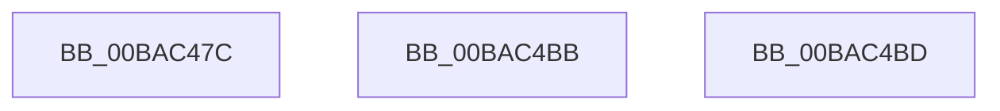

# VfGetVerifierInformationEx

- RVA: `0x00BAC47C`–`0x00BAC4BE` (길이 `66` bytes)
- VA: `0x0000000140BAC47C`
- 실행 섹션: `PAGEVRFY`
- PDB 이름 있음: `예`; PDB Function 태그: `아니요`
- unwind 정보 RVA: `0x000D275C`
- 디코드: `20`개 명령, `66/66` bytes 표시
- 미해석 바이트: `0` (있으면 어셈블리에 `.byte`로 보존)

> 이 문서는 커널 이미지의 기계어와 PDB 기호를 분석해 생성했습니다. 4번과 5번은 함수 원형과 자료형을 바이너리 사용 방식에서 추정한 C 해석이며 원본 소스 복구 결과는 아닙니다.

## 1. Dependencies

- 직접 호출 지점: **0**; 고유 호출 대상: **0**
- 직접 호출자로 확인된 함수: **1**
- RIP 상대 이미지 참조: **4**

### Outgoing calls
- 직접 디코드된 call 명령이 없습니다.

### Direct callers
- [ExpQuerySystemInformation](../../page/A5/ExpQuerySystemInformation_function_00A57858.md) at `0x00A591B0`

### Static image references
- `0x00BAC48F` → RVA `0x00E0E944` (`.data`; read)
- `0x00BAC497` → RVA `0x00F04AA0` (`.data`; read)
- `0x00BAC4A0` → RVA `0x00F04950` (`.data`; read)
- `0x00BAC4AF` → RVA `0x00FFDA18` (`PAGEVRFD`; read)

## 2. Other-region calls and transfers

- 다른 실행 섹션으로 향하는 call: **0**
- 별도 외부 분기/꼬리 이동을 확인하지 못했습니다.

## 3. Assembly (complete function range)

```asm
00BAC47C  48 8B D1                        mov rdx, rcx
00BAC47F  0F 57 C0                        xorps xmm0, xmm0
00BAC482  33 C0                           xor eax, eax
00BAC484  0F 11 01                        movups xmmword ptr [rcx], xmm0
00BAC487  0F 11 41 10                     movups xmmword ptr [rcx + 0x10], xmm0
00BAC48B  48 89 41 20                     mov qword ptr [rcx + 0x20], rax
00BAC48F  8B 05 AF 24 26 00               mov eax, dword ptr [rip + 0x2624af]
00BAC495  89 01                           mov dword ptr [rcx], eax
00BAC497  8B 05 03 86 35 00               mov eax, dword ptr [rip + 0x358603]
00BAC49D  89 41 04                        mov dword ptr [rcx + 4], eax
00BAC4A0  8B 05 AA 84 35 00               mov eax, dword ptr [rip + 0x3584aa]
00BAC4A6  69 C8 E8 03 00 00               imul ecx, eax, 0x3e8
00BAC4AC  89 4A 18                        mov dword ptr [rdx + 0x18], ecx
00BAC4AF  8B 05 63 15 45 00               mov eax, dword ptr [rip + 0x451563]
00BAC4B5  89 42 1C                        mov dword ptr [rdx + 0x1c], eax
00BAC4B8  33 C0                           xor eax, eax
00BAC4BA  C3                              ret
00BAC4BB  CC                              int3
00BAC4BC  C3                              ret
00BAC4BD  CC                              int3
```

## 4. C-style interpretation (structured pseudocode)

```c
__int64 __fastcall VfGetVerifierInformationEx(__int64 a1)
{
    __int64 result;

    result = 0;
    *(unsigned __int64 *)(a1) = v_xmm0;
    *(unsigned __int64 *)(a1 + 16) = v_xmm0;
    *(unsigned __int64 *)(a1 + 32) = 0;
    *(unsigned int *)(a1) = (unsigned int)((unsigned int)(*(unsigned int *)(v_rip + 2499759)));
    *(unsigned int *)(a1 + 4) = (unsigned int)((unsigned int)(*(unsigned int *)(v_rip + 3507715)));
    a1 = (unsigned int)((a1) * ((unsigned int)((unsigned int)(*(unsigned int *)(v_rip + 3507370)))));
    *(unsigned int *)(a1 + 24) = (unsigned int)(a1);
    *(unsigned int *)(a1 + 28) = (unsigned int)((unsigned int)(*(unsigned int *)(v_rip + 4527459)));
    result = 0;
    return result;
}
```

## 5. (Beta) C Style

```c
int64_t VfGetVerifierInformationEx(void *Arg1)
{
    uint8_t *arg1 = (uint8_t *)Arg1;

    int64_t result;

    result = 0;
    *(uint64_t *)(arg1) = v_xmm0;
    *(uint64_t *)(arg1 + 0x10) = v_xmm0;
    *(uint64_t *)(arg1 + 0x20) = 0;
    *(uint32_t *)(arg1) = (uint32_t)((uint32_t)(*(uint32_t *)(v_rip + 0x2624AF)));
    *(uint32_t *)(arg1 + 0x4) = (uint32_t)((uint32_t)(*(uint32_t *)(v_rip + 0x358603)));
    Arg1 = (uint32_t)((Arg1) * ((uint32_t)((uint32_t)(*(uint32_t *)(v_rip + 0x3584AA)))));
    *(uint32_t *)(arg1 + 0x18) = (uint32_t)(Arg1);
    *(uint32_t *)(arg1 + 0x1C) = (uint32_t)((uint32_t)(*(uint32_t *)(v_rip + 0x451563)));
    result = 0;
    return result;
}
```

### 관측된 메모리 오프셋

구조체 형식이 확인되지 않은 접근은 인자 기준의 오프셋으로만 기록했습니다.

| 기준 인자 | 오프셋 표현 | 폭 (bit) | 접근 |
|---|---:|---:|---|
| `Arg1` | `+ 0x0` | `32` | `W` |
| `Arg1` | `+ 0x0` | `128` | `R` |
| `Arg1` | `+ 0x4` | `32` | `W` |
| `Arg1` | `+ 0x10` | `128` | `R` |
| `Arg1` | `+ 0x18` | `32` | `W` |
| `Arg1` | `+ 0x1C` | `32` | `W` |
| `Arg1` | `+ 0x20` | `64` | `W` |

## 6. Execution-region graph

[열기: 2D/3D 그래프와 함수 탐색 컨트롤 패널](../../../control-panel.html?section=pagevrfy&rva=0x00BAC47C&view=graph)

- 2D 그래프는 위에서 아래로 흐르고, 3D 그래프는 빈 공간을 드래그해 회전합니다. Shift+드래그는 이동, 휠은 확대·축소, 함수 노드 선택은 대상 보고서 이동입니다.

### Static fallback


