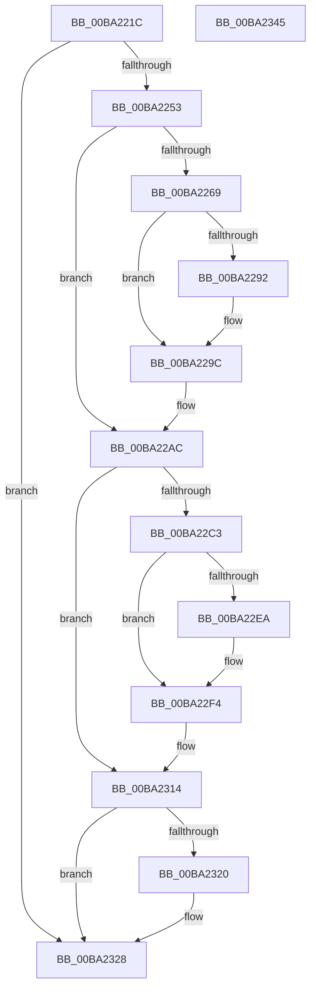

# VfIoDeleteDevice

- RVA: `0x00BA221C`–`0x00BA2346` (길이 `298` bytes)
- VA: `0x0000000140BA221C`
- 실행 섹션: `PAGEVRFY`
- PDB 이름 있음: `예`; PDB Function 태그: `아니요`
- unwind 정보 RVA: `0x000D252C`
- 디코드: `76`개 명령, `298/298` bytes 표시
- 미해석 바이트: `0` (있으면 어셈블리에 `.byte`로 보존)

> 이 문서는 커널 이미지의 기계어와 PDB 기호를 분석해 생성했습니다. 4번과 5번은 함수 원형과 자료형을 바이너리 사용 방식에서 추정한 C 해석이며 원본 소스 복구 결과는 아닙니다.

## 1. Dependencies

- 직접 호출 지점: **16**; 고유 호출 대상: **12**
- 직접 호출자로 확인된 함수: **1**
- RIP 상대 이미지 참조: **4**

### Outgoing calls
- `0x00BA2240` → [VfHalDeleteDevice](../B9/VfHalDeleteDevice_function_00B97190.md) (function, `0x00B97190`)
- `0x00BA2256` → [ViDevObjRemove](ViDevObjRemove_function_00BA248C.md) (function, `0x00BA248C`)
- `0x00BA2260` → [IovUtilIsDeviceObjectMarked](IovUtilIsDeviceObjectMarked_function_00BA2B34.md) (function, `0x00BA2B34`)
- `0x00BA2270` → [ViErrorDisplayDescription](ViErrorDisplayDescription_function_00BA361C.md) (function, `0x00BA361C`)
- `0x00BA2289` → [RtlStringCbPrintfA](../../text/53/RtlStringCbPrintfA_function_0053BC0C.md) (function, `0x0053BC0C`)
- `0x00BA2297` → [VfUtilDbgPrint](../../text/61/VfUtilDbgPrint_function_006122AC.md) (function, `0x006122AC`)
- `0x00BA22A7` → [ViErrorFinishReport](ViErrorFinishReport_function_00BA366C.md) (function, `0x00BA366C`)
- `0x00BA22B1` → [IovUtilMarkDeviceObject](../../text/4B/IovUtilMarkDeviceObject_function_004B77B0.md) (function, `0x004B77B0`)
- `0x00BA22B6` → [IovUtilGetLowerDeviceObjectWithTag](IovUtilGetLowerDeviceObjectWithTag_function_00BA2A84.md) (function, `0x00BA2A84`)
- `0x00BA22C8` → [ViErrorDisplayDescription](ViErrorDisplayDescription_function_00BA361C.md) (function, `0x00BA361C`)
- `0x00BA22E1` → [RtlStringCbPrintfA](../../text/53/RtlStringCbPrintfA_function_0053BC0C.md) (function, `0x0053BC0C`)
- `0x00BA22EF` → [VfUtilDbgPrint](../../text/61/VfUtilDbgPrint_function_006122AC.md) (function, `0x006122AC`)
- `0x00BA2302` → [ViErrorFinishReport](ViErrorFinishReport_function_00BA366C.md) (function, `0x00BA366C`)
- `0x00BA230F` → [ObfDereferenceObjectWithTag](../../text/2F/ObfDereferenceObjectWithTag_function_002F78E0.md) (function, `0x002F78E0`)
- `0x00BA2323` → [VfIrpLogDeleteDeviceLogs](VfIrpLogDeleteDeviceLogs_function_00BAB58C.md) (function, `0x00BAB58C`)
- `0x00BA2330` → [_security_check_cookie](../../text/6A/_security_check_cookie_function_006AC640.md) (function, `0x006AC640`)

### Direct callers
- [IovDeleteDevice](../B9/IovDeleteDevice_function_00B92724.md) at `0x00B92728`

### Static image references
- `0x00BA222B` → RVA `0x00E0A740` (`.data`; read)
- `0x00BA2245` → RVA `0x00FF4000` (`PAGEVRFD`; read)
- `0x00BA2278` → RVA `0x006CE600` (` ?? ::FNODOBFM::`string'`; read)
- `0x00BA2314` → RVA `0x00F04A20` (`.data`; read)

## 2. Other-region calls and transfers

- 다른 실행 섹션으로 향하는 call: **7**
  - `0x00BA2289` → [RtlStringCbPrintfA](../../text/53/RtlStringCbPrintfA_function_0053BC0C.md) (`PAGEVRFY` → `.text`)
  - `0x00BA2297` → [VfUtilDbgPrint](../../text/61/VfUtilDbgPrint_function_006122AC.md) (`PAGEVRFY` → `.text`)
  - `0x00BA22B1` → [IovUtilMarkDeviceObject](../../text/4B/IovUtilMarkDeviceObject_function_004B77B0.md) (`PAGEVRFY` → `.text`)
  - `0x00BA22E1` → [RtlStringCbPrintfA](../../text/53/RtlStringCbPrintfA_function_0053BC0C.md) (`PAGEVRFY` → `.text`)
  - `0x00BA22EF` → [VfUtilDbgPrint](../../text/61/VfUtilDbgPrint_function_006122AC.md) (`PAGEVRFY` → `.text`)
  - `0x00BA230F` → [ObfDereferenceObjectWithTag](../../text/2F/ObfDereferenceObjectWithTag_function_002F78E0.md) (`PAGEVRFY` → `.text`)
  - `0x00BA2330` → [_security_check_cookie](../../text/6A/_security_check_cookie_function_006AC640.md) (`PAGEVRFY` → `.text`)
- 별도 외부 분기/꼬리 이동을 확인하지 못했습니다.

## 3. Assembly (complete function range)

```asm
00BA221C  48 89 5C 24 18                  mov qword ptr [rsp + 0x18], rbx
00BA2221  48 89 74 24 20                  mov qword ptr [rsp + 0x20], rsi
00BA2226  57                              push rdi
00BA2227  48 83 EC 50                     sub rsp, 0x50
00BA222B  48 8B 05 0E 85 26 00            mov rax, qword ptr [rip + 0x26850e]
00BA2232  48 33 C4                        xor rax, rsp
00BA2235  48 89 44 24 48                  mov qword ptr [rsp + 0x48], rax
00BA223A  48 8B FA                        mov rdi, rdx
00BA223D  48 8B D9                        mov rbx, rcx
00BA2240  E8 4B 4F FF FF                  call 0x140b97190
00BA2245  8B 05 B5 1D 45 00               mov eax, dword ptr [rip + 0x451db5]
00BA224B  85 C0                           test eax, eax
00BA224D  0F 85 D5 00 00 00               jne 0x140ba2328
00BA2253  48 8B CB                        mov rcx, rbx
00BA2256  E8 31 02 00 00                  call 0x140ba248c
00BA225B  33 D2                           xor edx, edx
00BA225D  48 8B CB                        mov rcx, rbx
00BA2260  E8 CF 08 00 00                  call 0x140ba2b34
00BA2265  85 C0                           test eax, eax
00BA2267  74 43                           je 0x140ba22ac
00BA2269  BE 40 02 00 00                  mov esi, 0x240
00BA226E  8B CE                           mov ecx, esi
00BA2270  E8 A7 13 00 00                  call 0x140ba361c
00BA2275  4C 8B CF                        mov r9, rdi
00BA2278  4C 8D 05 81 C3 B2 FF            lea r8, [rip - 0x4d3c7f]
00BA227F  BA 26 00 00 00                  mov edx, 0x26
00BA2284  48 8D 4C 24 20                  lea rcx, [rsp + 0x20]
00BA2289  E8 7E 99 99 FF                  call 0x14053bc0c
00BA228E  85 C0                           test eax, eax
00BA2290  78 0A                           js 0x140ba229c
00BA2292  48 8D 4C 24 20                  lea rcx, [rsp + 0x20]
00BA2297  E8 10 00 A7 FF                  call 0x1406122ac
00BA229C  45 33 C9                        xor r9d, r9d
00BA229F  45 33 C0                        xor r8d, r8d
00BA22A2  48 8B D7                        mov rdx, rdi
00BA22A5  8B CE                           mov ecx, esi
00BA22A7  E8 C0 13 00 00                  call 0x140ba366c
00BA22AC  33 D2                           xor edx, edx
00BA22AE  48 8B CB                        mov rcx, rbx
00BA22B1  E8 FA 54 91 FF                  call 0x1404b77b0
00BA22B6  E8 C9 07 00 00                  call 0x140ba2a84
00BA22BB  48 8B F0                        mov rsi, rax
00BA22BE  48 85 C0                        test rax, rax
00BA22C1  74 51                           je 0x140ba2314
00BA22C3  B9 01 02 00 00                  mov ecx, 0x201
00BA22C8  E8 4F 13 00 00                  call 0x140ba361c
00BA22CD  4C 8B CF                        mov r9, rdi
00BA22D0  4C 8D 05 29 C3 B2 FF            lea r8, [rip - 0x4d3cd7]
00BA22D7  BA 26 00 00 00                  mov edx, 0x26
00BA22DC  48 8D 4C 24 20                  lea rcx, [rsp + 0x20]
00BA22E1  E8 26 99 99 FF                  call 0x14053bc0c
00BA22E6  85 C0                           test eax, eax
00BA22E8  78 0A                           js 0x140ba22f4
00BA22EA  48 8D 4C 24 20                  lea rcx, [rsp + 0x20]
00BA22EF  E8 B8 FF A6 FF                  call 0x1406122ac
00BA22F4  45 33 C9                        xor r9d, r9d
00BA22F7  45 33 C0                        xor r8d, r8d
00BA22FA  48 8B D7                        mov rdx, rdi
00BA22FD  B9 01 02 00 00                  mov ecx, 0x201
00BA2302  E8 65 13 00 00                  call 0x140ba366c
00BA2307  BA 56 72 66 49                  mov edx, 0x49667256
00BA230C  48 8B CE                        mov rcx, rsi
00BA230F  E8 CC 55 75 FF                  call 0x1402f78e0
00BA2314  F7 05 02 27 36 00 00 04 00 00   test dword ptr [rip + 0x362702], 0x400
00BA231E  74 08                           je 0x140ba2328
00BA2320  48 8B CB                        mov rcx, rbx
00BA2323  E8 64 92 00 00                  call 0x140bab58c
00BA2328  48 8B 4C 24 48                  mov rcx, qword ptr [rsp + 0x48]
00BA232D  48 33 CC                        xor rcx, rsp
00BA2330  E8 0B A3 B0 FF                  call 0x1406ac640
00BA2335  48 8B 5C 24 70                  mov rbx, qword ptr [rsp + 0x70]
00BA233A  48 8B 74 24 78                  mov rsi, qword ptr [rsp + 0x78]
00BA233F  48 83 C4 50                     add rsp, 0x50
00BA2343  5F                              pop rdi
00BA2344  C3                              ret
00BA2345  CC                              int3
```

## 4. C-style interpretation (structured pseudocode)

```c
__int64 __fastcall VfIoDeleteDevice(__int64 a1, __int64 a2)
{
    __int64 result;
    __int64 v_rsp;
    unsigned __int64 v_stack_m10;
    unsigned __int64 v_stack_m38;
    unsigned __int64 v_stack_p18;
    unsigned __int64 v_stack_p20;

    v_stack_p18 = v_rbx;
    v_stack_p20 = v_rsi;
    v_rsp = (v_rsp) - (80);
    result = (*(unsigned __int64 *)(v_rip + 2524430)) ^ (v_rsp);
    v_stack_m10 = result;
    result = VfHalDeleteDevice(a1, a2, a3, a4);
    if ((unsigned int)((unsigned int)(*(unsigned int *)(v_rip + 4529589))) != 0) goto loc_00BA2328;
    result = ViDevObjRemove(a1, a2, a3, a4);
    a2 = 0;
    result = IovUtilIsDeviceObjectMarked(a1, a2, a3, a4);
    if ((unsigned int)(result) == 0) goto loc_00BA22AC;
    result = ViErrorDisplayDescription(576, a2, a3, a4);
    result = RtlStringCbPrintfA(v_stack_m38, 38, v_rip - 5061759, 0);
    if (!(sign_flag)) {
        a1 = v_stack_m38;
        result = VfUtilDbgPrint(a1, 38, v_rip - 5061759, 0);
    }
    a4 = 0;
    a3 = 0;
    result = ViErrorFinishReport(576, 0, a3, a4);
loc_00BA22AC:
    a2 = 0;
    result = IovUtilMarkDeviceObject(a1, a2, a3, a4);
    result = IovUtilGetLowerDeviceObjectWithTag(a1, a2, a3, a4);
    if (result == 0) goto loc_00BA2314;
    result = ViErrorDisplayDescription(513, a2, a3, a4);
    result = RtlStringCbPrintfA(v_stack_m38, 38, v_rip - 5061847, 0);
    if (!(sign_flag)) {
        a1 = v_stack_m38;
        result = VfUtilDbgPrint(a1, 38, v_rip - 5061847, 0);
    }
    a4 = 0;
    a3 = 0;
    result = ViErrorFinishReport(513, 0, a3, a4);
    result = ObfDereferenceObjectWithTag(result, (unsigned int)(0x49667256ULL), a3, a4);
loc_00BA2314:
    if (((*(unsigned int *)(v_rip + 3548930)) & (0x400ULL)) != 0) {
        a1 = a1;
        result = VfIrpLogDeleteDeviceLogs(a1, (unsigned int)(0x49667256ULL), a3, a4);
    }
    a1 = (v_stack_m10) ^ (v_rsp);
    result = _security_check_cookie(a1, (unsigned int)(0x49667256ULL), a3, a4);
    v_rsp = (v_rsp) + (80);
    return result;
}
```

## 5. (Beta) C Style

```c
int64_t VfIoDeleteDevice(int64_t Arg1, int64_t Arg2)
{
    int64_t result;
    int64_t local_rsp;
    uint64_t v_stack_m10;
    uint64_t v_stack_m38;
    uint64_t v_stack_p18;
    uint64_t v_stack_p20;

    v_stack_p18 = local_rbx;
    v_stack_p20 = local_rsi;
    local_rsp = (local_rsp) - (80);
    result = (*(uint64_t *)(v_rip + 0x26850E)) ^ (local_rsp);
    v_stack_m10 = result;
    result = VfHalDeleteDevice(Arg1, Arg2, a3, a4);
    if ((uint32_t)((uint32_t)(*(uint32_t *)(v_rip + 0x451DB5))) != 0) goto loc_00BA2328;
    result = ViDevObjRemove(Arg1, Arg2, a3, a4);
    Arg2 = 0;
    result = IovUtilIsDeviceObjectMarked(Arg1, Arg2, a3, a4);
    if ((uint32_t)(result) == 0) goto loc_00BA22AC;
    result = ViErrorDisplayDescription(576, Arg2, a3, a4);
    result = RtlStringCbPrintfA(v_stack_m38, 38, v_rip - 5061759, 0);
    if (!(sign_flag)) {
        Arg1 = v_stack_m38;
        result = VfUtilDbgPrint(Arg1, 38, v_rip - 5061759, 0);
    }
    a4 = 0;
    a3 = 0;
    result = ViErrorFinishReport(576, 0, a3, a4);
loc_00BA22AC:
    Arg2 = 0;
    result = IovUtilMarkDeviceObject(Arg1, Arg2, a3, a4);
    result = IovUtilGetLowerDeviceObjectWithTag(Arg1, Arg2, a3, a4);
    if (result == 0) goto loc_00BA2314;
    result = ViErrorDisplayDescription(513, Arg2, a3, a4);
    result = RtlStringCbPrintfA(v_stack_m38, 38, v_rip - 5061847, 0);
    if (!(sign_flag)) {
        Arg1 = v_stack_m38;
        result = VfUtilDbgPrint(Arg1, 38, v_rip - 5061847, 0);
    }
    a4 = 0;
    a3 = 0;
    result = ViErrorFinishReport(513, 0, a3, a4);
    result = ObfDereferenceObjectWithTag(result, (uint32_t)(0x49667256ULL), a3, a4);
loc_00BA2314:
    if (((*(uint32_t *)(v_rip + 0x362702)) & (0x400ULL)) != 0) {
        Arg1 = Arg1;
        result = VfIrpLogDeleteDeviceLogs(Arg1, (uint32_t)(0x49667256ULL), a3, a4);
    }
    Arg1 = (v_stack_m10) ^ (local_rsp);
    result = _security_check_cookie(Arg1, (uint32_t)(0x49667256ULL), a3, a4);
    local_rsp = (local_rsp) + (80);
    return result;
}
```

## 6. Execution-region graph

[열기: 2D/3D 그래프와 함수 탐색 컨트롤 패널](../../../control-panel.html?section=pagevrfy&rva=0x00BA221C&view=graph)

- 2D 그래프는 위에서 아래로 흐르고, 3D 그래프는 빈 공간을 드래그해 회전합니다. Shift+드래그는 이동, 휠은 확대·축소, 함수 노드 선택은 대상 보고서 이동입니다.

### Static fallback


