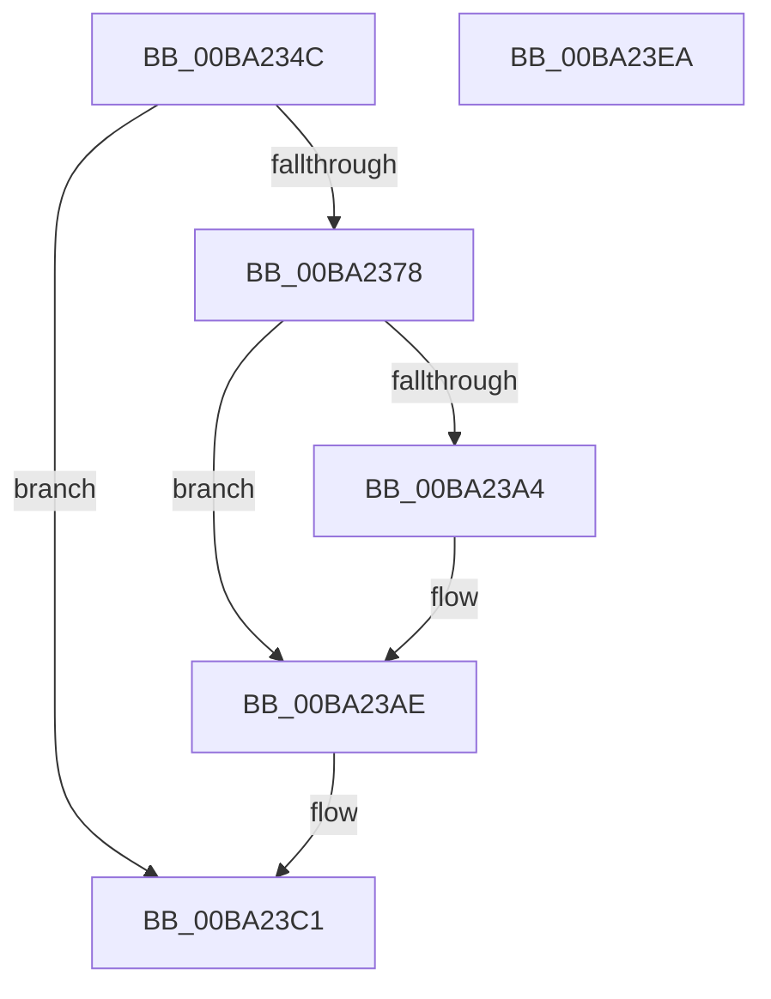

# VfIoDetachDevice

- RVA: `0x00BA234C`–`0x00BA23EB` (길이 `159` bytes)
- VA: `0x0000000140BA234C`
- 실행 섹션: `PAGEVRFY`
- PDB 이름 있음: `예`; PDB Function 태그: `아니요`
- unwind 정보 RVA: `0x000D2548`
- 디코드: `37`개 명령, `159/159` bytes 표시
- 미해석 바이트: `0` (있으면 어셈블리에 `.byte`로 보존)

> 이 문서는 커널 이미지의 기계어와 PDB 기호를 분석해 생성했습니다. 4번과 5번은 함수 원형과 자료형을 바이너리 사용 방식에서 추정한 C 해석이며 원본 소스 복구 결과는 아닙니다.

## 1. Dependencies

- 직접 호출 지점: **6**; 고유 호출 대상: **6**
- 직접 호출자로 확인된 함수: **1**
- RIP 상대 이미지 참조: **2**

### Outgoing calls
- `0x00BA237D` → [ViErrorDisplayDescription](ViErrorDisplayDescription_function_00BA361C.md) (function, `0x00BA361C`)
- `0x00BA239B` → [RtlStringCbPrintfA](../../text/53/RtlStringCbPrintfA_function_0053BC0C.md) (function, `0x0053BC0C`)
- `0x00BA23A9` → [VfUtilDbgPrint](../../text/61/VfUtilDbgPrint_function_006122AC.md) (function, `0x006122AC`)
- `0x00BA23BC` → [ViErrorFinishReport](ViErrorFinishReport_function_00BA366C.md) (function, `0x00BA366C`)
- `0x00BA23C4` → [IovUtilFlushStackCache](IovUtilFlushStackCache_function_00BA29EC.md) (function, `0x00BA29EC`)
- `0x00BA23D4` → [_security_check_cookie](../../text/6A/_security_check_cookie_function_006AC640.md) (function, `0x006AC640`)

### Direct callers
- [IovDetachDevice](../B9/IovDetachDevice_function_00B9273C.md) at `0x00B9274A`

### Static image references
- `0x00BA2359` → RVA `0x00E0A740` (`.data`; read)
- `0x00BA238A` → RVA `0x006CE710` (` ?? ::FNODOBFM::`string'`; read)

## 2. Other-region calls and transfers

- 다른 실행 섹션으로 향하는 call: **3**
  - `0x00BA239B` → [RtlStringCbPrintfA](../../text/53/RtlStringCbPrintfA_function_0053BC0C.md) (`PAGEVRFY` → `.text`)
  - `0x00BA23A9` → [VfUtilDbgPrint](../../text/61/VfUtilDbgPrint_function_006122AC.md) (`PAGEVRFY` → `.text`)
  - `0x00BA23D4` → [_security_check_cookie](../../text/6A/_security_check_cookie_function_006AC640.md) (`PAGEVRFY` → `.text`)
- 별도 외부 분기/꼬리 이동을 확인하지 못했습니다.

## 3. Assembly (complete function range)

```asm
00BA234C  48 89 5C 24 18                  mov qword ptr [rsp + 0x18], rbx
00BA2351  57                              push rdi
00BA2352  48 81 EC 90 00 00 00            sub rsp, 0x90
00BA2359  48 8B 05 E0 83 26 00            mov rax, qword ptr [rip + 0x2683e0]
00BA2360  48 33 C4                        xor rax, rsp
00BA2363  48 89 84 24 80 00 00 00         mov qword ptr [rsp + 0x80], rax
00BA236B  48 83 79 18 00                  cmp qword ptr [rcx + 0x18], 0
00BA2370  48 8B FA                        mov rdi, rdx
00BA2373  48 8B D9                        mov rbx, rcx
00BA2376  75 49                           jne 0x140ba23c1
00BA2378  B9 02 02 00 00                  mov ecx, 0x202
00BA237D  E8 9A 12 00 00                  call 0x140ba361c
00BA2382  4C 8B CF                        mov r9, rdi
00BA2385  48 89 5C 24 20                  mov qword ptr [rsp + 0x20], rbx
00BA238A  4C 8D 05 7F C3 B2 FF            lea r8, [rip - 0x4d3c81]
00BA2391  BA 49 00 00 00                  mov edx, 0x49
00BA2396  48 8D 4C 24 30                  lea rcx, [rsp + 0x30]
00BA239B  E8 6C 98 99 FF                  call 0x14053bc0c
00BA23A0  85 C0                           test eax, eax
00BA23A2  78 0A                           js 0x140ba23ae
00BA23A4  48 8D 4C 24 30                  lea rcx, [rsp + 0x30]
00BA23A9  E8 FE FE A6 FF                  call 0x1406122ac
00BA23AE  45 33 C9                        xor r9d, r9d
00BA23B1  4C 8B C3                        mov r8, rbx
00BA23B4  48 8B D7                        mov rdx, rdi
00BA23B7  B9 02 02 00 00                  mov ecx, 0x202
00BA23BC  E8 AB 12 00 00                  call 0x140ba366c
00BA23C1  48 8B CB                        mov rcx, rbx
00BA23C4  E8 23 06 00 00                  call 0x140ba29ec
00BA23C9  48 8B 8C 24 80 00 00 00         mov rcx, qword ptr [rsp + 0x80]
00BA23D1  48 33 CC                        xor rcx, rsp
00BA23D4  E8 67 A2 B0 FF                  call 0x1406ac640
00BA23D9  48 8B 9C 24 B0 00 00 00         mov rbx, qword ptr [rsp + 0xb0]
00BA23E1  48 81 C4 90 00 00 00            add rsp, 0x90
00BA23E8  5F                              pop rdi
00BA23E9  C3                              ret
00BA23EA  CC                              int3
```

## 4. C-style interpretation (structured pseudocode)

```c
__int64 __fastcall VfIoDetachDevice(__int64 a1, __int64 a2)
{
    __int64 result;
    __int64 v_rsp;
    unsigned __int64 v_stack_m18;
    unsigned __int64 v_stack_m68;
    unsigned __int64 v_stack_m78;
    unsigned __int64 v_stack_p18;

    v_stack_p18 = v_rbx;
    v_rsp = (v_rsp) - (144);
    result = (*(unsigned __int64 *)(v_rip + 2524128)) ^ (v_rsp);
    v_stack_m18 = result;
    if ((*(unsigned __int64 *)(a1 + 24)) != 0) goto loc_00BA23C1;
    result = ViErrorDisplayDescription(514, a2, a3, a4);
    v_stack_m78 = a1;
    result = RtlStringCbPrintfA(v_stack_m68, 73, v_rip - 5061761, a2);
    if (!(sign_flag)) {
        a1 = v_stack_m68;
        result = VfUtilDbgPrint(a1, 73, v_rip - 5061761, a2);
    }
    a4 = 0;
    result = ViErrorFinishReport(514, a2, a1, a4);
loc_00BA23C1:
    result = IovUtilFlushStackCache(a1, a2, a1, a4);
    a1 = (v_stack_m18) ^ (v_rsp);
    result = _security_check_cookie(a1, a2, a1, a4);
    v_rsp = (v_rsp) + (144);
    return result;
}
```

## 5. (Beta) C Style

```c
int64_t VfIoDetachDevice(void *Arg1, int64_t Arg2)
{
    uint8_t *arg1 = (uint8_t *)Arg1;

    int64_t result;
    int64_t local_rsp;
    uint64_t v_stack_m18;
    uint64_t v_stack_m68;
    uint64_t v_stack_m78;
    uint64_t v_stack_p18;

    v_stack_p18 = local_rbx;
    local_rsp = (local_rsp) - (144);
    result = (*(uint64_t *)(v_rip + 0x2683E0)) ^ (local_rsp);
    v_stack_m18 = result;
    if ((*(uint64_t *)(arg1 + 0x18)) != 0) goto loc_00BA23C1;
    result = ViErrorDisplayDescription(514, Arg2, a3, a4);
    v_stack_m78 = Arg1;
    result = RtlStringCbPrintfA(v_stack_m68, 73, v_rip - 5061761, Arg2);
    if (!(sign_flag)) {
        Arg1 = v_stack_m68;
        result = VfUtilDbgPrint(Arg1, 73, v_rip - 5061761, Arg2);
    }
    a4 = 0;
    result = ViErrorFinishReport(514, Arg2, Arg1, a4);
loc_00BA23C1:
    result = IovUtilFlushStackCache(Arg1, Arg2, Arg1, a4);
    Arg1 = (v_stack_m18) ^ (local_rsp);
    result = _security_check_cookie(Arg1, Arg2, Arg1, a4);
    local_rsp = (local_rsp) + (144);
    return result;
}
```

### 관측된 메모리 오프셋

구조체 형식이 확인되지 않은 접근은 인자 기준의 오프셋으로만 기록했습니다.

| 기준 인자 | 오프셋 표현 | 폭 (bit) | 접근 |
|---|---:|---:|---|
| `Arg1` | `+ 0x18` | `64` | `R` |

## 6. Execution-region graph

[열기: 2D/3D 그래프와 함수 탐색 컨트롤 패널](../../../control-panel.html?section=pagevrfy&rva=0x00BA234C&view=graph)

- 2D 그래프는 위에서 아래로 흐르고, 3D 그래프는 빈 공간을 드래그해 회전합니다. Shift+드래그는 이동, 휠은 확대·축소, 함수 노드 선택은 대상 보고서 이동입니다.

### Static fallback


