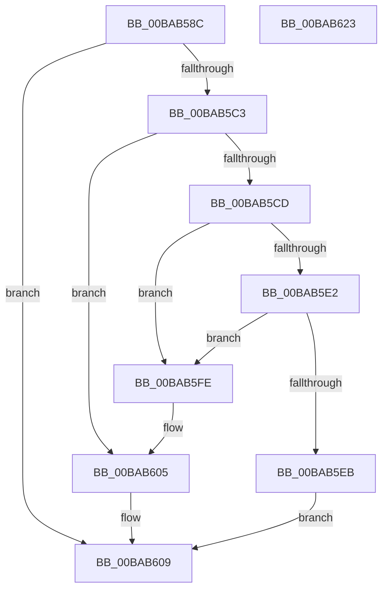

# VfIrpLogDeleteDeviceLogs

- RVA: `0x00BAB58C`–`0x00BAB624` (길이 `152` bytes)
- VA: `0x0000000140BAB58C`
- 실행 섹션: `PAGEVRFY`
- PDB 이름 있음: `예`; PDB Function 태그: `아니요`
- unwind 정보 RVA: `0x0005CAAC`
- 디코드: `43`개 명령, `152/152` bytes 표시
- 미해석 바이트: `0` (있으면 어셈블리에 `.byte`로 보존)

> 이 문서는 커널 이미지의 기계어와 PDB 기호를 분석해 생성했습니다. 4번과 5번은 함수 원형과 자료형을 바이너리 사용 방식에서 추정한 C 해석이며 원본 소스 복구 결과는 아닙니다.

## 1. Dependencies

- 직접 호출 지점: **5**; 고유 호출 대상: **5**
- 직접 호출자로 확인된 함수: **1**
- RIP 상대 이미지 참조: **1**

### Outgoing calls
- `0x00BAB5A6` → [KeAcquireSpinLockRaiseToDpc](../../text/20/KeAcquireSpinLockRaiseToDpc_function_00208470.md) (function, `0x00208470`)
- `0x00BAB5B6` → [ViIrpLogDatabaseFindPointer](ViIrpLogDatabaseFindPointer_function_00BABC0C.md) (function, `0x00BABC0C`)
- `0x00BAB5D0` → [ObfDereferenceObject](../../text/2F/ObfDereferenceObject_function_002F9350.md) (function, `0x002F9350`)
- `0x00BAB5F7` → [ExFreePoolWithTag](../../poolcode/B8/ExFreePoolWithTag_function_00B82870.md) (function, `0x00B82870`)
- `0x00BAB613` → [KeReleaseSpinLock](../../text/39/KeReleaseSpinLock_function_00392BA0.md) (function, `0x00392BA0`)

### Direct callers
- [VfIoDeleteDevice](VfIoDeleteDevice_function_00BA221C.md) at `0x00BA2323`

### Static image references
- `0x00BAB59F` → RVA `0x00F04870` (`.data`; read)

## 2. Other-region calls and transfers

- 다른 실행 섹션으로 향하는 call: **4**
  - `0x00BAB5A6` → [KeAcquireSpinLockRaiseToDpc](../../text/20/KeAcquireSpinLockRaiseToDpc_function_00208470.md) (`PAGEVRFY` → `.text`)
  - `0x00BAB5D0` → [ObfDereferenceObject](../../text/2F/ObfDereferenceObject_function_002F9350.md) (`PAGEVRFY` → `.text`)
  - `0x00BAB5F7` → [ExFreePoolWithTag](../../poolcode/B8/ExFreePoolWithTag_function_00B82870.md) (`PAGEVRFY` → `POOLCODE`)
  - `0x00BAB613` → [KeReleaseSpinLock](../../text/39/KeReleaseSpinLock_function_00392BA0.md) (`PAGEVRFY` → `.text`)
- 별도 외부 분기/꼬리 이동을 확인하지 못했습니다.

## 3. Assembly (complete function range)

```asm
00BAB58C  48 89 5C 24 08                  mov qword ptr [rsp + 8], rbx
00BAB591  57                              push rdi
00BAB592  48 83 EC 20                     sub rsp, 0x20
00BAB596  48 83 64 24 38 00               and qword ptr [rsp + 0x38], 0
00BAB59C  48 8B D9                        mov rbx, rcx
00BAB59F  48 8D 0D CA 92 35 00            lea rcx, [rip + 0x3592ca]
00BAB5A6  E8 C5 CE 65 FF                  call 0x140208470
00BAB5AB  48 8D 54 24 38                  lea rdx, [rsp + 0x38]
00BAB5B0  48 8B CB                        mov rcx, rbx
00BAB5B3  40 8A F8                        mov dil, al
00BAB5B6  E8 51 06 00 00                  call 0x140babc0c
00BAB5BB  48 8B D8                        mov rbx, rax
00BAB5BE  48 85 C0                        test rax, rax
00BAB5C1  74 46                           je 0x140bab609
00BAB5C3  48 8B 4C 24 38                  mov rcx, qword ptr [rsp + 0x38]
00BAB5C8  83 39 00                        cmp dword ptr [rcx], 0
00BAB5CB  75 38                           jne 0x140bab605
00BAB5CD  48 8B 08                        mov rcx, qword ptr [rax]
00BAB5D0  E8 7B DD 74 FF                  call 0x1402f9350
00BAB5D5  48 8D 4B 08                     lea rcx, [rbx + 8]
00BAB5D9  48 8B 11                        mov rdx, qword ptr [rcx]
00BAB5DC  48 39 4A 08                     cmp qword ptr [rdx + 8], rcx
00BAB5E0  75 1C                           jne 0x140bab5fe
00BAB5E2  48 8B 41 08                     mov rax, qword ptr [rcx + 8]
00BAB5E6  48 39 08                        cmp qword ptr [rax], rcx
00BAB5E9  75 13                           jne 0x140bab5fe
00BAB5EB  48 89 10                        mov qword ptr [rax], rdx
00BAB5EE  48 8B CB                        mov rcx, rbx
00BAB5F1  48 89 42 08                     mov qword ptr [rdx + 8], rax
00BAB5F5  33 D2                           xor edx, edx
00BAB5F7  E8 74 72 FD FF                  call 0x140b82870
00BAB5FC  EB 0B                           jmp 0x140bab609
00BAB5FE  B9 03 00 00 00                  mov ecx, 3
00BAB603  CD 29                           int 0x29
00BAB605  83 48 18 04                     or dword ptr [rax + 0x18], 4
00BAB609  40 8A D7                        mov dl, dil
00BAB60C  48 8D 0D 5D 92 35 00            lea rcx, [rip + 0x35925d]
00BAB613  E8 88 75 7E FF                  call 0x140392ba0
00BAB618  48 8B 5C 24 30                  mov rbx, qword ptr [rsp + 0x30]
00BAB61D  48 83 C4 20                     add rsp, 0x20
00BAB621  5F                              pop rdi
00BAB622  C3                              ret
00BAB623  CC                              int3
```

## 4. C-style interpretation (structured pseudocode)

```c
__int64 __fastcall VfIrpLogDeleteDeviceLogs(__int64 a1)
{
    __int64 result;
    __int64 v_rsp;
    unsigned __int64 v_stack_p10;
    unsigned __int64 v_stack_p8;

    v_stack_p8 = v_rbx;
    v_rsp = (v_rsp) - (32);
    result = KeAcquireSpinLockRaiseToDpc(v_rip + 3510986, a2, a3, a4);
    result = ViIrpLogDatabaseFindPointer(a1, v_stack_p10, a3, a4);
    if (result == 0) goto loc_00BAB609;
    if ((*(unsigned int *)(v_stack_p10)) != 0) goto loc_00BAB605;
    result = ObfDereferenceObject(*(unsigned __int64 *)(result), v_stack_p10, a3, a4);
    if ((*(unsigned __int64 *)(*(unsigned __int64 *)(result + 8) + 8)) != (result + 8)) goto loc_00BAB5FE;
    if ((*(unsigned __int64 *)(*(unsigned __int64 *)(result + 8 + 8))) != (result + 8)) goto loc_00BAB5FE;
    *(unsigned __int64 *)(*(unsigned __int64 *)(result + 8 + 8)) = *(unsigned __int64 *)(result + 8);
    *(unsigned __int64 *)(*(unsigned __int64 *)(result + 8) + 8) = *(unsigned __int64 *)(result + 8 + 8);
    a2 = 0;
    result = ExFreePoolWithTag(result, a2, a3, a4);
    goto loc_00BAB609;
loc_00BAB5FE:
loc_00BAB605:
loc_00BAB609:
    result = KeReleaseSpinLock(v_rip + 3510877, (unsigned __int8)((unsigned __int8)(result)), a3, a4);
    v_rsp = (v_rsp) + (32);
    return result;
}
```

## 5. (Beta) C Style

```c
int64_t VfIrpLogDeleteDeviceLogs(int64_t Arg1)
{
    int64_t result;
    int64_t local_rsp;
    uint64_t v_stack_p10;
    uint64_t v_stack_p8;

    v_stack_p8 = local_rbx;
    local_rsp = (local_rsp) - (32);
    result = KeAcquireSpinLockRaiseToDpc(v_rip + 3510986, a2, a3, a4);
    result = ViIrpLogDatabaseFindPointer(Arg1, v_stack_p10, a3, a4);
    if (result == 0) goto loc_00BAB609;
    if ((*(uint32_t *)(v_stack_p10)) != 0) goto loc_00BAB605;
    result = ObfDereferenceObject(*(uint64_t *)(result), v_stack_p10, a3, a4);
    if ((*(uint64_t *)(*(uint64_t *)(result + 0x8) + 0x8)) != (result + 8)) goto loc_00BAB5FE;
    if ((*(uint64_t *)(*(uint64_t *)(result + 0x8 + 0x8))) != (result + 8)) goto loc_00BAB5FE;
    *(uint64_t *)(*(uint64_t *)(result + 0x8 + 0x8)) = *(uint64_t *)(result + 0x8);
    *(uint64_t *)(*(uint64_t *)(result + 0x8) + 0x8) = *(uint64_t *)(result + 0x8 + 0x8);
    a2 = 0;
    result = ExFreePoolWithTag(result, a2, a3, a4);
    goto loc_00BAB609;
loc_00BAB5FE:
loc_00BAB605:
loc_00BAB609:
    result = KeReleaseSpinLock(v_rip + 3510877, (uint8_t)((uint8_t)(result)), a3, a4);
    local_rsp = (local_rsp) + (32);
    return result;
}
```

## 6. Execution-region graph

[열기: 2D/3D 그래프와 함수 탐색 컨트롤 패널](../../../control-panel.html?section=pagevrfy&rva=0x00BAB58C&view=graph)

- 2D 그래프는 위에서 아래로 흐르고, 3D 그래프는 빈 공간을 드래그해 회전합니다. Shift+드래그는 이동, 휠은 확대·축소, 함수 노드 선택은 대상 보고서 이동입니다.

### Static fallback


