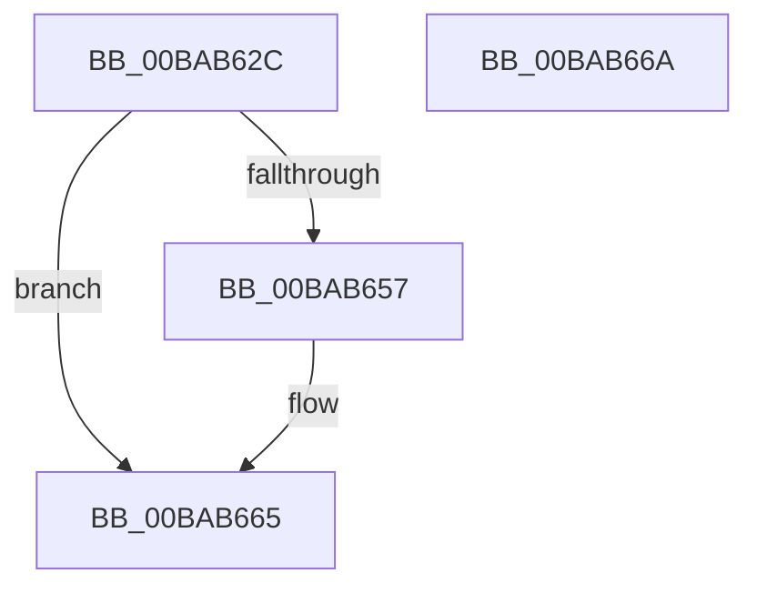

# VfIrpLogInit

- RVA: `0x00BAB62C`–`0x00BAB66B` (길이 `63` bytes)
- VA: `0x0000000140BAB62C`
- 실행 섹션: `PAGEVRFY`
- PDB 이름 있음: `예`; PDB Function 태그: `아니요`
- unwind 정보 RVA: `0x0005C788`
- 디코드: `16`개 명령, `63/63` bytes 표시
- 미해석 바이트: `0` (있으면 어셈블리에 `.byte`로 보존)

> 이 문서는 커널 이미지의 기계어와 PDB 기호를 분석해 생성했습니다. 4번과 5번은 함수 원형과 자료형을 바이너리 사용 방식에서 추정한 C 해석이며 원본 소스 복구 결과는 아닙니다.

## 1. Dependencies

- 직접 호출 지점: **1**; 고유 호출 대상: **1**
- 직접 호출자로 확인된 함수: **1**
- RIP 상대 이미지 참조: **2**

### Outgoing calls
- `0x00BAB646` → [ExAllocatePool2](../../poolcode/B8/ExAllocatePool2_function_00B820F0.md) (function, `0x00B820F0`)

### Direct callers
- [VfIrpTrackingPluginEntry](../../text/6A/VfIrpTrackingPluginEntry_function_006AAE60.md) at `0x006AAE99`

### Static image references
- `0x00BAB630` → RVA `0x00F04870` (`.data`; read/write)
- `0x00BAB64B` → RVA `0x00F04868` (`.data`; write)

## 2. Other-region calls and transfers

- 다른 실행 섹션으로 향하는 call: **1**
  - `0x00BAB646` → [ExAllocatePool2](../../poolcode/B8/ExAllocatePool2_function_00B820F0.md) (`PAGEVRFY` → `POOLCODE`)
- 별도 외부 분기/꼬리 이동을 확인하지 못했습니다.

## 3. Assembly (complete function range)

```asm
00BAB62C  48 83 EC 28                     sub rsp, 0x28
00BAB630  48 83 25 38 92 35 00 00         and qword ptr [rip + 0x359238], 0
00BAB638  BA 18 00 00 00                  mov edx, 0x18
00BAB63D  41 B8 56 66 49 64               mov r8d, 0x64496656
00BAB643  8D 4A 28                        lea ecx, [rdx + 0x28]
00BAB646  E8 A5 6A FD FF                  call 0x140b820f0
00BAB64B  48 89 05 16 92 35 00            mov qword ptr [rip + 0x359216], rax
00BAB652  48 85 C0                        test rax, rax
00BAB655  74 0E                           je 0x140bab665
00BAB657  83 20 00                        and dword ptr [rax], 0
00BAB65A  48 83 C0 08                     add rax, 8
00BAB65E  48 89 40 08                     mov qword ptr [rax + 8], rax
00BAB662  48 89 00                        mov qword ptr [rax], rax
00BAB665  48 83 C4 28                     add rsp, 0x28
00BAB669  C3                              ret
00BAB66A  CC                              int3
```

## 4. C-style interpretation (structured pseudocode)

```c
__int64 __fastcall VfIrpLogInit(void)
{
    __int64 result;
    __int64 v_rsp;

    v_rsp = (v_rsp) - (40);
    result = ExAllocatePool2(24 + 40, 24, (unsigned int)(0x64496656ULL), a4);
    *(unsigned __int64 *)(v_rip + 3510806) = result;
    if (result != 0) {
        result = (result) + (8);
        *(unsigned __int64 *)(result + 8) = result;
        *(unsigned __int64 *)(result) = result;
    }
    v_rsp = (v_rsp) + (40);
    return result;
}
```

## 5. (Beta) C Style

```c
void VfIrpLogInit(void)
{
    int64_t result;
    int64_t local_rsp;

    local_rsp = (local_rsp) - (40);
    result = ExAllocatePool2(24 + 40, 24, (uint32_t)(0x64496656ULL), a4);
    *(uint64_t *)(v_rip + 0x359216) = result;
    if (result != 0) {
        result = (result) + (8);
        *(uint64_t *)(result + 0x8) = result;
        *(uint64_t *)(result) = result;
    }
    local_rsp = (local_rsp) + (40);
    return result;
}
```

## 6. Execution-region graph

[열기: 2D/3D 그래프와 함수 탐색 컨트롤 패널](../../../control-panel.html?section=pagevrfy&rva=0x00BAB62C&view=graph)

- 2D 그래프는 위에서 아래로 흐르고, 3D 그래프는 빈 공간을 드래그해 회전합니다. Shift+드래그는 이동, 휠은 확대·축소, 함수 노드 선택은 대상 보고서 이동입니다.

### Static fallback


