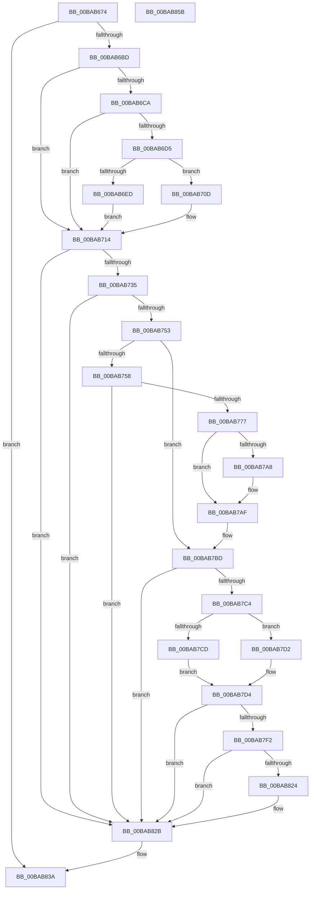

# VfIrpLogRecordEvent

- RVA: `0x00BAB674`–`0x00BAB85C` (길이 `488` bytes)
- VA: `0x0000000140BAB674`
- 실행 섹션: `PAGEVRFY`
- PDB 이름 있음: `예`; PDB Function 태그: `아니요`
- unwind 정보 RVA: `0x000D2710`
- 디코드: `131`개 명령, `488/488` bytes 표시
- 미해석 바이트: `0` (있으면 어셈블리에 `.byte`로 보존)

> 이 문서는 커널 이미지의 기계어와 PDB 기호를 분석해 생성했습니다. 4번과 5번은 함수 원형과 자료형을 바이너리 사용 방식에서 추정한 C 해석이며 원본 소스 복구 결과는 아닙니다.

## 1. Dependencies

- 직접 호출 지점: **10**; 고유 호출 대상: **9**
- 직접 호출자로 확인된 함수: **1**
- RIP 상대 이미지 참조: **5**

### Outgoing calls
- `0x00BAB6E3` → [ExAllocatePool2](../../poolcode/B8/ExAllocatePool2_function_00B820F0.md) (function, `0x00B820F0`)
- `0x00BAB706` → [ExQueueWorkItem](../../text/2F/ExQueueWorkItem_function_002F9520.md) (function, `0x002F9520`)
- `0x00BAB71B` → [KeAcquireSpinLockRaiseToDpc](../../text/20/KeAcquireSpinLockRaiseToDpc_function_00208470.md) (function, `0x00208470`)
- `0x00BAB728` → [IovUtilIsDeviceObjectMarked](IovUtilIsDeviceObjectMarked_function_00BA2B34.md) (function, `0x00BA2B34`)
- `0x00BAB73D` → [ViIrpLogDatabaseFindPointer](ViIrpLogDatabaseFindPointer_function_00BABC0C.md) (function, `0x00BABC0C`)
- `0x00BAB766` → [ExAllocatePool2](../../poolcode/B8/ExAllocatePool2_function_00B820F0.md) (function, `0x00B820F0`)
- `0x00BAB77A` → [ObfReferenceObject](../../text/20/ObfReferenceObject_function_0020FA20.md) (function, `0x0020FA20`)
- `0x00BAB7E9` → [VfMajorBuildIrpLogEntry](VfMajorBuildIrpLogEntry_function_00BA2E60.md) (function, `0x00BA2E60`)
- `0x00BAB835` → [KeReleaseSpinLock](../../text/39/KeReleaseSpinLock_function_00392BA0.md) (function, `0x00392BA0`)
- `0x00BAB842` → [_security_check_cookie](../../text/6A/_security_check_cookie_function_006AC640.md) (function, `0x006AC640`)

### Direct callers
- [IovpCallDriver1](../B9/IovpCallDriver1_function_00B9CCA4.md) at `0x00B9CE19`

### Static image references
- `0x00BAB684` → RVA `0x00E0A740` (`.data`; read)
- `0x00BAB6BD` → RVA `0x00E681A8` (`.data`; read)
- `0x00BAB6F1` → RVA `0x00BABC40` (`ViIrpLogExposeWmiCallback`; read)
- `0x00BAB70D` → RVA `0x00E681A8` (`.data`; read/write)
- `0x00BAB714` → RVA `0x00F04870` (`.data`; read)

## 2. Other-region calls and transfers

- 다른 실행 섹션으로 향하는 call: **7**
  - `0x00BAB6E3` → [ExAllocatePool2](../../poolcode/B8/ExAllocatePool2_function_00B820F0.md) (`PAGEVRFY` → `POOLCODE`)
  - `0x00BAB706` → [ExQueueWorkItem](../../text/2F/ExQueueWorkItem_function_002F9520.md) (`PAGEVRFY` → `.text`)
  - `0x00BAB71B` → [KeAcquireSpinLockRaiseToDpc](../../text/20/KeAcquireSpinLockRaiseToDpc_function_00208470.md) (`PAGEVRFY` → `.text`)
  - `0x00BAB766` → [ExAllocatePool2](../../poolcode/B8/ExAllocatePool2_function_00B820F0.md) (`PAGEVRFY` → `POOLCODE`)
  - `0x00BAB77A` → [ObfReferenceObject](../../text/20/ObfReferenceObject_function_0020FA20.md) (`PAGEVRFY` → `.text`)
  - `0x00BAB835` → [KeReleaseSpinLock](../../text/39/KeReleaseSpinLock_function_00392BA0.md) (`PAGEVRFY` → `.text`)
  - `0x00BAB842` → [_security_check_cookie](../../text/6A/_security_check_cookie_function_006AC640.md) (`PAGEVRFY` → `.text`)
- 별도 외부 분기/꼬리 이동을 확인하지 못했습니다.

## 3. Assembly (complete function range)

```asm
00BAB674  48 89 5C 24 08                  mov qword ptr [rsp + 8], rbx
00BAB679  55                              push rbp
00BAB67A  56                              push rsi
00BAB67B  57                              push rdi
00BAB67C  41 54                           push r12
00BAB67E  41 56                           push r14
00BAB680  48 83 EC 60                     sub rsp, 0x60
00BAB684  48 8B 05 B5 F0 25 00            mov rax, qword ptr [rip + 0x25f0b5]
00BAB68B  48 33 C4                        xor rax, rsp
00BAB68E  48 89 44 24 58                  mov qword ptr [rsp + 0x58], rax
00BAB693  48 83 64 24 20 00               and qword ptr [rsp + 0x20], 0
00BAB699  33 C0                           xor eax, eax
00BAB69B  48 89 44 24 50                  mov qword ptr [rsp + 0x50], rax
00BAB6A0  0F 57 C0                        xorps xmm0, xmm0
00BAB6A3  4D 8B F0                        mov r14, r8
00BAB6A6  48 8B FA                        mov rdi, rdx
00BAB6A9  0F 11 44 24 30                  movups xmmword ptr [rsp + 0x30], xmm0
00BAB6AE  0F 11 44 24 40                  movups xmmword ptr [rsp + 0x40], xmm0
00BAB6B3  0F BA E1 0A                     bt ecx, 0xa
00BAB6B7  0F 83 7D 01 00 00               jae 0x140bab83a
00BAB6BD  83 3D E4 CA 2B 00 02            cmp dword ptr [rip + 0x2bcae4], 2
00BAB6C4  44 8D 60 01                     lea r12d, [rax + 1]
00BAB6C8  74 4A                           je 0x140bab714
00BAB6CA  F0 44 0F B1 25 D5 CA 2B 00      lock cmpxchg dword ptr [rip + 0x2bcad5], r12d
00BAB6D3  75 3F                           jne 0x140bab714
00BAB6D5  41 8D 54 24 1F                  lea edx, [r12 + 0x1f]
00BAB6DA  41 B8 56 66 49 77               mov r8d, 0x77496656
00BAB6E0  8D 4A 20                        lea ecx, [rdx + 0x20]
00BAB6E3  E8 08 6A FD FF                  call 0x140b820f0
00BAB6E8  48 85 C0                        test rax, rax
00BAB6EB  74 20                           je 0x140bab70d
00BAB6ED  48 83 20 00                     and qword ptr [rax], 0
00BAB6F1  48 8D 0D 48 05 00 00            lea rcx, [rip + 0x548]
00BAB6F8  48 89 48 10                     mov qword ptr [rax + 0x10], rcx
00BAB6FC  41 8B D4                        mov edx, r12d
00BAB6FF  48 8B C8                        mov rcx, rax
00BAB702  48 89 40 18                     mov qword ptr [rax + 0x18], rax
00BAB706  E8 15 DE 74 FF                  call 0x1402f9520
00BAB70B  EB 07                           jmp 0x140bab714
00BAB70D  83 25 94 CA 2B 00 00            and dword ptr [rip + 0x2bca94], 0
00BAB714  48 8D 0D 55 91 35 00            lea rcx, [rip + 0x359155]
00BAB71B  E8 50 CD 65 FF                  call 0x140208470
00BAB720  33 D2                           xor edx, edx
00BAB722  48 8B CF                        mov rcx, rdi
00BAB725  40 8A E8                        mov bpl, al
00BAB728  E8 07 74 FF FF                  call 0x140ba2b34
00BAB72D  85 C0                           test eax, eax
00BAB72F  0F 85 F6 00 00 00               jne 0x140bab82b
00BAB735  48 8D 54 24 20                  lea rdx, [rsp + 0x20]
00BAB73A  48 8B CF                        mov rcx, rdi
00BAB73D  E8 CA 04 00 00                  call 0x140babc0c
00BAB742  48 8B 74 24 20                  mov rsi, qword ptr [rsp + 0x20]
00BAB747  48 8B D8                        mov rbx, rax
00BAB74A  83 3E 00                        cmp dword ptr [rsi], 0
00BAB74D  0F 85 D8 00 00 00               jne 0x140bab82b
00BAB753  48 85 C0                        test rax, rax
00BAB756  75 65                           jne 0x140bab7bd
00BAB758  BA 48 03 00 00                  mov edx, 0x348
00BAB75D  8D 48 40                        lea ecx, [rax + 0x40]
00BAB760  41 B8 56 66 49 65               mov r8d, 0x65496656
00BAB766  E8 85 69 FD FF                  call 0x140b820f0
00BAB76B  48 8B D8                        mov rbx, rax
00BAB76E  48 85 C0                        test rax, rax
00BAB771  0F 84 B4 00 00 00               je 0x140bab82b
00BAB777  48 8B CF                        mov rcx, rdi
00BAB77A  E8 A1 42 66 FF                  call 0x14020fa20
00BAB77F  83 63 18 00                     and dword ptr [rbx + 0x18], 0
00BAB783  48 8D 4E 08                     lea rcx, [rsi + 8]
00BAB787  48 89 3B                        mov qword ptr [rbx], rdi
00BAB78A  8B 47 48                        mov eax, dword ptr [rdi + 0x48]
00BAB78D  83 63 24 00                     and dword ptr [rbx + 0x24], 0
00BAB791  89 43 1C                        mov dword ptr [rbx + 0x1c], eax
00BAB794  48 8D 43 08                     lea rax, [rbx + 8]
00BAB798  C7 43 20 14 00 00 00            mov dword ptr [rbx + 0x20], 0x14
00BAB79F  48 8B 11                        mov rdx, qword ptr [rcx]
00BAB7A2  48 39 4A 08                     cmp qword ptr [rdx + 8], rcx
00BAB7A6  74 07                           je 0x140bab7af
00BAB7A8  B9 03 00 00 00                  mov ecx, 3
00BAB7AD  CD 29                           int 0x29
00BAB7AF  48 89 10                        mov qword ptr [rax], rdx
00BAB7B2  48 89 48 08                     mov qword ptr [rax + 8], rcx
00BAB7B6  48 89 42 08                     mov qword ptr [rdx + 8], rax
00BAB7BA  48 89 01                        mov qword ptr [rcx], rax
00BAB7BD  8B 43 18                        mov eax, dword ptr [rbx + 0x18]
00BAB7C0  A8 06                           test al, 6
00BAB7C2  75 67                           jne 0x140bab82b
00BAB7C4  48 8D 7B 24                     lea rdi, [rbx + 0x24]
00BAB7C8  41 3B C4                        cmp eax, r12d
00BAB7CB  75 05                           jne 0x140bab7d2
00BAB7CD  8B 53 20                        mov edx, dword ptr [rbx + 0x20]
00BAB7D0  EB 02                           jmp 0x140bab7d4
00BAB7D2  8B 17                           mov edx, dword ptr [rdi]
00BAB7D4  8B 07                           mov eax, dword ptr [rdi]
00BAB7D6  4C 8D 4C 24 30                  lea r9, [rsp + 0x30]
00BAB7DB  49 03 C4                        add rax, r12
00BAB7DE  49 8B CE                        mov rcx, r14
00BAB7E1  48 8D 04 80                     lea rax, [rax + rax*4]
00BAB7E5  4C 8D 04 C3                     lea r8, [rbx + rax*8]
00BAB7E9  E8 72 76 FF FF                  call 0x140ba2e60
00BAB7EE  85 C0                           test eax, eax
00BAB7F0  74 39                           je 0x140bab82b
00BAB7F2  8B 07                           mov eax, dword ptr [rdi]
00BAB7F4  0F 10 44 24 30                  movups xmm0, xmmword ptr [rsp + 0x30]
00BAB7F9  49 03 C4                        add rax, r12
00BAB7FC  48 8D 14 80                     lea rdx, [rax + rax*4]
00BAB800  0F 11 04 D3                     movups xmmword ptr [rbx + rdx*8], xmm0
00BAB804  0F 10 4C 24 40                  movups xmm1, xmmword ptr [rsp + 0x40]
00BAB809  0F 11 4C D3 10                  movups xmmword ptr [rbx + rdx*8 + 0x10], xmm1
00BAB80E  F2 0F 10 44 24 50               movsd xmm0, qword ptr [rsp + 0x50]
00BAB814  F2 0F 11 44 D3 20               movsd qword ptr [rbx + rdx*8 + 0x20], xmm0
00BAB81A  44 01 27                        add dword ptr [rdi], r12d
00BAB81D  8B 07                           mov eax, dword ptr [rdi]
00BAB81F  3B 43 20                        cmp eax, dword ptr [rbx + 0x20]
00BAB822  75 07                           jne 0x140bab82b
00BAB824  44 09 63 18                     or dword ptr [rbx + 0x18], r12d
00BAB828  83 27 00                        and dword ptr [rdi], 0
00BAB82B  40 8A D5                        mov dl, bpl
00BAB82E  48 8D 0D 3B 90 35 00            lea rcx, [rip + 0x35903b]
00BAB835  E8 66 73 7E FF                  call 0x140392ba0
00BAB83A  48 8B 4C 24 58                  mov rcx, qword ptr [rsp + 0x58]
00BAB83F  48 33 CC                        xor rcx, rsp
00BAB842  E8 F9 0D B0 FF                  call 0x1406ac640
00BAB847  48 8B 9C 24 90 00 00 00         mov rbx, qword ptr [rsp + 0x90]
00BAB84F  48 83 C4 60                     add rsp, 0x60
00BAB853  41 5E                           pop r14
00BAB855  41 5C                           pop r12
00BAB857  5F                              pop rdi
00BAB858  5E                              pop rsi
00BAB859  5D                              pop rbp
00BAB85A  C3                              ret
00BAB85B  CC                              int3
```

## 4. C-style interpretation (structured pseudocode)

```c
__int64 __fastcall VfIrpLogRecordEvent(int a1, __int64 a2, __int64 a3)
{
    __int64 result;
    __int64 v_rsp;
    unsigned __int64 v_stack_m30;
    unsigned __int64 v_stack_m38;
    unsigned __int64 v_stack_m48;
    unsigned __int64 v_stack_m58;
    unsigned __int64 v_stack_m68;
    unsigned __int64 v_stack_p8;

    v_stack_p8 = v_rbx;
    v_rsp = (v_rsp) - (96);
    result = (*(unsigned __int64 *)(v_rip + 2486453)) ^ (v_rsp);
    v_stack_m30 = result;
    result = 0;
    v_stack_m38 = 0;
    v_stack_m58 = v_xmm0;
    v_stack_m48 = v_xmm0;
    if (condition_is_above_or_equal) goto loc_00BAB83A;
    if ((*(unsigned int *)(v_rip + 2869988)) == 2) goto loc_00BAB714;
    if ((*(unsigned int *)(v_rip + 2869988)) != 2) goto loc_00BAB714;
    result = ExAllocatePool2(result + 1 + 31 + 32, result + 1 + 31, (unsigned int)(0x77496656ULL), a4);
    if (result == 0) goto loc_00BAB70D;
    *(unsigned __int64 *)(result + 16) = v_rip + 1352;
    *(unsigned __int64 *)(result + 24) = result;
    result = ExQueueWorkItem(result, (unsigned int)((unsigned int)(result + 1)), (unsigned int)(0x77496656ULL), a4);
    goto loc_00BAB714;
loc_00BAB70D:
loc_00BAB714:
    result = KeAcquireSpinLockRaiseToDpc(v_rip + 3510613, (unsigned int)((unsigned int)(result + 1)), (unsigned int)(0x77496656ULL), a4);
    a2 = 0;
    result = IovUtilIsDeviceObjectMarked(0, a2, (unsigned int)(0x77496656ULL), a4);
    if ((unsigned int)(result) != 0) goto loc_00BAB82B;
    result = ViIrpLogDatabaseFindPointer(0, v_stack_m68, (unsigned int)(0x77496656ULL), a4);
    if ((*(unsigned int *)(v_stack_m68)) != 0) goto loc_00BAB82B;
    if (result != 0) goto loc_00BAB7BD;
    result = ExAllocatePool2(result + 64, 840, (unsigned int)(0x65496656ULL), a4);
    if (result == 0) goto loc_00BAB82B;
    result = ObfReferenceObject(0, 840, (unsigned int)(0x65496656ULL), a4);
    *(unsigned __int64 *)(result) = 0;
    *(unsigned int *)(result + 28) = (unsigned int)((unsigned int)(*(unsigned int *)(a2 + 72)));
    *(unsigned int *)(result + 32) = 20;
    if ((*(unsigned __int64 *)(*(unsigned __int64 *)(v_stack_m68 + 8) + 8)) != (v_stack_m68 + 8)) {
        a1 = 3;
    }
    *(unsigned __int64 *)(result + 8) = *(unsigned __int64 *)(v_stack_m68 + 8);
    *(unsigned __int64 *)(result + 8 + 8) = a1;
    *(unsigned __int64 *)(*(unsigned __int64 *)(v_stack_m68 + 8) + 8) = result + 8;
    *(unsigned __int64 *)(a1) = result + 8;
loc_00BAB7BD:
    if ((((unsigned __int8)((unsigned int)(*(unsigned int *)(result + 24)))) & (6)) != 0) goto loc_00BAB82B;
    if (((unsigned int)((unsigned int)(*(unsigned int *)(result + 24)))) != ((unsigned int)(result + 1))) goto loc_00BAB7D2;
    goto loc_00BAB7D4;
loc_00BAB7D2:
loc_00BAB7D4:
    result = ((unsigned int)(*(unsigned int *)(result + 36))) + (result + 1);
    result = VfMajorBuildIrpLogEntry(a3, (unsigned int)(*(unsigned int *)(result + 36)), result + result + result * 4 * 8, v_stack_m58);
    if ((unsigned int)(result) == 0) goto loc_00BAB82B;
    result = ((unsigned int)(*(unsigned int *)(result + 36))) + (result + 1);
    *(unsigned __int64 *)(result + result + result * 4 * 8) = v_xmm0;
    *(unsigned __int64 *)(result + result + result * 4 * 8 + 16) = v_xmm1;
    *(unsigned __int64 *)(result + result + result * 4 * 8 + 32) = v_xmm0;
    if (((unsigned int)((unsigned int)(*(unsigned int *)(result + 36)))) == (*(unsigned int *)(result + 32))) {
    }
    result = KeReleaseSpinLock(v_rip + 3510331, (unsigned __int8)((unsigned __int8)(result)), result + result + result * 4 * 8, v_stack_m58);
loc_00BAB83A:
    a1 = (v_stack_m30) ^ (v_rsp);
    result = _security_check_cookie(a1, (unsigned __int8)((unsigned __int8)(result)), result + result + result * 4 * 8, v_stack_m58);
    v_rsp = (v_rsp) + (96);
    return result;
}
```

## 5. (Beta) C Style

```c
int64_t VfIrpLogRecordEvent(int32_t Arg1, void *Arg2, int64_t Arg3)
{
    uint8_t *arg2 = (uint8_t *)Arg2;

    int64_t result;
    int64_t local_rsp;
    uint64_t v_stack_m30;
    uint64_t v_stack_m38;
    uint64_t v_stack_m48;
    uint64_t v_stack_m58;
    uint64_t v_stack_m68;
    uint64_t v_stack_p8;

    v_stack_p8 = local_rbx;
    local_rsp = (local_rsp) - (96);
    result = (*(uint64_t *)(v_rip + 0x25F0B5)) ^ (local_rsp);
    v_stack_m30 = result;
    result = 0;
    v_stack_m38 = 0;
    v_stack_m58 = v_xmm0;
    v_stack_m48 = v_xmm0;
    if (condition_is_above_or_equal) goto loc_00BAB83A;
    if ((*(uint32_t *)(v_rip + 0x2BCAE4)) == 2) goto loc_00BAB714;
    if ((*(uint32_t *)(v_rip + 0x2BCAE4)) != 2) goto loc_00BAB714;
    result = ExAllocatePool2(result + 1 + 31 + 32, result + 1 + 31, (uint32_t)(0x77496656ULL), a4);
    if (result == 0) goto loc_00BAB70D;
    *(uint64_t *)(result + 0x10) = v_rip + 1352;
    *(uint64_t *)(result + 0x18) = result;
    result = ExQueueWorkItem(result, (uint32_t)((uint32_t)(result + 1)), (uint32_t)(0x77496656ULL), a4);
    goto loc_00BAB714;
loc_00BAB70D:
loc_00BAB714:
    result = KeAcquireSpinLockRaiseToDpc(v_rip + 3510613, (uint32_t)((uint32_t)(result + 1)), (uint32_t)(0x77496656ULL), a4);
    Arg2 = 0;
    result = IovUtilIsDeviceObjectMarked(0, Arg2, (uint32_t)(0x77496656ULL), a4);
    if ((uint32_t)(result) != 0) goto loc_00BAB82B;
    result = ViIrpLogDatabaseFindPointer(0, v_stack_m68, (uint32_t)(0x77496656ULL), a4);
    if ((*(uint32_t *)(v_stack_m68)) != 0) goto loc_00BAB82B;
    if (result != 0) goto loc_00BAB7BD;
    result = ExAllocatePool2(result + 64, 840, (uint32_t)(0x65496656ULL), a4);
    if (result == 0) goto loc_00BAB82B;
    result = ObfReferenceObject(0, 840, (uint32_t)(0x65496656ULL), a4);
    *(uint64_t *)(result) = 0;
    *(uint32_t *)(result + 0x1C) = (uint32_t)((uint32_t)(*(uint32_t *)(arg2 + 0x48)));
    *(uint32_t *)(result + 0x20) = 20;
    if ((*(uint64_t *)(*(uint64_t *)(v_stack_m68 + 0x8) + 0x8)) != (v_stack_m68 + 8)) {
        Arg1 = 3;
    }
    *(uint64_t *)(result + 0x8) = *(uint64_t *)(v_stack_m68 + 0x8);
    *(uint64_t *)(result + 0x8 + 0x8) = Arg1;
    *(uint64_t *)(*(uint64_t *)(v_stack_m68 + 0x8) + 0x8) = result + 8;
    *(uint64_t *)(Arg1) = result + 8;
loc_00BAB7BD:
    if ((((uint8_t)((uint32_t)(*(uint32_t *)(result + 0x18)))) & (6)) != 0) goto loc_00BAB82B;
    if (((uint32_t)((uint32_t)(*(uint32_t *)(result + 0x18)))) != ((uint32_t)(result + 1))) goto loc_00BAB7D2;
    goto loc_00BAB7D4;
loc_00BAB7D2:
loc_00BAB7D4:
    result = ((uint32_t)(*(uint32_t *)(result + 0x24))) + (result + 1);
    result = VfMajorBuildIrpLogEntry(Arg3, (uint32_t)(*(uint32_t *)(result + 0x24)), result + result + result * 4 * 8, v_stack_m58);
    if ((uint32_t)(result) == 0) goto loc_00BAB82B;
    result = ((uint32_t)(*(uint32_t *)(result + 0x24))) + (result + 1);
    *(uint64_t *)(result + result + result * 4 * 8) = v_xmm0;
    *(uint64_t *)(result + result + result * 4 * 8 + 0x10) = v_xmm1;
    *(uint64_t *)(result + result + result * 4 * 8 + 0x20) = v_xmm0;
    if (((uint32_t)((uint32_t)(*(uint32_t *)(result + 0x24)))) == (*(uint32_t *)(result + 0x20))) {
    }
    result = KeReleaseSpinLock(v_rip + 3510331, (uint8_t)((uint8_t)(result)), result + result + result * 4 * 8, v_stack_m58);
loc_00BAB83A:
    Arg1 = (v_stack_m30) ^ (local_rsp);
    result = _security_check_cookie(Arg1, (uint8_t)((uint8_t)(result)), result + result + result * 4 * 8, v_stack_m58);
    local_rsp = (local_rsp) + (96);
    return result;
}
```

### 관측된 메모리 오프셋

구조체 형식이 확인되지 않은 접근은 인자 기준의 오프셋으로만 기록했습니다.

| 기준 인자 | 오프셋 표현 | 폭 (bit) | 접근 |
|---|---:|---:|---|
| `Arg2` | `+ 0x48` | `32` | `R` |

## 6. Execution-region graph

[열기: 2D/3D 그래프와 함수 탐색 컨트롤 패널](../../../control-panel.html?section=pagevrfy&rva=0x00BAB674&view=graph)

- 2D 그래프는 위에서 아래로 흐르고, 3D 그래프는 빈 공간을 드래그해 회전합니다. Shift+드래그는 이동, 휠은 확대·축소, 함수 노드 선택은 대상 보고서 이동입니다.

### Static fallback


