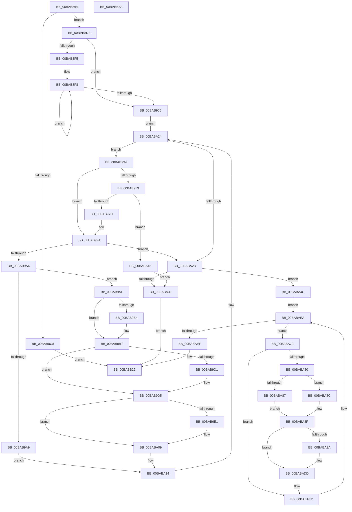

# VfIrpLogRetrieveWmiData

- RVA: `0x00BAB864`–`0x00BABB3B` (길이 `727` bytes)
- VA: `0x0000000140BAB864`
- 실행 섹션: `PAGEVRFY`
- PDB 이름 있음: `예`; PDB Function 태그: `아니요`
- unwind 정보 RVA: `0x00086C3C`
- 디코드: `209`개 명령, `727/727` bytes 표시
- 미해석 바이트: `0` (있으면 어셈블리에 `.byte`로 보존)

> 이 문서는 커널 이미지의 기계어와 PDB 기호를 분석해 생성했습니다. 4번과 5번은 함수 원형과 자료형을 바이너리 사용 방식에서 추정한 C 해석이며 원본 소스 복구 결과는 아닙니다.

## 1. Dependencies

- 직접 호출 지점: **8**; 고유 호출 대상: **4**
- 직접 호출자로 확인된 함수: **1**
- RIP 상대 이미지 참조: **2**

### Outgoing calls
- `0x00BAB8BB` → [ExAllocatePool2](../../poolcode/B8/ExAllocatePool2_function_00B820F0.md) (function, `0x00B820F0`)
- `0x00BAB945` → [ObQueryNameString](../../page/8A/ObQueryNameString_function_008A7EB0.md) (function, `0x008A7EB0`)
- `0x00BAB958` → [ExFreePoolWithTag](../../poolcode/B8/ExFreePoolWithTag_function_00B82870.md) (function, `0x00B82870`)
- `0x00BAB96C` → [ExAllocatePool2](../../poolcode/B8/ExAllocatePool2_function_00B820F0.md) (function, `0x00B820F0`)
- `0x00BAB993` → [ObQueryNameString](../../page/8A/ObQueryNameString_function_008A7EB0.md) (function, `0x008A7EB0`)
- `0x00BAB9F9` → [memcpy](../../text/6C/memcpy_function_006C6840.md) (function, `0x006C6840`)
- `0x00BABA32` → [ExFreePoolWithTag](../../poolcode/B8/ExFreePoolWithTag_function_00B82870.md) (function, `0x00B82870`)
- `0x00BABAD2` → [memcpy](../../text/6C/memcpy_function_006C6840.md) (function, `0x006C6840`)

### Direct callers
- [ViDdiDispatchWmiQueryAllData](../B9/ViDdiDispatchWmiQueryAllData_function_00B944D4.md) at `0x00B945CA`
- [ViDdiDispatchWmiQueryAllData](../B9/ViDdiDispatchWmiQueryAllData_function_00B944D4.md) at `0x00B94636`

### Static image references
- `0x00BAB8D2` → RVA `0x00F04868` (`.data`; read)
- `0x00BAB9E1` → RVA `0x00BBB210` (` ?? ::JKADOLAD::`string'`; read)

## 2. Other-region calls and transfers

- 다른 실행 섹션으로 향하는 call: **8**
  - `0x00BAB8BB` → [ExAllocatePool2](../../poolcode/B8/ExAllocatePool2_function_00B820F0.md) (`PAGEVRFY` → `POOLCODE`)
  - `0x00BAB945` → [ObQueryNameString](../../page/8A/ObQueryNameString_function_008A7EB0.md) (`PAGEVRFY` → `PAGE`)
  - `0x00BAB958` → [ExFreePoolWithTag](../../poolcode/B8/ExFreePoolWithTag_function_00B82870.md) (`PAGEVRFY` → `POOLCODE`)
  - `0x00BAB96C` → [ExAllocatePool2](../../poolcode/B8/ExAllocatePool2_function_00B820F0.md) (`PAGEVRFY` → `POOLCODE`)
  - `0x00BAB993` → [ObQueryNameString](../../page/8A/ObQueryNameString_function_008A7EB0.md) (`PAGEVRFY` → `PAGE`)
  - `0x00BAB9F9` → [memcpy](../../text/6C/memcpy_function_006C6840.md) (`PAGEVRFY` → `.text`)
  - `0x00BABA32` → [ExFreePoolWithTag](../../poolcode/B8/ExFreePoolWithTag_function_00B82870.md) (`PAGEVRFY` → `POOLCODE`)
  - `0x00BABAD2` → [memcpy](../../text/6C/memcpy_function_006C6840.md) (`PAGEVRFY` → `.text`)
- 별도 외부 분기/꼬리 이동을 확인하지 못했습니다.

## 3. Assembly (complete function range)

```asm
00BAB864  48 8B C4                        mov rax, rsp
00BAB867  48 89 58 08                     mov qword ptr [rax + 8], rbx
00BAB86B  4C 89 48 20                     mov qword ptr [rax + 0x20], r9
00BAB86F  4C 89 40 18                     mov qword ptr [rax + 0x18], r8
00BAB873  55                              push rbp
00BAB874  56                              push rsi
00BAB875  57                              push rdi
00BAB876  41 54                           push r12
00BAB878  41 55                           push r13
00BAB87A  41 56                           push r14
00BAB87C  41 57                           push r15
00BAB87E  48 83 EC 50                     sub rsp, 0x50
00BAB882  33 FF                           xor edi, edi
00BAB884  8B D9                           mov ebx, ecx
00BAB886  89 78 98                        mov dword ptr [rax - 0x68], edi
00BAB889  4C 8B EA                        mov r13, rdx
00BAB88C  48 8B 84 24 B0 00 00 00         mov rax, qword ptr [rsp + 0xb0]
00BAB894  B9 00 01 00 00                  mov ecx, 0x100
00BAB899  41 89 38                        mov dword ptr [r8], edi
00BAB89C  41 B8 56 66 49 74               mov r8d, 0x74496656
00BAB8A2  41 89 39                        mov dword ptr [r9], edi
00BAB8A5  89 38                           mov dword ptr [rax], edi
00BAB8A7  48 8B 84 24 B8 00 00 00         mov rax, qword ptr [rsp + 0xb8]
00BAB8AF  89 38                           mov dword ptr [rax], edi
00BAB8B1  8D 47 10                        lea eax, [rdi + 0x10]
00BAB8B4  8B D0                           mov edx, eax
00BAB8B6  48 89 44 24 28                  mov qword ptr [rsp + 0x28], rax
00BAB8BB  E8 30 68 FD FF                  call 0x140b820f0
00BAB8C0  48 8B F0                        mov rsi, rax
00BAB8C3  48 85 C0                        test rax, rax
00BAB8C6  75 0A                           jne 0x140bab8d2
00BAB8C8  B8 9A 00 00 C0                  mov eax, 0xc000009a
00BAB8CD  E9 50 02 00 00                  jmp 0x140babb22
00BAB8D2  4C 8B 25 8F 8F 35 00            mov r12, qword ptr [rip + 0x358f8f]
00BAB8D9  48 8D 14 5B                     lea rdx, [rbx + rbx*2]
00BAB8DD  49 83 C4 08                     add r12, 8
00BAB8E1  48 89 54 24 48                  mov qword ptr [rsp + 0x48], rdx
00BAB8E6  8B CF                           mov ecx, edi
00BAB8E8  4D 8D 24 D4                     lea r12, [r12 + rdx*8]
00BAB8EC  49 8B 3C 24                     mov rdi, qword ptr [r12]
00BAB8F0  49 3B FC                        cmp rdi, r12
00BAB8F3  74 10                           je 0x140bab905
00BAB8F5  48 8B D7                        mov rdx, rdi
00BAB8F8  48 8B 02                        mov rax, qword ptr [rdx]
00BAB8FB  FF C1                           inc ecx
00BAB8FD  48 8B D0                        mov rdx, rax
00BAB900  49 3B C4                        cmp rax, r12
00BAB903  75 F3                           jne 0x140bab8f8
00BAB905  8D 04 CD 3C 00 00 00            lea eax, [rcx*8 + 0x3c]
00BAB90C  4C 89 64 24 30                  mov qword ptr [rsp + 0x30], r12
00BAB911  8D 2C 88                        lea ebp, [rax + rcx*4]
00BAB914  44 8B F8                        mov r15d, eax
00BAB917  44 8B F5                        mov r14d, ebp
00BAB91A  4D 03 FD                        add r15, r13
00BAB91D  89 44 24 24                     mov dword ptr [rsp + 0x24], eax
00BAB921  4D 03 F5                        add r14, r13
00BAB924  49 8D 45 3C                     lea rax, [r13 + 0x3c]
00BAB928  33 DB                           xor ebx, ebx
00BAB92A  48 89 44 24 38                  mov qword ptr [rsp + 0x38], rax
00BAB92F  E9 F0 00 00 00                  jmp 0x140baba24
00BAB934  44 8B 44 24 28                  mov r8d, dword ptr [rsp + 0x28]
00BAB939  4C 8D 4C 24 20                  lea r9, [rsp + 0x20]
00BAB93E  48 8B 4F F8                     mov rcx, qword ptr [rdi - 8]
00BAB942  48 8B D6                        mov rdx, rsi
00BAB945  E8 66 C5 CF FF                  call 0x1408a7eb0
00BAB94A  8B D8                           mov ebx, eax
00BAB94C  3D 04 00 00 C0                  cmp eax, 0xc0000004
00BAB951  75 47                           jne 0x140bab99a
00BAB953  33 D2                           xor edx, edx
00BAB955  48 8B CE                        mov rcx, rsi
00BAB958  E8 13 6F FD FF                  call 0x140b82870
00BAB95D  8B 54 24 20                     mov edx, dword ptr [rsp + 0x20]
00BAB961  B9 00 01 00 00                  mov ecx, 0x100
00BAB966  41 B8 56 66 49 74               mov r8d, 0x74496656
00BAB96C  E8 7F 67 FD FF                  call 0x140b820f0
00BAB971  48 8B F0                        mov rsi, rax
00BAB974  48 85 C0                        test rax, rax
00BAB977  0F 84 C8 00 00 00               je 0x140baba45
00BAB97D  44 8B 44 24 20                  mov r8d, dword ptr [rsp + 0x20]
00BAB982  4C 8D 4C 24 20                  lea r9, [rsp + 0x20]
00BAB987  48 8B 4F F8                     mov rcx, qword ptr [rdi - 8]
00BAB98B  48 8B D0                        mov rdx, rax
00BAB98E  44 89 44 24 28                  mov dword ptr [rsp + 0x28], r8d
00BAB993  E8 18 C5 CF FF                  call 0x1408a7eb0
00BAB998  8B D8                           mov ebx, eax
00BAB99A  33 C0                           xor eax, eax
00BAB99C  85 DB                           test ebx, ebx
00BAB99E  0F 88 89 00 00 00               js 0x140baba2d
00BAB9A4  66 39 06                        cmp word ptr [rsi], ax
00BAB9A7  75 06                           jne 0x140bab9af
00BAB9A9  83 4F 10 02                     or dword ptr [rdi + 0x10], 2
00BAB9AD  EB 65                           jmp 0x140baba14
00BAB9AF  4D 85 ED                        test r13, r13
00BAB9B2  74 03                           je 0x140bab9b7
00BAB9B4  41 89 2F                        mov dword ptr [r15], ebp
00BAB9B7  0F B7 3E                        movzx edi, word ptr [rsi]
00BAB9BA  49 83 C7 04                     add r15, 4
00BAB9BE  83 C7 12                        add edi, 0x12
00BAB9C1  4C 89 7C 24 40                  mov qword ptr [rsp + 0x40], r15
00BAB9C6  44 8B FF                        mov r15d, edi
00BAB9C9  41 D1 EF                        shr r15d, 1
00BAB9CC  4D 85 ED                        test r13, r13
00BAB9CF  74 04                           je 0x140bab9d5
00BAB9D1  66 41 89 3E                     mov word ptr [r14], di
00BAB9D5  49 83 C6 02                     add r14, 2
00BAB9D9  83 C5 02                        add ebp, 2
00BAB9DC  4D 85 ED                        test r13, r13
00BAB9DF  74 28                           je 0x140baba09
00BAB9E1  0F 10 05 28 F8 00 00            movups xmm0, xmmword ptr [rip + 0xf828]
00BAB9E8  49 8D 4E 10                     lea rcx, [r14 + 0x10]
00BAB9EC  F3 41 0F 7F 06                  movdqu xmmword ptr [r14], xmm0
00BAB9F1  44 0F B7 06                     movzx r8d, word ptr [rsi]
00BAB9F5  48 8B 56 08                     mov rdx, qword ptr [rsi + 8]
00BAB9F9  E8 42 AE B1 FF                  call 0x1406c6840
00BAB9FE  41 8D 4F FF                     lea ecx, [r15 - 1]
00BABA02  33 C0                           xor eax, eax
00BABA04  66 41 89 04 4E                  mov word ptr [r14 + rcx*2], ax
00BABA09  4F 8D 34 7E                     lea r14, [r14 + r15*2]
00BABA0D  03 EF                           add ebp, edi
00BABA0F  4C 8B 7C 24 40                  mov r15, qword ptr [rsp + 0x40]
00BABA14  48 8B 44 24 30                  mov rax, qword ptr [rsp + 0x30]
00BABA19  48 8B 00                        mov rax, qword ptr [rax]
00BABA1C  48 89 44 24 30                  mov qword ptr [rsp + 0x30], rax
00BABA21  48 8B 38                        mov rdi, qword ptr [rax]
00BABA24  49 3B FC                        cmp rdi, r12
00BABA27  0F 85 07 FF FF FF               jne 0x140bab934
00BABA2D  33 D2                           xor edx, edx
00BABA2F  48 8B CE                        mov rcx, rsi
00BABA32  E8 39 6E FD FF                  call 0x140b82870
00BABA37  45 33 C0                        xor r8d, r8d
00BABA3A  85 DB                           test ebx, ebx
00BABA3C  79 0E                           jns 0x140baba4c
00BABA3E  8B C3                           mov eax, ebx
00BABA40  E9 DD 00 00 00                  jmp 0x140babb22
00BABA45  BB 9A 00 00 C0                  mov ebx, 0xc000009a
00BABA4A  EB F2                           jmp 0x140baba3e
00BABA4C  48 8B 4C 24 48                  mov rcx, qword ptr [rsp + 0x48]
00BABA51  8D 7D 07                        lea edi, [rbp + 7]
00BABA54  48 8B 05 0D 8E 35 00            mov rax, qword ptr [rip + 0x358e0d]
00BABA5B  83 E7 F8                        and edi, 0xfffffff8
00BABA5E  8B F7                           mov esi, edi
00BABA60  45 8B F0                        mov r14d, r8d
00BABA63  49 03 F5                        add rsi, r13
00BABA66  89 7C 24 28                     mov dword ptr [rsp + 0x28], edi
00BABA6A  48 FF C1                        inc rcx
00BABA6D  4C 8D 3C C8                     lea r15, [rax + rcx*8]
00BABA71  49 8B 0F                        mov rcx, qword ptr [r15]
00BABA74  4D 8B E7                        mov r12, r15
00BABA77  EB 71                           jmp 0x140babaea
00BABA79  8B 41 10                        mov eax, dword ptr [rcx + 0x10]
00BABA7C  A8 02                           test al, 2
00BABA7E  75 62                           jne 0x140babae2
00BABA80  41 FF C6                        inc r14d
00BABA83  A8 01                           test al, 1
00BABA85  74 05                           je 0x140baba8c
00BABA87  8B 51 18                        mov edx, dword ptr [rcx + 0x18]
00BABA8A  EB 03                           jmp 0x140baba8f
00BABA8C  8B 51 1C                        mov edx, dword ptr [rcx + 0x1c]
00BABA8F  8D 2C 92                        lea ebp, [rdx + rdx*4]
00BABA92  C1 E5 03                        shl ebp, 3
00BABA95  4D 85 ED                        test r13, r13
00BABA98  74 43                           je 0x140babadd
00BABA9A  4C 8B 44 24 38                  mov r8, qword ptr [rsp + 0x38]
00BABA9F  8D 45 08                        lea eax, [rbp + 8]
00BABAA2  41 89 40 04                     mov dword ptr [r8 + 4], eax
00BABAA6  41 89 38                        mov dword ptr [r8], edi
00BABAA9  49 83 C0 08                     add r8, 8
00BABAAD  8B 41 14                        mov eax, dword ptr [rcx + 0x14]
00BABAB0  89 06                           mov dword ptr [rsi], eax
00BABAB2  8B C2                           mov eax, edx
00BABAB4  89 56 04                        mov dword ptr [rsi + 4], edx
00BABAB7  48 83 C6 08                     add rsi, 8
00BABABB  4C 89 44 24 38                  mov qword ptr [rsp + 0x38], r8
00BABAC0  48 8D 51 20                     lea rdx, [rcx + 0x20]
00BABAC4  48 8B CE                        mov rcx, rsi
00BABAC7  48 8D 1C 80                     lea rbx, [rax + rax*4]
00BABACB  48 C1 E3 03                     shl rbx, 3
00BABACF  4C 8B C3                        mov r8, rbx
00BABAD2  E8 69 AD B1 FF                  call 0x1406c6840
00BABAD7  48 03 F3                        add rsi, rbx
00BABADA  45 33 C0                        xor r8d, r8d
00BABADD  83 C7 08                        add edi, 8
00BABAE0  03 FD                           add edi, ebp
00BABAE2  4D 8B 24 24                     mov r12, qword ptr [r12]
00BABAE6  49 8B 0C 24                     mov rcx, qword ptr [r12]
00BABAEA  49 3B CF                        cmp rcx, r15
00BABAED  75 8A                           jne 0x140baba79
00BABAEF  48 8B 8C 24 A0 00 00 00         mov rcx, qword ptr [rsp + 0xa0]
00BABAF7  8B 44 24 24                     mov eax, dword ptr [rsp + 0x24]
00BABAFB  89 01                           mov dword ptr [rcx], eax
00BABAFD  48 8B 84 24 A8 00 00 00         mov rax, qword ptr [rsp + 0xa8]
00BABB05  48 8B 8C 24 B0 00 00 00         mov rcx, qword ptr [rsp + 0xb0]
00BABB0D  44 89 30                        mov dword ptr [rax], r14d
00BABB10  8B 44 24 28                     mov eax, dword ptr [rsp + 0x28]
00BABB14  89 01                           mov dword ptr [rcx], eax
00BABB16  48 8B 84 24 B8 00 00 00         mov rax, qword ptr [rsp + 0xb8]
00BABB1E  89 38                           mov dword ptr [rax], edi
00BABB20  33 C0                           xor eax, eax
00BABB22  48 8B 9C 24 90 00 00 00         mov rbx, qword ptr [rsp + 0x90]
00BABB2A  48 83 C4 50                     add rsp, 0x50
00BABB2E  41 5F                           pop r15
00BABB30  41 5E                           pop r14
00BABB32  41 5D                           pop r13
00BABB34  41 5C                           pop r12
00BABB36  5F                              pop rdi
00BABB37  5E                              pop rsi
00BABB38  5D                              pop rbp
00BABB39  C3                              ret
00BABB3A  CC                              int3
```

## 4. C-style interpretation (structured pseudocode)

```c
__int64 __fastcall VfIrpLogRetrieveWmiData(int a1, __int64 a2, __int64 a3, __int64 a4, __int64 a5, __int64 a6)
{
    __int64 result;
    __int64 v_r12;
    __int64 v_r14;
    __int64 v_r15;
    __int64 v_rbp;
    __int64 v_rbx;
    __int64 v_rdi;
    __int64 v_rsi;
    __int64 v_rsp;
    unsigned __int64 v_stack_m40;
    unsigned __int64 v_stack_m48;
    unsigned __int64 v_stack_m50;
    unsigned __int64 v_stack_m58;
    unsigned __int64 v_stack_m60;
    unsigned int v_stack_m64;
    unsigned __int64 v_stack_m68;
    unsigned __int64 v_stack_p18;
    unsigned __int64 v_stack_p20;
    unsigned __int64 v_stack_p8;

    *(unsigned __int64 *)(v_rsp + 8) = v_rbx;
    *(unsigned __int64 *)(v_rsp + 32) = a4;
    *(unsigned __int64 *)(v_rsp + 24) = a3;
    v_rsp = (v_rsp) - (80);
    v_rdi = 0;
    *(unsigned int *)(v_rsp - 104) = 0;
    *(unsigned int *)(a3) = 0;
    *(unsigned int *)(a4) = 0;
    *(unsigned int *)(a5) = 0;
    *(unsigned int *)(a6) = 0;
    v_stack_m60 = v_rdi + 16;
    result = ExAllocatePool2(256, (unsigned int)((unsigned int)(v_rdi + 16)), (unsigned int)(0x74496656ULL), a4);
    if (result != 0) goto loc_00BAB8D2;
    goto loc_00BABB22;
loc_00BAB8D2:
    v_r12 = (*(unsigned __int64 *)(v_rip + 3510159)) + (8);
    v_stack_m40 = (unsigned int)(a1) + (unsigned int)(a1) * 2;
    if ((*(unsigned __int64 *)(v_r12 + (unsigned int)(a1) + (unsigned int)(a1) * 2 * 8)) == (v_r12 + (unsigned int)(a1) + (unsigned int)(a1) * 2 * 8)) goto loc_00BAB905;
loc_00BAB8F8:
    a1 = (unsigned int)((0) + 1);
    if ((*(unsigned __int64 *)(*(unsigned __int64 *)(v_r12 + (unsigned int)(a1) + (unsigned int)(a1) * 2 * 8))) != (v_r12 + (unsigned int)(a1) + (unsigned int)(a1) * 2 * 8)) goto loc_00BAB8F8;
loc_00BAB905:
    v_stack_m58 = v_r12 + (unsigned int)(a1) + (unsigned int)(a1) * 2 * 8;
    v_r15 = ((unsigned int)((unsigned int)(a1 * 8 + 60))) + (a2);
    v_stack_m64 = (unsigned int)(a1 * 8 + 60);
    v_r14 = ((unsigned int)((unsigned int)(a1 * 8 + 60 + a1 * 4))) + (a2);
    v_rbx = 0;
    v_stack_m50 = a2 + 60;
    goto loc_00BABA24;
loc_00BAB934:
    result = ObQueryNameString(*(unsigned __int64 *)(*(unsigned __int64 *)(v_r12 + (unsigned int)(a1) + (unsigned int)(a1) * 2 * 8) - 8), result, (unsigned int)(v_stack_m60), v_stack_m68);
    if (((unsigned int)(result)) != 0xC0000004ULL) goto loc_00BAB99A;
    a2 = 0;
    result = ExFreePoolWithTag(result, a2, (unsigned int)(v_stack_m60), v_stack_m68);
    result = ExAllocatePool2(256, (unsigned int)(v_stack_m68), (unsigned int)(0x74496656ULL), v_stack_m68);
    if (result == 0) goto loc_00BABA45;
    v_stack_m60 = (unsigned int)((unsigned int)(v_stack_m68));
    result = ObQueryNameString(*(unsigned __int64 *)(*(unsigned __int64 *)(v_r12 + (unsigned int)(a1) + (unsigned int)(a1) * 2 * 8) - 8), result, (unsigned int)(v_stack_m68), v_stack_m68);
loc_00BAB99A:
    result = 0;
    if (sign_flag) goto loc_00BABA2D;
    if ((*(unsigned __int16 *)(result)) != 0) goto loc_00BAB9AF;
    goto loc_00BABA14;
loc_00BAB9AF:
    if (0 != 0) {
        *(unsigned int *)(v_r15) = (unsigned int)(a1 * 8 + 60 + a1 * 4);
    }
    v_r15 = (v_r15) + (4);
    v_rdi = (unsigned int)((*(unsigned __int16 *)(result)) + (18));
    v_stack_m48 = v_r15;
    v_r15 = (unsigned int)(((unsigned int)((unsigned int)(v_rdi))) >> (1));
    if (0 != 0) {
        *(unsigned __int16 *)(v_r14) = (unsigned __int16)(v_rdi);
    }
    v_r14 = (v_r14) + (2);
    v_rbp = (unsigned int)((a1 * 8 + 60 + a1 * 4) + (2));
    if (0 != 0) {
        a1 = v_r14 + 16;
        *(unsigned __int64 *)(v_r14) = v_xmm0;
        a3 = *(unsigned __int16 *)(result);
        a2 = *(unsigned __int64 *)(result + 8);
        result = memcpy(a1, a2, a3, v_stack_m68);
        a1 = v_r15 - 1;
        result = 0;
        *(unsigned __int16 *)(v_r14 + a1 * 2) = 0;
    }
    v_rbp = (unsigned int)((v_rbp) + ((unsigned int)(v_rdi)));
loc_00BABA14:
    v_stack_m58 = *(unsigned __int64 *)(v_stack_m58);
loc_00BABA24:
    if ((*(unsigned __int64 *)(*(unsigned __int64 *)(v_stack_m58))) != (v_r12 + (unsigned int)(a1) + (unsigned int)(a1) * 2 * 8)) goto loc_00BAB934;
loc_00BABA2D:
    a2 = 0;
    result = ExFreePoolWithTag(0, a2, a3, v_stack_m68);
    a3 = 0;
    if (!sign_flag) goto loc_00BABA4C;
loc_00BABA3E:
    goto loc_00BABB22;
loc_00BABA45:
    goto loc_00BABA3E;
loc_00BABA4C:
    v_rdi = (unsigned int)((v_rbp + 7) & (0xFFFFFFF8ULL));
    v_rsi = ((unsigned int)((unsigned int)(v_rdi))) + (0);
    v_stack_m60 = (unsigned int)(v_rdi);
    a1 = (v_stack_m40) + 1;
    goto loc_00BABAEA;
loc_00BABA79:
    if ((((unsigned __int8)((unsigned int)(*(unsigned int *)(*(unsigned __int64 *)(*(unsigned __int64 *)(v_rip + 3509773) + a1 * 8) + 16)))) & (2)) != 0) goto loc_00BABAE2;
    v_r14 = (unsigned int)((0) + 1);
    if ((((unsigned __int8)((unsigned int)(*(unsigned int *)(*(unsigned __int64 *)(*(unsigned __int64 *)(v_rip + 3509773) + a1 * 8) + 16)))) & (1)) == 0) goto loc_00BABA8C;
    goto loc_00BABA8F;
loc_00BABA8C:
loc_00BABA8F:
    v_rbp = (unsigned int)(((unsigned int)(*(unsigned int *)(*(unsigned __int64 *)(*(unsigned __int64 *)(v_rip + 3509773) + a1 * 8) + 28)) + (unsigned int)(*(unsigned int *)(*(unsigned __int64 *)(*(unsigned __int64 *)(v_rip + 3509773) + a1 * 8) + 28)) * 4) << (3));
    result = (unsigned int)(*(unsigned int *)(*(unsigned __int64 *)(*(unsigned __int64 *)(v_rip + 3509773) + a1 * 8) + 16));
    v_rbx = (unsigned int)(0xC000009AULL);
    if (0 != 0) {
        a3 = v_stack_m50;
        result = v_rbp + 8;
        *(unsigned int *)(a3 + 4) = (unsigned int)(result);
        *(unsigned int *)(a3) = (unsigned int)(v_rdi);
        a3 = (a3) + (8);
        result = *(unsigned int *)(*(unsigned __int64 *)(*(unsigned __int64 *)(v_rip + 3509773) + a1 * 8) + 20);
        *(unsigned int *)(v_rsi) = (unsigned int)(result);
        result = (unsigned int)((unsigned int)(*(unsigned int *)(*(unsigned __int64 *)(*(unsigned __int64 *)(v_rip + 3509773) + a1 * 8) + 28)));
        *(unsigned int *)(v_rsi + 4) = (unsigned int)((unsigned int)(*(unsigned int *)(*(unsigned __int64 *)(*(unsigned __int64 *)(v_rip + 3509773) + a1 * 8) + 28)));
        v_rsi = (v_rsi) + (8);
        v_stack_m50 = a3;
        a2 = *(unsigned __int64 *)(*(unsigned __int64 *)(v_rip + 3509773) + a1 * 8) + 32;
        a1 = v_rsi;
        v_rbx = result + result * 4;
        v_rbx = (v_rbx) << (3);
        a3 = v_rbx;
        result = memcpy(a1, a2, a3, v_stack_m68);
        v_rsi = (v_rsi) + (v_rbx);
        a3 = 0;
    }
    v_rdi = (unsigned int)((v_rdi) + (8));
    v_rdi = (unsigned int)((v_rdi) + ((unsigned int)(v_rbp)));
loc_00BABAE2:
loc_00BABAEA:
    if ((*(unsigned __int64 *)(*(unsigned __int64 *)(*(unsigned __int64 *)(v_rip + 3509773) + a1 * 8))) != (*(unsigned __int64 *)(v_rip + 3509773) + a1 * 8)) goto loc_00BABA79;
    *(unsigned int *)(v_stack_p18) = (unsigned int)((unsigned int)(v_stack_m64));
    *(unsigned int *)(v_stack_p20) = (unsigned int)(v_r14);
    *(unsigned int *)(a5) = (unsigned int)((unsigned int)(v_stack_m60));
    *(unsigned int *)(a6) = (unsigned int)(v_rdi);
    result = 0;
loc_00BABB22:
    v_rsp = (v_rsp) + (80);
    return result;
}
```

## 5. (Beta) C Style

```c
int64_t VfIrpLogRetrieveWmiData(void *Arg1, void *Arg2, void *Arg3, void *Arg4, void *Arg5, void *Arg6)
{
    uint8_t *arg1 = (uint8_t *)Arg1;
    uint8_t *arg2 = (uint8_t *)Arg2;
    uint8_t *arg3 = (uint8_t *)Arg3;
    uint8_t *arg4 = (uint8_t *)Arg4;
    uint8_t *arg5 = (uint8_t *)Arg5;
    uint8_t *arg6 = (uint8_t *)Arg6;

    int64_t result;
    int64_t local_r12;
    int64_t local_r14;
    int64_t local_r15;
    int64_t local_rbp;
    int64_t local_rbx;
    int64_t local_rdi;
    int64_t local_rsi;
    int64_t local_rsp;
    uint64_t v_stack_m40;
    uint64_t v_stack_m48;
    uint64_t v_stack_m50;
    uint64_t v_stack_m58;
    uint64_t v_stack_m60;
    uint32_t v_stack_m64;
    uint64_t v_stack_m68;
    uint64_t v_stack_p18;
    uint64_t v_stack_p20;
    uint64_t v_stack_p8;

    *(uint64_t *)(local_rsp + 0x8) = local_rbx;
    *(void **)(local_rsp + 0x20) = Arg4;
    *(void **)(local_rsp + 0x18) = Arg3;
    local_rsp = (local_rsp) - (80);
    local_rdi = 0;
    *(uint32_t *)(local_rsp - 0x68) = 0;
    *(uint32_t *)(arg3) = 0;
    *(uint32_t *)(arg4) = 0;
    *(uint32_t *)(arg5) = 0;
    *(uint32_t *)(arg6) = 0;
    v_stack_m60 = local_rdi + 16;
    result = ExAllocatePool2(256, (uint32_t)((uint32_t)(local_rdi + 16)), (uint32_t)(0x74496656ULL), Arg4);
    if (result != 0) goto loc_00BAB8D2;
    goto loc_00BABB22;
loc_00BAB8D2:
    local_r12 = (*(uint64_t *)(v_rip + 0x358F8F)) + (8);
    v_stack_m40 = (uint32_t)(Arg1) + (uint32_t)(Arg1) * 2;
    if ((*(uint64_t *)(local_r12 + (uint32_t)(arg1) + (uint32_t)(arg1) * 2 * 8)) == (local_r12 + (uint32_t)(Arg1) + (uint32_t)(Arg1) * 2 * 8)) goto loc_00BAB905;
loc_00BAB8F8:
    Arg1 = (uint32_t)((0) + 1);
    if ((*(uint64_t *)(*(uint64_t *)(local_r12 + (uint32_t)(arg1) + (uint32_t)(arg1) * 2 * 8))) != (local_r12 + (uint32_t)(Arg1) + (uint32_t)(Arg1) * 2 * 8)) goto loc_00BAB8F8;
loc_00BAB905:
    v_stack_m58 = local_r12 + (uint32_t)(Arg1) + (uint32_t)(Arg1) * 2 * 8;
    local_r15 = ((uint32_t)((uint32_t)(Arg1 * 8 + 60))) + (Arg2);
    v_stack_m64 = (uint32_t)(Arg1 * 8 + 60);
    local_r14 = ((uint32_t)((uint32_t)(Arg1 * 8 + 60 + Arg1 * 4))) + (Arg2);
    local_rbx = 0;
    v_stack_m50 = Arg2 + 60;
    goto loc_00BABA24;
loc_00BAB934:
    result = ObQueryNameString(*(uint64_t *)(*(uint64_t *)(local_r12 + (uint32_t)(arg1) + (uint32_t)(arg1) * 2 * 8) - 0x8), result, (uint32_t)(v_stack_m60), v_stack_m68);
    if (((uint32_t)(result)) != 0xC0000004ULL) goto loc_00BAB99A;
    Arg2 = 0;
    result = ExFreePoolWithTag(result, Arg2, (uint32_t)(v_stack_m60), v_stack_m68);
    result = ExAllocatePool2(256, (uint32_t)(v_stack_m68), (uint32_t)(0x74496656ULL), v_stack_m68);
    if (result == 0) goto loc_00BABA45;
    v_stack_m60 = (uint32_t)((uint32_t)(v_stack_m68));
    result = ObQueryNameString(*(uint64_t *)(*(uint64_t *)(local_r12 + (uint32_t)(arg1) + (uint32_t)(arg1) * 2 * 8) - 0x8), result, (uint32_t)(v_stack_m68), v_stack_m68);
loc_00BAB99A:
    result = 0;
    if (sign_flag) goto loc_00BABA2D;
    if ((*(uint16_t *)(result)) != 0) goto loc_00BAB9AF;
    goto loc_00BABA14;
loc_00BAB9AF:
    if (0 != 0) {
        *(uint32_t *)(local_r15) = (uint32_t)(Arg1 * 8 + 60 + Arg1 * 4);
    }
    local_r15 = (local_r15) + (4);
    local_rdi = (uint32_t)((*(uint16_t *)(result)) + (18));
    v_stack_m48 = local_r15;
    local_r15 = (uint32_t)(((uint32_t)((uint32_t)(local_rdi))) >> (1));
    if (0 != 0) {
        *(uint16_t *)(local_r14) = (uint16_t)(local_rdi);
    }
    local_r14 = (local_r14) + (2);
    local_rbp = (uint32_t)((Arg1 * 8 + 60 + Arg1 * 4) + (2));
    if (0 != 0) {
        Arg1 = local_r14 + 16;
        *(uint64_t *)(local_r14) = v_xmm0;
        Arg3 = *(uint16_t *)(result);
        Arg2 = *(uint64_t *)(result + 0x8);
        result = memcpy(Arg1, Arg2, Arg3, v_stack_m68);
        Arg1 = local_r15 - 1;
        result = 0;
        *(uint16_t *)(local_r14 + arg1 * 2) = 0;
    }
    local_rbp = (uint32_t)((local_rbp) + ((uint32_t)(local_rdi)));
loc_00BABA14:
    v_stack_m58 = *(uint64_t *)(v_stack_m58);
loc_00BABA24:
    if ((*(uint64_t *)(*(uint64_t *)(v_stack_m58))) != (local_r12 + (uint32_t)(Arg1) + (uint32_t)(Arg1) * 2 * 8)) goto loc_00BAB934;
loc_00BABA2D:
    Arg2 = 0;
    result = ExFreePoolWithTag(0, Arg2, Arg3, v_stack_m68);
    Arg3 = 0;
    if (!sign_flag) goto loc_00BABA4C;
loc_00BABA3E:
    goto loc_00BABB22;
loc_00BABA45:
    goto loc_00BABA3E;
loc_00BABA4C:
    local_rdi = (uint32_t)((local_rbp + 7) & (0xFFFFFFF8ULL));
    local_rsi = ((uint32_t)((uint32_t)(local_rdi))) + (0);
    v_stack_m60 = (uint32_t)(local_rdi);
    Arg1 = (v_stack_m40) + 1;
    goto loc_00BABAEA;
loc_00BABA79:
    if ((((uint8_t)((uint32_t)(*(uint32_t *)(*(uint64_t *)(*(uint64_t *)(v_rip + 0x358E0D) + arg1 * 8) + 0x10)))) & (2)) != 0) goto loc_00BABAE2;
    local_r14 = (uint32_t)((0) + 1);
    if ((((uint8_t)((uint32_t)(*(uint32_t *)(*(uint64_t *)(*(uint64_t *)(v_rip + 0x358E0D) + arg1 * 8) + 0x10)))) & (1)) == 0) goto loc_00BABA8C;
    goto loc_00BABA8F;
loc_00BABA8C:
loc_00BABA8F:
    local_rbp = (uint32_t)(((uint32_t)(*(uint32_t *)(*(uint64_t *)(*(uint64_t *)(v_rip + 0x358E0D) + arg1 * 8) + 0x1C)) + (uint32_t)(*(uint32_t *)(*(uint64_t *)(*(uint64_t *)(v_rip + 0x358E0D) + arg1 * 8) + 0x1C)) * 4) << (3));
    result = (uint32_t)(*(uint32_t *)(*(uint64_t *)(*(uint64_t *)(v_rip + 0x358E0D) + arg1 * 8) + 0x10));
    local_rbx = (uint32_t)(0xC000009AULL);
    if (0 != 0) {
        Arg3 = v_stack_m50;
        result = local_rbp + 8;
        *(uint32_t *)(arg3 + 0x4) = (uint32_t)(result);
        *(uint32_t *)(arg3) = (uint32_t)(local_rdi);
        Arg3 = (Arg3) + (8);
        result = *(uint32_t *)(*(uint64_t *)(*(uint64_t *)(v_rip + 0x358E0D) + arg1 * 8) + 0x14);
        *(uint32_t *)(local_rsi) = (uint32_t)(result);
        result = (uint32_t)((uint32_t)(*(uint32_t *)(*(uint64_t *)(*(uint64_t *)(v_rip + 0x358E0D) + arg1 * 8) + 0x1C)));
        *(uint32_t *)(local_rsi + 0x4) = (uint32_t)((uint32_t)(*(uint32_t *)(*(uint64_t *)(*(uint64_t *)(v_rip + 0x358E0D) + arg1 * 8) + 0x1C)));
        local_rsi = (local_rsi) + (8);
        v_stack_m50 = Arg3;
        Arg2 = *(uint64_t *)(*(uint64_t *)(v_rip + 0x358E0D) + arg1 * 8) + 32;
        Arg1 = local_rsi;
        local_rbx = result + result * 4;
        local_rbx = (local_rbx) << (3);
        Arg3 = local_rbx;
        result = memcpy(Arg1, Arg2, Arg3, v_stack_m68);
        local_rsi = (local_rsi) + (local_rbx);
        Arg3 = 0;
    }
    local_rdi = (uint32_t)((local_rdi) + (8));
    local_rdi = (uint32_t)((local_rdi) + ((uint32_t)(local_rbp)));
loc_00BABAE2:
loc_00BABAEA:
    if ((*(uint64_t *)(*(uint64_t *)(*(uint64_t *)(v_rip + 0x358E0D) + arg1 * 8))) != (*(uint64_t *)(v_rip + 0x358E0D) + Arg1 * 8)) goto loc_00BABA79;
    *(uint32_t *)(v_stack_p18) = (uint32_t)((uint32_t)(v_stack_m64));
    *(uint32_t *)(v_stack_p20) = (uint32_t)(local_r14);
    *(uint32_t *)(arg5) = (uint32_t)((uint32_t)(v_stack_m60));
    *(uint32_t *)(arg6) = (uint32_t)(local_rdi);
    result = 0;
loc_00BABB22:
    local_rsp = (local_rsp) + (80);
    return result;
}
```

### 관측된 메모리 오프셋

구조체 형식이 확인되지 않은 접근은 인자 기준의 오프셋으로만 기록했습니다.

| 기준 인자 | 오프셋 표현 | 폭 (bit) | 접근 |
|---|---:|---:|---|
| `Arg1` | `+ 0x0 + rbx*2` | `64` | `R` |
| `Arg2` | `+ 0x3C` | `64` | `R` |
| `Arg3` | `+ 0x0` | `32` | `W` |
| `Arg4` | `+ 0x0` | `32` | `W` |
| `Arg5` | `+ 0x0` | `32` | `W` |
| `Arg6` | `+ 0x0` | `32` | `W` |

## 6. Execution-region graph

[열기: 2D/3D 그래프와 함수 탐색 컨트롤 패널](../../../control-panel.html?section=pagevrfy&rva=0x00BAB864&view=graph)

- 2D 그래프는 위에서 아래로 흐르고, 3D 그래프는 빈 공간을 드래그해 회전합니다. Shift+드래그는 이동, 휠은 확대·축소, 함수 노드 선택은 대상 보고서 이동입니다.

### Static fallback


