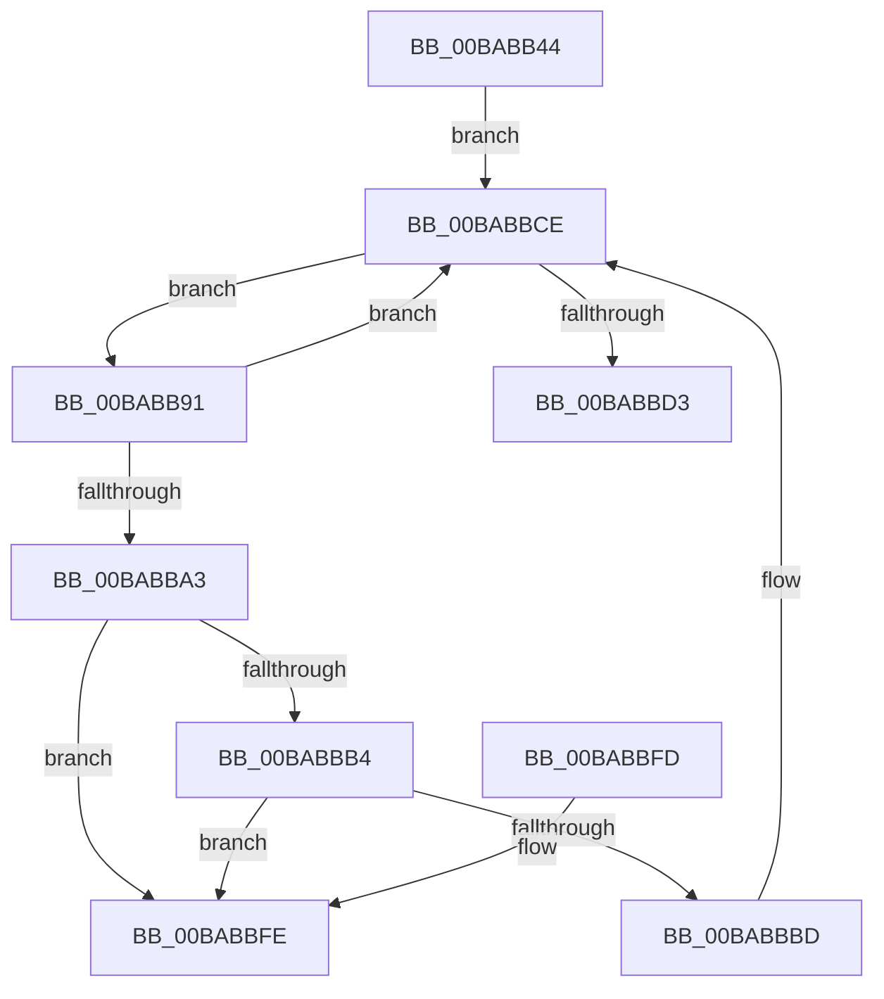

# VfIrpLogUnlockDatabase

- RVA: `0x00BABB44`–`0x00BABC05` (길이 `193` bytes)
- VA: `0x0000000140BABB44`
- 실행 섹션: `PAGEVRFY`
- PDB 이름 있음: `예`; PDB Function 태그: `아니요`
- unwind 정보 RVA: `0x0006B020`
- 디코드: `53`개 명령, `193/193` bytes 표시
- 미해석 바이트: `0` (있으면 어셈블리에 `.byte`로 보존)

> 이 문서는 커널 이미지의 기계어와 PDB 기호를 분석해 생성했습니다. 4번과 5번은 함수 원형과 자료형을 바이너리 사용 방식에서 추정한 C 해석이며 원본 소스 복구 결과는 아닙니다.

## 1. Dependencies

- 직접 호출 지점: **4**; 고유 호출 대상: **4**
- 직접 호출자로 확인된 함수: **1**
- RIP 상대 이미지 참조: **2**

### Outgoing calls
- `0x00BABB75` → [KeAcquireSpinLockRaiseToDpc](../../text/20/KeAcquireSpinLockRaiseToDpc_function_00208470.md) (function, `0x00208470`)
- `0x00BABBA6` → [ObfDereferenceObject](../../text/2F/ObfDereferenceObject_function_002F9350.md) (function, `0x002F9350`)
- `0x00BABBC9` → [ExFreePoolWithTag](../../poolcode/B8/ExFreePoolWithTag_function_00B82870.md) (function, `0x00B82870`)
- `0x00BABBDD` → [KeReleaseSpinLock](../../text/39/KeReleaseSpinLock_function_00392BA0.md) (function, `0x00392BA0`)

### Direct callers
- [ViDdiDispatchWmiQueryAllData](../B9/ViDdiDispatchWmiQueryAllData_function_00B944D4.md) at `0x00B945D9`
- [ViDdiDispatchWmiQueryAllData](../B9/ViDdiDispatchWmiQueryAllData_function_00B944D4.md) at `0x00B945F7`
- [ViDdiDispatchWmiQueryAllData](../B9/ViDdiDispatchWmiQueryAllData_function_00B944D4.md) at `0x00B94648`

### Static image references
- `0x00BABB5F` → RVA `0x00F04870` (`.data`; read)
- `0x00BABB6A` → RVA `0x00F04868` (`.data`; read)

## 2. Other-region calls and transfers

- 다른 실행 섹션으로 향하는 call: **4**
  - `0x00BABB75` → [KeAcquireSpinLockRaiseToDpc](../../text/20/KeAcquireSpinLockRaiseToDpc_function_00208470.md) (`PAGEVRFY` → `.text`)
  - `0x00BABBA6` → [ObfDereferenceObject](../../text/2F/ObfDereferenceObject_function_002F9350.md) (`PAGEVRFY` → `.text`)
  - `0x00BABBC9` → [ExFreePoolWithTag](../../poolcode/B8/ExFreePoolWithTag_function_00B82870.md) (`PAGEVRFY` → `POOLCODE`)
  - `0x00BABBDD` → [KeReleaseSpinLock](../../text/39/KeReleaseSpinLock_function_00392BA0.md) (`PAGEVRFY` → `.text`)
- 별도 외부 분기/꼬리 이동을 확인하지 못했습니다.

## 3. Assembly (complete function range)

```asm
00BABB44  48 8B C4                        mov rax, rsp
00BABB47  48 89 58 08                     mov qword ptr [rax + 8], rbx
00BABB4B  48 89 68 10                     mov qword ptr [rax + 0x10], rbp
00BABB4F  48 89 70 18                     mov qword ptr [rax + 0x18], rsi
00BABB53  48 89 78 20                     mov qword ptr [rax + 0x20], rdi
00BABB57  41 56                           push r14
00BABB59  48 83 EC 20                     sub rsp, 0x20
00BABB5D  8B C1                           mov eax, ecx
00BABB5F  48 8D 0D 0A 8D 35 00            lea rcx, [rip + 0x358d0a]
00BABB66  48 8D 1C 40                     lea rbx, [rax + rax*2]
00BABB6A  48 8B 05 F7 8C 35 00            mov rax, qword ptr [rip + 0x358cf7]
00BABB71  83 24 D8 00                     and dword ptr [rax + rbx*8], 0
00BABB75  E8 F6 C8 65 FF                  call 0x140208470
00BABB7A  48 8B 0D E7 8C 35 00            mov rcx, qword ptr [rip + 0x358ce7]
00BABB81  48 8D 5B 01                     lea rbx, [rbx + 1]
00BABB85  40 8A E8                        mov bpl, al
00BABB88  4C 8D 34 D9                     lea r14, [rcx + rbx*8]
00BABB8C  49 8B 1E                        mov rbx, qword ptr [r14]
00BABB8F  EB 3D                           jmp 0x140babbce
00BABB91  48 8D 73 F8                     lea rsi, [rbx - 8]
00BABB95  48 8B FB                        mov rdi, rbx
00BABB98  8B 4E 18                        mov ecx, dword ptr [rsi + 0x18]
00BABB9B  48 8B 1B                        mov rbx, qword ptr [rbx]
00BABB9E  F6 C1 04                        test cl, 4
00BABBA1  74 2B                           je 0x140babbce
00BABBA3  48 8B 0E                        mov rcx, qword ptr [rsi]
00BABBA6  E8 A5 D7 74 FF                  call 0x1402f9350
00BABBAB  48 8B 0F                        mov rcx, qword ptr [rdi]
00BABBAE  48 39 79 08                     cmp qword ptr [rcx + 8], rdi
00BABBB2  75 4A                           jne 0x140babbfe
00BABBB4  48 8B 47 08                     mov rax, qword ptr [rdi + 8]
00BABBB8  48 39 38                        cmp qword ptr [rax], rdi
00BABBBB  75 41                           jne 0x140babbfe
00BABBBD  48 89 08                        mov qword ptr [rax], rcx
00BABBC0  33 D2                           xor edx, edx
00BABBC2  48 89 41 08                     mov qword ptr [rcx + 8], rax
00BABBC6  48 8B CE                        mov rcx, rsi
00BABBC9  E8 A2 6C FD FF                  call 0x140b82870
00BABBCE  49 3B DE                        cmp rbx, r14
00BABBD1  75 BE                           jne 0x140babb91
00BABBD3  40 8A D5                        mov dl, bpl
00BABBD6  48 8D 0D 93 8C 35 00            lea rcx, [rip + 0x358c93]
00BABBDD  E8 BE 6F 7E FF                  call 0x140392ba0
00BABBE2  48 8B 5C 24 30                  mov rbx, qword ptr [rsp + 0x30]
00BABBE7  48 8B 6C 24 38                  mov rbp, qword ptr [rsp + 0x38]
00BABBEC  48 8B 74 24 40                  mov rsi, qword ptr [rsp + 0x40]
00BABBF1  48 8B 7C 24 48                  mov rdi, qword ptr [rsp + 0x48]
00BABBF6  48 83 C4 20                     add rsp, 0x20
00BABBFA  41 5E                           pop r14
00BABBFC  C3                              ret
00BABBFD  CC                              int3
00BABBFE  B9 03 00 00 00                  mov ecx, 3
00BABC03  CD 29                           int 0x29
```

## 4. C-style interpretation (structured pseudocode)

```c
__int64 __fastcall VfIrpLogUnlockDatabase(int a1, int a2)
{
    __int64 result;
    __int64 v_rsp;
    unsigned __int64 v_stack_p10;
    unsigned __int64 v_stack_p18;
    unsigned __int64 v_stack_p20;
    unsigned __int64 v_stack_p8;

    *(unsigned __int64 *)(v_rsp + 8) = v_rbx;
    *(unsigned __int64 *)(v_rsp + 16) = v_rbp;
    *(unsigned __int64 *)(v_rsp + 24) = v_rsi;
    *(unsigned __int64 *)(v_rsp + 32) = v_rdi;
    v_rsp = (v_rsp) - (32);
    result = KeAcquireSpinLockRaiseToDpc(v_rip + 3509514, a2, a3, a4);
    goto loc_00BABBCE;
loc_00BABB91:
    if ((((unsigned __int8)((unsigned int)(*(unsigned int *)(*(unsigned __int64 *)(*(unsigned __int64 *)(v_rip + 3509479) + (unsigned int)(a1) + (unsigned int)(a1) * 2 + 1 * 8) - 8 + 24)))) & (4)) == 0) goto loc_00BABBCE;
    result = ObfDereferenceObject(*(unsigned __int64 *)(*(unsigned __int64 *)(*(unsigned __int64 *)(v_rip + 3509479) + (unsigned int)(a1) + (unsigned int)(a1) * 2 + 1 * 8) - 8), a2, a3, a4);
    if ((*(unsigned __int64 *)(*(unsigned __int64 *)(*(unsigned __int64 *)(*(unsigned __int64 *)(v_rip + 3509479) + (unsigned int)(a1) + (unsigned int)(a1) * 2 + 1 * 8)) + 8)) != (*(unsigned __int64 *)(*(unsigned __int64 *)(v_rip + 3509479) + (unsigned int)(a1) + (unsigned int)(a1) * 2 + 1 * 8))) goto loc_00BABBFE;
    if ((*(unsigned __int64 *)(*(unsigned __int64 *)(*(unsigned __int64 *)(*(unsigned __int64 *)(v_rip + 3509479) + (unsigned int)(a1) + (unsigned int)(a1) * 2 + 1 * 8) + 8))) != (*(unsigned __int64 *)(*(unsigned __int64 *)(v_rip + 3509479) + (unsigned int)(a1) + (unsigned int)(a1) * 2 + 1 * 8))) goto loc_00BABBFE;
    *(unsigned __int64 *)(*(unsigned __int64 *)(*(unsigned __int64 *)(*(unsigned __int64 *)(v_rip + 3509479) + (unsigned int)(a1) + (unsigned int)(a1) * 2 + 1 * 8) + 8)) = *(unsigned __int64 *)(*(unsigned __int64 *)(*(unsigned __int64 *)(v_rip + 3509479) + (unsigned int)(a1) + (unsigned int)(a1) * 2 + 1 * 8));
    a2 = 0;
    *(unsigned __int64 *)(*(unsigned __int64 *)(*(unsigned __int64 *)(*(unsigned __int64 *)(v_rip + 3509479) + (unsigned int)(a1) + (unsigned int)(a1) * 2 + 1 * 8)) + 8) = *(unsigned __int64 *)(*(unsigned __int64 *)(*(unsigned __int64 *)(v_rip + 3509479) + (unsigned int)(a1) + (unsigned int)(a1) * 2 + 1 * 8) + 8);
    result = ExFreePoolWithTag(*(unsigned __int64 *)(*(unsigned __int64 *)(v_rip + 3509479) + (unsigned int)(a1) + (unsigned int)(a1) * 2 + 1 * 8) - 8, a2, a3, a4);
loc_00BABBCE:
    if ((*(unsigned __int64 *)(*(unsigned __int64 *)(*(unsigned __int64 *)(v_rip + 3509479) + (unsigned int)(a1) + (unsigned int)(a1) * 2 + 1 * 8))) != (*(unsigned __int64 *)(v_rip + 3509479) + (unsigned int)(a1) + (unsigned int)(a1) * 2 + 1 * 8)) goto loc_00BABB91;
    result = KeReleaseSpinLock(v_rip + 3509395, (unsigned __int8)((unsigned __int8)(result)), a3, a4);
    v_rsp = (v_rsp) + (32);
    return result;
loc_00BABBFE:
    return result;
}
```

## 5. (Beta) C Style

```c
int64_t VfIrpLogUnlockDatabase(void *Arg1, int32_t Arg2)
{
    uint8_t *arg1 = (uint8_t *)Arg1;

    int64_t result;
    int64_t local_rsp;
    uint64_t v_stack_p10;
    uint64_t v_stack_p18;
    uint64_t v_stack_p20;
    uint64_t v_stack_p8;

    *(uint64_t *)(local_rsp + 0x8) = local_rbx;
    *(uint64_t *)(local_rsp + 0x10) = local_rbp;
    *(uint64_t *)(local_rsp + 0x18) = local_rsi;
    *(uint64_t *)(local_rsp + 0x20) = local_rdi;
    local_rsp = (local_rsp) - (32);
    result = KeAcquireSpinLockRaiseToDpc(v_rip + 3509514, Arg2, a3, a4);
    goto loc_00BABBCE;
loc_00BABB91:
    if ((((uint8_t)((uint32_t)(*(uint32_t *)(*(uint64_t *)(*(uint64_t *)(v_rip + 0x358CE7) + (uint32_t)(arg1) + (uint32_t)(arg1) * 2 + 0x1 * 8) - 0x8 + 0x18)))) & (4)) == 0) goto loc_00BABBCE;
    result = ObfDereferenceObject(*(uint64_t *)(*(uint64_t *)(*(uint64_t *)(v_rip + 0x358CE7) + (uint32_t)(arg1) + (uint32_t)(arg1) * 2 + 0x1 * 8) - 0x8), Arg2, a3, a4);
    if ((*(uint64_t *)(*(uint64_t *)(*(uint64_t *)(*(uint64_t *)(v_rip + 0x358CE7) + (uint32_t)(arg1) + (uint32_t)(arg1) * 2 + 0x1 * 8)) + 0x8)) != (*(uint64_t *)(*(uint64_t *)(v_rip + 0x358CE7) + (uint32_t)(arg1) + (uint32_t)(arg1) * 2 + 0x1 * 8))) goto loc_00BABBFE;
    if ((*(uint64_t *)(*(uint64_t *)(*(uint64_t *)(*(uint64_t *)(v_rip + 0x358CE7) + (uint32_t)(arg1) + (uint32_t)(arg1) * 2 + 0x1 * 8) + 0x8))) != (*(uint64_t *)(*(uint64_t *)(v_rip + 0x358CE7) + (uint32_t)(arg1) + (uint32_t)(arg1) * 2 + 0x1 * 8))) goto loc_00BABBFE;
    *(uint64_t *)(*(uint64_t *)(*(uint64_t *)(*(uint64_t *)(v_rip + 0x358CE7) + (uint32_t)(arg1) + (uint32_t)(arg1) * 2 + 0x1 * 8) + 0x8)) = *(uint64_t *)(*(uint64_t *)(*(uint64_t *)(v_rip + 0x358CE7) + (uint32_t)(arg1) + (uint32_t)(arg1) * 2 + 0x1 * 8));
    Arg2 = 0;
    *(uint64_t *)(*(uint64_t *)(*(uint64_t *)(*(uint64_t *)(v_rip + 0x358CE7) + (uint32_t)(arg1) + (uint32_t)(arg1) * 2 + 0x1 * 8)) + 0x8) = *(uint64_t *)(*(uint64_t *)(*(uint64_t *)(v_rip + 0x358CE7) + (uint32_t)(arg1) + (uint32_t)(arg1) * 2 + 0x1 * 8) + 0x8);
    result = ExFreePoolWithTag(*(uint64_t *)(*(uint64_t *)(v_rip + 0x358CE7) + (uint32_t)(arg1) + (uint32_t)(arg1) * 2 + 0x1 * 8) - 8, Arg2, a3, a4);
loc_00BABBCE:
    if ((*(uint64_t *)(*(uint64_t *)(*(uint64_t *)(v_rip + 0x358CE7) + (uint32_t)(arg1) + (uint32_t)(arg1) * 2 + 0x1 * 8))) != (*(uint64_t *)(v_rip + 0x358CE7) + (uint32_t)(Arg1) + (uint32_t)(Arg1) * 2 + 1 * 8)) goto loc_00BABB91;
    result = KeReleaseSpinLock(v_rip + 3509395, (uint8_t)((uint8_t)(result)), a3, a4);
    local_rsp = (local_rsp) + (32);
    return result;
loc_00BABBFE:
    return result;
}
```

### 관측된 메모리 오프셋

구조체 형식이 확인되지 않은 접근은 인자 기준의 오프셋으로만 기록했습니다.

| 기준 인자 | 오프셋 표현 | 폭 (bit) | 접근 |
|---|---:|---:|---|
| `Arg1` | `+ 0x0 + rax*2` | `64` | `R` |
| `Arg1` | `+ 0x1` | `64` | `R` |

## 6. Execution-region graph

[열기: 2D/3D 그래프와 함수 탐색 컨트롤 패널](../../../control-panel.html?section=pagevrfy&rva=0x00BABB44&view=graph)

- 2D 그래프는 위에서 아래로 흐르고, 3D 그래프는 빈 공간을 드래그해 회전합니다. Shift+드래그는 이동, 휠은 확대·축소, 함수 노드 선택은 대상 보고서 이동입니다.

### Static fallback


