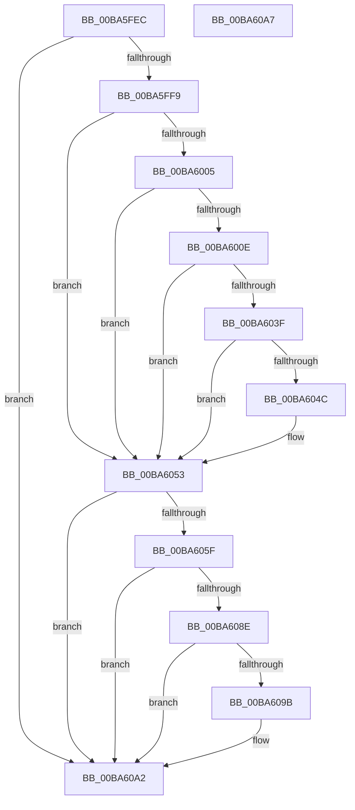

# VfKeCheckForChanges

- RVA: `0x00BA5FEC`–`0x00BA60A8` (길이 `188` bytes)
- VA: `0x0000000140BA5FEC`
- 실행 섹션: `PAGEVRFY`
- PDB 이름 있음: `예`; PDB Function 태그: `아니요`
- unwind 정보 RVA: `0x0005D2F4`
- 디코드: `44`개 명령, `188/188` bytes 표시
- 미해석 바이트: `0` (있으면 어셈블리에 `.byte`로 보존)

> 이 문서는 커널 이미지의 기계어와 PDB 기호를 분석해 생성했습니다. 4번과 5번은 함수 원형과 자료형을 바이너리 사용 방식에서 추정한 C 해석이며 원본 소스 복구 결과는 아닙니다.

## 1. Dependencies

- 직접 호출 지점: **4**; 고유 호출 대상: **2**
- 직접 호출자로 확인된 함수: **2**
- RIP 상대 이미지 참조: **6**

### Outgoing calls
- `0x00BA6032` → [ExAllocatePool3](../../poolcode/B8/ExAllocatePool3_function_00B84270.md) (function, `0x00B84270`)
- `0x00BA604E` → [ExFreePoolWithTag](../../poolcode/B8/ExFreePoolWithTag_function_00B82870.md) (function, `0x00B82870`)
- `0x00BA6081` → [ExAllocatePool3](../../poolcode/B8/ExAllocatePool3_function_00B84270.md) (function, `0x00B84270`)
- `0x00BA609D` → [ExFreePoolWithTag](../../poolcode/B8/ExFreePoolWithTag_function_00B82870.md) (function, `0x00B82870`)

### Direct callers
- [VfInitVerifierComponents](../B9/VfInitVerifierComponents_function_00B93AC0.md) at `0x00B93ACD`
- [VfSettingsCheckForChanges](VfSettingsCheckForChanges_function_00BAB250.md) at `0x00BAB276`

### Static image references
- `0x00BA5FF9` → RVA `0x00FFDA68` (`PAGEVRFD`; read)
- `0x00BA6005` → RVA `0x00E0E944` (`.data`; read)
- `0x00BA600E` → RVA `0x00FF401C` (`PAGEVRFD`; read)
- `0x00BA6014` → RVA `0x00E681B0` (`.data`; read)
- `0x00BA6053` → RVA `0x00FFDA60` (`PAGEVRFD`; read)
- `0x00BA605F` → RVA `0x00FF4018` (`PAGEVRFD`; read)

## 2. Other-region calls and transfers

- 다른 실행 섹션으로 향하는 call: **4**
  - `0x00BA6032` → [ExAllocatePool3](../../poolcode/B8/ExAllocatePool3_function_00B84270.md) (`PAGEVRFY` → `POOLCODE`)
  - `0x00BA604E` → [ExFreePoolWithTag](../../poolcode/B8/ExFreePoolWithTag_function_00B82870.md) (`PAGEVRFY` → `POOLCODE`)
  - `0x00BA6081` → [ExAllocatePool3](../../poolcode/B8/ExAllocatePool3_function_00B84270.md) (`PAGEVRFY` → `POOLCODE`)
  - `0x00BA609D` → [ExFreePoolWithTag](../../poolcode/B8/ExFreePoolWithTag_function_00B82870.md) (`PAGEVRFY` → `POOLCODE`)
- 별도 외부 분기/꼬리 이동을 확인하지 못했습니다.

## 3. Assembly (complete function range)

```asm
00BA5FEC  48 83 EC 38                     sub rsp, 0x38
00BA5FF0  F6 C1 02                        test cl, 2
00BA5FF3  0F 84 A9 00 00 00               je 0x140ba60a2
00BA5FF9  48 8B 05 68 7A 45 00            mov rax, qword ptr [rip + 0x457a68]
00BA6000  48 85 C0                        test rax, rax
00BA6003  75 4E                           jne 0x140ba6053
00BA6005  83 3D 38 89 26 00 03            cmp dword ptr [rip + 0x268938], 3
00BA600C  7C 45                           jl 0x140ba6053
00BA600E  8B 05 08 E0 44 00               mov eax, dword ptr [rip + 0x44e008]
00BA6014  4C 8D 0D 95 21 2C 00            lea r9, [rip + 0x2c2195]
00BA601B  48 6B D0 38                     imul rdx, rax, 0x38
00BA601F  B9 40 00 00 00                  mov ecx, 0x40
00BA6024  C7 44 24 20 01 00 00 00         mov dword ptr [rsp + 0x20], 1
00BA602C  41 B8 49 72 71 6C               mov r8d, 0x6c717249
00BA6032  E8 39 E2 FD FF                  call 0x140b84270
00BA6037  48 8B C8                        mov rcx, rax
00BA603A  48 85 C0                        test rax, rax
00BA603D  74 14                           je 0x140ba6053
00BA603F  33 C0                           xor eax, eax
00BA6041  F0 48 0F B1 0D 1E 7A 45 00      lock cmpxchg qword ptr [rip + 0x457a1e], rcx
00BA604A  74 07                           je 0x140ba6053
00BA604C  33 D2                           xor edx, edx
00BA604E  E8 1D C8 FD FF                  call 0x140b82870
00BA6053  48 8B 05 06 7A 45 00            mov rax, qword ptr [rip + 0x457a06]
00BA605A  48 85 C0                        test rax, rax
00BA605D  75 43                           jne 0x140ba60a2
00BA605F  8B 15 B3 DF 44 00               mov edx, dword ptr [rip + 0x44dfb3]
00BA6065  4C 8D 0D 44 21 2C 00            lea r9, [rip + 0x2c2144]
00BA606C  48 C1 E2 06                     shl rdx, 6
00BA6070  8D 48 40                        lea ecx, [rax + 0x40]
00BA6073  41 B8 56 66 43 52               mov r8d, 0x52436656
00BA6079  C7 44 24 20 01 00 00 00         mov dword ptr [rsp + 0x20], 1
00BA6081  E8 EA E1 FD FF                  call 0x140b84270
00BA6086  48 8B C8                        mov rcx, rax
00BA6089  48 85 C0                        test rax, rax
00BA608C  74 14                           je 0x140ba60a2
00BA608E  33 C0                           xor eax, eax
00BA6090  F0 48 0F B1 0D C7 79 45 00      lock cmpxchg qword ptr [rip + 0x4579c7], rcx
00BA6099  74 07                           je 0x140ba60a2
00BA609B  33 D2                           xor edx, edx
00BA609D  E8 CE C7 FD FF                  call 0x140b82870
00BA60A2  48 83 C4 38                     add rsp, 0x38
00BA60A6  C3                              ret
00BA60A7  CC                              int3
```

## 4. C-style interpretation (structured pseudocode)

```c
__int64 __fastcall VfKeCheckForChanges(unsigned __int8 a1)
{
    __int64 result;
    __int64 v_rsp;
    unsigned int v_stack_m18;

    v_rsp = (v_rsp) - (56);
    if (((a1) & (2)) == 0) goto loc_00BA60A2;
    if (*(unsigned __int64 *)(v_rip + 4553320) != 0) goto loc_00BA6053;
    if ((*(unsigned int *)(v_rip + 2525496)) < 3) goto loc_00BA6053;
    a2 = (a2) * ((unsigned int)(*(unsigned int *)(v_rip + 4513800)));
    v_stack_m18 = 1;
    result = ExAllocatePool3(64, a2, (unsigned int)(0x6C717249ULL), v_rip + 2892181);
    if (result == 0) goto loc_00BA6053;
    result = 0;
    if (!(condition_is_equal)) {
        a2 = 0;
        result = ExFreePoolWithTag(result, a2, (unsigned int)(0x6C717249ULL), v_rip + 2892181);
    }
    if (*(unsigned __int64 *)(v_rip + 4553222) != 0) goto loc_00BA60A2;
    a2 = ((unsigned int)(*(unsigned int *)(v_rip + 4513715))) << (6);
    v_stack_m18 = 1;
    result = ExAllocatePool3(*(unsigned __int64 *)(v_rip + 4553222) + 64, a2, (unsigned int)(0x52436656ULL), v_rip + 2892100);
    if (result == 0) goto loc_00BA60A2;
    result = 0;
    if (!(condition_is_equal)) {
        a2 = 0;
        result = ExFreePoolWithTag(result, a2, (unsigned int)(0x52436656ULL), v_rip + 2892100);
    }
    v_rsp = (v_rsp) + (56);
    return result;
}
```

## 5. (Beta) C Style

```c
int64_t VfKeCheckForChanges(uint8_t Arg1)
{
    int64_t result;
    int64_t local_rsp;
    uint32_t v_stack_m18;

    local_rsp = (local_rsp) - (56);
    if (((Arg1) & (2)) == 0) goto loc_00BA60A2;
    if (*(uint64_t *)(v_rip + 0x457A68) != 0) goto loc_00BA6053;
    if ((*(uint32_t *)(v_rip + 0x268938)) < 3) goto loc_00BA6053;
    a2 = (a2) * ((uint32_t)(*(uint32_t *)(v_rip + 0x44E008)));
    v_stack_m18 = 1;
    result = ExAllocatePool3(64, a2, (uint32_t)(0x6C717249ULL), v_rip + 2892181);
    if (result == 0) goto loc_00BA6053;
    result = 0;
    if (!(condition_is_equal)) {
        a2 = 0;
        result = ExFreePoolWithTag(result, a2, (uint32_t)(0x6C717249ULL), v_rip + 2892181);
    }
    if (*(uint64_t *)(v_rip + 0x457A06) != 0) goto loc_00BA60A2;
    a2 = ((uint32_t)(*(uint32_t *)(v_rip + 0x44DFB3))) << (6);
    v_stack_m18 = 1;
    result = ExAllocatePool3(*(uint64_t *)(v_rip + 0x457A06) + 64, a2, (uint32_t)(0x52436656ULL), v_rip + 2892100);
    if (result == 0) goto loc_00BA60A2;
    result = 0;
    if (!(condition_is_equal)) {
        a2 = 0;
        result = ExFreePoolWithTag(result, a2, (uint32_t)(0x52436656ULL), v_rip + 2892100);
    }
    local_rsp = (local_rsp) + (56);
    return result;
}
```

## 6. Execution-region graph

[열기: 2D/3D 그래프와 함수 탐색 컨트롤 패널](../../../control-panel.html?section=pagevrfy&rva=0x00BA5FEC&view=graph)

- 2D 그래프는 위에서 아래로 흐르고, 3D 그래프는 빈 공간을 드래그해 회전합니다. Shift+드래그는 이동, 휠은 확대·축소, 함수 노드 선택은 대상 보고서 이동입니다.

### Static fallback


