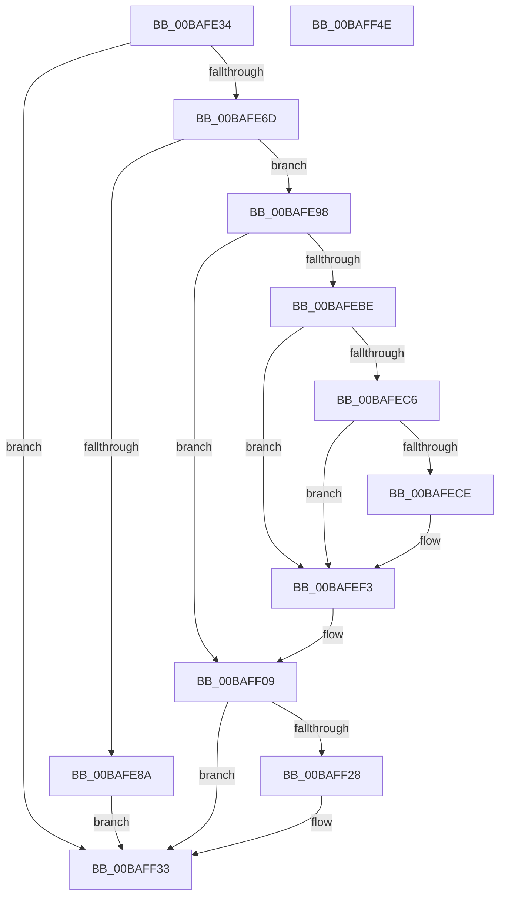

# VfLookasideAdd

- RVA: `0x00BAFE34`–`0x00BAFF4F` (길이 `283` bytes)
- VA: `0x0000000140BAFE34`
- 실행 섹션: `PAGEVRFY`
- PDB 이름 있음: `예`; PDB Function 태그: `아니요`
- unwind 정보 RVA: `0x000C57EC`
- 디코드: `75`개 명령, `283/283` bytes 표시
- 미해석 바이트: `0` (있으면 어셈블리에 `.byte`로 보존)

> 이 문서는 커널 이미지의 기계어와 PDB 기호를 분석해 생성했습니다. 4번과 5번은 함수 원형과 자료형을 바이너리 사용 방식에서 추정한 C 해석이며 원본 소스 복구 결과는 아닙니다.

## 1. Dependencies

- 직접 호출 지점: **8**; 고유 호출 대상: **8**
- 직접 호출자로 확인된 함수: **1**
- RIP 상대 이미지 참조: **5**

### Outgoing calls
- `0x00BAFE7D` → [VfAvlReserveNode](../../text/3E/VfAvlReserveNode_function_003EF760.md) (function, `0x003EF760`)
- `0x00BAFEA1` → [VfAvlInitializeLockContext](../../text/4A/VfAvlInitializeLockContext_function_004A686C.md) (function, `0x004A686C`)
- `0x00BAFEB4` → [VfAvlLookupTreeNode](../../text/3E/VfAvlLookupTreeNode_function_003EF1B4.md) (function, `0x003EF1B4`)
- `0x00BAFEEE` → [CarReportRuleViolationFromNt](../B9/CarReportRuleViolationFromNt_function_00B9D904.md) (function, `0x00B9D904`)
- `0x00BAFF01` → [VfAvlDeleteTreeNode](../../text/3E/VfAvlDeleteTreeNode_function_003EE240.md) (function, `0x003EE240`)
- `0x00BAFF14` → [VfAvlInsertReservedTreeNode](../../text/3E/VfAvlInsertReservedTreeNode_function_003EE424.md) (function, `0x003EE424`)
- `0x00BAFF1E` → [VfAvlCleanupLockContext](../../text/3E/VfAvlCleanupLockContext_function_003EF56C.md) (function, `0x003EF56C`)
- `0x00BAFF2E` → [VfAvlFreeNodeNoLock](../../text/61/VfAvlFreeNodeNoLock_function_006126D8.md) (function, `0x006126D8`)

### Direct callers
- [VfMiscExInitializeLookasideListEx_Exit](VfMiscExInitializeLookasideListEx_Exit_function_00BAD910.md) at `0x00BAD91B`

### Static image references
- `0x00BAFE52` → RVA `0x00FFDA84` (`PAGEVRFD`; read)
- `0x00BAFE70` → RVA `0x00FFDCA0` (`PAGEVRFD`; read)
- `0x00BAFE8D` → RVA `0x00FFDA88` (`PAGEVRFD`; read/write)
- `0x00BAFEBE` → RVA `0x00FFDA88` (`PAGEVRFD`; read)
- `0x00BAFEC6` → RVA `0x00FFDAA8` (`PAGEVRFD`; read)

## 2. Other-region calls and transfers

- 다른 실행 섹션으로 향하는 call: **7**
  - `0x00BAFE7D` → [VfAvlReserveNode](../../text/3E/VfAvlReserveNode_function_003EF760.md) (`PAGEVRFY` → `.text`)
  - `0x00BAFEA1` → [VfAvlInitializeLockContext](../../text/4A/VfAvlInitializeLockContext_function_004A686C.md) (`PAGEVRFY` → `.text`)
  - `0x00BAFEB4` → [VfAvlLookupTreeNode](../../text/3E/VfAvlLookupTreeNode_function_003EF1B4.md) (`PAGEVRFY` → `.text`)
  - `0x00BAFF01` → [VfAvlDeleteTreeNode](../../text/3E/VfAvlDeleteTreeNode_function_003EE240.md) (`PAGEVRFY` → `.text`)
  - `0x00BAFF14` → [VfAvlInsertReservedTreeNode](../../text/3E/VfAvlInsertReservedTreeNode_function_003EE424.md) (`PAGEVRFY` → `.text`)
  - `0x00BAFF1E` → [VfAvlCleanupLockContext](../../text/3E/VfAvlCleanupLockContext_function_003EF56C.md) (`PAGEVRFY` → `.text`)
  - `0x00BAFF2E` → [VfAvlFreeNodeNoLock](../../text/61/VfAvlFreeNodeNoLock_function_006126D8.md) (`PAGEVRFY` → `.text`)
- 별도 외부 분기/꼬리 이동을 확인하지 못했습니다.

## 3. Assembly (complete function range)

```asm
00BAFE34  4C 8B DC                        mov r11, rsp
00BAFE37  49 89 5B 08                     mov qword ptr [r11 + 8], rbx
00BAFE3B  49 89 6B 10                     mov qword ptr [r11 + 0x10], rbp
00BAFE3F  49 89 73 18                     mov qword ptr [r11 + 0x18], rsi
00BAFE43  49 89 7B 20                     mov qword ptr [r11 + 0x20], rdi
00BAFE47  41 57                           push r15
00BAFE49  48 83 EC 60                     sub rsp, 0x60
00BAFE4D  33 C0                           xor eax, eax
00BAFE4F  0F 57 C0                        xorps xmm0, xmm0
00BAFE52  39 05 2C DC 44 00               cmp dword ptr [rip + 0x44dc2c], eax
00BAFE58  48 8B EA                        mov rbp, rdx
00BAFE5B  0F 11 44 24 40                  movups xmmword ptr [rsp + 0x40], xmm0
00BAFE60  49 89 43 E8                     mov qword ptr [r11 - 0x18], rax
00BAFE64  48 8B D9                        mov rbx, rcx
00BAFE67  0F 84 C6 00 00 00               je 0x140baff33
00BAFE6D  48 8B D1                        mov rdx, rcx
00BAFE70  4C 8D 3D 29 DE 44 00            lea r15, [rip + 0x44de29]
00BAFE77  49 8B CF                        mov rcx, r15
00BAFE7A  45 33 C0                        xor r8d, r8d
00BAFE7D  E8 DE F8 83 FF                  call 0x1403ef760
00BAFE82  48 8B F0                        mov rsi, rax
00BAFE85  48 85 C0                        test rax, rax
00BAFE88  75 0E                           jne 0x140bafe98
00BAFE8A  8D 46 01                        lea eax, [rsi + 1]
00BAFE8D  87 05 F5 DB 44 00               xchg dword ptr [rip + 0x44dbf5], eax
00BAFE93  E9 9B 00 00 00                  jmp 0x140baff33
00BAFE98  33 D2                           xor edx, edx
00BAFE9A  48 8D 4C 24 40                  lea rcx, [rsp + 0x40]
00BAFE9F  33 FF                           xor edi, edi
00BAFEA1  E8 C6 69 8F FF                  call 0x1404a686c
00BAFEA6  45 33 C9                        xor r9d, r9d
00BAFEA9  48 8D 54 24 40                  lea rdx, [rsp + 0x40]
00BAFEAE  4C 8B C3                        mov r8, rbx
00BAFEB1  49 8B CF                        mov rcx, r15
00BAFEB4  E8 FB F2 83 FF                  call 0x1403ef1b4
00BAFEB9  48 85 C0                        test rax, rax
00BAFEBC  74 4B                           je 0x140baff09
00BAFEBE  39 3D C4 DB 44 00               cmp dword ptr [rip + 0x44dbc4], edi
00BAFEC4  75 2D                           jne 0x140bafef3
00BAFEC6  39 3D DC DB 44 00               cmp dword ptr [rip + 0x44dbdc], edi
00BAFECC  75 25                           jne 0x140bafef3
00BAFECE  BA CA 00 00 00                  mov edx, 0xca
00BAFED3  48 89 6C 24 30                  mov qword ptr [rsp + 0x30], rbp
00BAFED8  C7 44 24 28 0B 00 00 00         mov dword ptr [rsp + 0x28], 0xb
00BAFEE0  45 33 C9                        xor r9d, r9d
00BAFEE3  48 21 7C 24 20                  and qword ptr [rsp + 0x20], rdi
00BAFEE8  4C 8B C3                        mov r8, rbx
00BAFEEB  8D 4A FA                        lea ecx, [rdx - 6]
00BAFEEE  E8 11 DA FE FF                  call 0x140b9d904
00BAFEF3  45 33 C9                        xor r9d, r9d
00BAFEF6  48 8D 54 24 40                  lea rdx, [rsp + 0x40]
00BAFEFB  4C 8B C3                        mov r8, rbx
00BAFEFE  49 8B CF                        mov rcx, r15
00BAFF01  E8 3A E3 83 FF                  call 0x1403ee240
00BAFF06  48 8B F8                        mov rdi, rax
00BAFF09  4C 8B C6                        mov r8, rsi
00BAFF0C  48 8D 54 24 40                  lea rdx, [rsp + 0x40]
00BAFF11  49 8B CF                        mov rcx, r15
00BAFF14  E8 0B E5 83 FF                  call 0x1403ee424
00BAFF19  48 8D 4C 24 40                  lea rcx, [rsp + 0x40]
00BAFF1E  E8 49 F6 83 FF                  call 0x1403ef56c
00BAFF23  48 85 FF                        test rdi, rdi
00BAFF26  74 0B                           je 0x140baff33
00BAFF28  48 8B D7                        mov rdx, rdi
00BAFF2B  49 8B CF                        mov rcx, r15
00BAFF2E  E8 A5 27 A6 FF                  call 0x1406126d8
00BAFF33  4C 8D 5C 24 60                  lea r11, [rsp + 0x60]
00BAFF38  49 8B 5B 10                     mov rbx, qword ptr [r11 + 0x10]
00BAFF3C  49 8B 6B 18                     mov rbp, qword ptr [r11 + 0x18]
00BAFF40  49 8B 73 20                     mov rsi, qword ptr [r11 + 0x20]
00BAFF44  49 8B 7B 28                     mov rdi, qword ptr [r11 + 0x28]
00BAFF48  49 8B E3                        mov rsp, r11
00BAFF4B  41 5F                           pop r15
00BAFF4D  C3                              ret
00BAFF4E  CC                              int3
```

## 4. C-style interpretation (structured pseudocode)

```c
__int64 __fastcall VfLookasideAdd(__int64 a1, __int64 a2, int a3, int a4)
{
    __int64 result;
    __int64 v_rdi;
    __int64 v_rsp;
    unsigned __int64 v_stack_m28;
    unsigned __int64 v_stack_m38;
    unsigned int v_stack_m40;
    unsigned __int64 v_stack_m48;
    unsigned __int64 v_stack_m8;

    *(unsigned __int64 *)(v_rsp + 8) = v_rbx;
    *(unsigned __int64 *)(v_rsp + 16) = v_rbp;
    *(unsigned __int64 *)(v_rsp + 24) = v_rsi;
    *(unsigned __int64 *)(v_rsp + 32) = v_rdi;
    v_rsp = (v_rsp) - (96);
    result = 0;
    v_stack_m28 = v_xmm0;
    *(unsigned __int64 *)(v_rsp - 24) = 0;
    if ((*(unsigned int *)(v_rip + 4512812)) == 0) goto loc_00BAFF33;
    a3 = 0;
    result = VfAvlReserveNode(v_rip + 4513321, a1, a3, a4);
    if (result != 0) goto loc_00BAFE98;
    goto loc_00BAFF33;
loc_00BAFE98:
    a2 = 0;
    v_rdi = 0;
    result = VfAvlInitializeLockContext(v_stack_m28, a2, a3, a4);
    a4 = 0;
    result = VfAvlLookupTreeNode(v_rip + 4513321, v_stack_m28, a1, a4);
    if (result == 0) goto loc_00BAFF09;
    if ((*(unsigned int *)(v_rip + 4512708)) != 0) goto loc_00BAFEF3;
    if ((*(unsigned int *)(v_rip + 4512732)) == 0) {
        a2 = 202;
        v_stack_m38 = a2;
        v_stack_m40 = 11;
        a4 = 0;
        a3 = a1;
        a1 = a2 - 6;
        result = CarReportRuleViolationFromNt(a1, a2, a3, a4);
    }
    a4 = 0;
    result = VfAvlDeleteTreeNode(v_rip + 4513321, v_stack_m28, a1, a4);
loc_00BAFF09:
    result = VfAvlInsertReservedTreeNode(v_rip + 4513321, v_stack_m28, result, a4);
    result = VfAvlCleanupLockContext(v_stack_m28, v_stack_m28, result, a4);
    if (result != 0) {
        a2 = result;
        a1 = v_rip + 4513321;
        result = VfAvlFreeNodeNoLock(a1, a2, result, a4);
    }
    return result;
}
```

## 5. (Beta) C Style

```c
int64_t VfLookasideAdd(int64_t Arg1, int64_t Arg2, int32_t Arg3, int32_t Arg4)
{
    int64_t result;
    int64_t local_rdi;
    int64_t local_rsp;
    uint64_t v_stack_m28;
    uint64_t v_stack_m38;
    uint32_t v_stack_m40;
    uint64_t v_stack_m48;
    uint64_t v_stack_m8;

    *(uint64_t *)(local_rsp + 0x8) = local_rbx;
    *(uint64_t *)(local_rsp + 0x10) = local_rbp;
    *(uint64_t *)(local_rsp + 0x18) = local_rsi;
    *(uint64_t *)(local_rsp + 0x20) = local_rdi;
    local_rsp = (local_rsp) - (96);
    result = 0;
    v_stack_m28 = v_xmm0;
    *(uint64_t *)(local_rsp - 0x18) = 0;
    if ((*(uint32_t *)(v_rip + 0x44DC2C)) == 0) goto loc_00BAFF33;
    Arg3 = 0;
    result = VfAvlReserveNode(v_rip + 4513321, Arg1, Arg3, Arg4);
    if (result != 0) goto loc_00BAFE98;
    goto loc_00BAFF33;
loc_00BAFE98:
    Arg2 = 0;
    local_rdi = 0;
    result = VfAvlInitializeLockContext(v_stack_m28, Arg2, Arg3, Arg4);
    Arg4 = 0;
    result = VfAvlLookupTreeNode(v_rip + 4513321, v_stack_m28, Arg1, Arg4);
    if (result == 0) goto loc_00BAFF09;
    if ((*(uint32_t *)(v_rip + 0x44DBC4)) != 0) goto loc_00BAFEF3;
    if ((*(uint32_t *)(v_rip + 0x44DBDC)) == 0) {
        Arg2 = 202;
        v_stack_m38 = Arg2;
        v_stack_m40 = 11;
        Arg4 = 0;
        Arg3 = Arg1;
        Arg1 = Arg2 - 6;
        result = CarReportRuleViolationFromNt(Arg1, Arg2, Arg3, Arg4);
    }
    Arg4 = 0;
    result = VfAvlDeleteTreeNode(v_rip + 4513321, v_stack_m28, Arg1, Arg4);
loc_00BAFF09:
    result = VfAvlInsertReservedTreeNode(v_rip + 4513321, v_stack_m28, result, Arg4);
    result = VfAvlCleanupLockContext(v_stack_m28, v_stack_m28, result, Arg4);
    if (result != 0) {
        Arg2 = result;
        Arg1 = v_rip + 4513321;
        result = VfAvlFreeNodeNoLock(Arg1, Arg2, result, Arg4);
    }
    return result;
}
```

## 6. Execution-region graph

[열기: 2D/3D 그래프와 함수 탐색 컨트롤 패널](../../../control-panel.html?section=pagevrfy&rva=0x00BAFE34&view=graph)

- 2D 그래프는 위에서 아래로 흐르고, 3D 그래프는 빈 공간을 드래그해 회전합니다. Shift+드래그는 이동, 휠은 확대·축소, 함수 노드 선택은 대상 보고서 이동입니다.

### Static fallback


