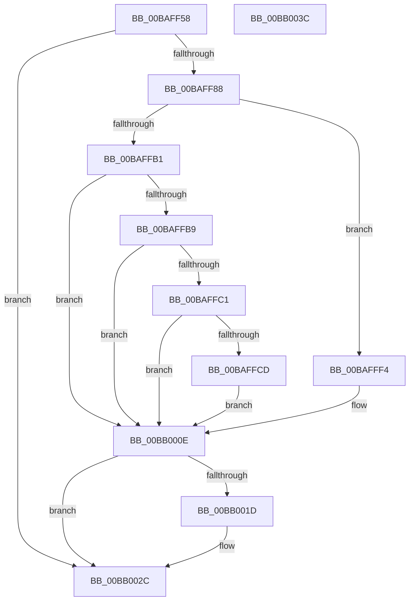

# VfLookasideDelete

- RVA: `0x00BAFF58`–`0x00BB003D` (길이 `229` bytes)
- VA: `0x0000000140BAFF58`
- 실행 섹션: `PAGEVRFY`
- PDB 이름 있음: `예`; PDB Function 태그: `아니요`
- unwind 정보 RVA: `0x0007AFEC`
- 디코드: `58`개 명령, `229/229` bytes 표시
- 미해석 바이트: `0` (있으면 어셈블리에 `.byte`로 보존)

> 이 문서는 커널 이미지의 기계어와 PDB 기호를 분석해 생성했습니다. 4번과 5번은 함수 원형과 자료형을 바이너리 사용 방식에서 추정한 C 해석이며 원본 소스 복구 결과는 아닙니다.

## 1. Dependencies

- 직접 호출 지점: **6**; 고유 호출 대상: **6**
- 직접 호출자로 확인된 함수: **1**
- RIP 상대 이미지 참조: **5**

### Outgoing calls
- `0x00BAFF90` → [VfAvlInitializeLockContext](../../text/4A/VfAvlInitializeLockContext_function_004A686C.md) (function, `0x004A686C`)
- `0x00BAFFA7` → [VfAvlLookupTreeNode](../../text/3E/VfAvlLookupTreeNode_function_003EF1B4.md) (function, `0x003EF1B4`)
- `0x00BAFFED` → [CarReportRuleViolationFromNt](../B9/CarReportRuleViolationFromNt_function_00B9D904.md) (function, `0x00B9D904`)
- `0x00BB0006` → [VfAvlDeleteTreeNode](../../text/3E/VfAvlDeleteTreeNode_function_003EE240.md) (function, `0x003EE240`)
- `0x00BB0013` → [VfAvlCleanupLockContext](../../text/3E/VfAvlCleanupLockContext_function_003EF56C.md) (function, `0x003EF56C`)
- `0x00BB0027` → [VfAvlFreeNodeNoLock](../../text/61/VfAvlFreeNodeNoLock_function_006126D8.md) (function, `0x006126D8`)

### Direct callers
- [VfMiscExDeleteLookasideListEx_Entry](VfMiscExDeleteLookasideListEx_Entry_function_00BAD820.md) at `0x00BAD82B`

### Static image references
- `0x00BAFF6D` → RVA `0x00FFDA84` (`PAGEVRFD`; read)
- `0x00BAFFA0` → RVA `0x00FFDCA0` (`PAGEVRFD`; read)
- `0x00BAFFB1` → RVA `0x00FFDA88` (`PAGEVRFD`; read)
- `0x00BAFFB9` → RVA `0x00FFDAA8` (`PAGEVRFD`; read)
- `0x00BAFFC1` → RVA `0x00E681A0` (`.data`; read)

## 2. Other-region calls and transfers

- 다른 실행 섹션으로 향하는 call: **5**
  - `0x00BAFF90` → [VfAvlInitializeLockContext](../../text/4A/VfAvlInitializeLockContext_function_004A686C.md) (`PAGEVRFY` → `.text`)
  - `0x00BAFFA7` → [VfAvlLookupTreeNode](../../text/3E/VfAvlLookupTreeNode_function_003EF1B4.md) (`PAGEVRFY` → `.text`)
  - `0x00BB0006` → [VfAvlDeleteTreeNode](../../text/3E/VfAvlDeleteTreeNode_function_003EE240.md) (`PAGEVRFY` → `.text`)
  - `0x00BB0013` → [VfAvlCleanupLockContext](../../text/3E/VfAvlCleanupLockContext_function_003EF56C.md) (`PAGEVRFY` → `.text`)
  - `0x00BB0027` → [VfAvlFreeNodeNoLock](../../text/61/VfAvlFreeNodeNoLock_function_006126D8.md) (`PAGEVRFY` → `.text`)
- 별도 외부 분기/꼬리 이동을 확인하지 못했습니다.

## 3. Assembly (complete function range)

```asm
00BAFF58  4C 8B DC                        mov r11, rsp
00BAFF5B  49 89 5B 08                     mov qword ptr [r11 + 8], rbx
00BAFF5F  49 89 73 10                     mov qword ptr [r11 + 0x10], rsi
00BAFF63  57                              push rdi
00BAFF64  48 83 EC 60                     sub rsp, 0x60
00BAFF68  33 C0                           xor eax, eax
00BAFF6A  0F 57 C0                        xorps xmm0, xmm0
00BAFF6D  39 05 11 DB 44 00               cmp dword ptr [rip + 0x44db11], eax
00BAFF73  48 8B F2                        mov rsi, rdx
00BAFF76  0F 11 44 24 40                  movups xmmword ptr [rsp + 0x40], xmm0
00BAFF7B  49 89 43 E8                     mov qword ptr [r11 - 0x18], rax
00BAFF7F  48 8B F9                        mov rdi, rcx
00BAFF82  0F 84 A4 00 00 00               je 0x140bb002c
00BAFF88  33 D2                           xor edx, edx
00BAFF8A  49 8D 4B D8                     lea rcx, [r11 - 0x28]
00BAFF8E  33 DB                           xor ebx, ebx
00BAFF90  E8 D7 68 8F FF                  call 0x1404a686c
00BAFF95  45 33 C9                        xor r9d, r9d
00BAFF98  48 8D 54 24 40                  lea rdx, [rsp + 0x40]
00BAFF9D  4C 8B C7                        mov r8, rdi
00BAFFA0  48 8D 0D F9 DC 44 00            lea rcx, [rip + 0x44dcf9]
00BAFFA7  E8 08 F2 83 FF                  call 0x1403ef1b4
00BAFFAC  48 85 C0                        test rax, rax
00BAFFAF  75 43                           jne 0x140bafff4
00BAFFB1  39 1D D1 DA 44 00               cmp dword ptr [rip + 0x44dad1], ebx
00BAFFB7  75 55                           jne 0x140bb000e
00BAFFB9  39 1D E9 DA 44 00               cmp dword ptr [rip + 0x44dae9], ebx
00BAFFBF  75 4D                           jne 0x140bb000e
00BAFFC1  F7 05 D5 81 2B 00 00 08 00 00   test dword ptr [rip + 0x2b81d5], 0x800
00BAFFCB  74 41                           je 0x140bb000e
00BAFFCD  BA CB 00 00 00                  mov edx, 0xcb
00BAFFD2  48 89 74 24 30                  mov qword ptr [rsp + 0x30], rsi
00BAFFD7  C7 44 24 28 0B 00 00 00         mov dword ptr [rsp + 0x28], 0xb
00BAFFDF  45 33 C9                        xor r9d, r9d
00BAFFE2  48 21 5C 24 20                  and qword ptr [rsp + 0x20], rbx
00BAFFE7  4C 8B C7                        mov r8, rdi
00BAFFEA  8D 4A F9                        lea ecx, [rdx - 7]
00BAFFED  E8 12 D9 FE FF                  call 0x140b9d904
00BAFFF2  EB 1A                           jmp 0x140bb000e
00BAFFF4  45 33 C9                        xor r9d, r9d
00BAFFF7  48 8D 54 24 40                  lea rdx, [rsp + 0x40]
00BAFFFC  4C 8B C7                        mov r8, rdi
00BAFFFF  48 8D 0D 9A DC 44 00            lea rcx, [rip + 0x44dc9a]
00BB0006  E8 35 E2 83 FF                  call 0x1403ee240
00BB000B  48 8B D8                        mov rbx, rax
00BB000E  48 8D 4C 24 40                  lea rcx, [rsp + 0x40]
00BB0013  E8 54 F5 83 FF                  call 0x1403ef56c
00BB0018  48 85 DB                        test rbx, rbx
00BB001B  74 0F                           je 0x140bb002c
00BB001D  48 8B D3                        mov rdx, rbx
00BB0020  48 8D 0D 79 DC 44 00            lea rcx, [rip + 0x44dc79]
00BB0027  E8 AC 26 A6 FF                  call 0x1406126d8
00BB002C  48 8B 5C 24 70                  mov rbx, qword ptr [rsp + 0x70]
00BB0031  48 8B 74 24 78                  mov rsi, qword ptr [rsp + 0x78]
00BB0036  48 83 C4 60                     add rsp, 0x60
00BB003A  5F                              pop rdi
00BB003B  C3                              ret
00BB003C  CC                              int3
```

## 4. C-style interpretation (structured pseudocode)

```c
__int64 __fastcall VfLookasideDelete(__int64 a1, __int64 a2, __int64 a3, int a4)
{
    __int64 result;
    __int64 v_rbx;
    __int64 v_rsp;
    unsigned __int64 v_stack_m28;
    unsigned __int64 v_stack_m38;
    unsigned int v_stack_m40;
    unsigned __int64 v_stack_m48;
    unsigned __int64 v_stack_p10;
    unsigned __int64 v_stack_p8;

    *(unsigned __int64 *)(v_rsp + 8) = v_rbx;
    *(unsigned __int64 *)(v_rsp + 16) = v_rsi;
    v_rsp = (v_rsp) - (96);
    result = 0;
    v_stack_m28 = v_xmm0;
    *(unsigned __int64 *)(v_rsp - 24) = 0;
    if ((*(unsigned int *)(v_rip + 4512529)) == 0) goto loc_00BB002C;
    a2 = 0;
    v_rbx = 0;
    result = VfAvlInitializeLockContext(v_rsp - 40, a2, a3, a4);
    a4 = 0;
    result = VfAvlLookupTreeNode(v_rip + 4513017, v_stack_m28, a1, a4);
    if (result != 0) goto loc_00BAFFF4;
    if ((*(unsigned int *)(v_rip + 4512465)) != 0) goto loc_00BB000E;
    if ((*(unsigned int *)(v_rip + 4512489)) != 0) goto loc_00BB000E;
    if (((*(unsigned int *)(v_rip + 2851285)) & (0x800ULL)) == 0) goto loc_00BB000E;
    v_stack_m38 = 0;
    v_stack_m40 = 11;
    a4 = 0;
    result = CarReportRuleViolationFromNt(203 - 7, 203, a1, a4);
    goto loc_00BB000E;
loc_00BAFFF4:
    a4 = 0;
    result = VfAvlDeleteTreeNode(v_rip + 4512922, v_stack_m28, a1, a4);
loc_00BB000E:
    result = VfAvlCleanupLockContext(v_stack_m28, v_stack_m28, a1, a4);
    if (result != 0) {
        a2 = result;
        a1 = v_rip + 4512889;
        result = VfAvlFreeNodeNoLock(a1, a2, a1, a4);
    }
    v_rsp = (v_rsp) + (96);
    return result;
}
```

## 5. (Beta) C Style

```c
int64_t VfLookasideDelete(int64_t Arg1, int64_t Arg2, int64_t Arg3, int32_t Arg4)
{
    int64_t result;
    int64_t local_rbx;
    int64_t local_rsp;
    uint64_t v_stack_m28;
    uint64_t v_stack_m38;
    uint32_t v_stack_m40;
    uint64_t v_stack_m48;
    uint64_t v_stack_p10;
    uint64_t v_stack_p8;

    *(uint64_t *)(local_rsp + 0x8) = local_rbx;
    *(uint64_t *)(local_rsp + 0x10) = local_rsi;
    local_rsp = (local_rsp) - (96);
    result = 0;
    v_stack_m28 = v_xmm0;
    *(uint64_t *)(local_rsp - 0x18) = 0;
    if ((*(uint32_t *)(v_rip + 0x44DB11)) == 0) goto loc_00BB002C;
    Arg2 = 0;
    local_rbx = 0;
    result = VfAvlInitializeLockContext(local_rsp - 40, Arg2, Arg3, Arg4);
    Arg4 = 0;
    result = VfAvlLookupTreeNode(v_rip + 4513017, v_stack_m28, Arg1, Arg4);
    if (result != 0) goto loc_00BAFFF4;
    if ((*(uint32_t *)(v_rip + 0x44DAD1)) != 0) goto loc_00BB000E;
    if ((*(uint32_t *)(v_rip + 0x44DAE9)) != 0) goto loc_00BB000E;
    if (((*(uint32_t *)(v_rip + 0x2B81D5)) & (0x800ULL)) == 0) goto loc_00BB000E;
    v_stack_m38 = 0;
    v_stack_m40 = 11;
    Arg4 = 0;
    result = CarReportRuleViolationFromNt(203 - 7, 203, Arg1, Arg4);
    goto loc_00BB000E;
loc_00BAFFF4:
    Arg4 = 0;
    result = VfAvlDeleteTreeNode(v_rip + 4512922, v_stack_m28, Arg1, Arg4);
loc_00BB000E:
    result = VfAvlCleanupLockContext(v_stack_m28, v_stack_m28, Arg1, Arg4);
    if (result != 0) {
        Arg2 = result;
        Arg1 = v_rip + 4512889;
        result = VfAvlFreeNodeNoLock(Arg1, Arg2, Arg1, Arg4);
    }
    local_rsp = (local_rsp) + (96);
    return result;
}
```

## 6. Execution-region graph

[열기: 2D/3D 그래프와 함수 탐색 컨트롤 패널](../../../control-panel.html?section=pagevrfy&rva=0x00BAFF58&view=graph)

- 2D 그래프는 위에서 아래로 흐르고, 3D 그래프는 빈 공간을 드래그해 회전합니다. Shift+드래그는 이동, 휠은 확대·축소, 함수 노드 선택은 대상 보고서 이동입니다.

### Static fallback


