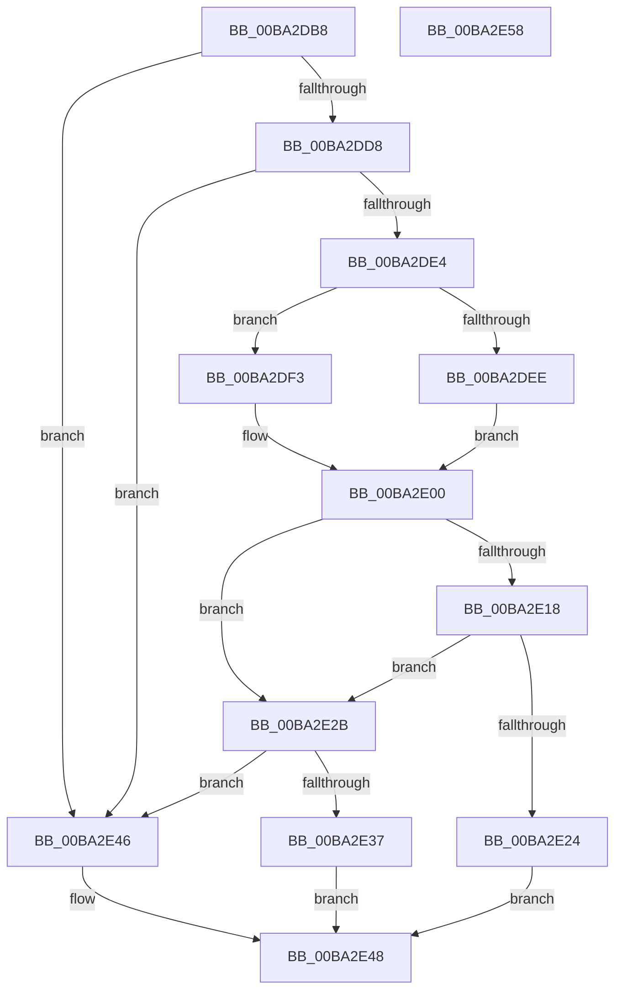

# VfMajorAdvanceIrpStatus

- RVA: `0x00BA2DB8`–`0x00BA2E59` (길이 `161` bytes)
- VA: `0x0000000140BA2DB8`
- 실행 섹션: `PAGEVRFY`
- PDB 이름 있음: `예`; PDB Function 태그: `아니요`
- unwind 정보 RVA: `0x00060BC4`
- 디코드: `47`개 명령, `161/161` bytes 표시
- 미해석 바이트: `0` (있으면 어셈블리에 `.byte`로 보존)

> 이 문서는 커널 이미지의 기계어와 PDB 기호를 분석해 생성했습니다. 4번과 5번은 함수 원형과 자료형을 바이너리 사용 방식에서 추정한 C 해석이며 원본 소스 복구 결과는 아닙니다.

## 1. Dependencies

- 직접 호출 지점: **2**; 고유 호출 대상: **1**
- 직접 호출자로 확인된 함수: **1**
- RIP 상대 이미지 참조: **4**

### Outgoing calls
- `0x00BA2E1B` → [guard_dispatch_icall](../../text/6B/guard_dispatch_icall_function_006BAAD0.md) (function, `0x006BAAD0`)
- `0x00BA2E3F` → [guard_dispatch_icall](../../text/6B/guard_dispatch_icall_function_006BAAD0.md) (function, `0x006BAAD0`)

### Direct callers
- [sub_00BBBE00](../BB/Unknown_function_00BBBE00.md) at `0x00BBBF5F`

### Static image references
- `0x00BA2DC7` → RVA `0x00E0E944` (`.data`; read)
- `0x00BA2DD8` → RVA `0x00F04A20` (`.data`; read)
- `0x00BA2E08` → RVA `0x00FFFC38` (`PAGEVRFD`; read)
- `0x00BA2E2B` → RVA `0x010006B8` (`PAGEVRFD`; read)

## 2. Other-region calls and transfers

- 다른 실행 섹션으로 향하는 call: **2**
  - `0x00BA2E1B` → [guard_dispatch_icall](../../text/6B/guard_dispatch_icall_function_006BAAD0.md) (`PAGEVRFY` → `.text`)
  - `0x00BA2E3F` → [guard_dispatch_icall](../../text/6B/guard_dispatch_icall_function_006BAAD0.md) (`PAGEVRFY` → `.text`)
- 별도 외부 분기/꼬리 이동을 확인하지 못했습니다.

## 3. Assembly (complete function range)

```asm
00BA2DB8  48 89 5C 24 08                  mov qword ptr [rsp + 8], rbx
00BA2DBD  48 89 74 24 10                  mov qword ptr [rsp + 0x10], rsi
00BA2DC2  57                              push rdi
00BA2DC3  48 83 EC 20                     sub rsp, 0x20
00BA2DC7  83 3D 76 BB 26 00 02            cmp dword ptr [rip + 0x26bb76], 2
00BA2DCE  49 8B F8                        mov rdi, r8
00BA2DD1  8B F2                           mov esi, edx
00BA2DD3  48 8B D9                        mov rbx, rcx
00BA2DD6  7E 6E                           jle 0x140ba2e46
00BA2DD8  F7 05 3E 1C 36 00 00 10 00 00   test dword ptr [rip + 0x361c3e], 0x1000
00BA2DE2  74 62                           je 0x140ba2e46
00BA2DE4  44 0F B6 09                     movzx r9d, byte ptr [rcx]
00BA2DE8  41 80 F9 1B                     cmp r9b, 0x1b
00BA2DEC  77 05                           ja 0x140ba2df3
00BA2DEE  41 8B C1                        mov eax, r9d
00BA2DF1  EB 0D                           jmp 0x140ba2e00
00BA2DF3  33 C0                           xor eax, eax
00BA2DF5  41 80 F9 FF                     cmp r9b, 0xff
00BA2DF9  0F 95 C0                        setne al
00BA2DFC  48 83 C0 1C                     add rax, 0x1c
00BA2E00  48 8D 04 40                     lea rax, [rax + rax*2]
00BA2E04  48 C1 E0 05                     shl rax, 5
00BA2E08  48 8D 0D 29 CE 45 00            lea rcx, [rip + 0x45ce29]
00BA2E0F  48 8B 04 08                     mov rax, qword ptr [rax + rcx]
00BA2E13  48 85 C0                        test rax, rax
00BA2E16  74 13                           je 0x140ba2e2b
00BA2E18  48 8B CB                        mov rcx, rbx
00BA2E1B  E8 B0 7C B1 FF                  call 0x1406baad0
00BA2E20  85 C0                           test eax, eax
00BA2E22  74 07                           je 0x140ba2e2b
00BA2E24  B8 01 00 00 00                  mov eax, 1
00BA2E29  EB 1D                           jmp 0x140ba2e48
00BA2E2B  48 8B 05 86 D8 45 00            mov rax, qword ptr [rip + 0x45d886]
00BA2E32  48 85 C0                        test rax, rax
00BA2E35  74 0F                           je 0x140ba2e46
00BA2E37  4C 8B C7                        mov r8, rdi
00BA2E3A  8B D6                           mov edx, esi
00BA2E3C  48 8B CB                        mov rcx, rbx
00BA2E3F  E8 8C 7C B1 FF                  call 0x1406baad0
00BA2E44  EB 02                           jmp 0x140ba2e48
00BA2E46  33 C0                           xor eax, eax
00BA2E48  48 8B 5C 24 30                  mov rbx, qword ptr [rsp + 0x30]
00BA2E4D  48 8B 74 24 38                  mov rsi, qword ptr [rsp + 0x38]
00BA2E52  48 83 C4 20                     add rsp, 0x20
00BA2E56  5F                              pop rdi
00BA2E57  C3                              ret
00BA2E58  CC                              int3
```

## 4. C-style interpretation (structured pseudocode)

```c
__int64 __fastcall VfMajorAdvanceIrpStatus(__int64 a1, int a2, __int64 a3)
{
    __int64 result;
    __int64 v_rsp;
    unsigned __int64 v_stack_p10;
    unsigned __int64 v_stack_p8;

    v_stack_p8 = v_rbx;
    v_stack_p10 = v_rsi;
    v_rsp = (v_rsp) - (32);
    if ((*(unsigned int *)(v_rip + 2538358)) <= 2) goto loc_00BA2E46;
    if (((*(unsigned int *)(v_rip + 3546174)) & (0x1000ULL)) == 0) goto loc_00BA2E46;
    if (((unsigned __int8)(*(unsigned __int8 *)(a1))) > 27) goto loc_00BA2DF3;
    goto loc_00BA2E00;
loc_00BA2DF3:
    result = 0;
    result = (((unsigned __int8)(*(unsigned __int8 *)(a1))) != 255) ? 1 : 0;
    result = (result) + (28);
loc_00BA2E00:
    result = (result + result * 2) << (5);
    if (*(unsigned __int64 *)(result + v_rip + 4574761 * 1) == 0) goto loc_00BA2E2B;
    result = guard_dispatch_icall(a1, a2, a3, *(unsigned __int8 *)(a1));
    if ((unsigned int)(result) == 0) goto loc_00BA2E2B;
    goto loc_00BA2E48;
loc_00BA2E2B:
    if (*(unsigned __int64 *)(v_rip + 4577414) == 0) goto loc_00BA2E46;
    result = guard_dispatch_icall(a1, (unsigned int)((unsigned int)((unsigned int)(a2))), a3, *(unsigned __int8 *)(a1));
    goto loc_00BA2E48;
loc_00BA2E46:
    result = 0;
loc_00BA2E48:
    v_rsp = (v_rsp) + (32);
    return result;
}
```

## 5. (Beta) C Style

```c
int64_t VfMajorAdvanceIrpStatus(void *Arg1, int32_t Arg2, int64_t Arg3)
{
    uint8_t *arg1 = (uint8_t *)Arg1;

    int64_t result;
    int64_t local_rsp;
    uint64_t v_stack_p10;
    uint64_t v_stack_p8;

    v_stack_p8 = local_rbx;
    v_stack_p10 = local_rsi;
    local_rsp = (local_rsp) - (32);
    if ((*(uint32_t *)(v_rip + 0x26BB76)) <= 2) goto loc_00BA2E46;
    if (((*(uint32_t *)(v_rip + 0x361C3E)) & (0x1000ULL)) == 0) goto loc_00BA2E46;
    if (((uint8_t)(*(uint8_t *)(arg1))) > 27) goto loc_00BA2DF3;
    goto loc_00BA2E00;
loc_00BA2DF3:
    result = 0;
    result = (((uint8_t)(*(uint8_t *)(arg1))) != 255) ? 1 : 0;
    result = (result) + (28);
loc_00BA2E00:
    result = (result + result * 2) << (5);
    if (*(uint64_t *)(result + v_rip + 0x45CE29 * 1) == 0) goto loc_00BA2E2B;
    result = guard_dispatch_icall(Arg1, Arg2, Arg3, *(uint8_t *)(arg1));
    if ((uint32_t)(result) == 0) goto loc_00BA2E2B;
    goto loc_00BA2E48;
loc_00BA2E2B:
    if (*(uint64_t *)(v_rip + 0x45D886) == 0) goto loc_00BA2E46;
    result = guard_dispatch_icall(Arg1, (uint32_t)((uint32_t)((uint32_t)(Arg2))), Arg3, *(uint8_t *)(arg1));
    goto loc_00BA2E48;
loc_00BA2E46:
    result = 0;
loc_00BA2E48:
    local_rsp = (local_rsp) + (32);
    return result;
}
```

### 관측된 메모리 오프셋

구조체 형식이 확인되지 않은 접근은 인자 기준의 오프셋으로만 기록했습니다.

| 기준 인자 | 오프셋 표현 | 폭 (bit) | 접근 |
|---|---:|---:|---|
| `Arg1` | `+ 0x0` | `8` | `R` |

## 6. Execution-region graph

[열기: 2D/3D 그래프와 함수 탐색 컨트롤 패널](../../../control-panel.html?section=pagevrfy&rva=0x00BA2DB8&view=graph)

- 2D 그래프는 위에서 아래로 흐르고, 3D 그래프는 빈 공간을 드래그해 회전합니다. Shift+드래그는 이동, 휠은 확대·축소, 함수 노드 선택은 대상 보고서 이동입니다.

### Static fallback


