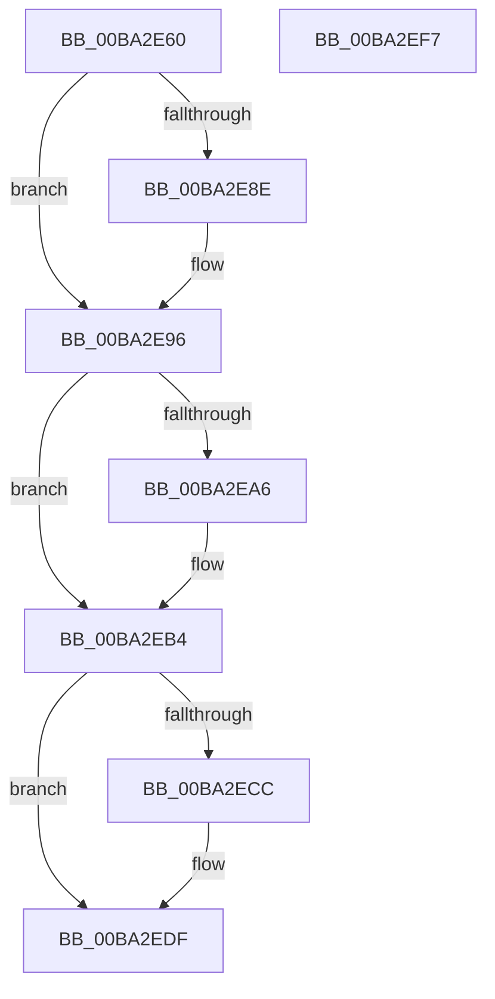

# VfMajorBuildIrpLogEntry

- RVA: `0x00BA2E60`–`0x00BA2EF8` (길이 `152` bytes)
- VA: `0x0000000140BA2E60`
- 실행 섹션: `PAGEVRFY`
- PDB 이름 있음: `예`; PDB Function 태그: `아니요`
- unwind 정보 RVA: `0x00066400`
- 디코드: `43`개 명령, `152/152` bytes 표시
- 미해석 바이트: `0` (있으면 어셈블리에 `.byte`로 보존)

> 이 문서는 커널 이미지의 기계어와 PDB 기호를 분석해 생성했습니다. 4번과 5번은 함수 원형과 자료형을 바이너리 사용 방식에서 추정한 C 해석이며 원본 소스 복구 결과는 아닙니다.

## 1. Dependencies

- 직접 호출 지점: **2**; 고유 호출 대상: **1**
- 직접 호출자로 확인된 함수: **1**
- RIP 상대 이미지 참조: **2**

### Outgoing calls
- `0x00BA2E8E` → [guard_dispatch_icall](../../text/6B/guard_dispatch_icall_function_006BAAD0.md) (function, `0x006BAAD0`)
- `0x00BA2ED7` → [guard_dispatch_icall](../../text/6B/guard_dispatch_icall_function_006BAAD0.md) (function, `0x006BAAD0`)

### Direct callers
- [VfIrpLogRecordEvent](VfIrpLogRecordEvent_function_00BAB674.md) at `0x00BAB7E9`

### Static image references
- `0x00BA2E74` → RVA `0x010006E8` (`PAGEVRFD`; read)
- `0x00BA2EBC` → RVA `0x00FFFC68` (`PAGEVRFD`; read)

## 2. Other-region calls and transfers

- 다른 실행 섹션으로 향하는 call: **2**
  - `0x00BA2E8E` → [guard_dispatch_icall](../../text/6B/guard_dispatch_icall_function_006BAAD0.md) (`PAGEVRFY` → `.text`)
  - `0x00BA2ED7` → [guard_dispatch_icall](../../text/6B/guard_dispatch_icall_function_006BAAD0.md) (`PAGEVRFY` → `.text`)
- 별도 외부 분기/꼬리 이동을 확인하지 못했습니다.

## 3. Assembly (complete function range)

```asm
00BA2E60  48 89 5C 24 08                  mov qword ptr [rsp + 8], rbx
00BA2E65  48 89 6C 24 10                  mov qword ptr [rsp + 0x10], rbp
00BA2E6A  48 89 74 24 18                  mov qword ptr [rsp + 0x18], rsi
00BA2E6F  57                              push rdi
00BA2E70  48 83 EC 30                     sub rsp, 0x30
00BA2E74  48 8B 05 6D D8 45 00            mov rax, qword ptr [rip + 0x45d86d]
00BA2E7B  45 33 D2                        xor r10d, r10d
00BA2E7E  49 8B F9                        mov rdi, r9
00BA2E81  49 8B F0                        mov rsi, r8
00BA2E84  8B EA                           mov ebp, edx
00BA2E86  48 8B D9                        mov rbx, rcx
00BA2E89  48 85 C0                        test rax, rax
00BA2E8C  74 08                           je 0x140ba2e96
00BA2E8E  E8 3D 7C B1 FF                  call 0x1406baad0
00BA2E93  44 8B D0                        mov r10d, eax
00BA2E96  48 8B 8B B8 00 00 00            mov rcx, qword ptr [rbx + 0xb8]
00BA2E9D  0F B6 51 B8                     movzx edx, byte ptr [rcx - 0x48]
00BA2EA1  83 FA 1B                        cmp edx, 0x1b
00BA2EA4  76 0E                           jbe 0x140ba2eb4
00BA2EA6  33 C0                           xor eax, eax
00BA2EA8  81 FA FF 00 00 00               cmp edx, 0xff
00BA2EAE  0F 95 C0                        setne al
00BA2EB1  8D 50 1C                        lea edx, [rax + 0x1c]
00BA2EB4  48 8D 0C 52                     lea rcx, [rdx + rdx*2]
00BA2EB8  48 C1 E1 05                     shl rcx, 5
00BA2EBC  48 8D 05 A5 CD 45 00            lea rax, [rip + 0x45cda5]
00BA2EC3  48 8B 04 01                     mov rax, qword ptr [rcx + rax]
00BA2EC7  48 85 C0                        test rax, rax
00BA2ECA  74 13                           je 0x140ba2edf
00BA2ECC  4C 8B CF                        mov r9, rdi
00BA2ECF  4C 8B C6                        mov r8, rsi
00BA2ED2  8B D5                           mov edx, ebp
00BA2ED4  48 8B CB                        mov rcx, rbx
00BA2ED7  E8 F4 7B B1 FF                  call 0x1406baad0
00BA2EDC  44 8B D0                        mov r10d, eax
00BA2EDF  48 8B 5C 24 40                  mov rbx, qword ptr [rsp + 0x40]
00BA2EE4  41 8B C2                        mov eax, r10d
00BA2EE7  48 8B 6C 24 48                  mov rbp, qword ptr [rsp + 0x48]
00BA2EEC  48 8B 74 24 50                  mov rsi, qword ptr [rsp + 0x50]
00BA2EF1  48 83 C4 30                     add rsp, 0x30
00BA2EF5  5F                              pop rdi
00BA2EF6  C3                              ret
00BA2EF7  CC                              int3
```

## 4. C-style interpretation (structured pseudocode)

```c
__int64 __fastcall VfMajorBuildIrpLogEntry(__int64 a1, int a2, __int64 a3, __int64 a4)
{
    __int64 result;
    __int64 v_r10;
    __int64 v_rsp;
    unsigned __int64 v_stack_p10;
    unsigned __int64 v_stack_p18;
    unsigned __int64 v_stack_p8;

    v_stack_p8 = v_rbx;
    v_stack_p10 = v_rbp;
    v_stack_p18 = v_rsi;
    v_rsp = (v_rsp) - (48);
    v_r10 = 0;
    result = *(unsigned __int64 *)(v_rip + 4577389);
    if (*(unsigned __int64 *)(v_rip + 4577389) != 0) {
        result = guard_dispatch_icall(a1, a2, a3, a4);
        v_r10 = (unsigned int)(result);
    }
    if (((unsigned int)(*(unsigned __int8 *)(*(unsigned __int64 *)(a1 + 184) - 72))) >= = 27) {
        result = 0;
        result = (((unsigned int)(*(unsigned __int8 *)(*(unsigned __int64 *)(a1 + 184) - 72))) != 255) ? 1 : 0;
        a2 = result + 28;
    }
    a1 = (a2 + a2 * 2) << (5);
    result = *(unsigned __int64 *)(a1 + v_rip + 4574629 * 1);
    if (*(unsigned __int64 *)(a1 + v_rip + 4574629 * 1) != 0) {
        a4 = a4;
        a3 = a3;
        a2 = (unsigned int)((unsigned int)(a2));
        a1 = a1;
        result = guard_dispatch_icall(a1, a2, a3, a4);
        v_r10 = (unsigned int)(result);
    }
    v_rsp = (v_rsp) + (48);
    return (unsigned int)((unsigned int)(v_r10));
}
```

## 5. (Beta) C Style

```c
int64_t VfMajorBuildIrpLogEntry(void *Arg1, int32_t Arg2, int64_t Arg3, int64_t Arg4)
{
    uint8_t *arg1 = (uint8_t *)Arg1;

    int64_t result;
    int64_t local_r10;
    int64_t local_rsp;
    uint64_t v_stack_p10;
    uint64_t v_stack_p18;
    uint64_t v_stack_p8;

    v_stack_p8 = local_rbx;
    v_stack_p10 = local_rbp;
    v_stack_p18 = local_rsi;
    local_rsp = (local_rsp) - (48);
    local_r10 = 0;
    result = *(uint64_t *)(v_rip + 0x45D86D);
    if (*(uint64_t *)(v_rip + 0x45D86D) != 0) {
        result = guard_dispatch_icall(Arg1, Arg2, Arg3, Arg4);
        local_r10 = (uint32_t)(result);
    }
    if (((uint32_t)(*(uint8_t *)(*(uint64_t *)(arg1 + 0xB8) - 0x48))) >= = 27) {
        result = 0;
        result = (((uint32_t)(*(uint8_t *)(*(uint64_t *)(arg1 + 0xB8) - 0x48))) != 255) ? 1 : 0;
        Arg2 = result + 28;
    }
    Arg1 = (Arg2 + Arg2 * 2) << (5);
    result = *(uint64_t *)(arg1 + v_rip + 0x45CDA5 * 1);
    if (*(uint64_t *)(arg1 + v_rip + 0x45CDA5 * 1) != 0) {
        Arg4 = Arg4;
        Arg3 = Arg3;
        Arg2 = (uint32_t)((uint32_t)(Arg2));
        Arg1 = Arg1;
        result = guard_dispatch_icall(Arg1, Arg2, Arg3, Arg4);
        local_r10 = (uint32_t)(result);
    }
    local_rsp = (local_rsp) + (48);
    return (uint32_t)((uint32_t)(local_r10));
}
```

### 관측된 메모리 오프셋

구조체 형식이 확인되지 않은 접근은 인자 기준의 오프셋으로만 기록했습니다.

| 기준 인자 | 오프셋 표현 | 폭 (bit) | 접근 |
|---|---:|---:|---|
| `Arg1` | `+ 0xB8` | `64` | `R` |

## 6. Execution-region graph

[열기: 2D/3D 그래프와 함수 탐색 컨트롤 패널](../../../control-panel.html?section=pagevrfy&rva=0x00BA2E60&view=graph)

- 2D 그래프는 위에서 아래로 흐르고, 3D 그래프는 빈 공간을 드래그해 회전합니다. Shift+드래그는 이동, 휠은 확대·축소, 함수 노드 선택은 대상 보고서 이동입니다.

### Static fallback


