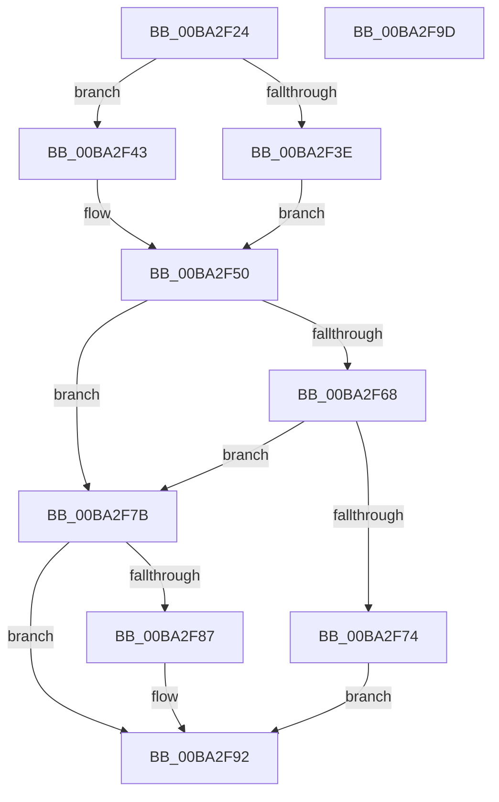

# VfMajorIsNewRequest

- RVA: `0x00BA2F24`–`0x00BA2F9E` (길이 `122` bytes)
- VA: `0x0000000140BA2F24`
- 실행 섹션: `PAGEVRFY`
- PDB 이름 있음: `예`; PDB Function 태그: `아니요`
- unwind 정보 RVA: `0x0005CAAC`
- 디코드: `37`개 명령, `122/122` bytes 표시
- 미해석 바이트: `0` (있으면 어셈블리에 `.byte`로 보존)

> 이 문서는 커널 이미지의 기계어와 PDB 기호를 분석해 생성했습니다. 4번과 5번은 함수 원형과 자료형을 바이너리 사용 방식에서 추정한 C 해석이며 원본 소스 복구 결과는 아닙니다.

## 1. Dependencies

- 직접 호출 지점: **2**; 고유 호출 대상: **1**
- 직접 호출자로 확인된 함수: **2**
- RIP 상대 이미지 참조: **2**

### Outgoing calls
- `0x00BA2F6B` → [guard_dispatch_icall](../../text/6B/guard_dispatch_icall_function_006BAAD0.md) (function, `0x006BAAD0`)
- `0x00BA2F8D` → [guard_dispatch_icall](../../text/6B/guard_dispatch_icall_function_006BAAD0.md) (function, `0x006BAAD0`)

### Direct callers
- [ViGenericVerifyIrpStackDownward](../B9/ViGenericVerifyIrpStackDownward_function_00B93F90.md) at `0x00B9400B`
- [IovpCallDriver1](../B9/IovpCallDriver1_function_00B9CCA4.md) at `0x00B9CF1E`

### Static image references
- `0x00BA2F58` → RVA `0x00FFFC48` (`PAGEVRFD`; read)
- `0x00BA2F7B` → RVA `0x010006C8` (`PAGEVRFD`; read)

## 2. Other-region calls and transfers

- 다른 실행 섹션으로 향하는 call: **2**
  - `0x00BA2F6B` → [guard_dispatch_icall](../../text/6B/guard_dispatch_icall_function_006BAAD0.md) (`PAGEVRFY` → `.text`)
  - `0x00BA2F8D` → [guard_dispatch_icall](../../text/6B/guard_dispatch_icall_function_006BAAD0.md) (`PAGEVRFY` → `.text`)
- 별도 외부 분기/꼬리 이동을 확인하지 못했습니다.

## 3. Assembly (complete function range)

```asm
00BA2F24  48 89 5C 24 08                  mov qword ptr [rsp + 8], rbx
00BA2F29  57                              push rdi
00BA2F2A  48 83 EC 20                     sub rsp, 0x20
00BA2F2E  44 0F B6 02                     movzx r8d, byte ptr [rdx]
00BA2F32  48 8B DA                        mov rbx, rdx
00BA2F35  48 8B F9                        mov rdi, rcx
00BA2F38  41 80 F8 1B                     cmp r8b, 0x1b
00BA2F3C  77 05                           ja 0x140ba2f43
00BA2F3E  41 8B C0                        mov eax, r8d
00BA2F41  EB 0D                           jmp 0x140ba2f50
00BA2F43  33 C0                           xor eax, eax
00BA2F45  41 80 F8 FF                     cmp r8b, 0xff
00BA2F49  0F 95 C0                        setne al
00BA2F4C  48 83 C0 1C                     add rax, 0x1c
00BA2F50  48 8D 04 40                     lea rax, [rax + rax*2]
00BA2F54  48 C1 E0 05                     shl rax, 5
00BA2F58  48 8D 0D E9 CC 45 00            lea rcx, [rip + 0x45cce9]
00BA2F5F  48 8B 04 08                     mov rax, qword ptr [rax + rcx]
00BA2F63  48 85 C0                        test rax, rax
00BA2F66  74 13                           je 0x140ba2f7b
00BA2F68  48 8B CF                        mov rcx, rdi
00BA2F6B  E8 60 7B B1 FF                  call 0x1406baad0
00BA2F70  85 C0                           test eax, eax
00BA2F72  74 07                           je 0x140ba2f7b
00BA2F74  B8 01 00 00 00                  mov eax, 1
00BA2F79  EB 17                           jmp 0x140ba2f92
00BA2F7B  48 8B 05 46 D7 45 00            mov rax, qword ptr [rip + 0x45d746]
00BA2F82  48 85 C0                        test rax, rax
00BA2F85  74 0B                           je 0x140ba2f92
00BA2F87  48 8B D3                        mov rdx, rbx
00BA2F8A  48 8B CF                        mov rcx, rdi
00BA2F8D  E8 3E 7B B1 FF                  call 0x1406baad0
00BA2F92  48 8B 5C 24 30                  mov rbx, qword ptr [rsp + 0x30]
00BA2F97  48 83 C4 20                     add rsp, 0x20
00BA2F9B  5F                              pop rdi
00BA2F9C  C3                              ret
00BA2F9D  CC                              int3
```

## 4. C-style interpretation (structured pseudocode)

```c
__int64 __fastcall VfMajorIsNewRequest(__int64 a1, __int64 a2)
{
    __int64 result;
    __int64 v_rsp;
    unsigned __int64 v_stack_p8;

    v_stack_p8 = v_rbx;
    v_rsp = (v_rsp) - (32);
    if (((unsigned __int8)(*(unsigned __int8 *)(a2))) > 27) goto loc_00BA2F43;
    goto loc_00BA2F50;
loc_00BA2F43:
    result = 0;
    result = (((unsigned __int8)(*(unsigned __int8 *)(a2))) != 255) ? 1 : 0;
    result = (result) + (28);
loc_00BA2F50:
    result = (result + result * 2) << (5);
    if (*(unsigned __int64 *)(result + v_rip + 4574441 * 1) == 0) goto loc_00BA2F7B;
    result = guard_dispatch_icall(a1, a2, *(unsigned __int8 *)(a2), a4);
    if ((unsigned int)(result) == 0) goto loc_00BA2F7B;
    goto loc_00BA2F92;
loc_00BA2F7B:
    result = *(unsigned __int64 *)(v_rip + 4577094);
    if (*(unsigned __int64 *)(v_rip + 4577094) != 0) {
        a2 = a2;
        a1 = a1;
        result = guard_dispatch_icall(a1, a2, *(unsigned __int8 *)(a2), a4);
    }
    v_rsp = (v_rsp) + (32);
    return result;
}
```

## 5. (Beta) C Style

```c
int64_t VfMajorIsNewRequest(int64_t Arg1, void *Arg2)
{
    uint8_t *arg2 = (uint8_t *)Arg2;

    int64_t result;
    int64_t local_rsp;
    uint64_t v_stack_p8;

    v_stack_p8 = local_rbx;
    local_rsp = (local_rsp) - (32);
    if (((uint8_t)(*(uint8_t *)(arg2))) > 27) goto loc_00BA2F43;
    goto loc_00BA2F50;
loc_00BA2F43:
    result = 0;
    result = (((uint8_t)(*(uint8_t *)(arg2))) != 255) ? 1 : 0;
    result = (result) + (28);
loc_00BA2F50:
    result = (result + result * 2) << (5);
    if (*(uint64_t *)(result + v_rip + 0x45CCE9 * 1) == 0) goto loc_00BA2F7B;
    result = guard_dispatch_icall(Arg1, Arg2, *(uint8_t *)(arg2), a4);
    if ((uint32_t)(result) == 0) goto loc_00BA2F7B;
    goto loc_00BA2F92;
loc_00BA2F7B:
    result = *(uint64_t *)(v_rip + 0x45D746);
    if (*(uint64_t *)(v_rip + 0x45D746) != 0) {
        Arg2 = Arg2;
        Arg1 = Arg1;
        result = guard_dispatch_icall(Arg1, Arg2, *(uint8_t *)(arg2), a4);
    }
    local_rsp = (local_rsp) + (32);
    return result;
}
```

### 관측된 메모리 오프셋

구조체 형식이 확인되지 않은 접근은 인자 기준의 오프셋으로만 기록했습니다.

| 기준 인자 | 오프셋 표현 | 폭 (bit) | 접근 |
|---|---:|---:|---|
| `Arg2` | `+ 0x0` | `8` | `R` |

## 6. Execution-region graph

[열기: 2D/3D 그래프와 함수 탐색 컨트롤 패널](../../../control-panel.html?section=pagevrfy&rva=0x00BA2F24&view=graph)

- 2D 그래프는 위에서 아래로 흐르고, 3D 그래프는 빈 공간을 드래그해 회전합니다. Shift+드래그는 이동, 휠은 확대·축소, 함수 노드 선택은 대상 보고서 이동입니다.

### Static fallback


