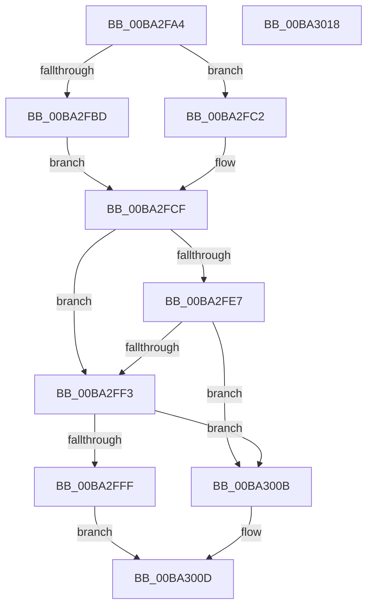

# VfMajorIsValidIrpStatus

- RVA: `0x00BA2FA4`–`0x00BA3019` (길이 `117` bytes)
- VA: `0x0000000140BA2FA4`
- 실행 섹션: `PAGEVRFY`
- PDB 이름 있음: `예`; PDB Function 태그: `아니요`
- unwind 정보 RVA: `0x0005CAAC`
- 디코드: `37`개 명령, `117/117` bytes 표시
- 미해석 바이트: `0` (있으면 어셈블리에 `.byte`로 보존)

> 이 문서는 커널 이미지의 기계어와 PDB 기호를 분석해 생성했습니다. 4번과 5번은 함수 원형과 자료형을 바이너리 사용 방식에서 추정한 C 해석이며 원본 소스 복구 결과는 아닙니다.

## 1. Dependencies

- 직접 호출 지점: **2**; 고유 호출 대상: **1**
- 직접 호출자로 확인된 함수: **2**
- RIP 상대 이미지 참조: **2**

### Outgoing calls
- `0x00BA2FEA` → [guard_dispatch_icall](../../text/6B/guard_dispatch_icall_function_006BAAD0.md) (function, `0x006BAAD0`)
- `0x00BA3004` → [guard_dispatch_icall](../../text/6B/guard_dispatch_icall_function_006BAAD0.md) (function, `0x006BAAD0`)

### Direct callers
- [ViGenericVerifyIrpStackDownward](../B9/ViGenericVerifyIrpStackDownward_function_00B93F90.md) at `0x00B94141`
- [ViGenericVerifyIrpStackUpward](../B9/ViGenericVerifyIrpStackUpward_function_00B94190.md) at `0x00B94217`

### Static image references
- `0x00BA2FD7` → RVA `0x00FFFC40` (`PAGEVRFD`; read)
- `0x00BA2FF3` → RVA `0x010006C0` (`PAGEVRFD`; read)

## 2. Other-region calls and transfers

- 다른 실행 섹션으로 향하는 call: **2**
  - `0x00BA2FEA` → [guard_dispatch_icall](../../text/6B/guard_dispatch_icall_function_006BAAD0.md) (`PAGEVRFY` → `.text`)
  - `0x00BA3004` → [guard_dispatch_icall](../../text/6B/guard_dispatch_icall_function_006BAAD0.md) (`PAGEVRFY` → `.text`)
- 별도 외부 분기/꼬리 이동을 확인하지 못했습니다.

## 3. Assembly (complete function range)

```asm
00BA2FA4  48 89 5C 24 08                  mov qword ptr [rsp + 8], rbx
00BA2FA9  57                              push rdi
00BA2FAA  48 83 EC 20                     sub rsp, 0x20
00BA2FAE  44 0F B6 01                     movzx r8d, byte ptr [rcx]
00BA2FB2  8B FA                           mov edi, edx
00BA2FB4  48 8B D9                        mov rbx, rcx
00BA2FB7  41 80 F8 1B                     cmp r8b, 0x1b
00BA2FBB  77 05                           ja 0x140ba2fc2
00BA2FBD  41 8B C0                        mov eax, r8d
00BA2FC0  EB 0D                           jmp 0x140ba2fcf
00BA2FC2  33 C0                           xor eax, eax
00BA2FC4  41 80 F8 FF                     cmp r8b, 0xff
00BA2FC8  0F 95 C0                        setne al
00BA2FCB  48 83 C0 1C                     add rax, 0x1c
00BA2FCF  48 8D 04 40                     lea rax, [rax + rax*2]
00BA2FD3  48 C1 E0 05                     shl rax, 5
00BA2FD7  48 8D 0D 62 CC 45 00            lea rcx, [rip + 0x45cc62]
00BA2FDE  48 8B 04 08                     mov rax, qword ptr [rax + rcx]
00BA2FE2  48 85 C0                        test rax, rax
00BA2FE5  74 0C                           je 0x140ba2ff3
00BA2FE7  48 8B CB                        mov rcx, rbx
00BA2FEA  E8 E1 7A B1 FF                  call 0x1406baad0
00BA2FEF  85 C0                           test eax, eax
00BA2FF1  74 18                           je 0x140ba300b
00BA2FF3  48 8B 05 C6 D6 45 00            mov rax, qword ptr [rip + 0x45d6c6]
00BA2FFA  48 85 C0                        test rax, rax
00BA2FFD  74 0C                           je 0x140ba300b
00BA2FFF  8B D7                           mov edx, edi
00BA3001  48 8B CB                        mov rcx, rbx
00BA3004  E8 C7 7A B1 FF                  call 0x1406baad0
00BA3009  EB 02                           jmp 0x140ba300d
00BA300B  33 C0                           xor eax, eax
00BA300D  48 8B 5C 24 30                  mov rbx, qword ptr [rsp + 0x30]
00BA3012  48 83 C4 20                     add rsp, 0x20
00BA3016  5F                              pop rdi
00BA3017  C3                              ret
00BA3018  CC                              int3
```

## 4. C-style interpretation (structured pseudocode)

```c
__int64 __fastcall VfMajorIsValidIrpStatus(__int64 a1, int a2)
{
    __int64 result;
    __int64 v_rsp;
    unsigned __int64 v_stack_p8;

    v_stack_p8 = v_rbx;
    v_rsp = (v_rsp) - (32);
    if (((unsigned __int8)(*(unsigned __int8 *)(a1))) > 27) goto loc_00BA2FC2;
    goto loc_00BA2FCF;
loc_00BA2FC2:
    result = 0;
    result = (((unsigned __int8)(*(unsigned __int8 *)(a1))) != 255) ? 1 : 0;
    result = (result) + (28);
loc_00BA2FCF:
    result = (result + result * 2) << (5);
    if (*(unsigned __int64 *)(result + v_rip + 4574306 * 1) == 0) goto loc_00BA2FF3;
    result = guard_dispatch_icall(a1, a2, *(unsigned __int8 *)(a1), a4);
    if ((unsigned int)(result) == 0) goto loc_00BA300B;
loc_00BA2FF3:
    if (*(unsigned __int64 *)(v_rip + 4576966) == 0) goto loc_00BA300B;
    result = guard_dispatch_icall(a1, (unsigned int)((unsigned int)((unsigned int)(a2))), *(unsigned __int8 *)(a1), a4);
    goto loc_00BA300D;
loc_00BA300B:
    result = 0;
loc_00BA300D:
    v_rsp = (v_rsp) + (32);
    return result;
}
```

## 5. (Beta) C Style

```c
int64_t VfMajorIsValidIrpStatus(void *Arg1, int32_t Arg2)
{
    uint8_t *arg1 = (uint8_t *)Arg1;

    int64_t result;
    int64_t local_rsp;
    uint64_t v_stack_p8;

    v_stack_p8 = local_rbx;
    local_rsp = (local_rsp) - (32);
    if (((uint8_t)(*(uint8_t *)(arg1))) > 27) goto loc_00BA2FC2;
    goto loc_00BA2FCF;
loc_00BA2FC2:
    result = 0;
    result = (((uint8_t)(*(uint8_t *)(arg1))) != 255) ? 1 : 0;
    result = (result) + (28);
loc_00BA2FCF:
    result = (result + result * 2) << (5);
    if (*(uint64_t *)(result + v_rip + 0x45CC62 * 1) == 0) goto loc_00BA2FF3;
    result = guard_dispatch_icall(Arg1, Arg2, *(uint8_t *)(arg1), a4);
    if ((uint32_t)(result) == 0) goto loc_00BA300B;
loc_00BA2FF3:
    if (*(uint64_t *)(v_rip + 0x45D6C6) == 0) goto loc_00BA300B;
    result = guard_dispatch_icall(Arg1, (uint32_t)((uint32_t)((uint32_t)(Arg2))), *(uint8_t *)(arg1), a4);
    goto loc_00BA300D;
loc_00BA300B:
    result = 0;
loc_00BA300D:
    local_rsp = (local_rsp) + (32);
    return result;
}
```

### 관측된 메모리 오프셋

구조체 형식이 확인되지 않은 접근은 인자 기준의 오프셋으로만 기록했습니다.

| 기준 인자 | 오프셋 표현 | 폭 (bit) | 접근 |
|---|---:|---:|---|
| `Arg1` | `+ 0x0` | `8` | `R` |

## 6. Execution-region graph

[열기: 2D/3D 그래프와 함수 탐색 컨트롤 패널](../../../control-panel.html?section=pagevrfy&rva=0x00BA2FA4&view=graph)

- 2D 그래프는 위에서 아래로 흐르고, 3D 그래프는 빈 공간을 드래그해 회전합니다. Shift+드래그는 이동, 휠은 확대·축소, 함수 노드 선택은 대상 보고서 이동입니다.

### Static fallback


