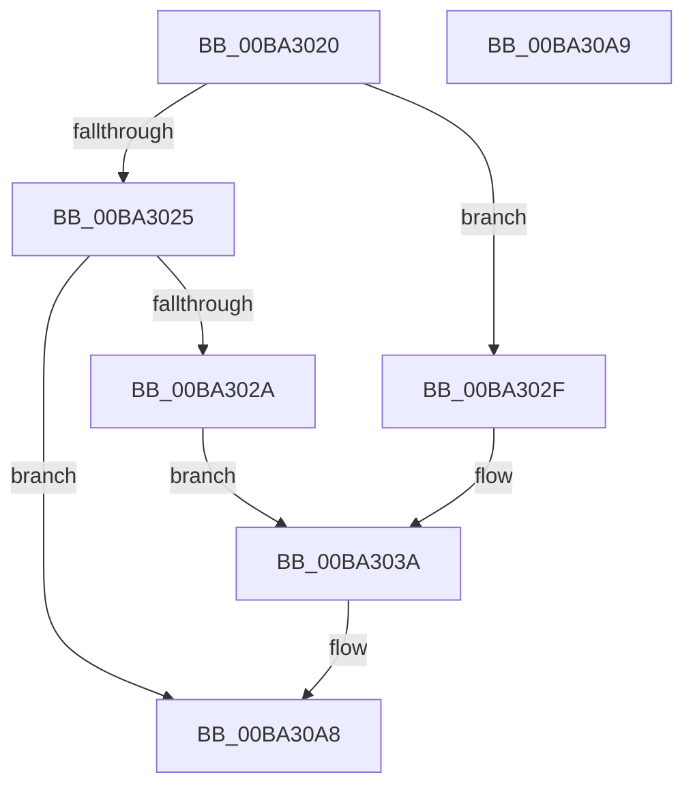

# VfMajorRegisterHandlers

- RVA: `0x00BA3020`–`0x00BA30AA` (길이 `138` bytes)
- VA: `0x0000000140BA3020`
- 실행 섹션: `PAGEVRFY`
- PDB 이름 있음: `예`; PDB Function 태그: `아니요`
- unwind 정보 RVA: `0x000DB714`
- 디코드: `37`개 명령, `138/138` bytes 표시
- 미해석 바이트: `0` (있으면 어셈블리에 `.byte`로 보존)

> 이 문서는 커널 이미지의 기계어와 PDB 기호를 분석해 생성했습니다. 4번과 5번은 함수 원형과 자료형을 바이너리 사용 방식에서 추정한 C 해석이며 원본 소스 복구 결과는 아닙니다.

## 1. Dependencies

- 직접 호출 지점: **0**; 고유 호출 대상: **0**
- 직접 호출자로 확인된 함수: **1**
- RIP 상대 이미지 참조: **1**

### Outgoing calls
- 직접 디코드된 call 명령이 없습니다.

### Direct callers
- [ViIovInitialization](../BB/ViIovInitialization_function_00BB4EC4.md) at `0x00BB5084`
- [ViIovInitialization](../BB/ViIovInitialization_function_00BB4EC4.md) at `0x00BB50E2`
- [ViIovInitialization](../BB/ViIovInitialization_function_00BB4EC4.md) at `0x00BB5139`

### Static image references
- `0x00BA303E` → RVA `0x00FFFC10` (`PAGEVRFD`; read)

## 2. Other-region calls and transfers

- 다른 실행 섹션으로 향하는 call: **0**
- 별도 외부 분기/꼬리 이동을 확인하지 못했습니다.

## 3. Assembly (complete function range)

```asm
00BA3020  80 F9 FF                        cmp cl, 0xff
00BA3023  74 0A                           je 0x140ba302f
00BA3025  80 F9 1B                        cmp cl, 0x1b
00BA3028  77 7E                           ja 0x140ba30a8
00BA302A  0F B6 C1                        movzx eax, cl
00BA302D  EB 0B                           jmp 0x140ba303a
00BA302F  33 C0                           xor eax, eax
00BA3031  80 F9 FF                        cmp cl, 0xff
00BA3034  0F 95 C0                        setne al
00BA3037  83 C0 1C                        add eax, 0x1c
00BA303A  48 8D 0C 40                     lea rcx, [rax + rax*2]
00BA303E  48 8D 05 CB CB 45 00            lea rax, [rip + 0x45cbcb]
00BA3045  48 C1 E1 05                     shl rcx, 5
00BA3049  48 03 C8                        add rcx, rax
00BA304C  48 8B 44 24 28                  mov rax, qword ptr [rsp + 0x28]
00BA3051  48 89 41 18                     mov qword ptr [rcx + 0x18], rax
00BA3055  48 8B 44 24 30                  mov rax, qword ptr [rsp + 0x30]
00BA305A  48 89 41 20                     mov qword ptr [rcx + 0x20], rax
00BA305E  48 8B 44 24 38                  mov rax, qword ptr [rsp + 0x38]
00BA3063  48 89 41 28                     mov qword ptr [rcx + 0x28], rax
00BA3067  48 8B 44 24 40                  mov rax, qword ptr [rsp + 0x40]
00BA306C  48 89 41 30                     mov qword ptr [rcx + 0x30], rax
00BA3070  48 8B 44 24 48                  mov rax, qword ptr [rsp + 0x48]
00BA3075  48 89 41 38                     mov qword ptr [rcx + 0x38], rax
00BA3079  48 8B 44 24 50                  mov rax, qword ptr [rsp + 0x50]
00BA307E  48 89 41 40                     mov qword ptr [rcx + 0x40], rax
00BA3082  48 8B 44 24 58                  mov rax, qword ptr [rsp + 0x58]
00BA3087  48 89 41 48                     mov qword ptr [rcx + 0x48], rax
00BA308B  48 8B 44 24 60                  mov rax, qword ptr [rsp + 0x60]
00BA3090  48 89 41 50                     mov qword ptr [rcx + 0x50], rax
00BA3094  48 8B 44 24 68                  mov rax, qword ptr [rsp + 0x68]
00BA3099  48 89 41 58                     mov qword ptr [rcx + 0x58], rax
00BA309D  4C 89 41 08                     mov qword ptr [rcx + 8], r8
00BA30A1  4C 89 49 10                     mov qword ptr [rcx + 0x10], r9
00BA30A5  48 89 11                        mov qword ptr [rcx], rdx
00BA30A8  C3                              ret
00BA30A9  CC                              int3
```

## 4. C-style interpretation (structured pseudocode)

```c
__int64 __fastcall VfMajorRegisterHandlers(unsigned __int8 a1, __int64 a2, __int64 a3, __int64 a4, __int64 a5, __int64 a6, __int64 a7, __int64 a8, __int64 a9, __int64 a10, __int64 a11, __int64 a12, __int64 a13)
{
    __int64 result;

    if (a1 == 255) goto loc_00BA302F;
    if (a1 > 27) goto loc_00BA30A8;
    goto loc_00BA303A;
loc_00BA302F:
    result = 0;
    result = (a1 != 255) ? 1 : 0;
    result = (unsigned int)((result) + (28));
loc_00BA303A:
    a1 = (result + result * 2) << (5);
    a1 = (a1) + (v_rip + 4574155);
    *(unsigned __int64 *)(a1 + 24) = a5;
    *(unsigned __int64 *)(a1 + 32) = a6;
    *(unsigned __int64 *)(a1 + 40) = a7;
    *(unsigned __int64 *)(a1 + 48) = a8;
    *(unsigned __int64 *)(a1 + 56) = a9;
    *(unsigned __int64 *)(a1 + 64) = a10;
    *(unsigned __int64 *)(a1 + 72) = a11;
    *(unsigned __int64 *)(a1 + 80) = a12;
    *(unsigned __int64 *)(a1 + 88) = a13;
    *(unsigned __int64 *)(a1 + 8) = a3;
    *(unsigned __int64 *)(a1 + 16) = a4;
    *(unsigned __int64 *)(a1) = a2;
loc_00BA30A8:
    return a13;
}
```

## 5. (Beta) C Style

```c
int64_t VfMajorRegisterHandlers(uint8_t Arg1, int64_t Arg2, int64_t Arg3, int64_t Arg4, int64_t Arg5, int64_t Arg6, int64_t Arg7, int64_t Arg8, int64_t Arg9, int64_t Arg10, int64_t Arg11, int64_t Arg12, int64_t Arg13)
{
    int64_t result;

    if (Arg1 == 255) goto loc_00BA302F;
    if (Arg1 > 27) goto loc_00BA30A8;
    goto loc_00BA303A;
loc_00BA302F:
    result = 0;
    result = (Arg1 != 255) ? 1 : 0;
    result = (uint32_t)((result) + (28));
loc_00BA303A:
    Arg1 = (result + result * 2) << (5);
    Arg1 = (Arg1) + (v_rip + 4574155);
    *(uint64_t *)(Arg1 + 0x18) = Arg5;
    *(uint64_t *)(Arg1 + 0x20) = Arg6;
    *(uint64_t *)(Arg1 + 0x28) = Arg7;
    *(uint64_t *)(Arg1 + 0x30) = Arg8;
    *(uint64_t *)(Arg1 + 0x38) = Arg9;
    *(uint64_t *)(Arg1 + 0x40) = Arg10;
    *(uint64_t *)(Arg1 + 0x48) = Arg11;
    *(uint64_t *)(Arg1 + 0x50) = Arg12;
    *(uint64_t *)(Arg1 + 0x58) = Arg13;
    *(uint64_t *)(Arg1 + 0x8) = Arg3;
    *(uint64_t *)(Arg1 + 0x10) = Arg4;
    *(uint64_t *)(Arg1) = Arg2;
loc_00BA30A8:
    return Arg13;
}
```

## 6. Execution-region graph

[열기: 2D/3D 그래프와 함수 탐색 컨트롤 패널](../../../control-panel.html?section=pagevrfy&rva=0x00BA3020&view=graph)

- 2D 그래프는 위에서 아래로 흐르고, 3D 그래프는 빈 공간을 드래그해 회전합니다. Shift+드래그는 이동, 휠은 확대·축소, 함수 노드 선택은 대상 보고서 이동입니다.

### Static fallback


