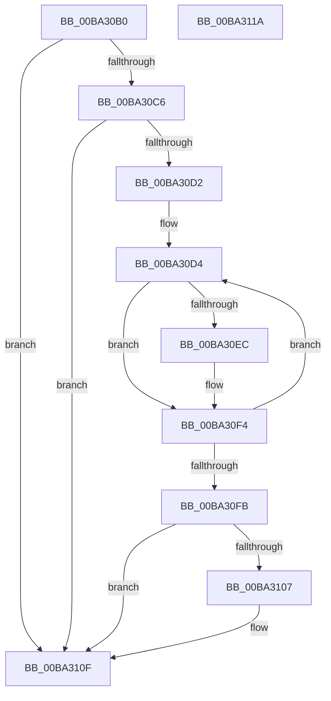

# VfMajorTestStartedPdoStack

- RVA: `0x00BA30B0`–`0x00BA311B` (길이 `107` bytes)
- VA: `0x0000000140BA30B0`
- 실행 섹션: `PAGEVRFY`
- PDB 이름 있음: `예`; PDB Function 태그: `아니요`
- unwind 정보 RVA: `0x0005CAAC`
- 디코드: `31`개 명령, `107/107` bytes 표시
- 미해석 바이트: `0` (있으면 어셈블리에 `.byte`로 보존)

> 이 문서는 커널 이미지의 기계어와 PDB 기호를 분석해 생성했습니다. 4번과 5번은 함수 원형과 자료형을 바이너리 사용 방식에서 추정한 C 해석이며 원본 소스 복구 결과는 아닙니다.

## 1. Dependencies

- 직접 호출 지점: **3**; 고유 호출 대상: **2**
- 직접 호출자로 확인된 함수: **1**
- RIP 상대 이미지 참조: **3**

### Outgoing calls
- `0x00BA30BD` → [IovUtilIsVerifiedDeviceStack](IovUtilIsVerifiedDeviceStack_function_00BA2B88.md) (function, `0x00BA2B88`)
- `0x00BA30EF` → [guard_dispatch_icall](../../text/6B/guard_dispatch_icall_function_006BAAD0.md) (function, `0x006BAAD0`)
- `0x00BA310A` → [guard_dispatch_icall](../../text/6B/guard_dispatch_icall_function_006BAAD0.md) (function, `0x006BAAD0`)

### Direct callers
- [PpvUtilTestStartedPdoStack](../../text/4B/PpvUtilTestStartedPdoStack_function_004BE4D8.md) at `0x004BE4EB`

### Static image references
- `0x00BA30C6` → RVA `0x00E681A0` (`.data`; read)
- `0x00BA30DC` → RVA `0x00FFFC60` (`PAGEVRFD`; read)
- `0x00BA30FB` → RVA `0x010006E0` (`PAGEVRFD`; read)

## 2. Other-region calls and transfers

- 다른 실행 섹션으로 향하는 call: **2**
  - `0x00BA30EF` → [guard_dispatch_icall](../../text/6B/guard_dispatch_icall_function_006BAAD0.md) (`PAGEVRFY` → `.text`)
  - `0x00BA310A` → [guard_dispatch_icall](../../text/6B/guard_dispatch_icall_function_006BAAD0.md) (`PAGEVRFY` → `.text`)
- 별도 외부 분기/꼬리 이동을 확인하지 못했습니다.

## 3. Assembly (complete function range)

```asm
00BA30B0  48 89 5C 24 08                  mov qword ptr [rsp + 8], rbx
00BA30B5  57                              push rdi
00BA30B6  48 83 EC 20                     sub rsp, 0x20
00BA30BA  48 8B F9                        mov rdi, rcx
00BA30BD  E8 C6 FA FF FF                  call 0x140ba2b88
00BA30C2  85 C0                           test eax, eax
00BA30C4  74 49                           je 0x140ba310f
00BA30C6  F7 05 D0 50 2C 00 00 00 40 00   test dword ptr [rip + 0x2c50d0], 0x400000
00BA30D0  75 3D                           jne 0x140ba310f
00BA30D2  33 DB                           xor ebx, ebx
00BA30D4  48 8D 0C 5B                     lea rcx, [rbx + rbx*2]
00BA30D8  48 C1 E1 05                     shl rcx, 5
00BA30DC  48 8D 05 7D CB 45 00            lea rax, [rip + 0x45cb7d]
00BA30E3  48 8B 04 01                     mov rax, qword ptr [rcx + rax]
00BA30E7  48 85 C0                        test rax, rax
00BA30EA  74 08                           je 0x140ba30f4
00BA30EC  48 8B CF                        mov rcx, rdi
00BA30EF  E8 DC 79 B1 FF                  call 0x1406baad0
00BA30F4  FF C3                           inc ebx
00BA30F6  83 FB 1B                        cmp ebx, 0x1b
00BA30F9  76 D9                           jbe 0x140ba30d4
00BA30FB  48 8B 05 DE D5 45 00            mov rax, qword ptr [rip + 0x45d5de]
00BA3102  48 85 C0                        test rax, rax
00BA3105  74 08                           je 0x140ba310f
00BA3107  48 8B CF                        mov rcx, rdi
00BA310A  E8 C1 79 B1 FF                  call 0x1406baad0
00BA310F  48 8B 5C 24 30                  mov rbx, qword ptr [rsp + 0x30]
00BA3114  48 83 C4 20                     add rsp, 0x20
00BA3118  5F                              pop rdi
00BA3119  C3                              ret
00BA311A  CC                              int3
```

## 4. C-style interpretation (structured pseudocode)

```c
__int64 __fastcall VfMajorTestStartedPdoStack(__int64 a1)
{
    __int64 result;
    __int64 v_rbx;
    __int64 v_rsp;
    unsigned __int64 v_stack_p8;

    v_stack_p8 = v_rbx;
    v_rsp = (v_rsp) - (32);
    result = IovUtilIsVerifiedDeviceStack(a1, a2, a3, a4);
    if ((unsigned int)(result) == 0) goto loc_00BA310F;
    if (((*(unsigned int *)(v_rip + 2904272)) & (0x400000ULL)) != 0) goto loc_00BA310F;
    v_rbx = 0;
loc_00BA30D4:
    a1 = (v_rbx + v_rbx * 2) << (5);
    result = *(unsigned __int64 *)(a1 + v_rip + 4574077 * 1);
    if (*(unsigned __int64 *)(a1 + v_rip + 4574077 * 1) != 0) {
        a1 = a1;
        result = guard_dispatch_icall(a1, a2, a3, a4);
    }
    v_rbx = (unsigned int)((v_rbx) + 1);
    if (((unsigned int)(v_rbx)) <= 27) goto loc_00BA30D4;
    result = *(unsigned __int64 *)(v_rip + 4576734);
    if (*(unsigned __int64 *)(v_rip + 4576734) != 0) {
        a1 = a1;
        result = guard_dispatch_icall(a1, a2, a3, a4);
    }
    v_rsp = (v_rsp) + (32);
    return result;
}
```

## 5. (Beta) C Style

```c
int64_t VfMajorTestStartedPdoStack(int64_t Arg1)
{
    int64_t result;
    int64_t local_rbx;
    int64_t local_rsp;
    uint64_t v_stack_p8;

    v_stack_p8 = local_rbx;
    local_rsp = (local_rsp) - (32);
    result = IovUtilIsVerifiedDeviceStack(Arg1, a2, a3, a4);
    if ((uint32_t)(result) == 0) goto loc_00BA310F;
    if (((*(uint32_t *)(v_rip + 0x2C50D0)) & (0x400000ULL)) != 0) goto loc_00BA310F;
    local_rbx = 0;
loc_00BA30D4:
    Arg1 = (local_rbx + local_rbx * 2) << (5);
    result = *(uint64_t *)(Arg1 + v_rip + 0x45CB7D * 1);
    if (*(uint64_t *)(Arg1 + v_rip + 0x45CB7D * 1) != 0) {
        Arg1 = Arg1;
        result = guard_dispatch_icall(Arg1, a2, a3, a4);
    }
    local_rbx = (uint32_t)((local_rbx) + 1);
    if (((uint32_t)(local_rbx)) <= 27) goto loc_00BA30D4;
    result = *(uint64_t *)(v_rip + 0x45D5DE);
    if (*(uint64_t *)(v_rip + 0x45D5DE) != 0) {
        Arg1 = Arg1;
        result = guard_dispatch_icall(Arg1, a2, a3, a4);
    }
    local_rsp = (local_rsp) + (32);
    return result;
}
```

## 6. Execution-region graph

[열기: 2D/3D 그래프와 함수 탐색 컨트롤 패널](../../../control-panel.html?section=pagevrfy&rva=0x00BA30B0&view=graph)

- 2D 그래프는 위에서 아래로 흐르고, 3D 그래프는 빈 공간을 드래그해 회전합니다. Shift+드래그는 이동, 휠은 확대·축소, 함수 노드 선택은 대상 보고서 이동입니다.

### Static fallback


