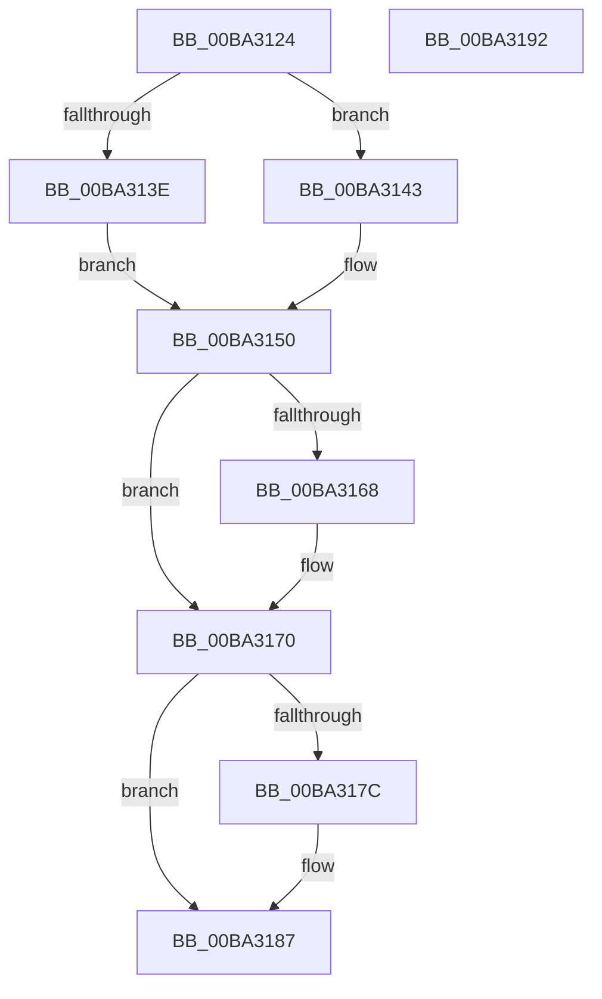

# VfMajorVerifyFinalIrpStack

- RVA: `0x00BA3124`–`0x00BA3193` (길이 `111` bytes)
- VA: `0x0000000140BA3124`
- 실행 섹션: `PAGEVRFY`
- PDB 이름 있음: `예`; PDB Function 태그: `아니요`
- unwind 정보 RVA: `0x0005CAAC`
- 디코드: `33`개 명령, `111/111` bytes 표시
- 미해석 바이트: `0` (있으면 어셈블리에 `.byte`로 보존)

> 이 문서는 커널 이미지의 기계어와 PDB 기호를 분석해 생성했습니다. 4번과 5번은 함수 원형과 자료형을 바이너리 사용 방식에서 추정한 C 해석이며 원본 소스 복구 결과는 아닙니다.

## 1. Dependencies

- 직접 호출 지점: **2**; 고유 호출 대상: **1**
- 직접 호출자로 확인된 함수: **1**
- RIP 상대 이미지 참조: **2**

### Outgoing calls
- `0x00BA316B` → [guard_dispatch_icall](../../text/6B/guard_dispatch_icall_function_006BAAD0.md) (function, `0x006BAAD0`)
- `0x00BA3182` → [guard_dispatch_icall](../../text/6B/guard_dispatch_icall_function_006BAAD0.md) (function, `0x006BAAD0`)

### Direct callers
- [sub_00BBBE00](../BB/Unknown_function_00BBBE00.md) at `0x00BBBFDE`

### Static image references
- `0x00BA3158` → RVA `0x00FFFC58` (`PAGEVRFD`; read)
- `0x00BA3170` → RVA `0x010006D8` (`PAGEVRFD`; read)

## 2. Other-region calls and transfers

- 다른 실행 섹션으로 향하는 call: **2**
  - `0x00BA316B` → [guard_dispatch_icall](../../text/6B/guard_dispatch_icall_function_006BAAD0.md) (`PAGEVRFY` → `.text`)
  - `0x00BA3182` → [guard_dispatch_icall](../../text/6B/guard_dispatch_icall_function_006BAAD0.md) (`PAGEVRFY` → `.text`)
- 별도 외부 분기/꼬리 이동을 확인하지 못했습니다.

## 3. Assembly (complete function range)

```asm
00BA3124  48 89 5C 24 08                  mov qword ptr [rsp + 8], rbx
00BA3129  57                              push rdi
00BA312A  48 83 EC 20                     sub rsp, 0x20
00BA312E  44 0F B6 02                     movzx r8d, byte ptr [rdx]
00BA3132  48 8B DA                        mov rbx, rdx
00BA3135  48 8B F9                        mov rdi, rcx
00BA3138  41 80 F8 1B                     cmp r8b, 0x1b
00BA313C  77 05                           ja 0x140ba3143
00BA313E  41 8B C0                        mov eax, r8d
00BA3141  EB 0D                           jmp 0x140ba3150
00BA3143  33 C0                           xor eax, eax
00BA3145  41 80 F8 FF                     cmp r8b, 0xff
00BA3149  0F 95 C0                        setne al
00BA314C  48 83 C0 1C                     add rax, 0x1c
00BA3150  48 8D 04 40                     lea rax, [rax + rax*2]
00BA3154  48 C1 E0 05                     shl rax, 5
00BA3158  48 8D 0D F9 CA 45 00            lea rcx, [rip + 0x45caf9]
00BA315F  48 8B 04 08                     mov rax, qword ptr [rax + rcx]
00BA3163  48 85 C0                        test rax, rax
00BA3166  74 08                           je 0x140ba3170
00BA3168  48 8B CF                        mov rcx, rdi
00BA316B  E8 60 79 B1 FF                  call 0x1406baad0
00BA3170  48 8B 05 61 D5 45 00            mov rax, qword ptr [rip + 0x45d561]
00BA3177  48 85 C0                        test rax, rax
00BA317A  74 0B                           je 0x140ba3187
00BA317C  48 8B D3                        mov rdx, rbx
00BA317F  48 8B CF                        mov rcx, rdi
00BA3182  E8 49 79 B1 FF                  call 0x1406baad0
00BA3187  48 8B 5C 24 30                  mov rbx, qword ptr [rsp + 0x30]
00BA318C  48 83 C4 20                     add rsp, 0x20
00BA3190  5F                              pop rdi
00BA3191  C3                              ret
00BA3192  CC                              int3
```

## 4. C-style interpretation (structured pseudocode)

```c
__int64 __fastcall VfMajorVerifyFinalIrpStack(__int64 a1, __int64 a2)
{
    __int64 result;
    __int64 v_rsp;
    unsigned __int64 v_stack_p8;

    v_stack_p8 = v_rbx;
    v_rsp = (v_rsp) - (32);
    if (((unsigned __int8)(*(unsigned __int8 *)(a2))) > 27) goto loc_00BA3143;
    goto loc_00BA3150;
loc_00BA3143:
    result = 0;
    result = (((unsigned __int8)(*(unsigned __int8 *)(a2))) != 255) ? 1 : 0;
    result = (result) + (28);
loc_00BA3150:
    result = (result + result * 2) << (5);
    result = *(unsigned __int64 *)(result + v_rip + 4573945 * 1);
    if (*(unsigned __int64 *)(result + v_rip + 4573945 * 1) != 0) {
        a1 = a1;
        result = guard_dispatch_icall(a1, a2, *(unsigned __int8 *)(a2), a4);
    }
    result = *(unsigned __int64 *)(v_rip + 4576609);
    if (*(unsigned __int64 *)(v_rip + 4576609) != 0) {
        a2 = a2;
        a1 = a1;
        result = guard_dispatch_icall(a1, a2, *(unsigned __int8 *)(a2), a4);
    }
    v_rsp = (v_rsp) + (32);
    return result;
}
```

## 5. (Beta) C Style

```c
int64_t VfMajorVerifyFinalIrpStack(int64_t Arg1, void *Arg2)
{
    uint8_t *arg2 = (uint8_t *)Arg2;

    int64_t result;
    int64_t local_rsp;
    uint64_t v_stack_p8;

    v_stack_p8 = local_rbx;
    local_rsp = (local_rsp) - (32);
    if (((uint8_t)(*(uint8_t *)(arg2))) > 27) goto loc_00BA3143;
    goto loc_00BA3150;
loc_00BA3143:
    result = 0;
    result = (((uint8_t)(*(uint8_t *)(arg2))) != 255) ? 1 : 0;
    result = (result) + (28);
loc_00BA3150:
    result = (result + result * 2) << (5);
    result = *(uint64_t *)(result + v_rip + 0x45CAF9 * 1);
    if (*(uint64_t *)(result + v_rip + 0x45CAF9 * 1) != 0) {
        Arg1 = Arg1;
        result = guard_dispatch_icall(Arg1, Arg2, *(uint8_t *)(arg2), a4);
    }
    result = *(uint64_t *)(v_rip + 0x45D561);
    if (*(uint64_t *)(v_rip + 0x45D561) != 0) {
        Arg2 = Arg2;
        Arg1 = Arg1;
        result = guard_dispatch_icall(Arg1, Arg2, *(uint8_t *)(arg2), a4);
    }
    local_rsp = (local_rsp) + (32);
    return result;
}
```

### 관측된 메모리 오프셋

구조체 형식이 확인되지 않은 접근은 인자 기준의 오프셋으로만 기록했습니다.

| 기준 인자 | 오프셋 표현 | 폭 (bit) | 접근 |
|---|---:|---:|---|
| `Arg2` | `+ 0x0` | `8` | `R` |

## 6. Execution-region graph

[열기: 2D/3D 그래프와 함수 탐색 컨트롤 패널](../../../control-panel.html?section=pagevrfy&rva=0x00BA3124&view=graph)

- 2D 그래프는 위에서 아래로 흐르고, 3D 그래프는 빈 공간을 드래그해 회전합니다. Shift+드래그는 이동, 휠은 확대·축소, 함수 노드 선택은 대상 보고서 이동입니다.

### Static fallback


