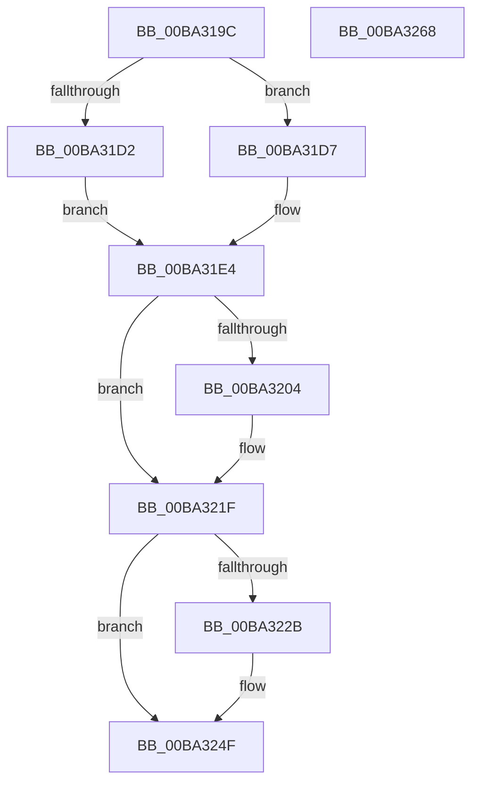

# VfMajorVerifyIrpStackDownward

- RVA: `0x00BA319C`–`0x00BA3269` (길이 `205` bytes)
- VA: `0x0000000140BA319C`
- 실행 섹션: `PAGEVRFY`
- PDB 이름 있음: `예`; PDB Function 태그: `아니요`
- unwind 정보 RVA: `0x00093E28`
- 디코드: `55`개 명령, `205/205` bytes 표시
- 미해석 바이트: `0` (있으면 어셈블리에 `.byte`로 보존)

> 이 문서는 커널 이미지의 기계어와 PDB 기호를 분석해 생성했습니다. 4번과 5번은 함수 원형과 자료형을 바이너리 사용 방식에서 추정한 C 해석이며 원본 소스 복구 결과는 아닙니다.

## 1. Dependencies

- 직접 호출 지점: **2**; 고유 호출 대상: **1**
- 직접 호출자로 확인된 함수: **1**
- RIP 상대 이미지 참조: **2**

### Outgoing calls
- `0x00BA321A` → [guard_dispatch_icall](../../text/6B/guard_dispatch_icall_function_006BAAD0.md) (function, `0x006BAAD0`)
- `0x00BA324A` → [guard_dispatch_icall](../../text/6B/guard_dispatch_icall_function_006BAAD0.md) (function, `0x006BAAD0`)

### Direct callers
- [IovpCallDriver1](../B9/IovpCallDriver1_function_00B9CCA4.md) at `0x00B9D1B1`

### Static image references
- `0x00BA31F4` → RVA `0x00FFFC20` (`PAGEVRFD`; read)
- `0x00BA321F` → RVA `0x010006A0` (`PAGEVRFD`; read)

## 2. Other-region calls and transfers

- 다른 실행 섹션으로 향하는 call: **2**
  - `0x00BA321A` → [guard_dispatch_icall](../../text/6B/guard_dispatch_icall_function_006BAAD0.md) (`PAGEVRFY` → `.text`)
  - `0x00BA324A` → [guard_dispatch_icall](../../text/6B/guard_dispatch_icall_function_006BAAD0.md) (`PAGEVRFY` → `.text`)
- 별도 외부 분기/꼬리 이동을 확인하지 못했습니다.

## 3. Assembly (complete function range)

```asm
00BA319C  48 89 5C 24 08                  mov qword ptr [rsp + 8], rbx
00BA31A1  48 89 6C 24 10                  mov qword ptr [rsp + 0x10], rbp
00BA31A6  48 89 74 24 18                  mov qword ptr [rsp + 0x18], rsi
00BA31AB  57                              push rdi
00BA31AC  41 56                           push r14
00BA31AE  41 57                           push r15
00BA31B0  48 83 EC 40                     sub rsp, 0x40
00BA31B4  45 0F B6 11                     movzx r10d, byte ptr [r9]
00BA31B8  49 8B D9                        mov rbx, r9
00BA31BB  48 8B BC 24 80 00 00 00         mov rdi, qword ptr [rsp + 0x80]
00BA31C3  49 8B E8                        mov rbp, r8
00BA31C6  4C 8B F2                        mov r14, rdx
00BA31C9  4C 8B F9                        mov r15, rcx
00BA31CC  41 80 FA 1B                     cmp r10b, 0x1b
00BA31D0  77 05                           ja 0x140ba31d7
00BA31D2  41 8B C2                        mov eax, r10d
00BA31D5  EB 0D                           jmp 0x140ba31e4
00BA31D7  33 C0                           xor eax, eax
00BA31D9  41 80 FA FF                     cmp r10b, 0xff
00BA31DD  0F 95 C0                        setne al
00BA31E0  48 83 C0 1C                     add rax, 0x1c
00BA31E4  48 8B B4 24 88 00 00 00         mov rsi, qword ptr [rsp + 0x88]
00BA31EC  48 8D 04 40                     lea rax, [rax + rax*2]
00BA31F0  48 C1 E0 05                     shl rax, 5
00BA31F4  48 8D 0D 25 CA 45 00            lea rcx, [rip + 0x45ca25]
00BA31FB  48 8B 04 08                     mov rax, qword ptr [rax + rcx]
00BA31FF  48 85 C0                        test rax, rax
00BA3202  74 1B                           je 0x140ba321f
00BA3204  48 8B 4F 08                     mov rcx, qword ptr [rdi + 8]
00BA3208  48 89 74 24 30                  mov qword ptr [rsp + 0x30], rsi
00BA320D  48 89 7C 24 28                  mov qword ptr [rsp + 0x28], rdi
00BA3212  48 89 4C 24 20                  mov qword ptr [rsp + 0x20], rcx
00BA3217  49 8B CF                        mov rcx, r15
00BA321A  E8 B1 78 B1 FF                  call 0x1406baad0
00BA321F  48 8B 05 7A D4 45 00            mov rax, qword ptr [rip + 0x45d47a]
00BA3226  48 85 C0                        test rax, rax
00BA3229  74 24                           je 0x140ba324f
00BA322B  48 8B 4F 08                     mov rcx, qword ptr [rdi + 8]
00BA322F  4C 8B CB                        mov r9, rbx
00BA3232  48 89 74 24 30                  mov qword ptr [rsp + 0x30], rsi
00BA3237  4C 8B C5                        mov r8, rbp
00BA323A  48 89 7C 24 28                  mov qword ptr [rsp + 0x28], rdi
00BA323F  49 8B D6                        mov rdx, r14
00BA3242  48 89 4C 24 20                  mov qword ptr [rsp + 0x20], rcx
00BA3247  49 8B CF                        mov rcx, r15
00BA324A  E8 81 78 B1 FF                  call 0x1406baad0
00BA324F  48 8B 5C 24 60                  mov rbx, qword ptr [rsp + 0x60]
00BA3254  48 8B 6C 24 68                  mov rbp, qword ptr [rsp + 0x68]
00BA3259  48 8B 74 24 70                  mov rsi, qword ptr [rsp + 0x70]
00BA325E  48 83 C4 40                     add rsp, 0x40
00BA3262  41 5F                           pop r15
00BA3264  41 5E                           pop r14
00BA3266  5F                              pop rdi
00BA3267  C3                              ret
00BA3268  CC                              int3
```

## 4. C-style interpretation (structured pseudocode)

```c
__int64 __fastcall VfMajorVerifyIrpStackDownward(__int64 a1, __int64 a2, __int64 a3, __int64 a4, __int64 a5, __int64 a6)
{
    __int64 result;
    __int64 v_rsp;
    unsigned __int64 v_stack_m28;
    unsigned __int64 v_stack_m30;
    unsigned __int64 v_stack_m38;
    unsigned __int64 v_stack_p10;
    unsigned __int64 v_stack_p18;
    unsigned __int64 v_stack_p8;

    v_stack_p8 = v_rbx;
    v_stack_p10 = v_rbp;
    v_stack_p18 = v_rsi;
    v_rsp = (v_rsp) - (64);
    if (((unsigned __int8)(*(unsigned __int8 *)(a4))) > 27) goto loc_00BA31D7;
    goto loc_00BA31E4;
loc_00BA31D7:
    result = 0;
    result = (((unsigned __int8)(*(unsigned __int8 *)(a4))) != 255) ? 1 : 0;
    result = (result) + (28);
loc_00BA31E4:
    result = (result + result * 2) << (5);
    result = *(unsigned __int64 *)(result + v_rip + 4573733 * 1);
    if (*(unsigned __int64 *)(result + v_rip + 4573733 * 1) != 0) {
        a1 = *(unsigned __int64 *)(a5 + 8);
        v_stack_m28 = a6;
        v_stack_m30 = a5;
        v_stack_m38 = a1;
        a1 = a1;
        result = guard_dispatch_icall(a1, a2, a3, a4);
    }
    result = *(unsigned __int64 *)(v_rip + 4576378);
    if (*(unsigned __int64 *)(v_rip + 4576378) != 0) {
        a1 = *(unsigned __int64 *)(a5 + 8);
        a4 = a4;
        v_stack_m28 = a6;
        a3 = a3;
        v_stack_m30 = a5;
        a2 = a2;
        v_stack_m38 = a1;
        a1 = a1;
        result = guard_dispatch_icall(a1, a2, a3, a4);
    }
    v_rsp = (v_rsp) + (64);
    return result;
}
```

## 5. (Beta) C Style

```c
int64_t VfMajorVerifyIrpStackDownward(int64_t Arg1, int64_t Arg2, int64_t Arg3, void *Arg4, void *Arg5, int64_t Arg6)
{
    uint8_t *arg4 = (uint8_t *)Arg4;
    uint8_t *arg5 = (uint8_t *)Arg5;

    int64_t result;
    int64_t local_rsp;
    uint64_t v_stack_m28;
    uint64_t v_stack_m30;
    uint64_t v_stack_m38;
    uint64_t v_stack_p10;
    uint64_t v_stack_p18;
    uint64_t v_stack_p8;

    v_stack_p8 = local_rbx;
    v_stack_p10 = local_rbp;
    v_stack_p18 = local_rsi;
    local_rsp = (local_rsp) - (64);
    if (((uint8_t)(*(uint8_t *)(arg4))) > 27) goto loc_00BA31D7;
    goto loc_00BA31E4;
loc_00BA31D7:
    result = 0;
    result = (((uint8_t)(*(uint8_t *)(arg4))) != 255) ? 1 : 0;
    result = (result) + (28);
loc_00BA31E4:
    result = (result + result * 2) << (5);
    result = *(uint64_t *)(result + v_rip + 0x45CA25 * 1);
    if (*(uint64_t *)(result + v_rip + 0x45CA25 * 1) != 0) {
        Arg1 = *(uint64_t *)(arg5 + 0x8);
        v_stack_m28 = Arg6;
        v_stack_m30 = Arg5;
        v_stack_m38 = Arg1;
        Arg1 = Arg1;
        result = guard_dispatch_icall(Arg1, Arg2, Arg3, Arg4);
    }
    result = *(uint64_t *)(v_rip + 0x45D47A);
    if (*(uint64_t *)(v_rip + 0x45D47A) != 0) {
        Arg1 = *(uint64_t *)(arg5 + 0x8);
        Arg4 = Arg4;
        v_stack_m28 = Arg6;
        Arg3 = Arg3;
        v_stack_m30 = Arg5;
        Arg2 = Arg2;
        v_stack_m38 = Arg1;
        Arg1 = Arg1;
        result = guard_dispatch_icall(Arg1, Arg2, Arg3, Arg4);
    }
    local_rsp = (local_rsp) + (64);
    return result;
}
```

### 관측된 메모리 오프셋

구조체 형식이 확인되지 않은 접근은 인자 기준의 오프셋으로만 기록했습니다.

| 기준 인자 | 오프셋 표현 | 폭 (bit) | 접근 |
|---|---:|---:|---|
| `Arg4` | `+ 0x0` | `8` | `R` |
| `Arg5` | `+ 0x8` | `64` | `R` |

## 6. Execution-region graph

[열기: 2D/3D 그래프와 함수 탐색 컨트롤 패널](../../../control-panel.html?section=pagevrfy&rva=0x00BA319C&view=graph)

- 2D 그래프는 위에서 아래로 흐르고, 3D 그래프는 빈 공간을 드래그해 회전합니다. Shift+드래그는 이동, 휠은 확대·축소, 함수 노드 선택은 대상 보고서 이동입니다.

### Static fallback


