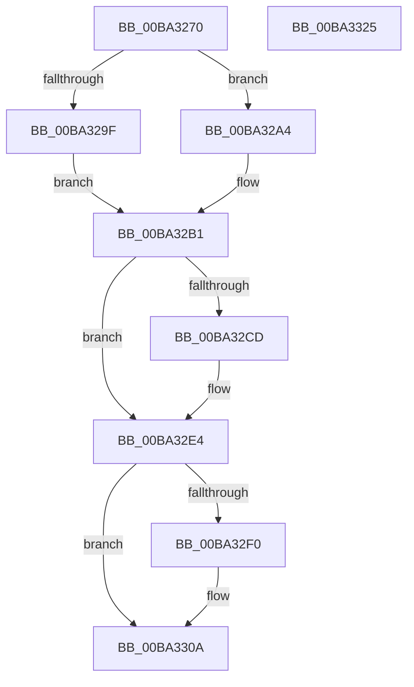

# VfMajorVerifyIrpStackUpward

- RVA: `0x00BA3270`–`0x00BA3326` (길이 `182` bytes)
- VA: `0x0000000140BA3270`
- 실행 섹션: `PAGEVRFY`
- PDB 이름 있음: `예`; PDB Function 태그: `아니요`
- unwind 정보 RVA: `0x00060130`
- 디코드: `51`개 명령, `182/182` bytes 표시
- 미해석 바이트: `0` (있으면 어셈블리에 `.byte`로 보존)

> 이 문서는 커널 이미지의 기계어와 PDB 기호를 분석해 생성했습니다. 4번과 5번은 함수 원형과 자료형을 바이너리 사용 방식에서 추정한 C 해석이며 원본 소스 복구 결과는 아닙니다.

## 1. Dependencies

- 직접 호출 지점: **2**; 고유 호출 대상: **1**
- 직접 호출자로 확인된 함수: **1**
- RIP 상대 이미지 참조: **2**

### Outgoing calls
- `0x00BA32DF` → [guard_dispatch_icall](../../text/6B/guard_dispatch_icall_function_006BAAD0.md) (function, `0x006BAAD0`)
- `0x00BA3305` → [guard_dispatch_icall](../../text/6B/guard_dispatch_icall_function_006BAAD0.md) (function, `0x006BAAD0`)

### Direct callers
- [sub_00BBBE00](../BB/Unknown_function_00BBBE00.md) at `0x00BBBE9A`

### Static image references
- `0x00BA32BD` → RVA `0x00FFFC28` (`PAGEVRFD`; read)
- `0x00BA32E4` → RVA `0x010006A8` (`PAGEVRFD`; read)

## 2. Other-region calls and transfers

- 다른 실행 섹션으로 향하는 call: **2**
  - `0x00BA32DF` → [guard_dispatch_icall](../../text/6B/guard_dispatch_icall_function_006BAAD0.md) (`PAGEVRFY` → `.text`)
  - `0x00BA3305` → [guard_dispatch_icall](../../text/6B/guard_dispatch_icall_function_006BAAD0.md) (`PAGEVRFY` → `.text`)
- 별도 외부 분기/꼬리 이동을 확인하지 못했습니다.

## 3. Assembly (complete function range)

```asm
00BA3270  48 8B C4                        mov rax, rsp
00BA3273  48 89 58 08                     mov qword ptr [rax + 8], rbx
00BA3277  48 89 68 10                     mov qword ptr [rax + 0x10], rbp
00BA327B  48 89 70 18                     mov qword ptr [rax + 0x18], rsi
00BA327F  48 89 78 20                     mov qword ptr [rax + 0x20], rdi
00BA3283  41 56                           push r14
00BA3285  48 83 EC 40                     sub rsp, 0x40
00BA3289  44 0F B6 12                     movzx r10d, byte ptr [rdx]
00BA328D  41 8B E9                        mov ebp, r9d
00BA3290  49 8B D8                        mov rbx, r8
00BA3293  48 8B FA                        mov rdi, rdx
00BA3296  4C 8B F1                        mov r14, rcx
00BA3299  41 80 FA 1B                     cmp r10b, 0x1b
00BA329D  77 05                           ja 0x140ba32a4
00BA329F  41 8B C2                        mov eax, r10d
00BA32A2  EB 0D                           jmp 0x140ba32b1
00BA32A4  33 C0                           xor eax, eax
00BA32A6  41 80 FA FF                     cmp r10b, 0xff
00BA32AA  0F 95 C0                        setne al
00BA32AD  48 83 C0 1C                     add rax, 0x1c
00BA32B1  8B 74 24 70                     mov esi, dword ptr [rsp + 0x70]
00BA32B5  48 8D 04 40                     lea rax, [rax + rax*2]
00BA32B9  48 C1 E0 05                     shl rax, 5
00BA32BD  48 8D 0D 64 C9 45 00            lea rcx, [rip + 0x45c964]
00BA32C4  48 8B 04 08                     mov rax, qword ptr [rax + rcx]
00BA32C8  48 85 C0                        test rax, rax
00BA32CB  74 17                           je 0x140ba32e4
00BA32CD  4D 8B 40 08                     mov r8, qword ptr [r8 + 8]
00BA32D1  4C 8B CB                        mov r9, rbx
00BA32D4  89 74 24 28                     mov dword ptr [rsp + 0x28], esi
00BA32D8  49 8B CE                        mov rcx, r14
00BA32DB  89 6C 24 20                     mov dword ptr [rsp + 0x20], ebp
00BA32DF  E8 EC 77 B1 FF                  call 0x1406baad0
00BA32E4  48 8B 05 BD D3 45 00            mov rax, qword ptr [rip + 0x45d3bd]
00BA32EB  48 85 C0                        test rax, rax
00BA32EE  74 1A                           je 0x140ba330a
00BA32F0  4C 8B 43 08                     mov r8, qword ptr [rbx + 8]
00BA32F4  4C 8B CB                        mov r9, rbx
00BA32F7  89 74 24 28                     mov dword ptr [rsp + 0x28], esi
00BA32FB  48 8B D7                        mov rdx, rdi
00BA32FE  49 8B CE                        mov rcx, r14
00BA3301  89 6C 24 20                     mov dword ptr [rsp + 0x20], ebp
00BA3305  E8 C6 77 B1 FF                  call 0x1406baad0
00BA330A  48 8B 5C 24 50                  mov rbx, qword ptr [rsp + 0x50]
00BA330F  48 8B 6C 24 58                  mov rbp, qword ptr [rsp + 0x58]
00BA3314  48 8B 74 24 60                  mov rsi, qword ptr [rsp + 0x60]
00BA3319  48 8B 7C 24 68                  mov rdi, qword ptr [rsp + 0x68]
00BA331E  48 83 C4 40                     add rsp, 0x40
00BA3322  41 5E                           pop r14
00BA3324  C3                              ret
00BA3325  CC                              int3
```

## 4. C-style interpretation (structured pseudocode)

```c
__int64 __fastcall VfMajorVerifyIrpStackUpward(__int64 a1, __int64 a2, __int64 a3, int a4, unsigned int a5)
{
    __int64 result;
    __int64 v_rsp;
    unsigned int v_stack_m20;
    unsigned int v_stack_m28;
    unsigned __int64 v_stack_p10;
    unsigned __int64 v_stack_p18;
    unsigned __int64 v_stack_p20;
    unsigned __int64 v_stack_p8;

    *(unsigned __int64 *)(v_rsp + 8) = v_rbx;
    *(unsigned __int64 *)(v_rsp + 16) = v_rbp;
    *(unsigned __int64 *)(v_rsp + 24) = v_rsi;
    *(unsigned __int64 *)(v_rsp + 32) = v_rdi;
    v_rsp = (v_rsp) - (64);
    if (((unsigned __int8)(*(unsigned __int8 *)(a2))) > 27) goto loc_00BA32A4;
    goto loc_00BA32B1;
loc_00BA32A4:
    result = 0;
    result = (((unsigned __int8)(*(unsigned __int8 *)(a2))) != 255) ? 1 : 0;
    result = (result) + (28);
loc_00BA32B1:
    result = (result + result * 2) << (5);
    result = *(unsigned __int64 *)(result + v_rip + 4573540 * 1);
    if (*(unsigned __int64 *)(result + v_rip + 4573540 * 1) != 0) {
        a3 = *(unsigned __int64 *)(a3 + 8);
        a4 = a3;
        v_stack_m20 = (unsigned int)((unsigned int)(a5));
        a1 = a1;
        v_stack_m28 = (unsigned int)((unsigned int)(a4));
        result = guard_dispatch_icall(a1, a2, a3, a4);
    }
    result = *(unsigned __int64 *)(v_rip + 4576189);
    if (*(unsigned __int64 *)(v_rip + 4576189) != 0) {
        a3 = *(unsigned __int64 *)(a3 + 8);
        a4 = a3;
        v_stack_m20 = (unsigned int)((unsigned int)(a5));
        a2 = a2;
        a1 = a1;
        v_stack_m28 = (unsigned int)((unsigned int)(a4));
        result = guard_dispatch_icall(a1, a2, a3, a4);
    }
    v_rsp = (v_rsp) + (64);
    return result;
}
```

## 5. (Beta) C Style

```c
int64_t VfMajorVerifyIrpStackUpward(int64_t Arg1, void *Arg2, void *Arg3, int32_t Arg4, uint32_t Arg5)
{
    uint8_t *arg2 = (uint8_t *)Arg2;
    uint8_t *arg3 = (uint8_t *)Arg3;

    int64_t result;
    int64_t local_rsp;
    uint32_t v_stack_m20;
    uint32_t v_stack_m28;
    uint64_t v_stack_p10;
    uint64_t v_stack_p18;
    uint64_t v_stack_p20;
    uint64_t v_stack_p8;

    *(uint64_t *)(local_rsp + 0x8) = local_rbx;
    *(uint64_t *)(local_rsp + 0x10) = local_rbp;
    *(uint64_t *)(local_rsp + 0x18) = local_rsi;
    *(uint64_t *)(local_rsp + 0x20) = local_rdi;
    local_rsp = (local_rsp) - (64);
    if (((uint8_t)(*(uint8_t *)(arg2))) > 27) goto loc_00BA32A4;
    goto loc_00BA32B1;
loc_00BA32A4:
    result = 0;
    result = (((uint8_t)(*(uint8_t *)(arg2))) != 255) ? 1 : 0;
    result = (result) + (28);
loc_00BA32B1:
    result = (result + result * 2) << (5);
    result = *(uint64_t *)(result + v_rip + 0x45C964 * 1);
    if (*(uint64_t *)(result + v_rip + 0x45C964 * 1) != 0) {
        Arg3 = *(uint64_t *)(arg3 + 0x8);
        Arg4 = Arg3;
        v_stack_m20 = (uint32_t)((uint32_t)(Arg5));
        Arg1 = Arg1;
        v_stack_m28 = (uint32_t)((uint32_t)(Arg4));
        result = guard_dispatch_icall(Arg1, Arg2, Arg3, Arg4);
    }
    result = *(uint64_t *)(v_rip + 0x45D3BD);
    if (*(uint64_t *)(v_rip + 0x45D3BD) != 0) {
        Arg3 = *(uint64_t *)(arg3 + 0x8);
        Arg4 = Arg3;
        v_stack_m20 = (uint32_t)((uint32_t)(Arg5));
        Arg2 = Arg2;
        Arg1 = Arg1;
        v_stack_m28 = (uint32_t)((uint32_t)(Arg4));
        result = guard_dispatch_icall(Arg1, Arg2, Arg3, Arg4);
    }
    local_rsp = (local_rsp) + (64);
    return result;
}
```

### 관측된 메모리 오프셋

구조체 형식이 확인되지 않은 접근은 인자 기준의 오프셋으로만 기록했습니다.

| 기준 인자 | 오프셋 표현 | 폭 (bit) | 접근 |
|---|---:|---:|---|
| `Arg2` | `+ 0x0` | `8` | `R` |
| `Arg3` | `+ 0x8` | `64` | `R` |

## 6. Execution-region graph

[열기: 2D/3D 그래프와 함수 탐색 컨트롤 패널](../../../control-panel.html?section=pagevrfy&rva=0x00BA3270&view=graph)

- 2D 그래프는 위에서 아래로 흐르고, 3D 그래프는 빈 공간을 드래그해 회전합니다. Shift+드래그는 이동, 휠은 확대·축소, 함수 노드 선택은 대상 보고서 이동입니다.

### Static fallback


