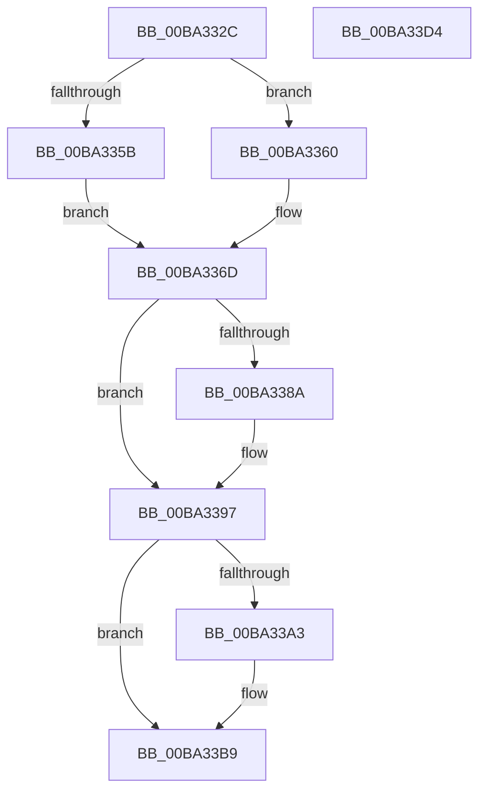

# VfMajorVerifyNewIrp

- RVA: `0x00BA332C`–`0x00BA33D5` (길이 `169` bytes)
- VA: `0x0000000140BA332C`
- 실행 섹션: `PAGEVRFY`
- PDB 이름 있음: `예`; PDB Function 태그: `아니요`
- unwind 정보 RVA: `0x0005D7BC`
- 디코드: `47`개 명령, `169/169` bytes 표시
- 미해석 바이트: `0` (있으면 어셈블리에 `.byte`로 보존)

> 이 문서는 커널 이미지의 기계어와 PDB 기호를 분석해 생성했습니다. 4번과 5번은 함수 원형과 자료형을 바이너리 사용 방식에서 추정한 C 해석이며 원본 소스 복구 결과는 아닙니다.

## 1. Dependencies

- 직접 호출 지점: **2**; 고유 호출 대상: **1**
- 직접 호출자로 확인된 함수: **1**
- RIP 상대 이미지 참조: **2**

### Outgoing calls
- `0x00BA3392` → [guard_dispatch_icall](../../text/6B/guard_dispatch_icall_function_006BAAD0.md) (function, `0x006BAAD0`)
- `0x00BA33B4` → [guard_dispatch_icall](../../text/6B/guard_dispatch_icall_function_006BAAD0.md) (function, `0x006BAAD0`)

### Direct callers
- [IovpCallDriver1](../B9/IovpCallDriver1_function_00B9CCA4.md) at `0x00B9D15E`

### Static image references
- `0x00BA337A` → RVA `0x00FFFC50` (`PAGEVRFD`; read)
- `0x00BA3397` → RVA `0x010006D0` (`PAGEVRFD`; read)

## 2. Other-region calls and transfers

- 다른 실행 섹션으로 향하는 call: **2**
  - `0x00BA3392` → [guard_dispatch_icall](../../text/6B/guard_dispatch_icall_function_006BAAD0.md) (`PAGEVRFY` → `.text`)
  - `0x00BA33B4` → [guard_dispatch_icall](../../text/6B/guard_dispatch_icall_function_006BAAD0.md) (`PAGEVRFY` → `.text`)
- 별도 외부 분기/꼬리 이동을 확인하지 못했습니다.

## 3. Assembly (complete function range)

```asm
00BA332C  48 8B C4                        mov rax, rsp
00BA332F  48 89 58 08                     mov qword ptr [rax + 8], rbx
00BA3333  48 89 68 10                     mov qword ptr [rax + 0x10], rbp
00BA3337  48 89 70 18                     mov qword ptr [rax + 0x18], rsi
00BA333B  48 89 78 20                     mov qword ptr [rax + 0x20], rdi
00BA333F  41 56                           push r14
00BA3341  48 83 EC 30                     sub rsp, 0x30
00BA3345  45 0F B6 10                     movzx r10d, byte ptr [r8]
00BA3349  49 8B F1                        mov rsi, r9
00BA334C  49 8B D8                        mov rbx, r8
00BA334F  48 8B EA                        mov rbp, rdx
00BA3352  4C 8B F1                        mov r14, rcx
00BA3355  41 80 FA 1B                     cmp r10b, 0x1b
00BA3359  77 05                           ja 0x140ba3360
00BA335B  41 8B C2                        mov eax, r10d
00BA335E  EB 0D                           jmp 0x140ba336d
00BA3360  33 C0                           xor eax, eax
00BA3362  41 80 FA FF                     cmp r10b, 0xff
00BA3366  0F 95 C0                        setne al
00BA3369  48 83 C0 1C                     add rax, 0x1c
00BA336D  48 8B 7C 24 60                  mov rdi, qword ptr [rsp + 0x60]
00BA3372  48 8D 04 40                     lea rax, [rax + rax*2]
00BA3376  48 C1 E0 05                     shl rax, 5
00BA337A  48 8D 0D CF C8 45 00            lea rcx, [rip + 0x45c8cf]
00BA3381  48 8B 04 08                     mov rax, qword ptr [rax + rcx]
00BA3385  48 85 C0                        test rax, rax
00BA3388  74 0D                           je 0x140ba3397
00BA338A  49 8B CE                        mov rcx, r14
00BA338D  48 89 7C 24 20                  mov qword ptr [rsp + 0x20], rdi
00BA3392  E8 39 77 B1 FF                  call 0x1406baad0
00BA3397  48 8B 05 32 D3 45 00            mov rax, qword ptr [rip + 0x45d332]
00BA339E  48 85 C0                        test rax, rax
00BA33A1  74 16                           je 0x140ba33b9
00BA33A3  4C 8B CE                        mov r9, rsi
00BA33A6  48 89 7C 24 20                  mov qword ptr [rsp + 0x20], rdi
00BA33AB  4C 8B C3                        mov r8, rbx
00BA33AE  48 8B D5                        mov rdx, rbp
00BA33B1  49 8B CE                        mov rcx, r14
00BA33B4  E8 17 77 B1 FF                  call 0x1406baad0
00BA33B9  48 8B 5C 24 40                  mov rbx, qword ptr [rsp + 0x40]
00BA33BE  48 8B 6C 24 48                  mov rbp, qword ptr [rsp + 0x48]
00BA33C3  48 8B 74 24 50                  mov rsi, qword ptr [rsp + 0x50]
00BA33C8  48 8B 7C 24 58                  mov rdi, qword ptr [rsp + 0x58]
00BA33CD  48 83 C4 30                     add rsp, 0x30
00BA33D1  41 5E                           pop r14
00BA33D3  C3                              ret
00BA33D4  CC                              int3
```

## 4. C-style interpretation (structured pseudocode)

```c
__int64 __fastcall VfMajorVerifyNewIrp(__int64 a1, __int64 a2, __int64 a3, __int64 a4, __int64 a5)
{
    __int64 result;
    __int64 v_rsp;
    unsigned __int64 v_stack_m18;
    unsigned __int64 v_stack_p10;
    unsigned __int64 v_stack_p18;
    unsigned __int64 v_stack_p20;
    unsigned __int64 v_stack_p8;

    *(unsigned __int64 *)(v_rsp + 8) = v_rbx;
    *(unsigned __int64 *)(v_rsp + 16) = v_rbp;
    *(unsigned __int64 *)(v_rsp + 24) = v_rsi;
    *(unsigned __int64 *)(v_rsp + 32) = v_rdi;
    v_rsp = (v_rsp) - (48);
    if (((unsigned __int8)(*(unsigned __int8 *)(a3))) > 27) goto loc_00BA3360;
    goto loc_00BA336D;
loc_00BA3360:
    result = 0;
    result = (((unsigned __int8)(*(unsigned __int8 *)(a3))) != 255) ? 1 : 0;
    result = (result) + (28);
loc_00BA336D:
    result = (result + result * 2) << (5);
    result = *(unsigned __int64 *)(result + v_rip + 4573391 * 1);
    if (*(unsigned __int64 *)(result + v_rip + 4573391 * 1) != 0) {
        a1 = a1;
        v_stack_m18 = a5;
        result = guard_dispatch_icall(a1, a2, a3, a4);
    }
    result = *(unsigned __int64 *)(v_rip + 4576050);
    if (*(unsigned __int64 *)(v_rip + 4576050) != 0) {
        a4 = a4;
        v_stack_m18 = a5;
        a3 = a3;
        a2 = a2;
        a1 = a1;
        result = guard_dispatch_icall(a1, a2, a3, a4);
    }
    v_rsp = (v_rsp) + (48);
    return result;
}
```

## 5. (Beta) C Style

```c
int64_t VfMajorVerifyNewIrp(int64_t Arg1, int64_t Arg2, void *Arg3, int64_t Arg4, int64_t Arg5)
{
    uint8_t *arg3 = (uint8_t *)Arg3;

    int64_t result;
    int64_t local_rsp;
    uint64_t v_stack_m18;
    uint64_t v_stack_p10;
    uint64_t v_stack_p18;
    uint64_t v_stack_p20;
    uint64_t v_stack_p8;

    *(uint64_t *)(local_rsp + 0x8) = local_rbx;
    *(uint64_t *)(local_rsp + 0x10) = local_rbp;
    *(uint64_t *)(local_rsp + 0x18) = local_rsi;
    *(uint64_t *)(local_rsp + 0x20) = local_rdi;
    local_rsp = (local_rsp) - (48);
    if (((uint8_t)(*(uint8_t *)(arg3))) > 27) goto loc_00BA3360;
    goto loc_00BA336D;
loc_00BA3360:
    result = 0;
    result = (((uint8_t)(*(uint8_t *)(arg3))) != 255) ? 1 : 0;
    result = (result) + (28);
loc_00BA336D:
    result = (result + result * 2) << (5);
    result = *(uint64_t *)(result + v_rip + 0x45C8CF * 1);
    if (*(uint64_t *)(result + v_rip + 0x45C8CF * 1) != 0) {
        Arg1 = Arg1;
        v_stack_m18 = Arg5;
        result = guard_dispatch_icall(Arg1, Arg2, Arg3, Arg4);
    }
    result = *(uint64_t *)(v_rip + 0x45D332);
    if (*(uint64_t *)(v_rip + 0x45D332) != 0) {
        Arg4 = Arg4;
        v_stack_m18 = Arg5;
        Arg3 = Arg3;
        Arg2 = Arg2;
        Arg1 = Arg1;
        result = guard_dispatch_icall(Arg1, Arg2, Arg3, Arg4);
    }
    local_rsp = (local_rsp) + (48);
    return result;
}
```

### 관측된 메모리 오프셋

구조체 형식이 확인되지 않은 접근은 인자 기준의 오프셋으로만 기록했습니다.

| 기준 인자 | 오프셋 표현 | 폭 (bit) | 접근 |
|---|---:|---:|---|
| `Arg3` | `+ 0x0` | `8` | `R` |

## 6. Execution-region graph

[열기: 2D/3D 그래프와 함수 탐색 컨트롤 패널](../../../control-panel.html?section=pagevrfy&rva=0x00BA332C&view=graph)

- 2D 그래프는 위에서 아래로 흐르고, 3D 그래프는 빈 공간을 드래그해 회전합니다. Shift+드래그는 이동, 휠은 확대·축소, 함수 노드 선택은 대상 보고서 이동입니다.

### Static fallback


