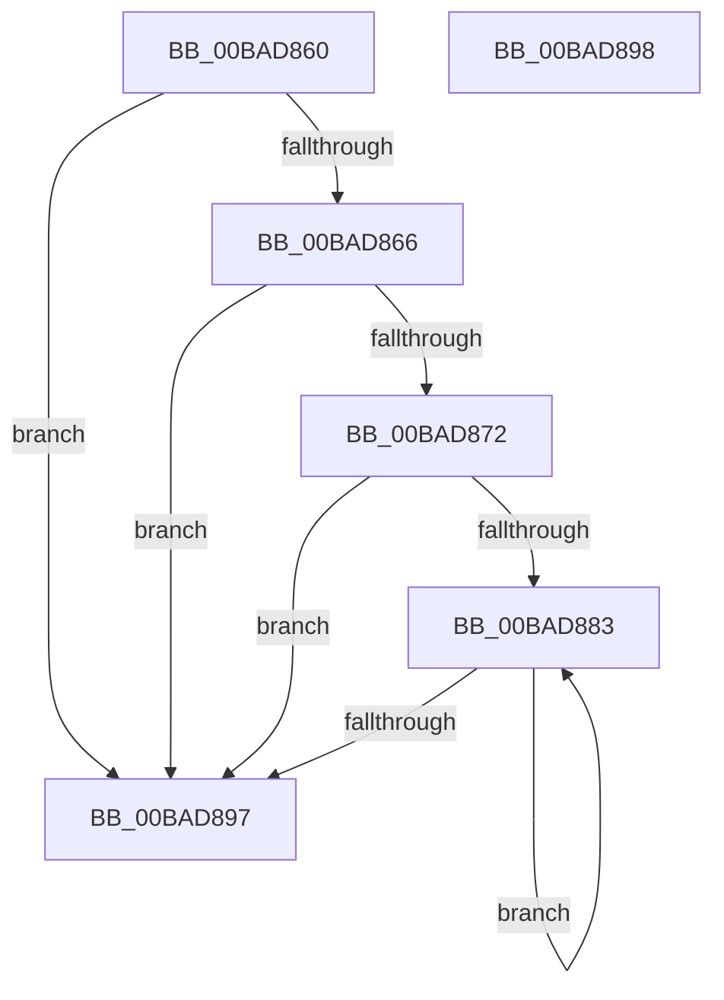

# VfMiscExDeleteResourceLite_Exit

- RVA: `0x00BAD860`–`0x00BAD899` (길이 `57` bytes)
- VA: `0x0000000140BAD860`
- 실행 섹션: `PAGEVRFY`
- PDB 이름 있음: `예`; PDB Function 태그: `아니요`
- unwind 정보 RVA: `0x000DB714`
- 디코드: `16`개 명령, `57/57` bytes 표시
- 미해석 바이트: `0` (있으면 어셈블리에 `.byte`로 보존)

> 이 문서는 커널 이미지의 기계어와 PDB 기호를 분석해 생성했습니다. 4번과 5번은 함수 원형과 자료형을 바이너리 사용 방식에서 추정한 C 해석이며 원본 소스 복구 결과는 아닙니다.

## 1. Dependencies

- 직접 호출 지점: **0**; 고유 호출 대상: **0**
- 직접 호출자로 확인된 함수: **0**
- RIP 상대 이미지 참조: **2**

### Outgoing calls
- 직접 디코드된 call 명령이 없습니다.

### Direct callers
- 이 함수 시작 RVA로 연결되는 직접 call은 확인되지 않았습니다. 간접 호출은 완전히 역산할 수 없습니다.

### Static image references
- `0x00BAD866` → RVA `0x00E681A0` (`.data`; read)
- `0x00BAD883` → RVA `0x00FC6C08` (`ALMOSTRO`; read)

## 2. Other-region calls and transfers

- 다른 실행 섹션으로 향하는 call: **0**
- 별도 외부 분기/꼬리 이동을 확인하지 못했습니다.

## 3. Assembly (complete function range)

```asm
00BAD860  83 79 10 00                     cmp dword ptr [rcx + 0x10], 0
00BAD864  7C 31                           jl 0x140bad897
00BAD866  F7 05 30 A9 2B 00 00 00 40 00   test dword ptr [rip + 0x2ba930], 0x400000
00BAD870  75 25                           jne 0x140bad897
00BAD872  48 8B 51 08                     mov rdx, qword ptr [rcx + 8]
00BAD876  48 8D 42 68                     lea rax, [rdx + 0x68]
00BAD87A  48 89 41 08                     mov qword ptr [rcx + 8], rax
00BAD87E  48 3B D0                        cmp rdx, rax
00BAD881  73 14                           jae 0x140bad897
00BAD883  48 8B 05 7E 93 41 00            mov rax, qword ptr [rip + 0x41937e]
00BAD88A  48 89 02                        mov qword ptr [rdx], rax
00BAD88D  48 83 C2 08                     add rdx, 8
00BAD891  48 3B 51 08                     cmp rdx, qword ptr [rcx + 8]
00BAD895  72 EC                           jb 0x140bad883
00BAD897  C3                              ret
00BAD898  CC                              int3
```

## 4. C-style interpretation (structured pseudocode)

```c
__int64 __fastcall VfMiscExDeleteResourceLite_Exit(__int64 a1)
{
    if ((*(unsigned int *)(a1 + 16)) < 0) goto loc_00BAD897;
    if (((*(unsigned int *)(v_rip + 2861360)) & (0x400000ULL)) != 0) goto loc_00BAD897;
    *(unsigned __int64 *)(a1 + 8) = *(unsigned __int64 *)(a1 + 8) + 104;
    if ((*(unsigned __int64 *)(a1 + 8)) >= (*(unsigned __int64 *)(a1 + 8) + 104)) goto loc_00BAD897;
loc_00BAD883:
    *(unsigned __int64 *)(*(unsigned __int64 *)(a1 + 8)) = *(unsigned __int64 *)(v_rip + 4297598);
    a2 = (*(unsigned __int64 *)(a1 + 8)) + (8);
    if (a2 < (*(unsigned __int64 *)(a1 + 8))) goto loc_00BAD883;
loc_00BAD897:
    return *(unsigned __int64 *)(v_rip + 4297598);
}
```

## 5. (Beta) C Style

```c
int64_t VfMiscExDeleteResourceLite_Exit(void *Arg1)
{
    uint8_t *arg1 = (uint8_t *)Arg1;

    if ((*(uint32_t *)(arg1 + 0x10)) < 0) goto loc_00BAD897;
    if (((*(uint32_t *)(v_rip + 0x2BA930)) & (0x400000ULL)) != 0) goto loc_00BAD897;
    *(uint64_t *)(arg1 + 0x8) = *(uint64_t *)(arg1 + 0x8) + 104;
    if ((*(uint64_t *)(arg1 + 0x8)) >= (*(uint64_t *)(arg1 + 0x8) + 104)) goto loc_00BAD897;
loc_00BAD883:
    *(uint64_t *)(*(uint64_t *)(arg1 + 0x8)) = *(uint64_t *)(v_rip + 0x41937E);
    a2 = (*(uint64_t *)(arg1 + 0x8)) + (8);
    if (a2 < (*(uint64_t *)(arg1 + 0x8))) goto loc_00BAD883;
loc_00BAD897:
    return *(uint64_t *)(v_rip + 0x41937E);
}
```

### 관측된 메모리 오프셋

구조체 형식이 확인되지 않은 접근은 인자 기준의 오프셋으로만 기록했습니다.

| 기준 인자 | 오프셋 표현 | 폭 (bit) | 접근 |
|---|---:|---:|---|
| `Arg1` | `+ 0x8` | `64` | `R` |
| `Arg1` | `+ 0x8` | `64` | `W` |
| `Arg1` | `+ 0x10` | `32` | `R` |

## 6. Execution-region graph

[열기: 2D/3D 그래프와 함수 탐색 컨트롤 패널](../../../control-panel.html?section=pagevrfy&rva=0x00BAD860&view=graph)

- 2D 그래프는 위에서 아래로 흐르고, 3D 그래프는 빈 공간을 드래그해 회전합니다. Shift+드래그는 이동, 휠은 확대·축소, 함수 노드 선택은 대상 보고서 이동입니다.

### Static fallback


