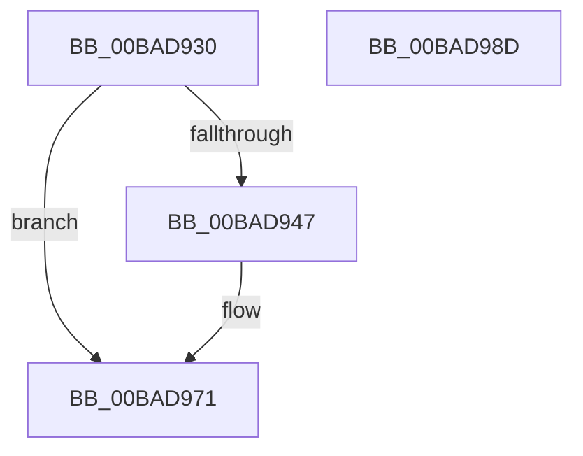

# VfMiscExInitializeNPagedLookasideList_Entry

- RVA: `0x00BAD930`–`0x00BAD98E` (길이 `94` bytes)
- VA: `0x0000000140BAD930`
- 실행 섹션: `PAGEVRFY`
- PDB 이름 있음: `예`; PDB Function 태그: `아니요`
- unwind 정보 RVA: `0x00065960`
- 디코드: `24`개 명령, `94/94` bytes 표시
- 미해석 바이트: `0` (있으면 어셈블리에 `.byte`로 보존)

> 이 문서는 커널 이미지의 기계어와 PDB 기호를 분석해 생성했습니다. 4번과 5번은 함수 원형과 자료형을 바이너리 사용 방식에서 추정한 C 해석이며 원본 소스 복구 결과는 아닙니다.

## 1. Dependencies

- 직접 호출 지점: **2**; 고유 호출 대상: **2**
- 직접 호출자로 확인된 함수: **0**
- RIP 상대 이미지 참조: **0**

### Outgoing calls
- `0x00BAD96C` → [CarReportRuleViolationFromNt](../B9/CarReportRuleViolationFromNt_function_00B9D904.md) (function, `0x00B9D904`)
- `0x00BAD97D` → [ViMiscValidateSynchronizationObject](ViMiscValidateSynchronizationObject_function_00BAF698.md) (function, `0x00BAF698`)

### Direct callers
- 이 함수 시작 RVA로 연결되는 직접 call은 확인되지 않았습니다. 간접 호출은 완전히 역산할 수 없습니다.

### Static image references
- 디코드된 RIP-relative 메모리 참조가 없습니다.

## 2. Other-region calls and transfers

- 다른 실행 섹션으로 향하는 call: **0**
- 별도 외부 분기/꼬리 이동을 확인하지 못했습니다.

## 3. Assembly (complete function range)

```asm
00BAD930  48 89 5C 24 08                  mov qword ptr [rsp + 8], rbx
00BAD935  57                              push rdi
00BAD936  48 83 EC 40                     sub rsp, 0x40
00BAD93A  4C 8B 49 18                     mov r9, qword ptr [rcx + 0x18]
00BAD93E  48 8B F9                        mov rdi, rcx
00BAD941  49 83 F9 08                     cmp r9, 8
00BAD945  73 2A                           jae 0x140bad971
00BAD947  48 8B 01                        mov rax, qword ptr [rcx]
00BAD94A  BA CD 00 00 00                  mov edx, 0xcd
00BAD94F  4C 8B 41 38                     mov r8, qword ptr [rcx + 0x38]
00BAD953  48 89 44 24 30                  mov qword ptr [rsp + 0x30], rax
00BAD958  C7 44 24 28 0B 00 00 00         mov dword ptr [rsp + 0x28], 0xb
00BAD960  8D 4A F7                        lea ecx, [rdx - 9]
00BAD963  48 C7 44 24 20 08 00 00 00      mov qword ptr [rsp + 0x20], 8
00BAD96C  E8 93 FF FE FF                  call 0x140b9d904
00BAD971  4C 8B 07                        mov r8, qword ptr [rdi]
00BAD974  BA 80 00 00 00                  mov edx, 0x80
00BAD979  48 8B 4F 38                     mov rcx, qword ptr [rdi + 0x38]
00BAD97D  E8 16 1D 00 00                  call 0x140baf698
00BAD982  48 8B 5C 24 50                  mov rbx, qword ptr [rsp + 0x50]
00BAD987  48 83 C4 40                     add rsp, 0x40
00BAD98B  5F                              pop rdi
00BAD98C  C3                              ret
00BAD98D  CC                              int3
```

## 4. C-style interpretation (structured pseudocode)

```c
__int64 __fastcall VfMiscExInitializeNPagedLookasideList_Entry(__int64 a1)
{
    __int64 result;
    __int64 v_rsp;
    unsigned __int64 v_stack_m18;
    unsigned int v_stack_m20;
    unsigned __int64 v_stack_m28;
    unsigned __int64 v_stack_p8;

    v_stack_p8 = v_rbx;
    v_rsp = (v_rsp) - (64);
    if ((*(unsigned __int64 *)(a1 + 24)) < 8) {
        result = *(unsigned __int64 *)(a1);
        a2 = 205;
        a3 = *(unsigned __int64 *)(a1 + 56);
        v_stack_m18 = result;
        v_stack_m20 = 11;
        a1 = a2 - 9;
        v_stack_m28 = 8;
        result = CarReportRuleViolationFromNt(a1, a2, a3, *(unsigned __int64 *)(a1 + 24));
    }
    result = ViMiscValidateSynchronizationObject(*(unsigned __int64 *)(a1 + 56), 128, *(unsigned __int64 *)(a1), *(unsigned __int64 *)(a1 + 24));
    v_rsp = (v_rsp) + (64);
    return result;
}
```

## 5. (Beta) C Style

```c
int64_t VfMiscExInitializeNPagedLookasideList_Entry(void *Arg1)
{
    uint8_t *arg1 = (uint8_t *)Arg1;

    int64_t result;
    int64_t local_rsp;
    uint64_t v_stack_m18;
    uint32_t v_stack_m20;
    uint64_t v_stack_m28;
    uint64_t v_stack_p8;

    v_stack_p8 = local_rbx;
    local_rsp = (local_rsp) - (64);
    if ((*(uint64_t *)(arg1 + 0x18)) < 8) {
        result = *(uint64_t *)(arg1);
        a2 = 205;
        a3 = *(uint64_t *)(arg1 + 0x38);
        v_stack_m18 = result;
        v_stack_m20 = 11;
        Arg1 = a2 - 9;
        v_stack_m28 = 8;
        result = CarReportRuleViolationFromNt(Arg1, a2, a3, *(uint64_t *)(arg1 + 0x18));
    }
    result = ViMiscValidateSynchronizationObject(*(uint64_t *)(arg1 + 0x38), 128, *(uint64_t *)(arg1), *(uint64_t *)(arg1 + 0x18));
    local_rsp = (local_rsp) + (64);
    return result;
}
```

### 관측된 메모리 오프셋

구조체 형식이 확인되지 않은 접근은 인자 기준의 오프셋으로만 기록했습니다.

| 기준 인자 | 오프셋 표현 | 폭 (bit) | 접근 |
|---|---:|---:|---|
| `Arg1` | `+ 0x0` | `64` | `R` |
| `Arg1` | `+ 0x18` | `64` | `R` |
| `Arg1` | `+ 0x38` | `64` | `R` |

## 6. Execution-region graph

[열기: 2D/3D 그래프와 함수 탐색 컨트롤 패널](../../../control-panel.html?section=pagevrfy&rva=0x00BAD930&view=graph)

- 2D 그래프는 위에서 아래로 흐르고, 3D 그래프는 빈 공간을 드래그해 회전합니다. Shift+드래그는 이동, 휠은 확대·축소, 함수 노드 선택은 대상 보고서 이동입니다.

### Static fallback


