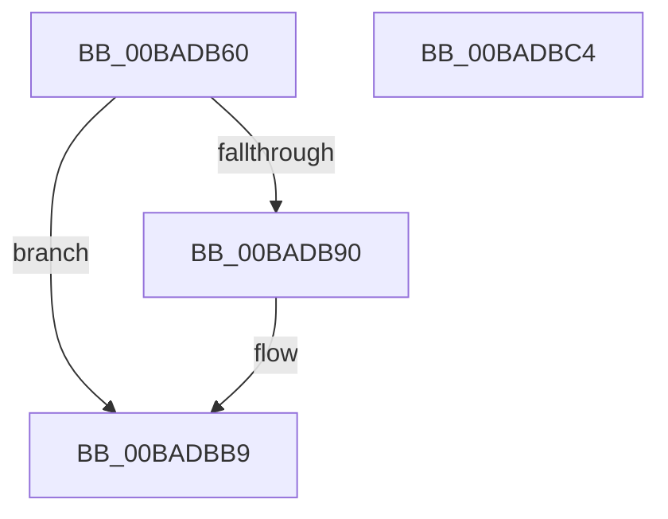

# VfMiscIoInitializeWorkItem_Entry

- RVA: `0x00BADB60`–`0x00BADBC5` (길이 `101` bytes)
- VA: `0x0000000140BADB60`
- 실행 섹션: `PAGEVRFY`
- PDB 이름 있음: `예`; PDB Function 태그: `아니요`
- unwind 정보 RVA: `0x00065960`
- 디코드: `28`개 명령, `101/101` bytes 표시
- 미해석 바이트: `0` (있으면 어셈블리에 `.byte`로 보존)

> 이 문서는 커널 이미지의 기계어와 PDB 기호를 분석해 생성했습니다. 4번과 5번은 함수 원형과 자료형을 바이너리 사용 방식에서 추정한 C 해석이며 원본 소스 복구 결과는 아닙니다.

## 1. Dependencies

- 직접 호출 지점: **4**; 고유 호출 대상: **4**
- 직접 호출자로 확인된 함수: **0**
- RIP 상대 이미지 참조: **0**

### Outgoing calls
- `0x00BADB6D` → [IoSizeofWorkItem](../../text/47/IoSizeofWorkItem_function_004744C0.md) (function, `0x004744C0`)
- `0x00BADB7B` → [VfMiscCheckKernelAddress](../../text/4B/VfMiscCheckKernelAddress_function_004BC694.md) (function, `0x004BC694`)
- `0x00BADB87` → [MmIsNonPagedSystemAddressValid](../../text/4B/MmIsNonPagedSystemAddressValid_function_004B79F0.md) (function, `0x004B79F0`)
- `0x00BADBB4` → [CarReportRuleViolationFromNt](../B9/CarReportRuleViolationFromNt_function_00B9D904.md) (function, `0x00B9D904`)

### Direct callers
- 이 함수 시작 RVA로 연결되는 직접 call은 확인되지 않았습니다. 간접 호출은 완전히 역산할 수 없습니다.

### Static image references
- 디코드된 RIP-relative 메모리 참조가 없습니다.

## 2. Other-region calls and transfers

- 다른 실행 섹션으로 향하는 call: **3**
  - `0x00BADB6D` → [IoSizeofWorkItem](../../text/47/IoSizeofWorkItem_function_004744C0.md) (`PAGEVRFY` → `.text`)
  - `0x00BADB7B` → [VfMiscCheckKernelAddress](../../text/4B/VfMiscCheckKernelAddress_function_004BC694.md) (`PAGEVRFY` → `.text`)
  - `0x00BADB87` → [MmIsNonPagedSystemAddressValid](../../text/4B/MmIsNonPagedSystemAddressValid_function_004B79F0.md) (`PAGEVRFY` → `.text`)
- 별도 외부 분기/꼬리 이동을 확인하지 못했습니다.

## 3. Assembly (complete function range)

```asm
00BADB60  48 89 5C 24 08                  mov qword ptr [rsp + 8], rbx
00BADB65  57                              push rdi
00BADB66  48 83 EC 40                     sub rsp, 0x40
00BADB6A  48 8B D9                        mov rbx, rcx
00BADB6D  E8 4E 69 8C FF                  call 0x1404744c0
00BADB72  4C 8B 03                        mov r8, qword ptr [rbx]
00BADB75  48 8B 4B 08                     mov rcx, qword ptr [rbx + 8]
00BADB79  8B D0                           mov edx, eax
00BADB7B  E8 14 EB 90 FF                  call 0x1404bc694
00BADB80  48 8B 7B 08                     mov rdi, qword ptr [rbx + 8]
00BADB84  48 8B CF                        mov rcx, rdi
00BADB87  E8 64 9E 90 FF                  call 0x1404b79f0
00BADB8C  84 C0                           test al, al
00BADB8E  75 29                           jne 0x140badbb9
00BADB90  48 8B 03                        mov rax, qword ptr [rbx]
00BADB93  BA 31 01 00 00                  mov edx, 0x131
00BADB98  48 89 44 24 30                  mov qword ptr [rsp + 0x30], rax
00BADB9D  45 33 C9                        xor r9d, r9d
00BADBA0  C7 44 24 28 0B 00 00 00         mov dword ptr [rsp + 0x28], 0xb
00BADBA8  4C 8B C7                        mov r8, rdi
00BADBAB  48 83 64 24 20 00               and qword ptr [rsp + 0x20], 0
00BADBB1  8D 4A 93                        lea ecx, [rdx - 0x6d]
00BADBB4  E8 4B FD FE FF                  call 0x140b9d904
00BADBB9  48 8B 5C 24 50                  mov rbx, qword ptr [rsp + 0x50]
00BADBBE  48 83 C4 40                     add rsp, 0x40
00BADBC2  5F                              pop rdi
00BADBC3  C3                              ret
00BADBC4  CC                              int3
```

## 4. C-style interpretation (structured pseudocode)

```c
__int64 __fastcall VfMiscIoInitializeWorkItem_Entry(__int64 a1, __int64 a2, __int64 a3, int a4)
{
    __int64 result;
    __int64 v_rsp;
    unsigned __int64 v_stack_m18;
    unsigned int v_stack_m20;
    unsigned __int64 v_stack_m28;
    unsigned __int64 v_stack_p8;

    v_stack_p8 = v_rbx;
    v_rsp = (v_rsp) - (64);
    result = IoSizeofWorkItem(a1, a2, a3, a4);
    result = VfMiscCheckKernelAddress(*(unsigned __int64 *)(a1 + 8), (unsigned int)((unsigned int)(result)), *(unsigned __int64 *)(a1), a4);
    result = MmIsNonPagedSystemAddressValid(*(unsigned __int64 *)(a1 + 8), (unsigned int)((unsigned int)(result)), *(unsigned __int64 *)(a1), a4);
    if ((unsigned __int8)(result) == 0) {
        result = *(unsigned __int64 *)(a1);
        a2 = 305;
        v_stack_m18 = result;
        a4 = 0;
        v_stack_m20 = 11;
        a3 = *(unsigned __int64 *)(a1 + 8);
        a1 = a2 - 109;
        result = CarReportRuleViolationFromNt(a1, a2, a3, a4);
    }
    v_rsp = (v_rsp) + (64);
    return result;
}
```

## 5. (Beta) C Style

```c
int64_t VfMiscIoInitializeWorkItem_Entry(void *Arg1, int64_t Arg2, int64_t Arg3, int32_t Arg4)
{
    uint8_t *arg1 = (uint8_t *)Arg1;

    int64_t result;
    int64_t local_rsp;
    uint64_t v_stack_m18;
    uint32_t v_stack_m20;
    uint64_t v_stack_m28;
    uint64_t v_stack_p8;

    v_stack_p8 = local_rbx;
    local_rsp = (local_rsp) - (64);
    result = IoSizeofWorkItem(Arg1, Arg2, Arg3, Arg4);
    result = VfMiscCheckKernelAddress(*(uint64_t *)(arg1 + 0x8), (uint32_t)((uint32_t)(result)), *(uint64_t *)(arg1), Arg4);
    result = MmIsNonPagedSystemAddressValid(*(uint64_t *)(arg1 + 0x8), (uint32_t)((uint32_t)(result)), *(uint64_t *)(arg1), Arg4);
    if ((uint8_t)(result) == 0) {
        result = *(uint64_t *)(arg1);
        Arg2 = 305;
        v_stack_m18 = result;
        Arg4 = 0;
        v_stack_m20 = 11;
        Arg3 = *(uint64_t *)(arg1 + 0x8);
        Arg1 = Arg2 - 109;
        result = CarReportRuleViolationFromNt(Arg1, Arg2, Arg3, Arg4);
    }
    local_rsp = (local_rsp) + (64);
    return result;
}
```

### 관측된 메모리 오프셋

구조체 형식이 확인되지 않은 접근은 인자 기준의 오프셋으로만 기록했습니다.

| 기준 인자 | 오프셋 표현 | 폭 (bit) | 접근 |
|---|---:|---:|---|
| `Arg1` | `+ 0x0` | `64` | `R` |
| `Arg1` | `+ 0x8` | `64` | `R` |

## 6. Execution-region graph

[열기: 2D/3D 그래프와 함수 탐색 컨트롤 패널](../../../control-panel.html?section=pagevrfy&rva=0x00BADB60&view=graph)

- 2D 그래프는 위에서 아래로 흐르고, 3D 그래프는 빈 공간을 드래그해 회전합니다. Shift+드래그는 이동, 휠은 확대·축소, 함수 노드 선택은 대상 보고서 이동입니다.

### Static fallback


