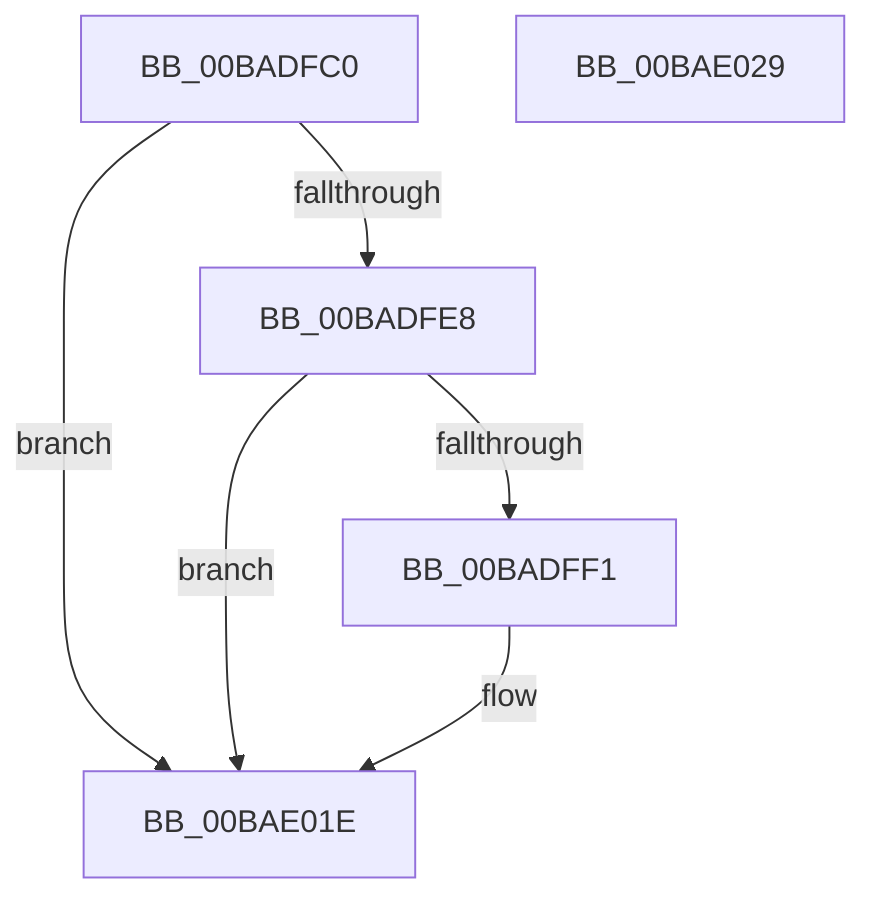

# VfMiscKeTryToAcquireSpinLockAtDpcLevel_Entry

- RVA: `0x00BADFC0`–`0x00BAE02A` (길이 `106` bytes)
- VA: `0x0000000140BADFC0`
- 실행 섹션: `PAGEVRFY`
- PDB 이름 있음: `예`; PDB Function 태그: `아니요`
- unwind 정보 RVA: `0x00065960`
- 디코드: `28`개 명령, `106/106` bytes 표시
- 미해석 바이트: `0` (있으면 어셈블리에 `.byte`로 보존)

> 이 문서는 커널 이미지의 기계어와 PDB 기호를 분석해 생성했습니다. 4번과 5번은 함수 원형과 자료형을 바이너리 사용 방식에서 추정한 C 해석이며 원본 소스 복구 결과는 아닙니다.

## 1. Dependencies

- 직접 호출 지점: **3**; 고유 호출 대상: **3**
- 직접 호출자로 확인된 함수: **0**
- RIP 상대 이미지 참조: **0**

### Outgoing calls
- `0x00BADFD9` → [VfMiscCheckKernelAddress](../../text/4B/VfMiscCheckKernelAddress_function_004BC694.md) (function, `0x004BC694`)
- `0x00BADFE8` → [KeAreInterruptsEnabled](../../text/2F/KeAreInterruptsEnabled_function_002F8060.md) (function, `0x002F8060`)
- `0x00BAE019` → [CarReportRuleViolationFromNt](../B9/CarReportRuleViolationFromNt_function_00B9D904.md) (function, `0x00B9D904`)

### Direct callers
- 이 함수 시작 RVA로 연결되는 직접 call은 확인되지 않았습니다. 간접 호출은 완전히 역산할 수 없습니다.

### Static image references
- 디코드된 RIP-relative 메모리 참조가 없습니다.

## 2. Other-region calls and transfers

- 다른 실행 섹션으로 향하는 call: **2**
  - `0x00BADFD9` → [VfMiscCheckKernelAddress](../../text/4B/VfMiscCheckKernelAddress_function_004BC694.md) (`PAGEVRFY` → `.text`)
  - `0x00BADFE8` → [KeAreInterruptsEnabled](../../text/2F/KeAreInterruptsEnabled_function_002F8060.md) (`PAGEVRFY` → `.text`)
- 별도 외부 분기/꼬리 이동을 확인하지 못했습니다.

## 3. Assembly (complete function range)

```asm
00BADFC0  48 89 5C 24 08                  mov qword ptr [rsp + 8], rbx
00BADFC5  57                              push rdi
00BADFC6  48 83 EC 40                     sub rsp, 0x40
00BADFCA  4C 8B 01                        mov r8, qword ptr [rcx]
00BADFCD  48 8B D9                        mov rbx, rcx
00BADFD0  48 8B 49 08                     mov rcx, qword ptr [rcx + 8]
00BADFD4  BA 08 00 00 00                  mov edx, 8
00BADFD9  E8 B6 E6 90 FF                  call 0x1404bc694
00BADFDE  44 0F 20 C7                     mov rdi, cr8
00BADFE2  40 80 FF 02                     cmp dil, 2
00BADFE6  73 36                           jae 0x140bae01e
00BADFE8  E8 73 A0 74 FF                  call 0x1402f8060
00BADFED  84 C0                           test al, al
00BADFEF  74 2D                           je 0x140bae01e
00BADFF1  48 8B 03                        mov rax, qword ptr [rbx]
00BADFF4  BA 40 00 00 00                  mov edx, 0x40
00BADFF9  4C 8B 4B 08                     mov r9, qword ptr [rbx + 8]
00BADFFD  B9 C4 00 00 00                  mov ecx, 0xc4
00BAE002  48 89 44 24 30                  mov qword ptr [rsp + 0x30], rax
00BAE007  C7 44 24 28 0B 00 00 00         mov dword ptr [rsp + 0x28], 0xb
00BAE00F  48 83 64 24 20 00               and qword ptr [rsp + 0x20], 0
00BAE015  44 0F B6 C7                     movzx r8d, dil
00BAE019  E8 E6 F8 FE FF                  call 0x140b9d904
00BAE01E  48 8B 5C 24 50                  mov rbx, qword ptr [rsp + 0x50]
00BAE023  48 83 C4 40                     add rsp, 0x40
00BAE027  5F                              pop rdi
00BAE028  C3                              ret
00BAE029  CC                              int3
```

## 4. C-style interpretation (structured pseudocode)

```c
__int64 __fastcall VfMiscKeTryToAcquireSpinLockAtDpcLevel_Entry(__int64 a1)
{
    __int64 result;
    __int64 v_rsp;
    unsigned __int64 v_stack_m18;
    unsigned int v_stack_m20;
    unsigned __int64 v_stack_m28;
    unsigned __int64 v_stack_p8;

    v_stack_p8 = v_rbx;
    v_rsp = (v_rsp) - (64);
    result = VfMiscCheckKernelAddress(*(unsigned __int64 *)(a1 + 8), 8, *(unsigned __int64 *)(a1), a4);
    if (((unsigned __int8)(v_cr8)) >= 2) goto loc_00BAE01E;
    result = KeAreInterruptsEnabled(*(unsigned __int64 *)(a1 + 8), 8, *(unsigned __int64 *)(a1), a4);
    if ((unsigned __int8)(result) != 0) {
        result = *(unsigned __int64 *)(a1);
        a2 = 64;
        a4 = *(unsigned __int64 *)(a1 + 8);
        a1 = 196;
        v_stack_m18 = result;
        v_stack_m20 = 11;
        a3 = (unsigned __int8)(v_cr8);
        result = CarReportRuleViolationFromNt(a1, a2, a3, a4);
    }
    v_rsp = (v_rsp) + (64);
    return result;
}
```

## 5. (Beta) C Style

```c
int64_t VfMiscKeTryToAcquireSpinLockAtDpcLevel_Entry(void *Arg1)
{
    uint8_t *arg1 = (uint8_t *)Arg1;

    int64_t result;
    int64_t local_rsp;
    uint64_t v_stack_m18;
    uint32_t v_stack_m20;
    uint64_t v_stack_m28;
    uint64_t v_stack_p8;

    v_stack_p8 = local_rbx;
    local_rsp = (local_rsp) - (64);
    result = VfMiscCheckKernelAddress(*(uint64_t *)(arg1 + 0x8), 8, *(uint64_t *)(arg1), a4);
    if (((uint8_t)(v_cr8)) >= 2) goto loc_00BAE01E;
    result = KeAreInterruptsEnabled(*(uint64_t *)(arg1 + 0x8), 8, *(uint64_t *)(arg1), a4);
    if ((uint8_t)(result) != 0) {
        result = *(uint64_t *)(arg1);
        a2 = 64;
        a4 = *(uint64_t *)(arg1 + 0x8);
        Arg1 = 196;
        v_stack_m18 = result;
        v_stack_m20 = 11;
        a3 = (uint8_t)(v_cr8);
        result = CarReportRuleViolationFromNt(Arg1, a2, a3, a4);
    }
    local_rsp = (local_rsp) + (64);
    return result;
}
```

### 관측된 메모리 오프셋

구조체 형식이 확인되지 않은 접근은 인자 기준의 오프셋으로만 기록했습니다.

| 기준 인자 | 오프셋 표현 | 폭 (bit) | 접근 |
|---|---:|---:|---|
| `Arg1` | `+ 0x0` | `64` | `R` |
| `Arg1` | `+ 0x8` | `64` | `R` |

## 6. Execution-region graph

[열기: 2D/3D 그래프와 함수 탐색 컨트롤 패널](../../../control-panel.html?section=pagevrfy&rva=0x00BADFC0&view=graph)

- 2D 그래프는 위에서 아래로 흐르고, 3D 그래프는 빈 공간을 드래그해 회전합니다. Shift+드래그는 이동, 휠은 확대·축소, 함수 노드 선택은 대상 보고서 이동입니다.

### Static fallback


