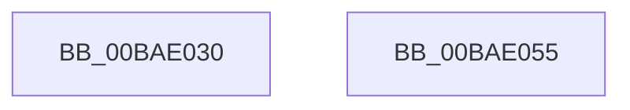

# VfMiscKeWaitForMultipleObjects_Entry

- RVA: `0x00BAE030`–`0x00BAE056` (길이 `38` bytes)
- VA: `0x0000000140BAE030`
- 실행 섹션: `PAGEVRFY`
- PDB 이름 있음: `예`; PDB Function 태그: `아니요`
- unwind 정보 RVA: `0x0005D2F4`
- 디코드: `11`개 명령, `38/38` bytes 표시
- 미해석 바이트: `0` (있으면 어셈블리에 `.byte`로 보존)

> 이 문서는 커널 이미지의 기계어와 PDB 기호를 분석해 생성했습니다. 4번과 5번은 함수 원형과 자료형을 바이너리 사용 방식에서 추정한 C 해석이며 원본 소스 복구 결과는 아닙니다.

## 1. Dependencies

- 직접 호출 지점: **1**; 고유 호출 대상: **1**
- 직접 호출자로 확인된 함수: **0**
- RIP 상대 이미지 참조: **0**

### Outgoing calls
- `0x00BAE04B` → [ViMiscValidateKeWaitUsage](ViMiscValidateKeWaitUsage_function_00BAF554.md) (function, `0x00BAF554`)

### Direct callers
- 이 함수 시작 RVA로 연결되는 직접 call은 확인되지 않았습니다. 간접 호출은 완전히 역산할 수 없습니다.

### Static image references
- 디코드된 RIP-relative 메모리 참조가 없습니다.

## 2. Other-region calls and transfers

- 다른 실행 섹션으로 향하는 call: **0**
- 별도 외부 분기/꼬리 이동을 확인하지 못했습니다.

## 3. Assembly (complete function range)

```asm
00BAE030  48 83 EC 38                     sub rsp, 0x38
00BAE034  48 8B 01                        mov rax, qword ptr [rcx]
00BAE037  4C 8B 49 10                     mov r9, qword ptr [rcx + 0x10]
00BAE03B  44 8A 41 19                     mov r8b, byte ptr [rcx + 0x19]
00BAE03F  48 8B 51 28                     mov rdx, qword ptr [rcx + 0x28]
00BAE043  8B 49 30                        mov ecx, dword ptr [rcx + 0x30]
00BAE046  48 89 44 24 20                  mov qword ptr [rsp + 0x20], rax
00BAE04B  E8 04 15 00 00                  call 0x140baf554
00BAE050  48 83 C4 38                     add rsp, 0x38
00BAE054  C3                              ret
00BAE055  CC                              int3
```

## 4. C-style interpretation (structured pseudocode)

```c
__int64 __fastcall VfMiscKeWaitForMultipleObjects_Entry(__int64 a1)
{
    __int64 result;
    __int64 v_rsp;
    unsigned __int64 v_stack_m18;

    v_rsp = (v_rsp) - (56);
    v_stack_m18 = *(unsigned __int64 *)(a1);
    result = ViMiscValidateKeWaitUsage((unsigned int)(*(unsigned int *)(a1 + 48)), *(unsigned __int64 *)(a1 + 40), *(unsigned __int8 *)(a1 + 25), *(unsigned __int64 *)(a1 + 16));
    v_rsp = (v_rsp) + (56);
    return result;
}
```

## 5. (Beta) C Style

```c
int64_t VfMiscKeWaitForMultipleObjects_Entry(void *Arg1)
{
    uint8_t *arg1 = (uint8_t *)Arg1;

    int64_t result;
    int64_t local_rsp;
    uint64_t v_stack_m18;

    local_rsp = (local_rsp) - (56);
    v_stack_m18 = *(uint64_t *)(arg1);
    result = ViMiscValidateKeWaitUsage((uint32_t)(*(uint32_t *)(arg1 + 0x30)), *(uint64_t *)(arg1 + 0x28), *(uint8_t *)(arg1 + 0x19), *(uint64_t *)(arg1 + 0x10));
    local_rsp = (local_rsp) + (56);
    return result;
}
```

### 관측된 메모리 오프셋

구조체 형식이 확인되지 않은 접근은 인자 기준의 오프셋으로만 기록했습니다.

| 기준 인자 | 오프셋 표현 | 폭 (bit) | 접근 |
|---|---:|---:|---|
| `Arg1` | `+ 0x0` | `64` | `R` |
| `Arg1` | `+ 0x10` | `64` | `R` |
| `Arg1` | `+ 0x19` | `8` | `R` |
| `Arg1` | `+ 0x28` | `64` | `R` |
| `Arg1` | `+ 0x30` | `32` | `R` |

## 6. Execution-region graph

[열기: 2D/3D 그래프와 함수 탐색 컨트롤 패널](../../../control-panel.html?section=pagevrfy&rva=0x00BAE030&view=graph)

- 2D 그래프는 위에서 아래로 흐르고, 3D 그래프는 빈 공간을 드래그해 회전합니다. Shift+드래그는 이동, 휠은 확대·축소, 함수 노드 선택은 대상 보고서 이동입니다.

### Static fallback


