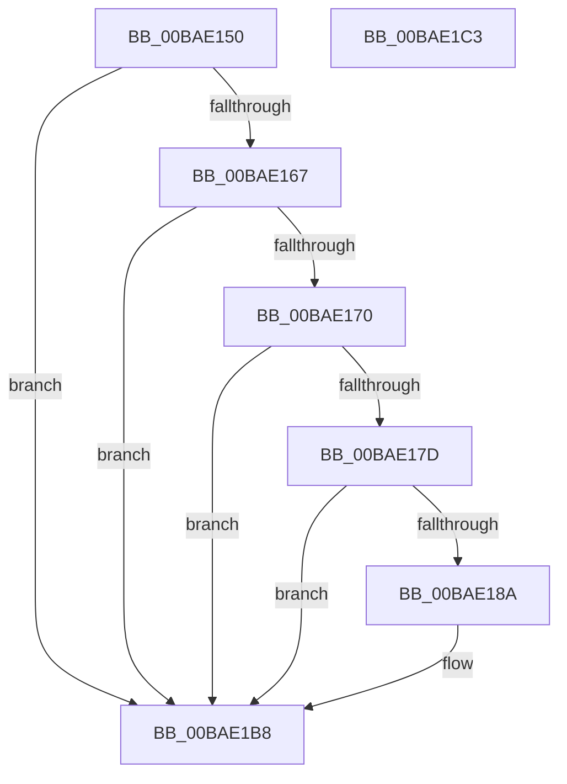

# VfMiscMmBuildMdlForNonPagedPool_Exit

- RVA: `0x00BAE150`–`0x00BAE1C4` (길이 `116` bytes)
- VA: `0x0000000140BAE150`
- 실행 섹션: `PAGEVRFY`
- PDB 이름 있음: `예`; PDB Function 태그: `아니요`
- unwind 정보 RVA: `0x00065960`
- 디코드: `32`개 명령, `116/116` bytes 표시
- 미해석 바이트: `0` (있으면 어셈블리에 `.byte`로 보존)

> 이 문서는 커널 이미지의 기계어와 PDB 기호를 분석해 생성했습니다. 4번과 5번은 함수 원형과 자료형을 바이너리 사용 방식에서 추정한 C 해석이며 원본 소스 복구 결과는 아닙니다.

## 1. Dependencies

- 직접 호출 지점: **3**; 고유 호출 대상: **3**
- 직접 호출자로 확인된 함수: **0**
- RIP 상대 이미지 참조: **1**

### Outgoing calls
- `0x00BAE174` → [MmAreMdlPagesLocked](../BB/MmAreMdlPagesLocked_function_00BB4684.md) (function, `0x00BB4684`)
- `0x00BAE180` → [VfUtilCheckRuleEnforcement](../B9/VfUtilCheckRuleEnforcement_function_00B931E0.md) (function, `0x00B931E0`)
- `0x00BAE1B3` → [CarReportRuleViolationFromNt](../B9/CarReportRuleViolationFromNt_function_00B9D904.md) (function, `0x00B9D904`)

### Direct callers
- 이 함수 시작 RVA로 연결되는 직접 call은 확인되지 않았습니다. 간접 호출은 완전히 역산할 수 없습니다.

### Static image references
- `0x00BAE167` → RVA `0x00F04600` (`.data`; read)

## 2. Other-region calls and transfers

- 다른 실행 섹션으로 향하는 call: **0**
- 별도 외부 분기/꼬리 이동을 확인하지 못했습니다.

## 3. Assembly (complete function range)

```asm
00BAE150  48 89 5C 24 08                  mov qword ptr [rsp + 8], rbx
00BAE155  57                              push rdi
00BAE156  48 83 EC 40                     sub rsp, 0x40
00BAE15A  48 8B D9                        mov rbx, rcx
00BAE15D  44 0F 20 C7                     mov rdi, cr8
00BAE161  40 80 FF 02                     cmp dil, 2
00BAE165  77 51                           ja 0x140bae1b8
00BAE167  83 3D 92 64 35 00 00            cmp dword ptr [rip + 0x356492], 0
00BAE16E  75 48                           jne 0x140bae1b8
00BAE170  48 8B 49 08                     mov rcx, qword ptr [rcx + 8]
00BAE174  E8 0B 65 00 00                  call 0x140bb4684
00BAE179  85 C0                           test eax, eax
00BAE17B  75 3B                           jne 0x140bae1b8
00BAE17D  48 8B 0B                        mov rcx, qword ptr [rbx]
00BAE180  E8 5B 50 FE FF                  call 0x140b931e0
00BAE185  83 F8 01                        cmp eax, 1
00BAE188  75 2E                           jne 0x140bae1b8
00BAE18A  48 8B 03                        mov rax, qword ptr [rbx]
00BAE18D  BA 40 01 00 00                  mov edx, 0x140
00BAE192  4C 8B 4B 08                     mov r9, qword ptr [rbx + 8]
00BAE196  48 89 44 24 30                  mov qword ptr [rsp + 0x30], rax
00BAE19B  44 0F B6 C7                     movzx r8d, dil
00BAE19F  C7 44 24 28 0B 00 00 00         mov dword ptr [rsp + 0x28], 0xb
00BAE1A7  8D 4A 84                        lea ecx, [rdx - 0x7c]
00BAE1AA  49 8B 41 20                     mov rax, qword ptr [r9 + 0x20]
00BAE1AE  48 89 44 24 20                  mov qword ptr [rsp + 0x20], rax
00BAE1B3  E8 4C F7 FE FF                  call 0x140b9d904
00BAE1B8  48 8B 5C 24 50                  mov rbx, qword ptr [rsp + 0x50]
00BAE1BD  48 83 C4 40                     add rsp, 0x40
00BAE1C1  5F                              pop rdi
00BAE1C2  C3                              ret
00BAE1C3  CC                              int3
```

## 4. C-style interpretation (structured pseudocode)

```c
__int64 __fastcall VfMiscMmBuildMdlForNonPagedPool_Exit(__int64 a1)
{
    __int64 result;
    __int64 v_rsp;
    unsigned __int64 v_stack_m18;
    unsigned int v_stack_m20;
    unsigned __int64 v_stack_m28;
    unsigned __int64 v_stack_p8;

    v_stack_p8 = v_rbx;
    v_rsp = (v_rsp) - (64);
    if (((unsigned __int8)(v_cr8)) > 2) goto loc_00BAE1B8;
    if ((*(unsigned int *)(v_rip + 3499154)) != 0) goto loc_00BAE1B8;
    result = MmAreMdlPagesLocked(*(unsigned __int64 *)(a1 + 8), a2, a3, a4);
    if ((unsigned int)(result) != 0) goto loc_00BAE1B8;
    result = VfUtilCheckRuleEnforcement(*(unsigned __int64 *)(a1), a2, a3, a4);
    if (((unsigned int)(result)) == 1) {
        result = *(unsigned __int64 *)(a1);
        a2 = 320;
        a4 = *(unsigned __int64 *)(a1 + 8);
        v_stack_m18 = result;
        a3 = (unsigned __int8)(v_cr8);
        v_stack_m20 = 11;
        a1 = a2 - 124;
        result = *(unsigned __int64 *)(a4 + 32);
        v_stack_m28 = result;
        result = CarReportRuleViolationFromNt(a1, a2, a3, a4);
    }
    v_rsp = (v_rsp) + (64);
    return result;
}
```

## 5. (Beta) C Style

```c
int64_t VfMiscMmBuildMdlForNonPagedPool_Exit(void *Arg1)
{
    uint8_t *arg1 = (uint8_t *)Arg1;

    int64_t result;
    int64_t local_rsp;
    uint64_t v_stack_m18;
    uint32_t v_stack_m20;
    uint64_t v_stack_m28;
    uint64_t v_stack_p8;

    v_stack_p8 = local_rbx;
    local_rsp = (local_rsp) - (64);
    if (((uint8_t)(v_cr8)) > 2) goto loc_00BAE1B8;
    if ((*(uint32_t *)(v_rip + 0x356492)) != 0) goto loc_00BAE1B8;
    result = MmAreMdlPagesLocked(*(uint64_t *)(arg1 + 0x8), a2, a3, a4);
    if ((uint32_t)(result) != 0) goto loc_00BAE1B8;
    result = VfUtilCheckRuleEnforcement(*(uint64_t *)(arg1), a2, a3, a4);
    if (((uint32_t)(result)) == 1) {
        result = *(uint64_t *)(arg1);
        a2 = 320;
        a4 = *(uint64_t *)(arg1 + 0x8);
        v_stack_m18 = result;
        a3 = (uint8_t)(v_cr8);
        v_stack_m20 = 11;
        Arg1 = a2 - 124;
        result = *(uint64_t *)(a4 + 0x20);
        v_stack_m28 = result;
        result = CarReportRuleViolationFromNt(Arg1, a2, a3, a4);
    }
    local_rsp = (local_rsp) + (64);
    return result;
}
```

### 관측된 메모리 오프셋

구조체 형식이 확인되지 않은 접근은 인자 기준의 오프셋으로만 기록했습니다.

| 기준 인자 | 오프셋 표현 | 폭 (bit) | 접근 |
|---|---:|---:|---|
| `Arg1` | `+ 0x0` | `64` | `R` |
| `Arg1` | `+ 0x8` | `64` | `R` |

## 6. Execution-region graph

[열기: 2D/3D 그래프와 함수 탐색 컨트롤 패널](../../../control-panel.html?section=pagevrfy&rva=0x00BAE150&view=graph)

- 2D 그래프는 위에서 아래로 흐르고, 3D 그래프는 빈 공간을 드래그해 회전합니다. Shift+드래그는 이동, 휠은 확대·축소, 함수 노드 선택은 대상 보고서 이동입니다.

### Static fallback


