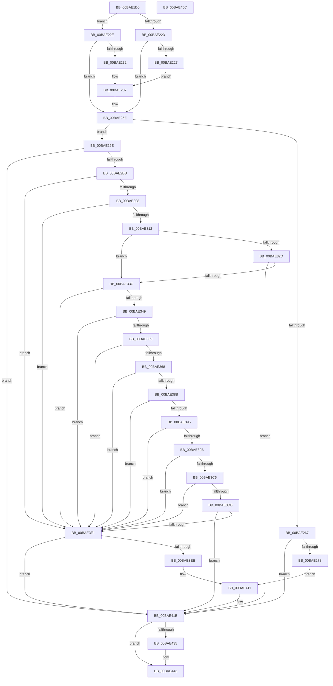

# VfMiscMmUnmapLockedPages_Entry

- RVA: `0x00BAE1D0`–`0x00BAE45D` (길이 `653` bytes)
- VA: `0x0000000140BAE1D0`
- 실행 섹션: `PAGEVRFY`
- PDB 이름 있음: `예`; PDB Function 태그: `아니요`
- unwind 정보 RVA: `0x000D28F8`
- 디코드: `156`개 명령, `653/653` bytes 표시
- 미해석 바이트: `0` (있으면 어셈블리에 `.byte`로 보존)

> 이 문서는 커널 이미지의 기계어와 PDB 기호를 분석해 생성했습니다. 4번과 5번은 함수 원형과 자료형을 바이너리 사용 방식에서 추정한 C 해석이며 원본 소스 복구 결과는 아닙니다.

## 1. Dependencies

- 직접 호출 지점: **8**; 고유 호출 대상: **5**
- 직접 호출자로 확인된 함수: **0**
- RIP 상대 이미지 참조: **1**

### Outgoing calls
- `0x00BAE259` → [CarReportRuleViolationFromNt](../B9/CarReportRuleViolationFromNt_function_00B9D904.md) (function, `0x00B9D904`)
- `0x00BAE2AE` → [PsGetProcessExitProcessCalled](../../text/47/PsGetProcessExitProcessCalled_function_00477E00.md) (function, `0x00477E00`)
- `0x00BAE2FB` → [ZwQueryVirtualMemory](../../text/6A/ZwQueryVirtualMemory_function_006AD530.md) (function, `0x006AD530`)
- `0x00BAE382` → [ZwQueryVirtualMemory](../../text/6A/ZwQueryVirtualMemory_function_006AD530.md) (function, `0x006AD530`)
- `0x00BAE3BD` → [ZwQueryVirtualMemory](../../text/6A/ZwQueryVirtualMemory_function_006AD530.md) (function, `0x006AD530`)
- `0x00BAE3E4` → [VfUtilCheckRuleEnforcement](../B9/VfUtilCheckRuleEnforcement_function_00B931E0.md) (function, `0x00B931E0`)
- `0x00BAE416` → [CarReportRuleViolationFromNt](../B9/CarReportRuleViolationFromNt_function_00B9D904.md) (function, `0x00B9D904`)
- `0x00BAE43E` → [ViTargetAddToCounter](../B9/ViTargetAddToCounter_function_00B9B8E0.md) (function, `0x00B9B8E0`)

### Direct callers
- 이 함수 시작 RVA로 연결되는 직접 call은 확인되지 않았습니다. 간접 호출은 완전히 역산할 수 없습니다.

### Static image references
- `0x00BAE429` → RVA `0x00F04A20` (`.data`; read)

## 2. Other-region calls and transfers

- 다른 실행 섹션으로 향하는 call: **4**
  - `0x00BAE2AE` → [PsGetProcessExitProcessCalled](../../text/47/PsGetProcessExitProcessCalled_function_00477E00.md) (`PAGEVRFY` → `.text`)
  - `0x00BAE2FB` → [ZwQueryVirtualMemory](../../text/6A/ZwQueryVirtualMemory_function_006AD530.md) (`PAGEVRFY` → `.text`)
  - `0x00BAE382` → [ZwQueryVirtualMemory](../../text/6A/ZwQueryVirtualMemory_function_006AD530.md) (`PAGEVRFY` → `.text`)
  - `0x00BAE3BD` → [ZwQueryVirtualMemory](../../text/6A/ZwQueryVirtualMemory_function_006AD530.md) (`PAGEVRFY` → `.text`)
- 별도 외부 분기/꼬리 이동을 확인하지 못했습니다.

## 3. Assembly (complete function range)

```asm
00BAE1D0  48 8B C4                        mov rax, rsp
00BAE1D3  48 89 58 08                     mov qword ptr [rax + 8], rbx
00BAE1D7  48 89 70 10                     mov qword ptr [rax + 0x10], rsi
00BAE1DB  48 89 78 18                     mov qword ptr [rax + 0x18], rdi
00BAE1DF  55                              push rbp
00BAE1E0  48 8D 68 A1                     lea rbp, [rax - 0x5f]
00BAE1E4  48 81 EC A0 00 00 00            sub rsp, 0xa0
00BAE1EB  0F 57 C0                        xorps xmm0, xmm0
00BAE1EE  0F 57 C9                        xorps xmm1, xmm1
00BAE1F1  0F 11 45 F7                     movups xmmword ptr [rbp - 9], xmm0
00BAE1F5  48 8B D9                        mov rbx, rcx
00BAE1F8  0F 11 45 07                     movups xmmword ptr [rbp + 7], xmm0
00BAE1FC  0F 11 45 17                     movups xmmword ptr [rbp + 0x17], xmm0
00BAE200  0F 11 4D 27                     movups xmmword ptr [rbp + 0x27], xmm1
00BAE204  0F 11 4D 37                     movups xmmword ptr [rbp + 0x37], xmm1
00BAE208  0F 11 4D 47                     movups xmmword ptr [rbp + 0x47], xmm1
00BAE20C  44 0F 20 C0                     mov rax, cr8
00BAE210  4C 8B 49 10                     mov r9, qword ptr [rcx + 0x10]
00BAE214  48 BF FF FF FE FF FF 7F 00 00   movabs rdi, 0x7ffffffeffff
00BAE21E  4C 3B CF                        cmp r9, rdi
00BAE221  76 0B                           jbe 0x140bae22e
00BAE223  3C 02                           cmp al, 2
00BAE225  76 37                           jbe 0x140bae25e
00BAE227  BA 79 00 00 00                  mov edx, 0x79
00BAE22C  EB 09                           jmp 0x140bae237
00BAE22E  3C 01                           cmp al, 1
00BAE230  76 2C                           jbe 0x140bae25e
00BAE232  BA 7A 00 00 00                  mov edx, 0x7a
00BAE237  44 0F B6 C0                     movzx r8d, al
00BAE23B  48 8B 01                        mov rax, qword ptr [rcx]
00BAE23E  48 89 44 24 30                  mov qword ptr [rsp + 0x30], rax
00BAE243  48 8B 41 08                     mov rax, qword ptr [rcx + 8]
00BAE247  B9 C4 00 00 00                  mov ecx, 0xc4
00BAE24C  C7 44 24 28 0B 00 00 00         mov dword ptr [rsp + 0x28], 0xb
00BAE254  48 89 44 24 20                  mov qword ptr [rsp + 0x20], rax
00BAE259  E8 A6 F6 FE FF                  call 0x140b9d904
00BAE25E  48 8B 73 10                     mov rsi, qword ptr [rbx + 0x10]
00BAE262  48 3B F7                        cmp rsi, rdi
00BAE265  76 37                           jbe 0x140bae29e
00BAE267  4C 8B 43 08                     mov r8, qword ptr [rbx + 8]
00BAE26B  49 0F BF 40 0A                  movsx rax, word ptr [r8 + 0xa]
00BAE270  A8 01                           test al, 1
00BAE272  0F 85 A3 01 00 00               jne 0x140bae41b
00BAE278  4C 8B C8                        mov r9, rax
00BAE27B  BA B6 00 00 00                  mov edx, 0xb6
00BAE280  48 8B 03                        mov rax, qword ptr [rbx]
00BAE283  48 89 44 24 30                  mov qword ptr [rsp + 0x30], rax
00BAE288  C7 44 24 28 0B 00 00 00         mov dword ptr [rsp + 0x28], 0xb
00BAE290  48 C7 44 24 20 01 00 00 00      mov qword ptr [rsp + 0x20], 1
00BAE299  E9 73 01 00 00                  jmp 0x140bae411
00BAE29E  65 48 8B 0C 25 88 01 00 00      mov rcx, qword ptr gs:[0x188]
00BAE2A7  48 8B 89 B8 00 00 00            mov rcx, qword ptr [rcx + 0xb8]
00BAE2AE  E8 4D 9B 8C FF                  call 0x140477e00
00BAE2B3  84 C0                           test al, al
00BAE2B5  0F 85 60 01 00 00               jne 0x140bae41b
00BAE2BB  48 8B 43 08                     mov rax, qword ptr [rbx + 8]
00BAE2BF  4C 8D 4D F7                     lea r9, [rbp - 9]
00BAE2C3  48 83 64 24 28 00               and qword ptr [rsp + 0x28], 0
00BAE2C9  48 8B D6                        mov rdx, rsi
00BAE2CC  48 83 CE FF                     or rsi, 0xffffffffffffffff
00BAE2D0  48 C7 44 24 20 30 00 00 00      mov qword ptr [rsp + 0x20], 0x30
00BAE2D9  41 B8 07 00 00 00               mov r8d, 7
00BAE2DF  8B 48 2C                        mov ecx, dword ptr [rax + 0x2c]
00BAE2E2  03 48 20                        add ecx, dword ptr [rax + 0x20]
00BAE2E5  8B 78 28                        mov edi, dword ptr [rax + 0x28]
00BAE2E8  81 E1 FF 0F 00 00               and ecx, 0xfff
00BAE2EE  48 81 C7 FF 0F 00 00            add rdi, 0xfff
00BAE2F5  48 03 F9                        add rdi, rcx
00BAE2F8  48 8B CE                        mov rcx, rsi
00BAE2FB  E8 30 F2 AF FF                  call 0x1406ad530
00BAE300  85 C0                           test eax, eax
00BAE302  0F 88 D9 00 00 00               js 0x140bae3e1
00BAE308  F6 45 03 01                     test byte ptr [rbp + 3], 1
00BAE30C  0F 84 CF 00 00 00               je 0x140bae3e1
00BAE312  48 8B 4B 10                     mov rcx, qword ptr [rbx + 0x10]
00BAE316  49 C7 C1 00 F0 FF FF            mov r9, 0xfffffffffffff000
00BAE31D  48 8B 55 F7                     mov rdx, qword ptr [rbp - 9]
00BAE321  49 23 C9                        and rcx, r9
00BAE324  4C 8B 45 07                     mov r8, qword ptr [rbp + 7]
00BAE328  48 3B D1                        cmp rdx, rcx
00BAE32B  75 0F                           jne 0x140bae33c
00BAE32D  48 8B C7                        mov rax, rdi
00BAE330  49 23 C1                        and rax, r9
00BAE333  4C 3B C0                        cmp r8, rax
00BAE336  0F 84 DF 00 00 00               je 0x140bae41b
00BAE33C  49 81 F8 00 30 00 00            cmp r8, 0x3000
00BAE343  0F 82 98 00 00 00               jb 0x140bae3e1
00BAE349  48 8D 82 00 10 00 00            lea rax, [rdx + 0x1000]
00BAE350  48 3B C1                        cmp rax, rcx
00BAE353  0F 85 88 00 00 00               jne 0x140bae3e1
00BAE359  49 23 F9                        and rdi, r9
00BAE35C  49 8D 80 00 E0 FF FF            lea rax, [r8 - 0x2000]
00BAE363  48 3B C7                        cmp rax, rdi
00BAE366  75 79                           jne 0x140bae3e1
00BAE368  48 83 64 24 28 00               and qword ptr [rsp + 0x28], 0
00BAE36E  4C 8D 4D 27                     lea r9, [rbp + 0x27]
00BAE372  BF 30 00 00 00                  mov edi, 0x30
00BAE377  45 33 C0                        xor r8d, r8d
00BAE37A  48 8B CE                        mov rcx, rsi
00BAE37D  48 89 7C 24 20                  mov qword ptr [rsp + 0x20], rdi
00BAE382  E8 A9 F1 AF FF                  call 0x1406ad530
00BAE387  85 C0                           test eax, eax
00BAE389  78 56                           js 0x140bae3e1
00BAE38B  48 8B 55 F7                     mov rdx, qword ptr [rbp - 9]
00BAE38F  48 39 55 27                     cmp qword ptr [rbp + 0x27], rdx
00BAE393  75 4C                           jne 0x140bae3e1
00BAE395  83 7D 4B 00                     cmp dword ptr [rbp + 0x4b], 0
00BAE399  75 46                           jne 0x140bae3e1
00BAE39B  48 8B 45 07                     mov rax, qword ptr [rbp + 7]
00BAE39F  4C 8D 4D 27                     lea r9, [rbp + 0x27]
00BAE3A3  48 83 64 24 28 00               and qword ptr [rsp + 0x28], 0
00BAE3A9  48 05 00 F0 FF FF               add rax, -0x1000
00BAE3AF  48 03 D0                        add rdx, rax
00BAE3B2  48 89 7C 24 20                  mov qword ptr [rsp + 0x20], rdi
00BAE3B7  45 33 C0                        xor r8d, r8d
00BAE3BA  48 8B CE                        mov rcx, rsi
00BAE3BD  E8 6E F1 AF FF                  call 0x1406ad530
00BAE3C2  85 C0                           test eax, eax
00BAE3C4  78 1B                           js 0x140bae3e1
00BAE3C6  48 8B 4D 07                     mov rcx, qword ptr [rbp + 7]
00BAE3CA  48 81 C1 00 F0 FF FF            add rcx, -0x1000
00BAE3D1  48 03 4D F7                     add rcx, qword ptr [rbp - 9]
00BAE3D5  48 39 4D 27                     cmp qword ptr [rbp + 0x27], rcx
00BAE3D9  75 06                           jne 0x140bae3e1
00BAE3DB  83 7D 4B 00                     cmp dword ptr [rbp + 0x4b], 0
00BAE3DF  74 3A                           je 0x140bae41b
00BAE3E1  48 8B 0B                        mov rcx, qword ptr [rbx]
00BAE3E4  E8 F7 4D FE FF                  call 0x140b931e0
00BAE3E9  83 F8 01                        cmp eax, 1
00BAE3EC  75 2D                           jne 0x140bae41b
00BAE3EE  48 8B 03                        mov rax, qword ptr [rbx]
00BAE3F1  BA B9 00 00 00                  mov edx, 0xb9
00BAE3F6  4C 8B 4B 08                     mov r9, qword ptr [rbx + 8]
00BAE3FA  4C 8B 43 10                     mov r8, qword ptr [rbx + 0x10]
00BAE3FE  48 89 44 24 30                  mov qword ptr [rsp + 0x30], rax
00BAE403  C7 44 24 28 0B 00 00 00         mov dword ptr [rsp + 0x28], 0xb
00BAE40B  48 83 64 24 20 00               and qword ptr [rsp + 0x20], 0
00BAE411  B9 C4 00 00 00                  mov ecx, 0xc4
00BAE416  E8 E9 F4 FE FF                  call 0x140b9d904
00BAE41B  48 8B 43 08                     mov rax, qword ptr [rbx + 8]
00BAE41F  48 8B 0B                        mov rcx, qword ptr [rbx]
00BAE422  44 8B 48 28                     mov r9d, dword ptr [rax + 0x28]
00BAE426  49 F7 D9                        neg r9
00BAE429  F7 05 ED 65 35 00 00 10 00 00   test dword ptr [rip + 0x3565ed], 0x1000
00BAE433  74 0E                           je 0x140bae443
00BAE435  BA C8 00 00 00                  mov edx, 0xc8
00BAE43A  44 8D 42 08                     lea r8d, [rdx + 8]
00BAE43E  E8 9D D4 FE FF                  call 0x140b9b8e0
00BAE443  4C 8D 9C 24 A0 00 00 00         lea r11, [rsp + 0xa0]
00BAE44B  49 8B 5B 10                     mov rbx, qword ptr [r11 + 0x10]
00BAE44F  49 8B 73 18                     mov rsi, qword ptr [r11 + 0x18]
00BAE453  49 8B 7B 20                     mov rdi, qword ptr [r11 + 0x20]
00BAE457  49 8B E3                        mov rsp, r11
00BAE45A  5D                              pop rbp
00BAE45B  C3                              ret
00BAE45C  CC                              int3
```

## 4. C-style interpretation (structured pseudocode)

```c
__int64 __fastcall VfMiscMmUnmapLockedPages_Entry(__int64 a1)
{
    __int64 result;
    __int64 v_rdi;
    __int64 v_rsi;
    __int64 v_rsp;
    unsigned __int64 v_stack_m78;
    unsigned __int64 v_stack_m8;
    unsigned int v_stack_m80;
    unsigned __int64 v_stack_m88;

    *(unsigned __int64 *)(v_rsp + 8) = v_rbx;
    *(unsigned __int64 *)(v_rsp + 16) = v_rsi;
    *(unsigned __int64 *)(v_rsp + 24) = v_rdi;
    v_rsp = (v_rsp) - (160);
    *(unsigned __int64 *)(v_rsp - 95 - 9) = v_xmm0;
    *(unsigned __int64 *)(v_rsp - 95 + 7) = v_xmm0;
    *(unsigned __int64 *)(v_rsp - 95 + 23) = v_xmm0;
    *(unsigned __int64 *)(v_rsp - 95 + 39) = v_xmm1;
    *(unsigned __int64 *)(v_rsp - 95 + 55) = v_xmm1;
    *(unsigned __int64 *)(v_rsp - 95 + 71) = v_xmm1;
    if ((*(unsigned __int64 *)(a1 + 16)) <= v_rdi) goto loc_00BAE22E;
    if (((unsigned __int8)(v_cr8)) <= 2) goto loc_00BAE25E;
    goto loc_00BAE237;
loc_00BAE22E:
    if (((unsigned __int8)(v_cr8)) <= 1) goto loc_00BAE25E;
loc_00BAE237:
    v_stack_m78 = *(unsigned __int64 *)(a1);
    v_stack_m80 = 11;
    v_stack_m88 = *(unsigned __int64 *)(a1 + 8);
    result = CarReportRuleViolationFromNt(196, 122, (unsigned __int8)(v_cr8), *(unsigned __int64 *)(a1 + 16));
loc_00BAE25E:
    if ((*(unsigned __int64 *)(a1 + 16)) <= v_rdi) goto loc_00BAE29E;
    if ((((unsigned __int8)((__int16)(*(unsigned __int16 *)(*(unsigned __int64 *)(a1 + 8) + 10)))) & (1)) != 0) goto loc_00BAE41B;
    v_stack_m78 = *(unsigned __int64 *)(a1);
    v_stack_m80 = 11;
    v_stack_m88 = 1;
    goto loc_00BAE411;
loc_00BAE29E:
    result = PsGetProcessExitProcessCalled(*(unsigned __int64 *)(*(unsigned __int64 *)(gs_base + (0 + 392)) + 184), 182, *(unsigned __int64 *)(a1 + 8), (__int16)(*(unsigned __int16 *)(*(unsigned __int64 *)(a1 + 8) + 10)));
    if ((unsigned __int8)(result) != 0) goto loc_00BAE41B;
    v_rsi = (*(unsigned __int64 *)(a1 + 16)) | (-1);
    v_stack_m88 = 48;
    a1 = (unsigned int)(((unsigned int)(*(unsigned int *)(*(unsigned __int64 *)(a1 + 8) + 44))) + (*(unsigned int *)(*(unsigned __int64 *)(a1 + 8) + 32)));
    a1 = (unsigned int)((a1) & (0xFFFULL));
    v_rdi = ((unsigned int)(*(unsigned int *)(*(unsigned __int64 *)(a1 + 8) + 40))) + (0xFFFULL);
    v_rdi = (v_rdi) + (a1);
    result = ZwQueryVirtualMemory(v_rsi, *(unsigned __int64 *)(a1 + 16), 7, v_rsp - 95 - 9);
    if (sign_flag) goto loc_00BAE3E1;
    if (((*(unsigned __int8 *)(v_rsp - 95 + 3)) & (1)) == 0) goto loc_00BAE3E1;
    a1 = (*(unsigned __int64 *)(a1 + 16)) & (0xFFFFFFFFFFFFF000ULL);
    if ((*(unsigned __int64 *)(v_rsp - 95 - 9)) != a1) goto loc_00BAE33C;
    result = (v_rdi) & (0xFFFFFFFFFFFFF000ULL);
    if ((*(unsigned __int64 *)(v_rsp - 95 + 7)) == result) goto loc_00BAE41B;
loc_00BAE33C:
    if ((*(unsigned __int64 *)(v_rsp - 95 + 7)) < 0x3000ULL) goto loc_00BAE3E1;
    if ((*(unsigned __int64 *)(v_rsp - 95 - 9) + 4096) != a1) goto loc_00BAE3E1;
    v_rdi = (v_rdi) & (0xFFFFFFFFFFFFF000ULL);
    if ((*(unsigned __int64 *)(v_rsp - 95 + 7) - 8192) != v_rdi) goto loc_00BAE3E1;
    a3 = 0;
    v_stack_m88 = 48;
    result = ZwQueryVirtualMemory(v_rsi, *(unsigned __int64 *)(v_rsp - 95 - 9), a3, v_rsp - 95 + 39);
    if (sign_flag) goto loc_00BAE3E1;
    if ((*(unsigned __int64 *)(v_rsp - 95 + 39)) != (*(unsigned __int64 *)(v_rsp - 95 - 9))) goto loc_00BAE3E1;
    if ((*(unsigned int *)(v_rsp - 95 + 75)) != 0) goto loc_00BAE3E1;
    result = (*(unsigned __int64 *)(v_rsp - 95 + 7)) + (0xFFFFFFFFFFFFF000ULL);
    a2 = (*(unsigned __int64 *)(v_rsp - 95 - 9)) + (result);
    v_stack_m88 = 48;
    a3 = 0;
    result = ZwQueryVirtualMemory(v_rsi, a2, a3, v_rsp - 95 + 39);
    if (sign_flag) goto loc_00BAE3E1;
    a1 = (*(unsigned __int64 *)(v_rsp - 95 + 7)) + (0xFFFFFFFFFFFFF000ULL);
    a1 = (a1) + (*(unsigned __int64 *)(v_rsp - 95 - 9));
    if ((*(unsigned __int64 *)(v_rsp - 95 + 39)) != a1) goto loc_00BAE3E1;
    if ((*(unsigned int *)(v_rsp - 95 + 75)) == 0) goto loc_00BAE41B;
loc_00BAE3E1:
    result = VfUtilCheckRuleEnforcement(*(unsigned __int64 *)(a1), a2, a3, v_rsp - 95 + 39);
    if (((unsigned int)(result)) != 1) goto loc_00BAE41B;
    v_stack_m78 = *(unsigned __int64 *)(a1);
    v_stack_m80 = 11;
loc_00BAE411:
    result = CarReportRuleViolationFromNt(196, 185, *(unsigned __int64 *)(a1 + 16), *(unsigned __int64 *)(a1 + 8));
loc_00BAE41B:
    a4 = -((unsigned int)(*(unsigned int *)(*(unsigned __int64 *)(a1 + 8) + 40)));
    result = *(unsigned __int64 *)(a1 + 8);
    if (((*(unsigned int *)(v_rip + 3499501)) & (0x1000ULL)) != 0) {
        a2 = 200;
        a3 = a2 + 8;
        result = ViTargetAddToCounter(*(unsigned __int64 *)(a1), a2, a3, a4);
    }
    return result;
}
```

## 5. (Beta) C Style

```c
int64_t VfMiscMmUnmapLockedPages_Entry(void *Arg1)
{
    uint8_t *arg1 = (uint8_t *)Arg1;

    int64_t result;
    int64_t local_rdi;
    int64_t local_rsi;
    int64_t local_rsp;
    uint64_t v_stack_m78;
    uint64_t v_stack_m8;
    uint32_t v_stack_m80;
    uint64_t v_stack_m88;

    *(uint64_t *)(local_rsp + 0x8) = local_rbx;
    *(uint64_t *)(local_rsp + 0x10) = local_rsi;
    *(uint64_t *)(local_rsp + 0x18) = local_rdi;
    local_rsp = (local_rsp) - (160);
    *(uint64_t *)(local_rsp - 0x5F - 0x9) = v_xmm0;
    *(uint64_t *)(local_rsp - 0x5F + 0x7) = v_xmm0;
    *(uint64_t *)(local_rsp - 0x5F + 0x17) = v_xmm0;
    *(uint64_t *)(local_rsp - 0x5F + 0x27) = v_xmm1;
    *(uint64_t *)(local_rsp - 0x5F + 0x37) = v_xmm1;
    *(uint64_t *)(local_rsp - 0x5F + 0x47) = v_xmm1;
    if ((*(uint64_t *)(arg1 + 0x10)) <= local_rdi) goto loc_00BAE22E;
    if (((uint8_t)(v_cr8)) <= 2) goto loc_00BAE25E;
    goto loc_00BAE237;
loc_00BAE22E:
    if (((uint8_t)(v_cr8)) <= 1) goto loc_00BAE25E;
loc_00BAE237:
    v_stack_m78 = *(uint64_t *)(arg1);
    v_stack_m80 = 11;
    v_stack_m88 = *(uint64_t *)(arg1 + 0x8);
    result = CarReportRuleViolationFromNt(196, 122, (uint8_t)(v_cr8), *(uint64_t *)(arg1 + 0x10));
loc_00BAE25E:
    if ((*(uint64_t *)(arg1 + 0x10)) <= local_rdi) goto loc_00BAE29E;
    if ((((uint8_t)((int16_t)(*(uint16_t *)(*(uint64_t *)(arg1 + 0x8) + 0xA)))) & (1)) != 0) goto loc_00BAE41B;
    v_stack_m78 = *(uint64_t *)(arg1);
    v_stack_m80 = 11;
    v_stack_m88 = 1;
    goto loc_00BAE411;
loc_00BAE29E:
    result = PsGetProcessExitProcessCalled(*(uint64_t *)(*(uint64_t *)(gs_base + (0 + 0x188)) + 0xB8), 182, *(uint64_t *)(arg1 + 0x8), (int16_t)(*(uint16_t *)(*(uint64_t *)(arg1 + 0x8) + 0xA)));
    if ((uint8_t)(result) != 0) goto loc_00BAE41B;
    local_rsi = (*(uint64_t *)(arg1 + 0x10)) | (-1);
    v_stack_m88 = 48;
    Arg1 = (uint32_t)(((uint32_t)(*(uint32_t *)(*(uint64_t *)(arg1 + 0x8) + 0x2C))) + (*(uint32_t *)(*(uint64_t *)(arg1 + 0x8) + 0x20)));
    Arg1 = (uint32_t)((Arg1) & (0xFFFULL));
    local_rdi = ((uint32_t)(*(uint32_t *)(*(uint64_t *)(arg1 + 0x8) + 0x28))) + (0xFFFULL);
    local_rdi = (local_rdi) + (Arg1);
    result = ZwQueryVirtualMemory(local_rsi, *(uint64_t *)(arg1 + 0x10), 7, local_rsp - 95 - 9);
    if (sign_flag) goto loc_00BAE3E1;
    if (((*(uint8_t *)(local_rsp - 0x5F + 0x3)) & (1)) == 0) goto loc_00BAE3E1;
    Arg1 = (*(uint64_t *)(arg1 + 0x10)) & (0xFFFFFFFFFFFFF000ULL);
    if ((*(uint64_t *)(local_rsp - 0x5F - 0x9)) != Arg1) goto loc_00BAE33C;
    result = (local_rdi) & (0xFFFFFFFFFFFFF000ULL);
    if ((*(uint64_t *)(local_rsp - 0x5F + 0x7)) == result) goto loc_00BAE41B;
loc_00BAE33C:
    if ((*(uint64_t *)(local_rsp - 0x5F + 0x7)) < 0x3000ULL) goto loc_00BAE3E1;
    if ((*(uint64_t *)(local_rsp - 0x5F - 0x9) + 4096) != Arg1) goto loc_00BAE3E1;
    local_rdi = (local_rdi) & (0xFFFFFFFFFFFFF000ULL);
    if ((*(uint64_t *)(local_rsp - 0x5F + 0x7) - 8192) != local_rdi) goto loc_00BAE3E1;
    a3 = 0;
    v_stack_m88 = 48;
    result = ZwQueryVirtualMemory(local_rsi, *(uint64_t *)(local_rsp - 0x5F - 0x9), a3, local_rsp - 95 + 39);
    if (sign_flag) goto loc_00BAE3E1;
    if ((*(uint64_t *)(local_rsp - 0x5F + 0x27)) != (*(uint64_t *)(local_rsp - 0x5F - 0x9))) goto loc_00BAE3E1;
    if ((*(uint32_t *)(local_rsp - 0x5F + 0x4B)) != 0) goto loc_00BAE3E1;
    result = (*(uint64_t *)(local_rsp - 0x5F + 0x7)) + (0xFFFFFFFFFFFFF000ULL);
    a2 = (*(uint64_t *)(local_rsp - 0x5F - 0x9)) + (result);
    v_stack_m88 = 48;
    a3 = 0;
    result = ZwQueryVirtualMemory(local_rsi, a2, a3, local_rsp - 95 + 39);
    if (sign_flag) goto loc_00BAE3E1;
    Arg1 = (*(uint64_t *)(local_rsp - 0x5F + 0x7)) + (0xFFFFFFFFFFFFF000ULL);
    Arg1 = (Arg1) + (*(uint64_t *)(local_rsp - 0x5F - 0x9));
    if ((*(uint64_t *)(local_rsp - 0x5F + 0x27)) != Arg1) goto loc_00BAE3E1;
    if ((*(uint32_t *)(local_rsp - 0x5F + 0x4B)) == 0) goto loc_00BAE41B;
loc_00BAE3E1:
    result = VfUtilCheckRuleEnforcement(*(uint64_t *)(arg1), a2, a3, local_rsp - 95 + 39);
    if (((uint32_t)(result)) != 1) goto loc_00BAE41B;
    v_stack_m78 = *(uint64_t *)(arg1);
    v_stack_m80 = 11;
loc_00BAE411:
    result = CarReportRuleViolationFromNt(196, 185, *(uint64_t *)(arg1 + 0x10), *(uint64_t *)(arg1 + 0x8));
loc_00BAE41B:
    a4 = -((uint32_t)(*(uint32_t *)(*(uint64_t *)(arg1 + 0x8) + 0x28)));
    result = *(uint64_t *)(arg1 + 0x8);
    if (((*(uint32_t *)(v_rip + 0x3565ED)) & (0x1000ULL)) != 0) {
        a2 = 200;
        a3 = a2 + 8;
        result = ViTargetAddToCounter(*(uint64_t *)(arg1), a2, a3, a4);
    }
    return result;
}
```

### 관측된 메모리 오프셋

구조체 형식이 확인되지 않은 접근은 인자 기준의 오프셋으로만 기록했습니다.

| 기준 인자 | 오프셋 표현 | 폭 (bit) | 접근 |
|---|---:|---:|---|
| `Arg1` | `+ 0x0` | `64` | `R` |
| `Arg1` | `+ 0x8` | `64` | `R` |
| `Arg1` | `+ 0x10` | `64` | `R` |

## 6. Execution-region graph

[열기: 2D/3D 그래프와 함수 탐색 컨트롤 패널](../../../control-panel.html?section=pagevrfy&rva=0x00BAE1D0&view=graph)

- 2D 그래프는 위에서 아래로 흐르고, 3D 그래프는 빈 공간을 드래그해 회전합니다. Shift+드래그는 이동, 휠은 확대·축소, 함수 노드 선택은 대상 보고서 이동입니다.

### Static fallback


