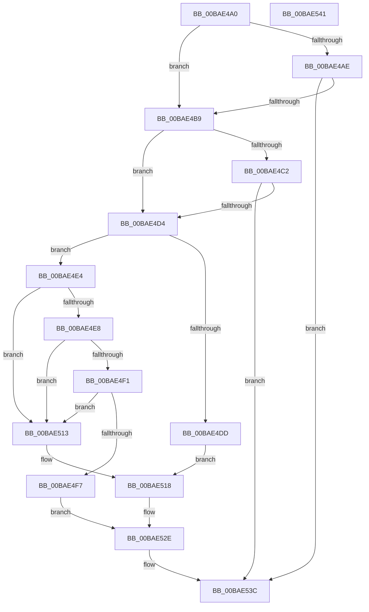

# VfMiscObReferenceObjectByHandle_Exit

- RVA: `0x00BAE4A0`–`0x00BAE542` (길이 `162` bytes)
- VA: `0x0000000140BAE4A0`
- 실행 섹션: `PAGEVRFY`
- PDB 이름 있음: `예`; PDB Function 태그: `아니요`
- unwind 정보 RVA: `0x00063458`
- 디코드: `40`개 명령, `162/162` bytes 표시
- 미해석 바이트: `0` (있으면 어셈블리에 `.byte`로 보존)

> 이 문서는 커널 이미지의 기계어와 PDB 기호를 분석해 생성했습니다. 4번과 5번은 함수 원형과 자료형을 바이너리 사용 방식에서 추정한 C 해석이며 원본 소스 복구 결과는 아닙니다.

## 1. Dependencies

- 직접 호출 지점: **1**; 고유 호출 대상: **1**
- 직접 호출자로 확인된 함수: **0**
- RIP 상대 이미지 참조: **0**

### Outgoing calls
- `0x00BAE537` → [CarReportRuleViolationFromNt](../B9/CarReportRuleViolationFromNt_function_00B9D904.md) (function, `0x00B9D904`)

### Direct callers
- 이 함수 시작 RVA로 연결되는 직접 call은 확인되지 않았습니다. 간접 호출은 완전히 역산할 수 없습니다.

### Static image references
- 디코드된 RIP-relative 메모리 참조가 없습니다.

## 2. Other-region calls and transfers

- 다른 실행 섹션으로 향하는 call: **0**
- 별도 외부 분기/꼬리 이동을 확인하지 못했습니다.

## 3. Assembly (complete function range)

```asm
00BAE4A0  48 83 EC 48                     sub rsp, 0x48
00BAE4A4  8B 41 38                        mov eax, dword ptr [rcx + 0x38]
00BAE4A7  3D 08 00 00 C0                  cmp eax, 0xc0000008
00BAE4AC  74 0B                           je 0x140bae4b9
00BAE4AE  3D 24 00 00 C0                  cmp eax, 0xc0000024
00BAE4B3  0F 85 83 00 00 00               jne 0x140bae53c
00BAE4B9  48 0F BE 51 18                  movsx rdx, byte ptr [rcx + 0x18]
00BAE4BE  84 D2                           test dl, dl
00BAE4C0  74 12                           je 0x140bae4d4
00BAE4C2  65 48 8B 04 25 88 01 00 00      mov rax, qword ptr gs:[0x188]
00BAE4CB  F7 40 74 00 04 00 00            test dword ptr [rax + 0x74], 0x400
00BAE4D2  74 68                           je 0x140bae53c
00BAE4D4  4C 8B 41 30                     mov r8, qword ptr [rcx + 0x30]
00BAE4D8  4D 85 C0                        test r8, r8
00BAE4DB  75 07                           jne 0x140bae4e4
00BAE4DD  BA F5 00 00 00                  mov edx, 0xf5
00BAE4E2  EB 34                           jmp 0x140bae518
00BAE4E4  84 D2                           test dl, dl
00BAE4E6  74 2B                           je 0x140bae513
00BAE4E8  49 F7 C0 00 00 00 80            test r8, -0x80000000
00BAE4EF  74 22                           je 0x140bae513
00BAE4F1  49 83 F8 FD                     cmp r8, -3
00BAE4F5  77 1C                           ja 0x140bae513
00BAE4F7  48 8B 01                        mov rax, qword ptr [rcx]
00BAE4FA  48 89 44 24 30                  mov qword ptr [rsp + 0x30], rax
00BAE4FF  C7 44 24 28 0B 00 00 00         mov dword ptr [rsp + 0x28], 0xb
00BAE507  48 89 54 24 20                  mov qword ptr [rsp + 0x20], rdx
00BAE50C  BA F7 00 00 00                  mov edx, 0xf7
00BAE511  EB 1B                           jmp 0x140bae52e
00BAE513  BA 3C 00 00 00                  mov edx, 0x3c
00BAE518  48 8B 01                        mov rax, qword ptr [rcx]
00BAE51B  48 89 44 24 30                  mov qword ptr [rsp + 0x30], rax
00BAE520  C7 44 24 28 0B 00 00 00         mov dword ptr [rsp + 0x28], 0xb
00BAE528  48 83 64 24 20 00               and qword ptr [rsp + 0x20], 0
00BAE52E  4C 8B 49 20                     mov r9, qword ptr [rcx + 0x20]
00BAE532  B9 C4 00 00 00                  mov ecx, 0xc4
00BAE537  E8 C8 F3 FE FF                  call 0x140b9d904
00BAE53C  48 83 C4 48                     add rsp, 0x48
00BAE540  C3                              ret
00BAE541  CC                              int3
```

## 4. C-style interpretation (structured pseudocode)

```c
__int64 __fastcall VfMiscObReferenceObjectByHandle_Exit(__int64 a1)
{
    __int64 result;
    __int64 v_rsp;
    unsigned __int64 v_stack_m18;
    unsigned int v_stack_m20;
    unsigned __int64 v_stack_m28;

    v_rsp = (v_rsp) - (72);
    if (((unsigned int)((unsigned int)(*(unsigned int *)(a1 + 56)))) == 0xC0000008ULL) goto loc_00BAE4B9;
    if (((unsigned int)((unsigned int)(*(unsigned int *)(a1 + 56)))) != 0xC0000024ULL) goto loc_00BAE53C;
loc_00BAE4B9:
    if ((unsigned __int8)((__int8)(*(unsigned __int8 *)(a1 + 24))) == 0) goto loc_00BAE4D4;
    if (((*(unsigned int *)(*(unsigned __int64 *)(gs_base + (0 + 392)) + 116)) & (0x400ULL)) == 0) goto loc_00BAE53C;
loc_00BAE4D4:
    if (*(unsigned __int64 *)(a1 + 48) != 0) goto loc_00BAE4E4;
    goto loc_00BAE518;
loc_00BAE4E4:
    if (245 == 0) goto loc_00BAE513;
    if (((*(unsigned __int64 *)(a1 + 48)) & (0xFFFFFFFF80000000ULL)) == 0) goto loc_00BAE513;
    if ((*(unsigned __int64 *)(a1 + 48)) > -3) goto loc_00BAE513;
    v_stack_m18 = *(unsigned __int64 *)(a1);
    v_stack_m20 = 11;
    v_stack_m28 = 245;
    goto loc_00BAE52E;
loc_00BAE513:
loc_00BAE518:
    v_stack_m18 = *(unsigned __int64 *)(a1);
    v_stack_m20 = 11;
loc_00BAE52E:
    result = CarReportRuleViolationFromNt(196, 60, *(unsigned __int64 *)(a1 + 48), *(unsigned __int64 *)(a1 + 32));
loc_00BAE53C:
    v_rsp = (v_rsp) + (72);
    return result;
}
```

## 5. (Beta) C Style

```c
int64_t VfMiscObReferenceObjectByHandle_Exit(void *Arg1)
{
    uint8_t *arg1 = (uint8_t *)Arg1;

    int64_t result;
    int64_t local_rsp;
    uint64_t v_stack_m18;
    uint32_t v_stack_m20;
    uint64_t v_stack_m28;

    local_rsp = (local_rsp) - (72);
    if (((uint32_t)((uint32_t)(*(uint32_t *)(arg1 + 0x38)))) == 0xC0000008ULL) goto loc_00BAE4B9;
    if (((uint32_t)((uint32_t)(*(uint32_t *)(arg1 + 0x38)))) != 0xC0000024ULL) goto loc_00BAE53C;
loc_00BAE4B9:
    if ((uint8_t)((int8_t)(*(uint8_t *)(arg1 + 0x18))) == 0) goto loc_00BAE4D4;
    if (((*(uint32_t *)(*(uint64_t *)(gs_base + (0 + 0x188)) + 0x74)) & (0x400ULL)) == 0) goto loc_00BAE53C;
loc_00BAE4D4:
    if (*(uint64_t *)(arg1 + 0x30) != 0) goto loc_00BAE4E4;
    goto loc_00BAE518;
loc_00BAE4E4:
    if (245 == 0) goto loc_00BAE513;
    if (((*(uint64_t *)(arg1 + 0x30)) & (0xFFFFFFFF80000000ULL)) == 0) goto loc_00BAE513;
    if ((*(uint64_t *)(arg1 + 0x30)) > -3) goto loc_00BAE513;
    v_stack_m18 = *(uint64_t *)(arg1);
    v_stack_m20 = 11;
    v_stack_m28 = 245;
    goto loc_00BAE52E;
loc_00BAE513:
loc_00BAE518:
    v_stack_m18 = *(uint64_t *)(arg1);
    v_stack_m20 = 11;
loc_00BAE52E:
    result = CarReportRuleViolationFromNt(196, 60, *(uint64_t *)(arg1 + 0x30), *(uint64_t *)(arg1 + 0x20));
loc_00BAE53C:
    local_rsp = (local_rsp) + (72);
    return result;
}
```

### 관측된 메모리 오프셋

구조체 형식이 확인되지 않은 접근은 인자 기준의 오프셋으로만 기록했습니다.

| 기준 인자 | 오프셋 표현 | 폭 (bit) | 접근 |
|---|---:|---:|---|
| `Arg1` | `+ 0x0` | `64` | `R` |
| `Arg1` | `+ 0x18` | `8` | `R` |
| `Arg1` | `+ 0x20` | `64` | `R` |
| `Arg1` | `+ 0x30` | `64` | `R` |
| `Arg1` | `+ 0x38` | `32` | `R` |

## 6. Execution-region graph

[열기: 2D/3D 그래프와 함수 탐색 컨트롤 패널](../../../control-panel.html?section=pagevrfy&rva=0x00BAE4A0&view=graph)

- 2D 그래프는 위에서 아래로 흐르고, 3D 그래프는 빈 공간을 드래그해 회전합니다. Shift+드래그는 이동, 휠은 확대·축소, 함수 노드 선택은 대상 보고서 이동입니다.

### Static fallback


