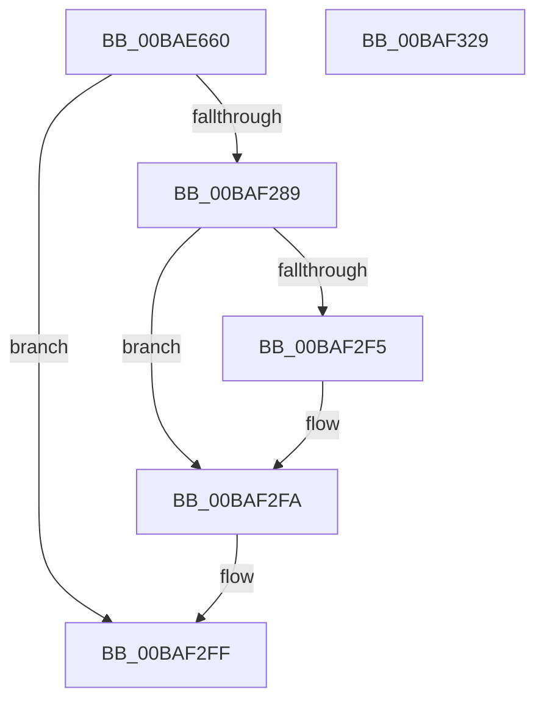

# VfMiscPluginEntry

- RVA: `0x00BAE660`–`0x00BAF32A` (길이 `3,274` bytes)
- VA: `0x0000000140BAE660`
- 실행 섹션: `PAGEVRFY`
- PDB 이름 있음: `예`; PDB Function 태그: `아니요`
- unwind 정보 RVA: `0x000D2914`
- 디코드: `479`개 명령, `3,274/3,274` bytes 표시
- 미해석 바이트: `0` (있으면 어셈블리에 `.byte`로 보존)

> 이 문서는 커널 이미지의 기계어와 PDB 기호를 분석해 생성했습니다. 4번과 5번은 함수 원형과 자료형을 바이너리 사용 방식에서 추정한 C 해석이며 원본 소스 복구 결과는 아닙니다.

## 1. Dependencies

- 직접 호출 지점: **7**; 고유 호출 대상: **6**
- 직접 호출자로 확인된 함수: **0**
- RIP 상대 이미지 참조: **131**

### Outgoing calls
- `0x00BAF27E` → [DifRegisterPlugin](../../text/61/DifRegisterPlugin_function_0061ABE0.md) (function, `0x0061ABE0`)
- `0x00BAF29D` → [VfAvlInitializeTree](../../text/61/VfAvlInitializeTree_function_00612704.md) (function, `0x00612704`)
- `0x00BAF2D1` → [VfAvlInitializeTree](../../text/61/VfAvlInitializeTree_function_00612704.md) (function, `0x00612704`)
- `0x00BAF2EC` → [DifIsPluginRunningWithoutReboot](../../text/61/DifIsPluginRunningWithoutReboot_function_0061A8EC.md) (function, `0x0061A8EC`)
- `0x00BAF2F5` → [VfCtxInit](../BB/VfCtxInit_function_00BB1D74.md) (function, `0x00BB1D74`)
- `0x00BAF2FA` → [VfSettingsApplyMiscellaneousChecks](VfSettingsApplyMiscellaneousChecks_function_00BAB210.md) (function, `0x00BAB210`)
- `0x00BAF30B` → [_security_check_cookie](../../text/6A/_security_check_cookie_function_006AC640.md) (function, `0x006AC640`)

### Direct callers
- 이 함수 시작 RVA로 연결되는 직접 call은 확인되지 않았습니다. 간접 호출은 완전히 역산할 수 없습니다.

### Static image references
- `0x00BAE67E` → RVA `0x00E0A740` (`.data`; read)
- `0x00BAE699` → RVA `0x00617050` (`VfMiscPluginUnload`; read)
- `0x00BAE6A5` → RVA `0x00F03F28` (`.data`; write)
- `0x00BAE6AC` → RVA `0x00BBB3F0` (` ?? ::JKADOLAD::`string'`; read)
- `0x00BAE6B8` → RVA `0x00BAE0C0` (`VfMiscMmAllocateContiguousMemory_Entry`; read)
- `0x00BAE6C4` → RVA `0x00BBB3D0` (` ?? ::JKADOLAD::`string'`; read)
- `0x00BAE6D0` → RVA `0x00BAE090` (`VfMiscMmAllocateContiguousMemoryEx_Entry`; read)
- `0x00BAE6DC` → RVA `0x00BBB370` (` ?? ::JKADOLAD::`string'`; read)
- `0x00BAE6E8` → RVA `0x00BADEE0` (`VfMiscKeReleaseQueuedSpinLock_Entry`; read)
- `0x00BAE6F4` → RVA `0x00BBB350` (` ?? ::JKADOLAD::`string'`; read)
- `0x00BAE6FF` → RVA `0x00BADCE0` (`VfMiscKeInitializeEvent_Entry`; read)
- `0x00BAE70A` → RVA `0x00BBABA0` (` ?? ::JKADOLAD::`string'`; read)
- `0x00BAE715` → RVA `0x00BADD10` (`VfMiscKeInitializeMutant_Entry`; read)
- `0x00BAE720` → RVA `0x00BBAD60` (` ?? ::JKADOLAD::`string'`; read)
- `0x00BAE736` → RVA `0x00BBB3B0` (` ?? ::JKADOLAD::`string'`; read)
- `0x00BAE741` → RVA `0x00BADD70` (`VfMiscKeInitializeTimerEx_Entry`; read)
- `0x00BAE74C` → RVA `0x00BBAAE0` (` ?? ::JKADOLAD::`string'`; read)
- `0x00BAE757` → RVA `0x00BAE060` (`VfMiscKeWaitForSingleObject_Entry`; read)
- `0x00BAE762` → RVA `0x00BBAB50` (` ?? ::JKADOLAD::`string'`; read)
- `0x00BAE76D` → RVA `0x00BAE030` (`VfMiscKeWaitForMultipleObjects_Entry`; read)
- `0x00BAE778` → RVA `0x00BBB390` (` ?? ::JKADOLAD::`string'`; read)
- `0x00BAE783` → RVA `0x00BAD8A0` (`VfMiscExInitializeLookasideListEx_Entry`; read)
- `0x00BAE78E` → RVA `0x00BAD910` (`VfMiscExInitializeLookasideListEx_Exit`; read)
- `0x00BAE799` → RVA `0x00BBB2F0` (` ?? ::JKADOLAD::`string'`; read)
- `0x00BAE7A4` → RVA `0x00BAD930` (`VfMiscExInitializeNPagedLookasideList_Entry`; read)
- `0x00BAE7BA` → RVA `0x00BBB2D0` (` ?? ::JKADOLAD::`string'`; read)
- `0x00BAE7E4` → RVA `0x00BBB330` (` ?? ::JKADOLAD::`string'`; read)
- `0x00BAE870` → RVA `0x00BAD820` (`VfMiscExDeleteLookasideListEx_Entry`; read)
- `0x00BAE885` → RVA `0x00BBB310` (` ?? ::JKADOLAD::`string'`; read)
- `0x00BAE8A1` → RVA `0x00BBB270` (` ?? ::JKADOLAD::`string'`; read)
- `0x00BAE8BD` → RVA `0x00BBB250` (` ?? ::JKADOLAD::`string'`; read)
- `0x00BAE8CB` → RVA `0x00BAE580` (`VfMiscObReferenceObjectByPointer_Entry`; read)
- `0x00BAE8D9` → RVA `0x00BBB2B0` (` ?? ::JKADOLAD::`string'`; read)
- `0x00BAE8E7` → RVA `0x00BAE4A0` (`VfMiscObReferenceObjectByHandle_Exit`; read)
- `0x00BAE8F5` → RVA `0x00BBB290` (` ?? ::JKADOLAD::`string'`; read)
- `0x00BAE903` → RVA `0x00BADF10` (`VfMiscKeReleaseSpinLockFromDpcLevel_Entry`; read)
- `0x00BAE911` → RVA `0x00BAE610` (`VfMiscObfReferenceObject_Exit`; read)
- `0x00BAE91F` → RVA `0x00BBB5A0` (` ?? ::JKADOLAD::`string'`; read)
- `0x00BAE92D` → RVA `0x00BAE5E0` (`VfMiscObfDereferenceObjectWithTag_Entry`; read)
- `0x00BAE93B` → RVA `0x00BBB580` (` ?? ::JKADOLAD::`string'`; read)
- `0x00BAE957` → RVA `0x00BBB5E0` (` ?? ::JKADOLAD::`string'`; read)
- `0x00BAE973` → RVA `0x00BBB5C0` (` ?? ::JKADOLAD::`string'`; read)
- `0x00BAE981` → RVA `0x00BAE470` (`VfMiscObGetObjectSecurity_Entry`; read)
- `0x00BAE98F` → RVA `0x00BBB510` (` ?? ::JKADOLAD::`string'`; read)
- `0x00BAE99D` → RVA `0x00BAE550` (`VfMiscObReferenceObjectByPointerWithTag_Entry`; read)
- `0x00BAE9AB` → RVA `0x00BBACB0` (` ?? ::JKADOLAD::`string'`; read)
- `0x00BAE9B9` → RVA `0x00BB8120` (`VfMiscKeReleaseSpinLock_Entry`; read)
- `0x00BAE9C7` → RVA `0x00BBACD0` (` ?? ::JKADOLAD::`string'`; read)
- `0x00BAE9D5` → RVA `0x00617020` (`VfMiscKeAcquireSpinLockAtDpcLevel_Entry`; read)
- `0x00BAE9E3` → RVA `0x00BBB180` (` ?? ::JKADOLAD::`string'`; read)
- `0x00BAEACE` → RVA `0x00BBAC70` (` ?? ::JKADOLAD::`string'`; read)
- `0x00BAEAE3` → RVA `0x00BADCA0` (`VfMiscKeAcquireSpinLockRaiseToDpc_Entry`; read)
- `0x00BAEAF1` → RVA `0x00BBB4F0` (` ?? ::JKADOLAD::`string'`; read)
- `0x00BAEAFF` → RVA `0x00B93F80` (`VfMiscIoConnectInterruptEx_Entry`; read)
- `0x00BAEB0D` → RVA `0x00BBB560` (` ?? ::JKADOLAD::`string'`; read)
- `0x00BAEB29` → RVA `0x00BBB540` (` ?? ::JKADOLAD::`string'`; read)
- `0x00BAEB45` → RVA `0x00BBB4A0` (` ?? ::JKADOLAD::`string'`; read)
- `0x00BAEB61` → RVA `0x00BBAD80` (` ?? ::JKADOLAD::`string'`; read)
- `0x00BAEB6F` → RVA `0x00BADEB0` (`VfMiscKeReleaseMutant_Entry`; read)
- `0x00BAEB7D` → RVA `0x00BBB480` (` ?? ::JKADOLAD::`string'`; read)
- `0x00BAEB8B` → RVA `0x00BADDA0` (`VfMiscKeInsertQueueDpc_Entry`; read)
- `0x00BAEB99` → RVA `0x00BBB4D0` (` ?? ::JKADOLAD::`string'`; read)
- `0x00BAEBA7` → RVA `0x00BADF40` (`VfMiscKeRemoveQueueDpc_Entry`; read)
- `0x00BAEBB5` → RVA `0x00BBAB70` (` ?? ::JKADOLAD::`string'`; read)
- `0x00BAEBC3` → RVA `0x00BADFC0` (`VfMiscKeTryToAcquireSpinLockAtDpcLevel_Entry`; read)
- `0x00BAEBD1` → RVA `0x00BBABC0` (` ?? ::JKADOLAD::`string'`; read)
- `0x00BAEBDF` → RVA `0x00BADBD0` (`VfMiscKeAcquireInStackQueuedSpinLockAtDpcLevel_Entry`; read)
- `0x00BAEBED` → RVA `0x00BBAB00` (` ?? ::JKADOLAD::`string'`; read)
- `0x00BAEBFB` → RVA `0x00BADC60` (`VfMiscKeAcquireInStackQueuedSpinLockForDpc_Entry`; read)
- `0x00BAEC09` → RVA `0x00BBB4C0` (` ?? ::JKADOLAD::`string'`; read)
- `0x00BAEC17` → RVA `0x00BADF70` (`VfMiscKeSetEvent_Entry`; read)
- `0x00BAEC25` → RVA `0x00BBB430` (` ?? ::JKADOLAD::`string'`; read)
- `0x00BAEC33` → RVA `0x00BADB00` (`VfMiscIoFreeMdl_Entry`; read)
- `0x00BAEC41` → RVA `0x00BBB410` (` ?? ::JKADOLAD::`string'`; read)
- `0x00BAED2C` → RVA `0x00BADB60` (`VfMiscIoInitializeWorkItem_Entry`; read)
- `0x00BAED44` → RVA `0x00BBB460` (` ?? ::JKADOLAD::`string'`; read)
- `0x00BAED52` → RVA `0x00BAD9A0` (`VfMiscExInitializeResourceLite_Entry`; read)
- `0x00BAED60` → RVA `0x00BAD9D0` (`VfMiscExInitializeResourceLite_Exit`; read)
- `0x00BAED6E` → RVA `0x00BBB440` (` ?? ::JKADOLAD::`string'`; read)
- `0x00BAED7C` → RVA `0x00BAD840` (`VfMiscExDeleteResourceLite_Entry`; read)
- `0x00BAED8A` → RVA `0x00BAD860` (`VfMiscExDeleteResourceLite_Exit`; read)
- `0x00BAED98` → RVA `0x00BBAE30` (` ?? ::JKADOLAD::`string'`; read)
- `0x00BAEDA6` → RVA `0x00BADA30` (`VfMiscExReleaseFastMutex_Entry`; read)
- `0x00BAEDB4` → RVA `0x00BBAC30` (` ?? ::JKADOLAD::`string'`; read)
- `0x00BAEDC2` → RVA `0x00BAD7D0` (`VfMiscExAcquireFastMutexUnsafe_Entry`; read)
- `0x00BAEDD0` → RVA `0x00BBAD90` (` ?? ::JKADOLAD::`string'`; read)
- `0x00BAEDDE` → RVA `0x00BADA00` (`VfMiscExReleaseFastMutexUnsafe_Entry`; read)
- `0x00BAEDEC` → RVA `0x00BBB7A0` (` ?? ::JKADOLAD::`string'`; read)
- `0x00BAEDFA` → RVA `0x00BADAA0` (`VfMiscExfAcquirePushLockExclusive_Entry`; read)
- `0x00BAEE08` → RVA `0x00BBB780` (` ?? ::JKADOLAD::`string'`; read)
- `0x00BAEE24` → RVA `0x00BBB7E0` (` ?? ::JKADOLAD::`string'`; read)
- `0x00BAEE40` → RVA `0x00BBB7C0` (` ?? ::JKADOLAD::`string'`; read)
- `0x00BAEE4E` → RVA `0x00BADAD0` (`VfMiscExfReleasePushLockShared_Entry`; read)
- `0x00BAEE5C` → RVA `0x00BBB720` (` ?? ::JKADOLAD::`string'`; read)
- `0x00BAEE78` → RVA `0x00BBB700` (` ?? ::JKADOLAD::`string'`; read)
- `0x00BAEE94` → RVA `0x00BBB760` (` ?? ::JKADOLAD::`string'`; read)
- `0x00BAEEA2` → RVA `0x00BAE1D0` (`VfMiscMmUnmapLockedPages_Entry`; read)
- `0x00BAEEB0` → RVA `0x00BBB740` (` ?? ::JKADOLAD::`string'`; read)
- `0x00BAEF8D` → RVA `0x00BAE0F0` (`VfMiscMmBuildMdlForNonPagedPool_Entry`; read)
- `0x00BAEFA5` → RVA `0x00BAE150` (`VfMiscMmBuildMdlForNonPagedPool_Exit`; read)
- `0x00BAEFB3` → RVA `0x00BBAB30` (` ?? ::JKADOLAD::`string'`; read)
- `0x00BAEFC1` → RVA `0x00BAD800` (`VfMiscExAcquireResourceExclusiveLite_Entry`; read)
- `0x00BAEFCF` → RVA `0x00BBAAC0` (` ?? ::JKADOLAD::`string'`; read)
- `0x00BAEFEB` → RVA `0x00BBADE0` (` ?? ::JKADOLAD::`string'`; read)
- `0x00BAF007` → RVA `0x00BBAE50` (` ?? ::JKADOLAD::`string'`; read)
- `0x00BAF023` → RVA `0x00BBB690` (` ?? ::JKADOLAD::`string'`; read)
- `0x00BAF031` → RVA `0x00BADA60` (`VfMiscExReleaseResourceAndLeaveCriticalRegion_Entry`; read)
- `0x00BAF03F` → RVA `0x00BBB660` (` ?? ::JKADOLAD::`string'`; read)
- `0x00BAF05B` → RVA `0x00BBB6D0` (` ?? ::JKADOLAD::`string'`; read)
- `0x00BAF077` → RVA `0x00BBB6B0` (` ?? ::JKADOLAD::`string'`; read)
- `0x00BAF085` → RVA `0x00BADA80` (`VfMiscExReleaseResourceForThreadLite_Entry`; read)
- `0x00BAF093` → RVA `0x00BBB620` (` ?? ::JKADOLAD::`string'`; read)
- `0x00BAF0A1` → RVA `0x00BADFA0` (`VfMiscKeSynchronizeExecution_Entry`; read)
- `0x00BAF0AF` → RVA `0x00BBADB0` (` ?? ::JKADOLAD::`string'`; read)
- `0x00BAF0BD` → RVA `0x00BADE30` (`VfMiscKeReleaseInStackQueuedSpinLock_Entry`; read)
- `0x00BAF0CB` → RVA `0x00BBADD0` (` ?? ::JKADOLAD::`string'`; read)
- `0x00BAF0E7` → RVA `0x00BBB600` (` ?? ::JKADOLAD::`string'`; read)
- `0x00BAF0F5` → RVA `0x00BADD40` (`VfMiscKeInitializeSemaphore_Entry`; read)
- `0x00BAF103` → RVA `0x00BBAD20` (` ?? ::JKADOLAD::`string'`; read)
- `0x00BAF111` → RVA `0x00BADDD0` (`VfMiscKeReleaseInStackQueuedSpinLockForDpc_Entry`; read)
- `0x00BAF1EB` → RVA `0x00BBACF0` (` ?? ::JKADOLAD::`string'`; read)
- `0x00BAF200` → RVA `0x00F03F20` (`.data`; read)
- `0x00BAF222` → RVA `0x00BBB650` (` ?? ::JKADOLAD::`string'`; read)
- `0x00BAF23B` → RVA `0x00BBB640` (` ?? ::JKADOLAD::`string'`; read)
- `0x00BAF289` → RVA `0x00BA2480` (`ViDevObjDelayFreeAvlNode`; read)
- `0x00BAF296` → RVA `0x00FFDCA0` (`PAGEVRFD`; read)
- `0x00BAF2A4` → RVA `0x00FFDA88` (`PAGEVRFD`; read)
- `0x00BAF2AB` → RVA `0x00FFDA84` (`PAGEVRFD`; read)
- `0x00BAF2CA` → RVA `0x00FFDBC0` (`PAGEVRFD`; read)
- `0x00BAF2D8` → RVA `0x00FFDAAC` (`PAGEVRFD`; read)
- `0x00BAF2DF` → RVA `0x00FFDA80` (`PAGEVRFD`; read)

## 2. Other-region calls and transfers

- 다른 실행 섹션으로 향하는 call: **5**
  - `0x00BAF27E` → [DifRegisterPlugin](../../text/61/DifRegisterPlugin_function_0061ABE0.md) (`PAGEVRFY` → `.text`)
  - `0x00BAF29D` → [VfAvlInitializeTree](../../text/61/VfAvlInitializeTree_function_00612704.md) (`PAGEVRFY` → `.text`)
  - `0x00BAF2D1` → [VfAvlInitializeTree](../../text/61/VfAvlInitializeTree_function_00612704.md) (`PAGEVRFY` → `.text`)
  - `0x00BAF2EC` → [DifIsPluginRunningWithoutReboot](../../text/61/DifIsPluginRunningWithoutReboot_function_0061A8EC.md) (`PAGEVRFY` → `.text`)
  - `0x00BAF30B` → [_security_check_cookie](../../text/6A/_security_check_cookie_function_006AC640.md) (`PAGEVRFY` → `.text`)
- 별도 외부 분기/꼬리 이동을 확인하지 못했습니다.

## 3. Assembly (complete function range)

```asm
00BAE660  48 8B C4                        mov rax, rsp
00BAE663  48 89 58 08                     mov qword ptr [rax + 8], rbx
00BAE667  48 89 70 10                     mov qword ptr [rax + 0x10], rsi
00BAE66B  48 89 78 18                     mov qword ptr [rax + 0x18], rdi
00BAE66F  55                              push rbp
00BAE670  48 8D A8 28 F8 FF FF            lea rbp, [rax - 0x7d8]
00BAE677  48 81 EC D0 08 00 00            sub rsp, 0x8d0
00BAE67E  48 8B 05 BB C0 25 00            mov rax, qword ptr [rip + 0x25c0bb]
00BAE685  48 33 C4                        xor rax, rsp
00BAE688  48 89 85 C0 07 00 00            mov qword ptr [rbp + 0x7c0], rax
00BAE68F  33 F6                           xor esi, esi
00BAE691  C7 44 24 28 EE 00 00 00         mov dword ptr [rsp + 0x28], 0xee
00BAE699  48 8D 05 B0 89 A6 FF            lea rax, [rip - 0x597650]
00BAE6A0  48 89 74 24 38                  mov qword ptr [rsp + 0x38], rsi
00BAE6A5  48 89 05 7C 58 35 00            mov qword ptr [rip + 0x35587c], rax
00BAE6AC  48 8D 05 3D CD 00 00            lea rax, [rip + 0xcd3d]
00BAE6B3  48 89 44 24 20                  mov qword ptr [rsp + 0x20], rax
00BAE6B8  48 8D 05 01 FA FF FF            lea rax, [rip - 0x5ff]
00BAE6BF  48 89 44 24 30                  mov qword ptr [rsp + 0x30], rax
00BAE6C4  48 8D 05 05 CD 00 00            lea rax, [rip + 0xcd05]
00BAE6CB  48 89 44 24 40                  mov qword ptr [rsp + 0x40], rax
00BAE6D0  48 8D 05 B9 F9 FF FF            lea rax, [rip - 0x647]
00BAE6D7  48 89 44 24 50                  mov qword ptr [rsp + 0x50], rax
00BAE6DC  48 8D 05 8D CC 00 00            lea rax, [rip + 0xcc8d]
00BAE6E3  48 89 44 24 60                  mov qword ptr [rsp + 0x60], rax
00BAE6E8  48 8D 05 F1 F7 FF FF            lea rax, [rip - 0x80f]
00BAE6EF  48 89 44 24 70                  mov qword ptr [rsp + 0x70], rax
00BAE6F4  48 8D 05 55 CC 00 00            lea rax, [rip + 0xcc55]
00BAE6FB  48 89 45 80                     mov qword ptr [rbp - 0x80], rax
00BAE6FF  48 8D 05 DA F5 FF FF            lea rax, [rip - 0xa26]
00BAE706  48 89 45 90                     mov qword ptr [rbp - 0x70], rax
00BAE70A  48 8D 05 8F C4 00 00            lea rax, [rip + 0xc48f]
00BAE711  48 89 45 A0                     mov qword ptr [rbp - 0x60], rax
00BAE715  48 8D 05 F4 F5 FF FF            lea rax, [rip - 0xa0c]
00BAE71C  48 89 45 B0                     mov qword ptr [rbp - 0x50], rax
00BAE720  48 8D 05 39 C6 00 00            lea rax, [rip + 0xc639]
00BAE727  48 89 45 C0                     mov qword ptr [rbp - 0x40], rax
00BAE72B  48 8D 05 DE F5 FF FF            lea rax, [rip - 0xa22]
00BAE732  48 89 45 D0                     mov qword ptr [rbp - 0x30], rax
00BAE736  48 8D 05 73 CC 00 00            lea rax, [rip + 0xcc73]
00BAE73D  48 89 45 E0                     mov qword ptr [rbp - 0x20], rax
00BAE741  48 8D 05 28 F6 FF FF            lea rax, [rip - 0x9d8]
00BAE748  48 89 45 F0                     mov qword ptr [rbp - 0x10], rax
00BAE74C  48 8D 05 8D C3 00 00            lea rax, [rip + 0xc38d]
00BAE753  48 89 45 00                     mov qword ptr [rbp], rax
00BAE757  48 8D 05 02 F9 FF FF            lea rax, [rip - 0x6fe]
00BAE75E  48 89 45 10                     mov qword ptr [rbp + 0x10], rax
00BAE762  48 8D 05 E7 C3 00 00            lea rax, [rip + 0xc3e7]
00BAE769  48 89 45 20                     mov qword ptr [rbp + 0x20], rax
00BAE76D  48 8D 05 BC F8 FF FF            lea rax, [rip - 0x744]
00BAE774  48 89 45 30                     mov qword ptr [rbp + 0x30], rax
00BAE778  48 8D 05 11 CC 00 00            lea rax, [rip + 0xcc11]
00BAE77F  48 89 45 40                     mov qword ptr [rbp + 0x40], rax
00BAE783  48 8D 05 16 F1 FF FF            lea rax, [rip - 0xeea]
00BAE78A  48 89 45 50                     mov qword ptr [rbp + 0x50], rax
00BAE78E  48 8D 05 7B F1 FF FF            lea rax, [rip - 0xe85]
00BAE795  48 89 45 58                     mov qword ptr [rbp + 0x58], rax
00BAE799  48 8D 05 50 CB 00 00            lea rax, [rip + 0xcb50]
00BAE7A0  48 89 45 60                     mov qword ptr [rbp + 0x60], rax
00BAE7A4  48 8D 05 85 F1 FF FF            lea rax, [rip - 0xe7b]
00BAE7AB  48 89 45 70                     mov qword ptr [rbp + 0x70], rax
00BAE7AF  48 8D 05 5A F1 FF FF            lea rax, [rip - 0xea6]
00BAE7B6  48 89 45 78                     mov qword ptr [rbp + 0x78], rax
00BAE7BA  48 8D 05 0F CB 00 00            lea rax, [rip + 0xcb0f]
00BAE7C1  48 89 85 80 00 00 00            mov qword ptr [rbp + 0x80], rax
00BAE7C8  48 8D 05 61 F1 FF FF            lea rax, [rip - 0xe9f]
00BAE7CF  48 89 85 90 00 00 00            mov qword ptr [rbp + 0x90], rax
00BAE7D6  48 8D 05 33 F1 FF FF            lea rax, [rip - 0xecd]
00BAE7DD  48 89 85 98 00 00 00            mov qword ptr [rbp + 0x98], rax
00BAE7E4  48 8D 05 45 CB 00 00            lea rax, [rip + 0xcb45]
00BAE7EB  48 89 85 A0 00 00 00            mov qword ptr [rbp + 0xa0], rax
00BAE7F2  C7 44 24 48 ED 00 00 00         mov dword ptr [rsp + 0x48], 0xed
00BAE7FA  48 89 74 24 58                  mov qword ptr [rsp + 0x58], rsi
00BAE7FF  C7 44 24 68 03 01 00 00         mov dword ptr [rsp + 0x68], 0x103
00BAE807  48 89 74 24 78                  mov qword ptr [rsp + 0x78], rsi
00BAE80C  C7 45 88 1B 01 00 00            mov dword ptr [rbp - 0x78], 0x11b
00BAE813  48 89 75 98                     mov qword ptr [rbp - 0x68], rsi
00BAE817  C7 45 A8 1A 01 00 00            mov dword ptr [rbp - 0x58], 0x11a
00BAE81E  48 89 75 B8                     mov qword ptr [rbp - 0x48], rsi
00BAE822  C7 45 C8 19 01 00 00            mov dword ptr [rbp - 0x38], 0x119
00BAE829  48 89 75 D8                     mov qword ptr [rbp - 0x28], rsi
00BAE82D  C7 45 E8 16 01 00 00            mov dword ptr [rbp - 0x18], 0x116
00BAE834  48 89 75 F8                     mov qword ptr [rbp - 8], rsi
00BAE838  C7 45 08 F0 00 00 00            mov dword ptr [rbp + 8], 0xf0
00BAE83F  48 89 75 18                     mov qword ptr [rbp + 0x18], rsi
00BAE843  C7 45 28 F1 00 00 00            mov dword ptr [rbp + 0x28], 0xf1
00BAE84A  48 89 75 38                     mov qword ptr [rbp + 0x38], rsi
00BAE84E  C7 45 48 8F 01 00 00            mov dword ptr [rbp + 0x48], 0x18f
00BAE855  C7 45 68 8E 01 00 00            mov dword ptr [rbp + 0x68], 0x18e
00BAE85C  C7 85 88 00 00 00 8D 01 00 00   mov dword ptr [rbp + 0x88], 0x18d
00BAE866  C7 85 A8 00 00 00 98 01 00 00   mov dword ptr [rbp + 0xa8], 0x198
00BAE870  48 8D 05 A9 EF FF FF            lea rax, [rip - 0x1057]
00BAE877  48 89 B5 B8 00 00 00            mov qword ptr [rbp + 0xb8], rsi
00BAE87E  48 89 85 B0 00 00 00            mov qword ptr [rbp + 0xb0], rax
00BAE885  48 8D 05 84 CA 00 00            lea rax, [rip + 0xca84]
00BAE88C  48 89 85 C0 00 00 00            mov qword ptr [rbp + 0xc0], rax
00BAE893  48 8D 05 86 EF FF FF            lea rax, [rip - 0x107a]
00BAE89A  48 89 85 D0 00 00 00            mov qword ptr [rbp + 0xd0], rax
00BAE8A1  48 8D 05 C8 C9 00 00            lea rax, [rip + 0xc9c8]
00BAE8A8  48 89 85 E0 00 00 00            mov qword ptr [rbp + 0xe0], rax
00BAE8AF  48 8D 05 6A EF FF FF            lea rax, [rip - 0x1096]
00BAE8B6  48 89 85 F0 00 00 00            mov qword ptr [rbp + 0xf0], rax
00BAE8BD  48 8D 05 8C C9 00 00            lea rax, [rip + 0xc98c]
00BAE8C4  48 89 85 00 01 00 00            mov qword ptr [rbp + 0x100], rax
00BAE8CB  48 8D 05 AE FC FF FF            lea rax, [rip - 0x352]
00BAE8D2  48 89 85 10 01 00 00            mov qword ptr [rbp + 0x110], rax
00BAE8D9  48 8D 05 D0 C9 00 00            lea rax, [rip + 0xc9d0]
00BAE8E0  48 89 85 20 01 00 00            mov qword ptr [rbp + 0x120], rax
00BAE8E7  48 8D 05 B2 FB FF FF            lea rax, [rip - 0x44e]
00BAE8EE  48 89 85 38 01 00 00            mov qword ptr [rbp + 0x138], rax
00BAE8F5  48 8D 05 94 C9 00 00            lea rax, [rip + 0xc994]
00BAE8FC  48 89 85 40 01 00 00            mov qword ptr [rbp + 0x140], rax
00BAE903  48 8D 05 06 F6 FF FF            lea rax, [rip - 0x9fa]
00BAE90A  48 89 85 50 01 00 00            mov qword ptr [rbp + 0x150], rax
00BAE911  48 8D 05 F8 FC FF FF            lea rax, [rip - 0x308]
00BAE918  48 89 85 58 01 00 00            mov qword ptr [rbp + 0x158], rax
00BAE91F  48 8D 05 7A CC 00 00            lea rax, [rip + 0xcc7a]
00BAE926  48 89 85 60 01 00 00            mov qword ptr [rbp + 0x160], rax
00BAE92D  48 8D 05 AC FC FF FF            lea rax, [rip - 0x354]
00BAE934  48 89 85 70 01 00 00            mov qword ptr [rbp + 0x170], rax
00BAE93B  48 8D 05 3E CC 00 00            lea rax, [rip + 0xcc3e]
00BAE942  48 89 85 80 01 00 00            mov qword ptr [rbp + 0x180], rax
00BAE949  48 8D 05 C0 F5 FF FF            lea rax, [rip - 0xa40]
00BAE950  48 89 85 90 01 00 00            mov qword ptr [rbp + 0x190], rax
00BAE957  48 8D 05 82 CC 00 00            lea rax, [rip + 0xcc82]
00BAE95E  48 89 85 A0 01 00 00            mov qword ptr [rbp + 0x1a0], rax
00BAE965  48 8D 05 74 FC FF FF            lea rax, [rip - 0x38c]
00BAE96C  48 89 85 B0 01 00 00            mov qword ptr [rbp + 0x1b0], rax
00BAE973  48 8D 05 46 CC 00 00            lea rax, [rip + 0xcc46]
00BAE97A  48 89 85 C0 01 00 00            mov qword ptr [rbp + 0x1c0], rax
00BAE981  48 8D 05 E8 FA FF FF            lea rax, [rip - 0x518]
00BAE988  48 89 85 D0 01 00 00            mov qword ptr [rbp + 0x1d0], rax
00BAE98F  48 8D 05 7A CB 00 00            lea rax, [rip + 0xcb7a]
00BAE996  48 89 85 E0 01 00 00            mov qword ptr [rbp + 0x1e0], rax
00BAE99D  48 8D 05 AC FB FF FF            lea rax, [rip - 0x454]
00BAE9A4  48 89 85 F0 01 00 00            mov qword ptr [rbp + 0x1f0], rax
00BAE9AB  48 8D 05 FE C2 00 00            lea rax, [rip + 0xc2fe]
00BAE9B2  48 89 85 00 02 00 00            mov qword ptr [rbp + 0x200], rax
00BAE9B9  48 8D 05 60 97 00 00            lea rax, [rip + 0x9760]
00BAE9C0  48 89 85 10 02 00 00            mov qword ptr [rbp + 0x210], rax
00BAE9C7  48 8D 05 02 C3 00 00            lea rax, [rip + 0xc302]
00BAE9CE  48 89 85 20 02 00 00            mov qword ptr [rbp + 0x220], rax
00BAE9D5  48 8D 05 44 86 A6 FF            lea rax, [rip - 0x5979bc]
00BAE9DC  48 89 85 30 02 00 00            mov qword ptr [rbp + 0x230], rax
00BAE9E3  48 8D 05 96 C7 00 00            lea rax, [rip + 0xc796]
00BAE9EA  48 89 85 40 02 00 00            mov qword ptr [rbp + 0x240], rax
00BAE9F1  48 8D 05 18 F5 FF FF            lea rax, [rip - 0xae8]
00BAE9F8  48 89 85 50 02 00 00            mov qword ptr [rbp + 0x250], rax
00BAE9FF  C7 85 C8 00 00 00 99 01 00 00   mov dword ptr [rbp + 0xc8], 0x199
00BAEA09  48 89 B5 D8 00 00 00            mov qword ptr [rbp + 0xd8], rsi
00BAEA10  C7 85 E8 00 00 00 9A 01 00 00   mov dword ptr [rbp + 0xe8], 0x19a
00BAEA1A  48 89 B5 F8 00 00 00            mov qword ptr [rbp + 0xf8], rsi
00BAEA21  C7 85 08 01 00 00 C9 00 00 00   mov dword ptr [rbp + 0x108], 0xc9
00BAEA2B  48 89 B5 18 01 00 00            mov qword ptr [rbp + 0x118], rsi
00BAEA32  C7 85 28 01 00 00 CA 00 00 00   mov dword ptr [rbp + 0x128], 0xca
00BAEA3C  48 89 B5 30 01 00 00            mov qword ptr [rbp + 0x130], rsi
00BAEA43  C7 85 48 01 00 00 C4 00 00 00   mov dword ptr [rbp + 0x148], 0xc4
00BAEA4D  C7 85 68 01 00 00 C3 00 00 00   mov dword ptr [rbp + 0x168], 0xc3
00BAEA57  48 89 B5 78 01 00 00            mov qword ptr [rbp + 0x178], rsi
00BAEA5E  C7 85 88 01 00 00 C6 00 00 00   mov dword ptr [rbp + 0x188], 0xc6
00BAEA68  48 89 B5 98 01 00 00            mov qword ptr [rbp + 0x198], rsi
00BAEA6F  C7 85 A8 01 00 00 C5 00 00 00   mov dword ptr [rbp + 0x1a8], 0xc5
00BAEA79  48 89 B5 B8 01 00 00            mov qword ptr [rbp + 0x1b8], rsi
00BAEA80  C7 85 C8 01 00 00 CB 00 00 00   mov dword ptr [rbp + 0x1c8], 0xcb
00BAEA8A  48 89 B5 D8 01 00 00            mov qword ptr [rbp + 0x1d8], rsi
00BAEA91  C7 85 E8 01 00 00 C8 00 00 00   mov dword ptr [rbp + 0x1e8], 0xc8
00BAEA9B  48 89 B5 F8 01 00 00            mov qword ptr [rbp + 0x1f8], rsi
00BAEAA2  C7 85 08 02 00 00 02 01 00 00   mov dword ptr [rbp + 0x208], 0x102
00BAEAAC  48 89 B5 18 02 00 00            mov qword ptr [rbp + 0x218], rsi
00BAEAB3  C7 85 28 02 00 00 24 01 00 00   mov dword ptr [rbp + 0x228], 0x124
00BAEABD  48 89 B5 38 02 00 00            mov qword ptr [rbp + 0x238], rsi
00BAEAC4  C7 85 48 02 00 00 01 01 00 00   mov dword ptr [rbp + 0x248], 0x101
00BAEACE  48 8D 05 9B C1 00 00            lea rax, [rip + 0xc19b]
00BAEAD5  48 89 B5 58 02 00 00            mov qword ptr [rbp + 0x258], rsi
00BAEADC  48 89 85 60 02 00 00            mov qword ptr [rbp + 0x260], rax
00BAEAE3  48 8D 05 B6 F1 FF FF            lea rax, [rip - 0xe4a]
00BAEAEA  48 89 85 70 02 00 00            mov qword ptr [rbp + 0x270], rax
00BAEAF1  48 8D 05 F8 C9 00 00            lea rax, [rip + 0xc9f8]
00BAEAF8  48 89 85 80 02 00 00            mov qword ptr [rbp + 0x280], rax
00BAEAFF  48 8D 05 7A 54 FE FF            lea rax, [rip - 0x1ab86]
00BAEB06  48 89 85 90 02 00 00            mov qword ptr [rbp + 0x290], rax
00BAEB0D  48 8D 05 4C CA 00 00            lea rax, [rip + 0xca4c]
00BAEB14  48 89 85 A0 02 00 00            mov qword ptr [rbp + 0x2a0], rax
00BAEB1B  48 8D 05 5E 54 FE FF            lea rax, [rip - 0x1aba2]
00BAEB22  48 89 85 B0 02 00 00            mov qword ptr [rbp + 0x2b0], rax
00BAEB29  48 8D 05 10 CA 00 00            lea rax, [rip + 0xca10]
00BAEB30  48 89 85 C0 02 00 00            mov qword ptr [rbp + 0x2c0], rax
00BAEB37  48 8D 05 42 54 FE FF            lea rax, [rip - 0x1abbe]
00BAEB3E  48 89 85 D0 02 00 00            mov qword ptr [rbp + 0x2d0], rax
00BAEB45  48 8D 05 54 C9 00 00            lea rax, [rip + 0xc954]
00BAEB4C  48 89 85 E0 02 00 00            mov qword ptr [rbp + 0x2e0], rax
00BAEB53  48 8D 05 26 54 FE FF            lea rax, [rip - 0x1abda]
00BAEB5A  48 89 85 F0 02 00 00            mov qword ptr [rbp + 0x2f0], rax
00BAEB61  48 8D 05 18 C2 00 00            lea rax, [rip + 0xc218]
00BAEB68  48 89 85 00 03 00 00            mov qword ptr [rbp + 0x300], rax
00BAEB6F  48 8D 05 3A F3 FF FF            lea rax, [rip - 0xcc6]
00BAEB76  48 89 85 10 03 00 00            mov qword ptr [rbp + 0x310], rax
00BAEB7D  48 8D 05 FC C8 00 00            lea rax, [rip + 0xc8fc]
00BAEB84  48 89 85 20 03 00 00            mov qword ptr [rbp + 0x320], rax
00BAEB8B  48 8D 05 0E F2 FF FF            lea rax, [rip - 0xdf2]
00BAEB92  48 89 85 30 03 00 00            mov qword ptr [rbp + 0x330], rax
00BAEB99  48 8D 05 30 C9 00 00            lea rax, [rip + 0xc930]
00BAEBA0  48 89 85 40 03 00 00            mov qword ptr [rbp + 0x340], rax
00BAEBA7  48 8D 05 92 F3 FF FF            lea rax, [rip - 0xc6e]
00BAEBAE  48 89 85 50 03 00 00            mov qword ptr [rbp + 0x350], rax
00BAEBB5  48 8D 05 B4 BF 00 00            lea rax, [rip + 0xbfb4]
00BAEBBC  48 89 85 60 03 00 00            mov qword ptr [rbp + 0x360], rax
00BAEBC3  48 8D 05 F6 F3 FF FF            lea rax, [rip - 0xc0a]
00BAEBCA  48 89 85 70 03 00 00            mov qword ptr [rbp + 0x370], rax
00BAEBD1  48 8D 05 E8 BF 00 00            lea rax, [rip + 0xbfe8]
00BAEBD8  48 89 85 80 03 00 00            mov qword ptr [rbp + 0x380], rax
00BAEBDF  48 8D 05 EA EF FF FF            lea rax, [rip - 0x1016]
00BAEBE6  48 89 85 90 03 00 00            mov qword ptr [rbp + 0x390], rax
00BAEBED  48 8D 05 0C BF 00 00            lea rax, [rip + 0xbf0c]
00BAEBF4  48 89 85 A0 03 00 00            mov qword ptr [rbp + 0x3a0], rax
00BAEBFB  48 8D 05 5E F0 FF FF            lea rax, [rip - 0xfa2]
00BAEC02  48 89 85 B0 03 00 00            mov qword ptr [rbp + 0x3b0], rax
00BAEC09  48 8D 05 B0 C8 00 00            lea rax, [rip + 0xc8b0]
00BAEC10  48 89 85 C0 03 00 00            mov qword ptr [rbp + 0x3c0], rax
00BAEC17  48 8D 05 52 F3 FF FF            lea rax, [rip - 0xcae]
00BAEC1E  48 89 85 D0 03 00 00            mov qword ptr [rbp + 0x3d0], rax
00BAEC25  48 8D 05 04 C8 00 00            lea rax, [rip + 0xc804]
00BAEC2C  48 89 85 E0 03 00 00            mov qword ptr [rbp + 0x3e0], rax
00BAEC33  48 8D 05 C6 EE FF FF            lea rax, [rip - 0x113a]
00BAEC3A  48 89 85 F0 03 00 00            mov qword ptr [rbp + 0x3f0], rax
00BAEC41  48 8D 05 C8 C7 00 00            lea rax, [rip + 0xc7c8]
00BAEC48  48 89 85 00 04 00 00            mov qword ptr [rbp + 0x400], rax
00BAEC4F  C7 85 68 02 00 00 23 01 00 00   mov dword ptr [rbp + 0x268], 0x123
00BAEC59  48 89 B5 78 02 00 00            mov qword ptr [rbp + 0x278], rsi
00BAEC60  C7 85 88 02 00 00 66 01 00 00   mov dword ptr [rbp + 0x288], 0x166
00BAEC6A  48 89 B5 98 02 00 00            mov qword ptr [rbp + 0x298], rsi
00BAEC71  C7 85 A8 02 00 00 57 01 00 00   mov dword ptr [rbp + 0x2a8], 0x157
00BAEC7B  48 89 B5 B8 02 00 00            mov qword ptr [rbp + 0x2b8], rsi
00BAEC82  C7 85 C8 02 00 00 65 01 00 00   mov dword ptr [rbp + 0x2c8], 0x165
00BAEC8C  48 89 B5 D8 02 00 00            mov qword ptr [rbp + 0x2d8], rsi
00BAEC93  C7 85 E8 02 00 00 56 01 00 00   mov dword ptr [rbp + 0x2e8], 0x156
00BAEC9D  48 89 B5 F8 02 00 00            mov qword ptr [rbp + 0x2f8], rsi
00BAECA4  C7 85 08 03 00 00 04 01 00 00   mov dword ptr [rbp + 0x308], 0x104
00BAECAE  48 89 B5 18 03 00 00            mov qword ptr [rbp + 0x318], rsi
00BAECB5  C7 85 28 03 00 00 13 01 00 00   mov dword ptr [rbp + 0x328], 0x113
00BAECBF  48 89 B5 38 03 00 00            mov qword ptr [rbp + 0x338], rsi
00BAECC6  C7 85 48 03 00 00 FD 00 00 00   mov dword ptr [rbp + 0x348], 0xfd
00BAECD0  48 89 B5 58 03 00 00            mov qword ptr [rbp + 0x358], rsi
00BAECD7  C7 85 68 03 00 00 F2 00 00 00   mov dword ptr [rbp + 0x368], 0xf2
00BAECE1  48 89 B5 78 03 00 00            mov qword ptr [rbp + 0x378], rsi
00BAECE8  C7 85 88 03 00 00 29 01 00 00   mov dword ptr [rbp + 0x388], 0x129
00BAECF2  48 89 B5 98 03 00 00            mov qword ptr [rbp + 0x398], rsi
00BAECF9  C7 85 A8 03 00 00 28 01 00 00   mov dword ptr [rbp + 0x3a8], 0x128
00BAED03  48 89 B5 B8 03 00 00            mov qword ptr [rbp + 0x3b8], rsi
00BAED0A  C7 85 C8 03 00 00 F9 00 00 00   mov dword ptr [rbp + 0x3c8], 0xf9
00BAED14  48 89 B5 D8 03 00 00            mov qword ptr [rbp + 0x3d8], rsi
00BAED1B  C7 85 E8 03 00 00 53 01 00 00   mov dword ptr [rbp + 0x3e8], 0x153
00BAED25  48 89 B5 F8 03 00 00            mov qword ptr [rbp + 0x3f8], rsi
00BAED2C  48 8D 05 2D EE FF FF            lea rax, [rip - 0x11d3]
00BAED33  C7 85 08 04 00 00 48 01 00 00   mov dword ptr [rbp + 0x408], 0x148
00BAED3D  48 89 85 10 04 00 00            mov qword ptr [rbp + 0x410], rax
00BAED44  48 8D 05 15 C7 00 00            lea rax, [rip + 0xc715]
00BAED4B  48 89 85 20 04 00 00            mov qword ptr [rbp + 0x420], rax
00BAED52  48 8D 05 47 EC FF FF            lea rax, [rip - 0x13b9]
00BAED59  48 89 85 30 04 00 00            mov qword ptr [rbp + 0x430], rax
00BAED60  48 8D 05 69 EC FF FF            lea rax, [rip - 0x1397]
00BAED67  48 89 85 38 04 00 00            mov qword ptr [rbp + 0x438], rax
00BAED6E  48 8D 05 CB C6 00 00            lea rax, [rip + 0xc6cb]
00BAED75  48 89 85 40 04 00 00            mov qword ptr [rbp + 0x440], rax
00BAED7C  48 8D 05 BD EA FF FF            lea rax, [rip - 0x1543]
00BAED83  48 89 85 50 04 00 00            mov qword ptr [rbp + 0x450], rax
00BAED8A  48 8D 05 CF EA FF FF            lea rax, [rip - 0x1531]
00BAED91  48 89 85 58 04 00 00            mov qword ptr [rbp + 0x458], rax
00BAED98  48 8D 05 91 C0 00 00            lea rax, [rip + 0xc091]
00BAED9F  48 89 85 60 04 00 00            mov qword ptr [rbp + 0x460], rax
00BAEDA6  48 8D 05 83 EC FF FF            lea rax, [rip - 0x137d]
00BAEDAD  48 89 85 70 04 00 00            mov qword ptr [rbp + 0x470], rax
00BAEDB4  48 8D 05 75 BE 00 00            lea rax, [rip + 0xbe75]
00BAEDBB  48 89 85 80 04 00 00            mov qword ptr [rbp + 0x480], rax
00BAEDC2  48 8D 05 07 EA FF FF            lea rax, [rip - 0x15f9]
00BAEDC9  48 89 85 90 04 00 00            mov qword ptr [rbp + 0x490], rax
00BAEDD0  48 8D 05 B9 BF 00 00            lea rax, [rip + 0xbfb9]
00BAEDD7  48 89 85 A0 04 00 00            mov qword ptr [rbp + 0x4a0], rax
00BAEDDE  48 8D 05 1B EC FF FF            lea rax, [rip - 0x13e5]
00BAEDE5  48 89 85 B0 04 00 00            mov qword ptr [rbp + 0x4b0], rax
00BAEDEC  48 8D 05 AD C9 00 00            lea rax, [rip + 0xc9ad]
00BAEDF3  48 89 85 C0 04 00 00            mov qword ptr [rbp + 0x4c0], rax
00BAEDFA  48 8D 05 9F EC FF FF            lea rax, [rip - 0x1361]
00BAEE01  48 89 85 D0 04 00 00            mov qword ptr [rbp + 0x4d0], rax
00BAEE08  48 8D 05 71 C9 00 00            lea rax, [rip + 0xc971]
00BAEE0F  48 89 85 E0 04 00 00            mov qword ptr [rbp + 0x4e0], rax
00BAEE16  48 8D 05 83 EC FF FF            lea rax, [rip - 0x137d]
00BAEE1D  48 89 85 F0 04 00 00            mov qword ptr [rbp + 0x4f0], rax
00BAEE24  48 8D 05 B5 C9 00 00            lea rax, [rip + 0xc9b5]
00BAEE2B  48 89 85 00 05 00 00            mov qword ptr [rbp + 0x500], rax
00BAEE32  48 8D 05 67 EC FF FF            lea rax, [rip - 0x1399]
00BAEE39  48 89 85 10 05 00 00            mov qword ptr [rbp + 0x510], rax
00BAEE40  48 8D 05 79 C9 00 00            lea rax, [rip + 0xc979]
00BAEE47  48 89 85 20 05 00 00            mov qword ptr [rbp + 0x520], rax
00BAEE4E  48 8D 05 7B EC FF FF            lea rax, [rip - 0x1385]
00BAEE55  48 89 85 30 05 00 00            mov qword ptr [rbp + 0x530], rax
00BAEE5C  48 8D 05 BD C8 00 00            lea rax, [rip + 0xc8bd]
00BAEE63  48 89 85 40 05 00 00            mov qword ptr [rbp + 0x540], rax
00BAEE6A  48 8D 05 5F EC FF FF            lea rax, [rip - 0x13a1]
00BAEE71  48 89 85 50 05 00 00            mov qword ptr [rbp + 0x550], rax
00BAEE78  48 8D 05 81 C8 00 00            lea rax, [rip + 0xc881]
00BAEE7F  48 89 85 60 05 00 00            mov qword ptr [rbp + 0x560], rax
00BAEE86  48 8D 05 43 EC FF FF            lea rax, [rip - 0x13bd]
00BAEE8D  48 89 85 70 05 00 00            mov qword ptr [rbp + 0x570], rax
00BAEE94  48 8D 05 C5 C8 00 00            lea rax, [rip + 0xc8c5]
00BAEE9B  48 89 85 80 05 00 00            mov qword ptr [rbp + 0x580], rax
00BAEEA2  48 8D 05 27 F3 FF FF            lea rax, [rip - 0xcd9]
00BAEEA9  48 89 85 90 05 00 00            mov qword ptr [rbp + 0x590], rax
00BAEEB0  48 8D 05 89 C8 00 00            lea rax, [rip + 0xc889]
00BAEEB7  48 89 85 A0 05 00 00            mov qword ptr [rbp + 0x5a0], rax
00BAEEBE  48 89 B5 18 04 00 00            mov qword ptr [rbp + 0x418], rsi
00BAEEC5  C7 85 28 04 00 00 8C 01 00 00   mov dword ptr [rbp + 0x428], 0x18c
00BAEECF  C7 85 48 04 00 00 97 01 00 00   mov dword ptr [rbp + 0x448], 0x197
00BAEED9  C7 85 68 04 00 00 86 01 00 00   mov dword ptr [rbp + 0x468], 0x186
00BAEEE3  48 89 B5 78 04 00 00            mov qword ptr [rbp + 0x478], rsi
00BAEEEA  C7 85 88 04 00 00 A8 01 00 00   mov dword ptr [rbp + 0x488], 0x1a8
00BAEEF4  48 89 B5 98 04 00 00            mov qword ptr [rbp + 0x498], rsi
00BAEEFB  C7 85 A8 04 00 00 85 01 00 00   mov dword ptr [rbp + 0x4a8], 0x185
00BAEF05  48 89 B5 B8 04 00 00            mov qword ptr [rbp + 0x4b8], rsi
00BAEF0C  C7 85 C8 04 00 00 7C 01 00 00   mov dword ptr [rbp + 0x4c8], 0x17c
00BAEF16  48 89 B5 D8 04 00 00            mov qword ptr [rbp + 0x4d8], rsi
00BAEF1D  C7 85 E8 04 00 00 7B 01 00 00   mov dword ptr [rbp + 0x4e8], 0x17b
00BAEF27  48 89 B5 F8 04 00 00            mov qword ptr [rbp + 0x4f8], rsi
00BAEF2E  C7 85 08 05 00 00 78 01 00 00   mov dword ptr [rbp + 0x508], 0x178
00BAEF38  48 89 B5 18 05 00 00            mov qword ptr [rbp + 0x518], rsi
00BAEF3F  C7 85 28 05 00 00 7A 01 00 00   mov dword ptr [rbp + 0x528], 0x17a
00BAEF49  48 89 B5 38 05 00 00            mov qword ptr [rbp + 0x538], rsi
00BAEF50  C7 85 48 05 00 00 77 01 00 00   mov dword ptr [rbp + 0x548], 0x177
00BAEF5A  48 89 B5 58 05 00 00            mov qword ptr [rbp + 0x558], rsi
00BAEF61  C7 85 68 05 00 00 79 01 00 00   mov dword ptr [rbp + 0x568], 0x179
00BAEF6B  48 89 B5 78 05 00 00            mov qword ptr [rbp + 0x578], rsi
00BAEF72  C7 85 88 05 00 00 D2 00 00 00   mov dword ptr [rbp + 0x588], 0xd2
00BAEF7C  48 89 B5 98 05 00 00            mov qword ptr [rbp + 0x598], rsi
00BAEF83  C7 85 A8 05 00 00 E4 00 00 00   mov dword ptr [rbp + 0x5a8], 0xe4
00BAEF8D  48 8D 05 5C F1 FF FF            lea rax, [rip - 0xea4]
00BAEF94  C7 85 C8 05 00 00 A7 01 00 00   mov dword ptr [rbp + 0x5c8], 0x1a7
00BAEF9E  48 89 85 B0 05 00 00            mov qword ptr [rbp + 0x5b0], rax
00BAEFA5  48 8D 05 A4 F1 FF FF            lea rax, [rip - 0xe5c]
00BAEFAC  48 89 85 B8 05 00 00            mov qword ptr [rbp + 0x5b8], rax
00BAEFB3  48 8D 05 76 BB 00 00            lea rax, [rip + 0xbb76]
00BAEFBA  48 89 85 C0 05 00 00            mov qword ptr [rbp + 0x5c0], rax
00BAEFC1  48 8D 05 38 E8 FF FF            lea rax, [rip - 0x17c8]
00BAEFC8  48 89 85 D0 05 00 00            mov qword ptr [rbp + 0x5d0], rax
00BAEFCF  48 8D 05 EA BA 00 00            lea rax, [rip + 0xbaea]
00BAEFD6  48 89 85 E0 05 00 00            mov qword ptr [rbp + 0x5e0], rax
00BAEFDD  48 8D 05 1C E8 FF FF            lea rax, [rip - 0x17e4]
00BAEFE4  48 89 85 F0 05 00 00            mov qword ptr [rbp + 0x5f0], rax
00BAEFEB  48 8D 05 EE BD 00 00            lea rax, [rip + 0xbdee]
00BAEFF2  48 89 85 00 06 00 00            mov qword ptr [rbp + 0x600], rax
00BAEFF9  48 8D 05 00 E8 FF FF            lea rax, [rip - 0x1800]
00BAF000  48 89 85 10 06 00 00            mov qword ptr [rbp + 0x610], rax
00BAF007  48 8D 05 42 BE 00 00            lea rax, [rip + 0xbe42]
00BAF00E  48 89 85 20 06 00 00            mov qword ptr [rbp + 0x620], rax
00BAF015  48 8D 05 E4 E7 FF FF            lea rax, [rip - 0x181c]
00BAF01C  48 89 85 30 06 00 00            mov qword ptr [rbp + 0x630], rax
00BAF023  48 8D 05 66 C6 00 00            lea rax, [rip + 0xc666]
00BAF02A  48 89 85 40 06 00 00            mov qword ptr [rbp + 0x640], rax
00BAF031  48 8D 05 28 EA FF FF            lea rax, [rip - 0x15d8]
00BAF038  48 89 85 50 06 00 00            mov qword ptr [rbp + 0x650], rax
00BAF03F  48 8D 05 1A C6 00 00            lea rax, [rip + 0xc61a]
00BAF046  48 89 85 60 06 00 00            mov qword ptr [rbp + 0x660], rax
00BAF04D  48 8D 05 0C EA FF FF            lea rax, [rip - 0x15f4]
00BAF054  48 89 85 70 06 00 00            mov qword ptr [rbp + 0x670], rax
00BAF05B  48 8D 05 6E C6 00 00            lea rax, [rip + 0xc66e]
00BAF062  48 89 85 80 06 00 00            mov qword ptr [rbp + 0x680], rax
00BAF069  48 8D 05 F0 E9 FF FF            lea rax, [rip - 0x1610]
00BAF070  48 89 85 90 06 00 00            mov qword ptr [rbp + 0x690], rax
00BAF077  48 8D 05 32 C6 00 00            lea rax, [rip + 0xc632]
00BAF07E  48 89 85 A0 06 00 00            mov qword ptr [rbp + 0x6a0], rax
00BAF085  48 8D 05 F4 E9 FF FF            lea rax, [rip - 0x160c]
00BAF08C  48 89 85 B0 06 00 00            mov qword ptr [rbp + 0x6b0], rax
00BAF093  48 8D 05 86 C5 00 00            lea rax, [rip + 0xc586]
00BAF09A  48 89 85 C0 06 00 00            mov qword ptr [rbp + 0x6c0], rax
00BAF0A1  48 8D 05 F8 EE FF FF            lea rax, [rip - 0x1108]
00BAF0A8  48 89 85 D0 06 00 00            mov qword ptr [rbp + 0x6d0], rax
00BAF0AF  48 8D 05 FA BC 00 00            lea rax, [rip + 0xbcfa]
00BAF0B6  48 89 85 E0 06 00 00            mov qword ptr [rbp + 0x6e0], rax
00BAF0BD  48 8D 05 6C ED FF FF            lea rax, [rip - 0x1294]
00BAF0C4  48 89 85 F0 06 00 00            mov qword ptr [rbp + 0x6f0], rax
00BAF0CB  48 8D 05 FE BC 00 00            lea rax, [rip + 0xbcfe]
00BAF0D2  48 89 85 00 07 00 00            mov qword ptr [rbp + 0x700], rax
00BAF0D9  48 8D 05 D0 ED FF FF            lea rax, [rip - 0x1230]
00BAF0E0  48 89 85 10 07 00 00            mov qword ptr [rbp + 0x710], rax
00BAF0E7  48 8D 05 12 C5 00 00            lea rax, [rip + 0xc512]
00BAF0EE  48 89 85 20 07 00 00            mov qword ptr [rbp + 0x720], rax
00BAF0F5  48 8D 05 44 EC FF FF            lea rax, [rip - 0x13bc]
00BAF0FC  48 89 85 30 07 00 00            mov qword ptr [rbp + 0x730], rax
00BAF103  48 8D 05 16 BC 00 00            lea rax, [rip + 0xbc16]
00BAF10A  48 89 85 40 07 00 00            mov qword ptr [rbp + 0x740], rax
00BAF111  48 8D 05 B8 EC FF FF            lea rax, [rip - 0x1348]
00BAF118  48 89 85 50 07 00 00            mov qword ptr [rbp + 0x750], rax
00BAF11F  48 89 B5 D8 05 00 00            mov qword ptr [rbp + 0x5d8], rsi
00BAF126  C7 85 E8 05 00 00 A6 01 00 00   mov dword ptr [rbp + 0x5e8], 0x1a6
00BAF130  48 89 B5 F8 05 00 00            mov qword ptr [rbp + 0x5f8], rsi
00BAF137  C7 85 08 06 00 00 A5 01 00 00   mov dword ptr [rbp + 0x608], 0x1a5
00BAF141  48 89 B5 18 06 00 00            mov qword ptr [rbp + 0x618], rsi
00BAF148  C7 85 28 06 00 00 A4 01 00 00   mov dword ptr [rbp + 0x628], 0x1a4
00BAF152  48 89 B5 38 06 00 00            mov qword ptr [rbp + 0x638], rsi
00BAF159  C7 85 48 06 00 00 81 01 00 00   mov dword ptr [rbp + 0x648], 0x181
00BAF163  48 89 B5 58 06 00 00            mov qword ptr [rbp + 0x658], rsi
00BAF16A  C7 85 68 06 00 00 84 01 00 00   mov dword ptr [rbp + 0x668], 0x184
00BAF174  48 89 B5 78 06 00 00            mov qword ptr [rbp + 0x678], rsi
00BAF17B  C7 85 88 06 00 00 83 01 00 00   mov dword ptr [rbp + 0x688], 0x183
00BAF185  48 89 B5 98 06 00 00            mov qword ptr [rbp + 0x698], rsi
00BAF18C  C7 85 A8 06 00 00 82 01 00 00   mov dword ptr [rbp + 0x6a8], 0x182
00BAF196  48 89 B5 B8 06 00 00            mov qword ptr [rbp + 0x6b8], rsi
00BAF19D  C7 85 C8 06 00 00 F6 00 00 00   mov dword ptr [rbp + 0x6c8], 0xf6
00BAF1A7  48 89 B5 D8 06 00 00            mov qword ptr [rbp + 0x6d8], rsi
00BAF1AE  C7 85 E8 06 00 00 08 01 00 00   mov dword ptr [rbp + 0x6e8], 0x108
00BAF1B8  48 89 B5 F8 06 00 00            mov qword ptr [rbp + 0x6f8], rsi
00BAF1BF  C7 85 08 07 00 00 05 01 00 00   mov dword ptr [rbp + 0x708], 0x105
00BAF1C9  48 89 B5 18 07 00 00            mov qword ptr [rbp + 0x718], rsi
00BAF1D0  C7 85 28 07 00 00 18 01 00 00   mov dword ptr [rbp + 0x728], 0x118
00BAF1DA  48 89 B5 38 07 00 00            mov qword ptr [rbp + 0x738], rsi
00BAF1E1  C7 85 48 07 00 00 06 01 00 00   mov dword ptr [rbp + 0x748], 0x106
00BAF1EB  48 8D 05 FE BA 00 00            lea rax, [rip + 0xbafe]
00BAF1F2  48 89 B5 58 07 00 00            mov qword ptr [rbp + 0x758], rsi
00BAF1F9  48 89 85 60 07 00 00            mov qword ptr [rbp + 0x760], rax
00BAF200  4C 8D 0D 19 4D 35 00            lea r9, [rip + 0x354d19]
00BAF207  48 8D 05 C2 EB FF FF            lea rax, [rip - 0x143e]
00BAF20E  C7 85 68 07 00 00 07 01 00 00   mov dword ptr [rbp + 0x768], 0x107
00BAF218  48 89 85 70 07 00 00            mov qword ptr [rbp + 0x770], rax
00BAF21F  8D 56 45                        lea edx, [rsi + 0x45]
00BAF222  48 8D 05 27 C4 00 00            lea rax, [rip + 0xc427]
00BAF229  48 89 B5 78 07 00 00            mov qword ptr [rbp + 0x778], rsi
00BAF230  48 89 85 80 07 00 00            mov qword ptr [rbp + 0x780], rax
00BAF237  44 8D 46 0B                     lea r8d, [rsi + 0xb]
00BAF23B  48 8D 05 FE C3 00 00            lea rax, [rip + 0xc3fe]
00BAF242  C7 85 88 07 00 00 D4 00 00 00   mov dword ptr [rbp + 0x788], 0xd4
00BAF24C  48 8D 4C 24 20                  lea rcx, [rsp + 0x20]
00BAF251  48 89 85 A0 07 00 00            mov qword ptr [rbp + 0x7a0], rax
00BAF258  48 89 B5 90 07 00 00            mov qword ptr [rbp + 0x790], rsi
00BAF25F  48 89 B5 98 07 00 00            mov qword ptr [rbp + 0x798], rsi
00BAF266  C7 85 A8 07 00 00 D3 00 00 00   mov dword ptr [rbp + 0x7a8], 0xd3
00BAF270  48 89 B5 B0 07 00 00            mov qword ptr [rbp + 0x7b0], rsi
00BAF277  48 89 B5 B8 07 00 00            mov qword ptr [rbp + 0x7b8], rsi
00BAF27E  E8 5D B9 A6 FF                  call 0x14061abe0
00BAF283  8B F8                           mov edi, eax
00BAF285  85 C0                           test eax, eax
00BAF287  78 76                           js 0x140baf2ff
00BAF289  4C 8D 0D F0 31 FF FF            lea r9, [rip - 0xce10]
00BAF290  45 33 C0                        xor r8d, r8d
00BAF293  8D 56 60                        lea edx, [rsi + 0x60]
00BAF296  48 8D 0D 03 EA 44 00            lea rcx, [rip + 0x44ea03]
00BAF29D  E8 62 34 A6 FF                  call 0x140612704
00BAF2A2  85 C0                           test eax, eax
00BAF2A4  48 8D 15 DD E7 44 00            lea rdx, [rip + 0x44e7dd]
00BAF2AB  48 8D 0D D2 E7 44 00            lea rcx, [rip + 0x44e7d2]
00BAF2B2  48 0F 48 CA                     cmovs rcx, rdx
00BAF2B6  8D 5E 01                        lea ebx, [rsi + 1]
00BAF2B9  8B C3                           mov eax, ebx
00BAF2BB  4C 8D 0D BE 31 FF FF            lea r9, [rip - 0xce42]
00BAF2C2  45 33 C0                        xor r8d, r8d
00BAF2C5  8D 56 68                        lea edx, [rsi + 0x68]
00BAF2C8  87 01                           xchg dword ptr [rcx], eax
00BAF2CA  48 8D 0D EF E8 44 00            lea rcx, [rip + 0x44e8ef]
00BAF2D1  E8 2E 34 A6 FF                  call 0x140612704
00BAF2D6  85 C0                           test eax, eax
00BAF2D8  48 8D 15 CD E7 44 00            lea rdx, [rip + 0x44e7cd]
00BAF2DF  48 8D 0D 9A E7 44 00            lea rcx, [rip + 0x44e79a]
00BAF2E6  48 0F 48 CA                     cmovs rcx, rdx
00BAF2EA  87 19                           xchg dword ptr [rcx], ebx
00BAF2EC  E8 FB B5 A6 FF                  call 0x14061a8ec
00BAF2F1  84 C0                           test al, al
00BAF2F3  75 05                           jne 0x140baf2fa
00BAF2F5  E8 7A 2A 00 00                  call 0x140bb1d74
00BAF2FA  E8 11 BF FF FF                  call 0x140bab210
00BAF2FF  8B C7                           mov eax, edi
00BAF301  48 8B 8D C0 07 00 00            mov rcx, qword ptr [rbp + 0x7c0]
00BAF308  48 33 CC                        xor rcx, rsp
00BAF30B  E8 30 D3 AF FF                  call 0x1406ac640
00BAF310  4C 8D 9C 24 D0 08 00 00         lea r11, [rsp + 0x8d0]
00BAF318  49 8B 5B 10                     mov rbx, qword ptr [r11 + 0x10]
00BAF31C  49 8B 73 18                     mov rsi, qword ptr [r11 + 0x18]
00BAF320  49 8B 7B 20                     mov rdi, qword ptr [r11 + 0x20]
00BAF324  49 8B E3                        mov rsp, r11
00BAF327  5D                              pop rbp
00BAF328  C3                              ret
00BAF329  CC                              int3
```

## 4. C-style interpretation (structured pseudocode)

```c
__int64 __fastcall VfMiscPluginEntry(void)
{
    __int64 result;
    __int64 v_rsi;
    __int64 v_rsp;
    unsigned __int64 v_stack_m8;
    unsigned __int64 v_stack_m860;
    unsigned __int64 v_stack_m868;
    unsigned int v_stack_m870;
    unsigned __int64 v_stack_m878;
    unsigned __int64 v_stack_m880;
    unsigned __int64 v_stack_m888;
    unsigned int v_stack_m890;
    unsigned __int64 v_stack_m898;
    unsigned __int64 v_stack_m8A0;
    unsigned __int64 v_stack_m8A8;
    unsigned int v_stack_m8B0;
    unsigned __int64 v_stack_m8B8;

    *(unsigned __int64 *)(v_rsp + 8) = v_rbx;
    *(unsigned __int64 *)(v_rsp + 16) = v_rsi;
    *(unsigned __int64 *)(v_rsp + 24) = v_rdi;
    v_rsp = (v_rsp) - (0x8D0ULL);
    result = (*(unsigned __int64 *)(v_rip + 2474171)) ^ (v_rsp);
    *(unsigned __int64 *)(v_rsp - 2008 + 1984) = result;
    v_rsi = 0;
    v_stack_m8B0 = 238;
    v_stack_m8A0 = 0;
    *(unsigned __int64 *)(v_rip + 3496060) = v_rip - 5862992;
    v_stack_m8B8 = v_rip + 52541;
    v_stack_m8A8 = v_rip - 1535;
    v_stack_m898 = v_rip + 52485;
    v_stack_m888 = v_rip - 1607;
    v_stack_m878 = v_rip + 52365;
    v_stack_m868 = v_rip - 2063;
    *(unsigned __int64 *)(v_rsp - 2008 - 128) = v_rip + 52309;
    *(unsigned __int64 *)(v_rsp - 2008 - 112) = v_rip - 2598;
    *(unsigned __int64 *)(v_rsp - 2008 - 96) = v_rip + 50319;
    *(unsigned __int64 *)(v_rsp - 2008 - 80) = v_rip - 2572;
    *(unsigned __int64 *)(v_rsp - 2008 - 64) = v_rip + 50745;
    *(unsigned __int64 *)(v_rsp - 2008 - 48) = v_rip - 2594;
    *(unsigned __int64 *)(v_rsp - 2008 - 32) = v_rip + 52339;
    *(unsigned __int64 *)(v_rsp - 2008 - 16) = v_rip - 2520;
    *(unsigned __int64 *)(v_rsp - 2008) = v_rip + 50061;
    *(unsigned __int64 *)(v_rsp - 2008 + 16) = v_rip - 1790;
    *(unsigned __int64 *)(v_rsp - 2008 + 32) = v_rip + 50151;
    *(unsigned __int64 *)(v_rsp - 2008 + 48) = v_rip - 1860;
    *(unsigned __int64 *)(v_rsp - 2008 + 64) = v_rip + 52241;
    *(unsigned __int64 *)(v_rsp - 2008 + 80) = v_rip - 3818;
    *(unsigned __int64 *)(v_rsp - 2008 + 88) = v_rip - 3717;
    *(unsigned __int64 *)(v_rsp - 2008 + 96) = v_rip + 52048;
    *(unsigned __int64 *)(v_rsp - 2008 + 112) = v_rip - 3707;
    *(unsigned __int64 *)(v_rsp - 2008 + 120) = v_rip - 3750;
    *(unsigned __int64 *)(v_rsp - 2008 + 128) = v_rip + 51983;
    *(unsigned __int64 *)(v_rsp - 2008 + 144) = v_rip - 3743;
    *(unsigned __int64 *)(v_rsp - 2008 + 152) = v_rip - 3789;
    *(unsigned __int64 *)(v_rsp - 2008 + 160) = v_rip + 52037;
    v_stack_m890 = 237;
    v_stack_m880 = 0;
    v_stack_m870 = 259;
    v_stack_m860 = 0;
    *(unsigned int *)(v_rsp - 2008 - 120) = 283;
    *(unsigned __int64 *)(v_rsp - 2008 - 104) = 0;
    *(unsigned int *)(v_rsp - 2008 - 88) = 282;
    *(unsigned __int64 *)(v_rsp - 2008 - 72) = 0;
    *(unsigned int *)(v_rsp - 2008 - 56) = 281;
    *(unsigned __int64 *)(v_rsp - 2008 - 40) = 0;
    *(unsigned int *)(v_rsp - 2008 - 24) = 278;
    *(unsigned __int64 *)(v_rsp - 2008 - 8) = 0;
    *(unsigned int *)(v_rsp - 2008 + 8) = 240;
    *(unsigned __int64 *)(v_rsp - 2008 + 24) = 0;
    *(unsigned int *)(v_rsp - 2008 + 40) = 241;
    *(unsigned __int64 *)(v_rsp - 2008 + 56) = 0;
    *(unsigned int *)(v_rsp - 2008 + 72) = 399;
    *(unsigned int *)(v_rsp - 2008 + 104) = 398;
    *(unsigned int *)(v_rsp - 2008 + 136) = 397;
    *(unsigned int *)(v_rsp - 2008 + 168) = 408;
    *(unsigned __int64 *)(v_rsp - 2008 + 184) = 0;
    *(unsigned __int64 *)(v_rsp - 2008 + 176) = v_rip - 4183;
    *(unsigned __int64 *)(v_rsp - 2008 + 192) = v_rip + 51844;
    *(unsigned __int64 *)(v_rsp - 2008 + 208) = v_rip - 4218;
    *(unsigned __int64 *)(v_rsp - 2008 + 224) = v_rip + 51656;
    *(unsigned __int64 *)(v_rsp - 2008 + 240) = v_rip - 4246;
    *(unsigned __int64 *)(v_rsp - 2008 + 256) = v_rip + 51596;
    *(unsigned __int64 *)(v_rsp - 2008 + 272) = v_rip - 850;
    *(unsigned __int64 *)(v_rsp - 2008 + 288) = v_rip + 51664;
    *(unsigned __int64 *)(v_rsp - 2008 + 312) = v_rip - 1102;
    *(unsigned __int64 *)(v_rsp - 2008 + 320) = v_rip + 51604;
    *(unsigned __int64 *)(v_rsp - 2008 + 336) = v_rip - 2554;
    *(unsigned __int64 *)(v_rsp - 2008 + 344) = v_rip - 776;
    *(unsigned __int64 *)(v_rsp - 2008 + 352) = v_rip + 52346;
    *(unsigned __int64 *)(v_rsp - 2008 + 368) = v_rip - 852;
    *(unsigned __int64 *)(v_rsp - 2008 + 384) = v_rip + 52286;
    *(unsigned __int64 *)(v_rsp - 2008 + 400) = v_rip - 2624;
    *(unsigned __int64 *)(v_rsp - 2008 + 416) = v_rip + 52354;
    *(unsigned __int64 *)(v_rsp - 2008 + 432) = v_rip - 908;
    *(unsigned __int64 *)(v_rsp - 2008 + 448) = v_rip + 52294;
    *(unsigned __int64 *)(v_rsp - 2008 + 464) = v_rip - 1304;
    *(unsigned __int64 *)(v_rsp - 2008 + 480) = v_rip + 52090;
    *(unsigned __int64 *)(v_rsp - 2008 + 496) = v_rip - 1108;
    *(unsigned __int64 *)(v_rsp - 2008 + 512) = v_rip + 49918;
    *(unsigned __int64 *)(v_rsp - 2008 + 528) = v_rip + 38752;
    *(unsigned __int64 *)(v_rsp - 2008 + 544) = v_rip + 49922;
    *(unsigned __int64 *)(v_rsp - 2008 + 560) = v_rip - 5863868;
    *(unsigned __int64 *)(v_rsp - 2008 + 576) = v_rip + 51094;
    *(unsigned __int64 *)(v_rsp - 2008 + 592) = v_rip - 2792;
    *(unsigned int *)(v_rsp - 2008 + 200) = 409;
    *(unsigned __int64 *)(v_rsp - 2008 + 216) = 0;
    *(unsigned int *)(v_rsp - 2008 + 232) = 410;
    *(unsigned __int64 *)(v_rsp - 2008 + 248) = 0;
    *(unsigned int *)(v_rsp - 2008 + 264) = 201;
    *(unsigned __int64 *)(v_rsp - 2008 + 280) = 0;
    *(unsigned int *)(v_rsp - 2008 + 296) = 202;
    *(unsigned __int64 *)(v_rsp - 2008 + 304) = 0;
    *(unsigned int *)(v_rsp - 2008 + 328) = 196;
    *(unsigned int *)(v_rsp - 2008 + 360) = 195;
    *(unsigned __int64 *)(v_rsp - 2008 + 376) = 0;
    *(unsigned int *)(v_rsp - 2008 + 392) = 198;
    *(unsigned __int64 *)(v_rsp - 2008 + 408) = 0;
    *(unsigned int *)(v_rsp - 2008 + 424) = 197;
    *(unsigned __int64 *)(v_rsp - 2008 + 440) = 0;
    *(unsigned int *)(v_rsp - 2008 + 456) = 203;
    *(unsigned __int64 *)(v_rsp - 2008 + 472) = 0;
    *(unsigned int *)(v_rsp - 2008 + 488) = 200;
    *(unsigned __int64 *)(v_rsp - 2008 + 504) = 0;
    *(unsigned int *)(v_rsp - 2008 + 520) = 258;
    *(unsigned __int64 *)(v_rsp - 2008 + 536) = 0;
    *(unsigned int *)(v_rsp - 2008 + 552) = 292;
    *(unsigned __int64 *)(v_rsp - 2008 + 568) = 0;
    *(unsigned int *)(v_rsp - 2008 + 584) = 257;
    *(unsigned __int64 *)(v_rsp - 2008 + 600) = 0;
    *(unsigned __int64 *)(v_rsp - 2008 + 608) = v_rip + 49563;
    *(unsigned __int64 *)(v_rsp - 2008 + 624) = v_rip - 3658;
    *(unsigned __int64 *)(v_rsp - 2008 + 640) = v_rip + 51704;
    *(unsigned __int64 *)(v_rsp - 2008 + 656) = v_rip - 109446;
    *(unsigned __int64 *)(v_rsp - 2008 + 672) = v_rip + 51788;
    *(unsigned __int64 *)(v_rsp - 2008 + 688) = v_rip - 109474;
    *(unsigned __int64 *)(v_rsp - 2008 + 704) = v_rip + 51728;
    *(unsigned __int64 *)(v_rsp - 2008 + 720) = v_rip - 109502;
    *(unsigned __int64 *)(v_rsp - 2008 + 736) = v_rip + 51540;
    *(unsigned __int64 *)(v_rsp - 2008 + 752) = v_rip - 109530;
    *(unsigned __int64 *)(v_rsp - 2008 + 768) = v_rip + 49688;
    *(unsigned __int64 *)(v_rsp - 2008 + 784) = v_rip - 3270;
    *(unsigned __int64 *)(v_rsp - 2008 + 800) = v_rip + 51452;
    *(unsigned __int64 *)(v_rsp - 2008 + 816) = v_rip - 3570;
    *(unsigned __int64 *)(v_rsp - 2008 + 832) = v_rip + 51504;
    *(unsigned __int64 *)(v_rsp - 2008 + 848) = v_rip - 3182;
    *(unsigned __int64 *)(v_rsp - 2008 + 864) = v_rip + 49076;
    *(unsigned __int64 *)(v_rsp - 2008 + 880) = v_rip - 3082;
    *(unsigned __int64 *)(v_rsp - 2008 + 896) = v_rip + 49128;
    *(unsigned __int64 *)(v_rsp - 2008 + 912) = v_rip - 4118;
    *(unsigned __int64 *)(v_rsp - 2008 + 928) = v_rip + 48908;
    *(unsigned __int64 *)(v_rsp - 2008 + 944) = v_rip - 4002;
    *(unsigned __int64 *)(v_rsp - 2008 + 960) = v_rip + 51376;
    *(unsigned __int64 *)(v_rsp - 2008 + 976) = v_rip - 3246;
    *(unsigned __int64 *)(v_rsp - 2008 + 992) = v_rip + 51204;
    *(unsigned __int64 *)(v_rsp - 2008 + 1008) = v_rip - 4410;
    *(unsigned __int64 *)(v_rsp - 2008 + 1024) = v_rip + 51144;
    *(unsigned int *)(v_rsp - 2008 + 616) = 291;
    *(unsigned __int64 *)(v_rsp - 2008 + 632) = 0;
    *(unsigned int *)(v_rsp - 2008 + 648) = 358;
    *(unsigned __int64 *)(v_rsp - 2008 + 664) = 0;
    *(unsigned int *)(v_rsp - 2008 + 680) = 343;
    *(unsigned __int64 *)(v_rsp - 2008 + 696) = 0;
    *(unsigned int *)(v_rsp - 2008 + 712) = 357;
    *(unsigned __int64 *)(v_rsp - 2008 + 728) = 0;
    *(unsigned int *)(v_rsp - 2008 + 744) = 342;
    *(unsigned __int64 *)(v_rsp - 2008 + 760) = 0;
    *(unsigned int *)(v_rsp - 2008 + 776) = 260;
    *(unsigned __int64 *)(v_rsp - 2008 + 792) = 0;
    *(unsigned int *)(v_rsp - 2008 + 808) = 275;
    *(unsigned __int64 *)(v_rsp - 2008 + 824) = 0;
    *(unsigned int *)(v_rsp - 2008 + 840) = 253;
    *(unsigned __int64 *)(v_rsp - 2008 + 856) = 0;
    *(unsigned int *)(v_rsp - 2008 + 872) = 242;
    *(unsigned __int64 *)(v_rsp - 2008 + 888) = 0;
    *(unsigned int *)(v_rsp - 2008 + 904) = 297;
    *(unsigned __int64 *)(v_rsp - 2008 + 920) = 0;
    *(unsigned int *)(v_rsp - 2008 + 936) = 296;
    *(unsigned __int64 *)(v_rsp - 2008 + 952) = 0;
    *(unsigned int *)(v_rsp - 2008 + 968) = 249;
    *(unsigned __int64 *)(v_rsp - 2008 + 984) = 0;
    *(unsigned int *)(v_rsp - 2008 + 1000) = 339;
    *(unsigned __int64 *)(v_rsp - 2008 + 1016) = 0;
    *(unsigned int *)(v_rsp - 2008 + 1032) = 328;
    *(unsigned __int64 *)(v_rsp - 2008 + 1040) = v_rip - 4563;
    *(unsigned __int64 *)(v_rsp - 2008 + 1056) = v_rip + 50965;
    *(unsigned __int64 *)(v_rsp - 2008 + 1072) = v_rip - 5049;
    *(unsigned __int64 *)(v_rsp - 2008 + 1080) = v_rip - 5015;
    *(unsigned __int64 *)(v_rsp - 2008 + 1088) = v_rip + 50891;
    *(unsigned __int64 *)(v_rsp - 2008 + 1104) = v_rip - 5443;
    *(unsigned __int64 *)(v_rsp - 2008 + 1112) = v_rip - 5425;
    *(unsigned __int64 *)(v_rsp - 2008 + 1120) = v_rip + 49297;
    *(unsigned __int64 *)(v_rsp - 2008 + 1136) = v_rip - 4989;
    *(unsigned __int64 *)(v_rsp - 2008 + 1152) = v_rip + 48757;
    *(unsigned __int64 *)(v_rsp - 2008 + 1168) = v_rip - 5625;
    *(unsigned __int64 *)(v_rsp - 2008 + 1184) = v_rip + 49081;
    *(unsigned __int64 *)(v_rsp - 2008 + 1200) = v_rip - 5093;
    *(unsigned __int64 *)(v_rsp - 2008 + 1216) = v_rip + 51629;
    *(unsigned __int64 *)(v_rsp - 2008 + 1232) = v_rip - 4961;
    *(unsigned __int64 *)(v_rsp - 2008 + 1248) = v_rip + 51569;
    *(unsigned __int64 *)(v_rsp - 2008 + 1264) = v_rip - 4989;
    *(unsigned __int64 *)(v_rsp - 2008 + 1280) = v_rip + 51637;
    *(unsigned __int64 *)(v_rsp - 2008 + 1296) = v_rip - 5017;
    *(unsigned __int64 *)(v_rsp - 2008 + 1312) = v_rip + 51577;
    *(unsigned __int64 *)(v_rsp - 2008 + 1328) = v_rip - 4997;
    *(unsigned __int64 *)(v_rsp - 2008 + 1344) = v_rip + 51389;
    *(unsigned __int64 *)(v_rsp - 2008 + 1360) = v_rip - 5025;
    *(unsigned __int64 *)(v_rsp - 2008 + 1376) = v_rip + 51329;
    *(unsigned __int64 *)(v_rsp - 2008 + 1392) = v_rip - 5053;
    *(unsigned __int64 *)(v_rsp - 2008 + 1408) = v_rip + 51397;
    *(unsigned __int64 *)(v_rsp - 2008 + 1424) = v_rip - 3289;
    *(unsigned __int64 *)(v_rsp - 2008 + 1440) = v_rip + 51337;
    *(unsigned __int64 *)(v_rsp - 2008 + 1048) = 0;
    *(unsigned int *)(v_rsp - 2008 + 1064) = 396;
    *(unsigned int *)(v_rsp - 2008 + 1096) = 407;
    *(unsigned int *)(v_rsp - 2008 + 1128) = 390;
    *(unsigned __int64 *)(v_rsp - 2008 + 1144) = 0;
    *(unsigned int *)(v_rsp - 2008 + 1160) = 424;
    *(unsigned __int64 *)(v_rsp - 2008 + 1176) = 0;
    *(unsigned int *)(v_rsp - 2008 + 1192) = 389;
    *(unsigned __int64 *)(v_rsp - 2008 + 1208) = 0;
    *(unsigned int *)(v_rsp - 2008 + 1224) = 380;
    *(unsigned __int64 *)(v_rsp - 2008 + 1240) = 0;
    *(unsigned int *)(v_rsp - 2008 + 1256) = 379;
    *(unsigned __int64 *)(v_rsp - 2008 + 1272) = 0;
    *(unsigned int *)(v_rsp - 2008 + 1288) = 376;
    *(unsigned __int64 *)(v_rsp - 2008 + 1304) = 0;
    *(unsigned int *)(v_rsp - 2008 + 1320) = 378;
    *(unsigned __int64 *)(v_rsp - 2008 + 1336) = 0;
    *(unsigned int *)(v_rsp - 2008 + 1352) = 375;
    *(unsigned __int64 *)(v_rsp - 2008 + 1368) = 0;
    *(unsigned int *)(v_rsp - 2008 + 1384) = 377;
    *(unsigned __int64 *)(v_rsp - 2008 + 1400) = 0;
    *(unsigned int *)(v_rsp - 2008 + 1416) = 210;
    *(unsigned __int64 *)(v_rsp - 2008 + 1432) = 0;
    *(unsigned int *)(v_rsp - 2008 + 1448) = 228;
    *(unsigned int *)(v_rsp - 2008 + 1480) = 423;
    *(unsigned __int64 *)(v_rsp - 2008 + 1456) = v_rip - 3748;
    *(unsigned __int64 *)(v_rsp - 2008 + 1464) = v_rip - 3676;
    *(unsigned __int64 *)(v_rsp - 2008 + 1472) = v_rip + 47990;
    *(unsigned __int64 *)(v_rsp - 2008 + 1488) = v_rip - 6088;
    *(unsigned __int64 *)(v_rsp - 2008 + 1504) = v_rip + 47850;
    *(unsigned __int64 *)(v_rsp - 2008 + 1520) = v_rip - 6116;
    *(unsigned __int64 *)(v_rsp - 2008 + 1536) = v_rip + 48622;
    *(unsigned __int64 *)(v_rsp - 2008 + 1552) = v_rip - 6144;
    *(unsigned __int64 *)(v_rsp - 2008 + 1568) = v_rip + 48706;
    *(unsigned __int64 *)(v_rsp - 2008 + 1584) = v_rip - 6172;
    *(unsigned __int64 *)(v_rsp - 2008 + 1600) = v_rip + 50790;
    *(unsigned __int64 *)(v_rsp - 2008 + 1616) = v_rip - 5592;
    *(unsigned __int64 *)(v_rsp - 2008 + 1632) = v_rip + 50714;
    *(unsigned __int64 *)(v_rsp - 2008 + 1648) = v_rip - 5620;
    *(unsigned __int64 *)(v_rsp - 2008 + 1664) = v_rip + 50798;
    *(unsigned __int64 *)(v_rsp - 2008 + 1680) = v_rip - 5648;
    *(unsigned __int64 *)(v_rsp - 2008 + 1696) = v_rip + 50738;
    *(unsigned __int64 *)(v_rsp - 2008 + 1712) = v_rip - 5644;
    *(unsigned __int64 *)(v_rsp - 2008 + 1728) = v_rip + 50566;
    *(unsigned __int64 *)(v_rsp - 2008 + 1744) = v_rip - 4360;
    *(unsigned __int64 *)(v_rsp - 2008 + 1760) = v_rip + 48378;
    *(unsigned __int64 *)(v_rsp - 2008 + 1776) = v_rip - 4756;
    *(unsigned __int64 *)(v_rsp - 2008 + 1792) = v_rip + 48382;
    *(unsigned __int64 *)(v_rsp - 2008 + 1808) = v_rip - 4656;
    *(unsigned __int64 *)(v_rsp - 2008 + 1824) = v_rip + 50450;
    *(unsigned __int64 *)(v_rsp - 2008 + 1840) = v_rip - 5052;
    *(unsigned __int64 *)(v_rsp - 2008 + 1856) = v_rip + 48150;
    *(unsigned __int64 *)(v_rsp - 2008 + 1872) = v_rip - 4936;
    *(unsigned __int64 *)(v_rsp - 2008 + 1496) = 0;
    *(unsigned int *)(v_rsp - 2008 + 1512) = 422;
    *(unsigned __int64 *)(v_rsp - 2008 + 1528) = 0;
    *(unsigned int *)(v_rsp - 2008 + 1544) = 421;
    *(unsigned __int64 *)(v_rsp - 2008 + 1560) = 0;
    *(unsigned int *)(v_rsp - 2008 + 1576) = 420;
    *(unsigned __int64 *)(v_rsp - 2008 + 1592) = 0;
    *(unsigned int *)(v_rsp - 2008 + 1608) = 385;
    *(unsigned __int64 *)(v_rsp - 2008 + 1624) = 0;
    *(unsigned int *)(v_rsp - 2008 + 1640) = 388;
    *(unsigned __int64 *)(v_rsp - 2008 + 1656) = 0;
    *(unsigned int *)(v_rsp - 2008 + 1672) = 387;
    *(unsigned __int64 *)(v_rsp - 2008 + 1688) = 0;
    *(unsigned int *)(v_rsp - 2008 + 1704) = 386;
    *(unsigned __int64 *)(v_rsp - 2008 + 1720) = 0;
    *(unsigned int *)(v_rsp - 2008 + 1736) = 246;
    *(unsigned __int64 *)(v_rsp - 2008 + 1752) = 0;
    *(unsigned int *)(v_rsp - 2008 + 1768) = 264;
    *(unsigned __int64 *)(v_rsp - 2008 + 1784) = 0;
    *(unsigned int *)(v_rsp - 2008 + 1800) = 261;
    *(unsigned __int64 *)(v_rsp - 2008 + 1816) = 0;
    *(unsigned int *)(v_rsp - 2008 + 1832) = 280;
    *(unsigned __int64 *)(v_rsp - 2008 + 1848) = 0;
    *(unsigned int *)(v_rsp - 2008 + 1864) = 262;
    *(unsigned __int64 *)(v_rsp - 2008 + 1880) = 0;
    *(unsigned __int64 *)(v_rsp - 2008 + 1888) = v_rip + 47870;
    *(unsigned int *)(v_rsp - 2008 + 1896) = 263;
    *(unsigned __int64 *)(v_rsp - 2008 + 1904) = v_rip - 5182;
    *(unsigned __int64 *)(v_rsp - 2008 + 1912) = 0;
    *(unsigned __int64 *)(v_rsp - 2008 + 1920) = v_rip + 50215;
    *(unsigned int *)(v_rsp - 2008 + 1928) = 212;
    *(unsigned __int64 *)(v_rsp - 2008 + 1952) = v_rip + 50174;
    *(unsigned __int64 *)(v_rsp - 2008 + 1936) = 0;
    *(unsigned __int64 *)(v_rsp - 2008 + 1944) = 0;
    *(unsigned int *)(v_rsp - 2008 + 1960) = 211;
    *(unsigned __int64 *)(v_rsp - 2008 + 1968) = 0;
    *(unsigned __int64 *)(v_rsp - 2008 + 1976) = 0;
    result = DifRegisterPlugin(v_stack_m8B8, v_rsi + 69, v_rsi + 11, v_rip + 3493145);
    if (sign_flag) goto loc_00BAF2FF;
    a3 = 0;
    result = VfAvlInitializeTree(v_rip + 4516355, v_rsi + 96, a3, v_rip - 52752);
    a1 = v_rip + 4515794;
    if (sign_flag) { a1 = v_rip + 4515805; }
    a3 = 0;
    result = VfAvlInitializeTree(v_rip + 4516079, v_rsi + 104, a3, v_rip - 52802);
    a1 = v_rip + 4515738;
    if (sign_flag) { a1 = v_rip + 4515789; }
    result = DifIsPluginRunningWithoutReboot(a1, v_rip + 4515789, a3, v_rip - 52802);
    if ((unsigned __int8)(result) == 0) {
        result = VfCtxInit(a1, v_rip + 4515789, a3, v_rip - 52802);
    }
    result = VfSettingsApplyMiscellaneousChecks(a1, v_rip + 4515789, a3, v_rip - 52802);
loc_00BAF2FF:
    a1 = (*(unsigned __int64 *)(v_rsp - 2008 + 1984)) ^ (v_rsp);
    result = _security_check_cookie(a1, v_rip + 4515789, a3, v_rip - 52802);
    return result;
}
```

## 5. (Beta) C Style

```c
void VfMiscPluginEntry(void)
{
    int64_t result;
    int64_t local_rsi;
    int64_t local_rsp;
    uint64_t v_stack_m8;
    uint64_t v_stack_m860;
    uint64_t v_stack_m868;
    uint32_t v_stack_m870;
    uint64_t v_stack_m878;
    uint64_t v_stack_m880;
    uint64_t v_stack_m888;
    uint32_t v_stack_m890;
    uint64_t v_stack_m898;
    uint64_t v_stack_m8A0;
    uint64_t v_stack_m8A8;
    uint32_t v_stack_m8B0;
    uint64_t v_stack_m8B8;

    *(uint64_t *)(local_rsp + 0x8) = local_rbx;
    *(uint64_t *)(local_rsp + 0x10) = local_rsi;
    *(uint64_t *)(local_rsp + 0x18) = local_rdi;
    local_rsp = (local_rsp) - (0x8D0ULL);
    result = (*(uint64_t *)(v_rip + 0x25C0BB)) ^ (local_rsp);
    *(uint64_t *)(local_rsp - 0x7D8 + 0x7C0) = result;
    local_rsi = 0;
    v_stack_m8B0 = 238;
    v_stack_m8A0 = 0;
    *(uint64_t *)(v_rip + 0x35587C) = v_rip - 5862992;
    v_stack_m8B8 = v_rip + 52541;
    v_stack_m8A8 = v_rip - 1535;
    v_stack_m898 = v_rip + 52485;
    v_stack_m888 = v_rip - 1607;
    v_stack_m878 = v_rip + 52365;
    v_stack_m868 = v_rip - 2063;
    *(uint64_t *)(local_rsp - 0x7D8 - 0x80) = v_rip + 52309;
    *(uint64_t *)(local_rsp - 0x7D8 - 0x70) = v_rip - 2598;
    *(uint64_t *)(local_rsp - 0x7D8 - 0x60) = v_rip + 50319;
    *(uint64_t *)(local_rsp - 0x7D8 - 0x50) = v_rip - 2572;
    *(uint64_t *)(local_rsp - 0x7D8 - 0x40) = v_rip + 50745;
    *(uint64_t *)(local_rsp - 0x7D8 - 0x30) = v_rip - 2594;
    *(uint64_t *)(local_rsp - 0x7D8 - 0x20) = v_rip + 52339;
    *(uint64_t *)(local_rsp - 0x7D8 - 0x10) = v_rip - 2520;
    *(uint64_t *)(local_rsp - 0x7D8) = v_rip + 50061;
    *(uint64_t *)(local_rsp - 0x7D8 + 0x10) = v_rip - 1790;
    *(uint64_t *)(local_rsp - 0x7D8 + 0x20) = v_rip + 50151;
    *(uint64_t *)(local_rsp - 0x7D8 + 0x30) = v_rip - 1860;
    *(uint64_t *)(local_rsp - 0x7D8 + 0x40) = v_rip + 52241;
    *(uint64_t *)(local_rsp - 0x7D8 + 0x50) = v_rip - 3818;
    *(uint64_t *)(local_rsp - 0x7D8 + 0x58) = v_rip - 3717;
    *(uint64_t *)(local_rsp - 0x7D8 + 0x60) = v_rip + 52048;
    *(uint64_t *)(local_rsp - 0x7D8 + 0x70) = v_rip - 3707;
    *(uint64_t *)(local_rsp - 0x7D8 + 0x78) = v_rip - 3750;
    *(uint64_t *)(local_rsp - 0x7D8 + 0x80) = v_rip + 51983;
    *(uint64_t *)(local_rsp - 0x7D8 + 0x90) = v_rip - 3743;
    *(uint64_t *)(local_rsp - 0x7D8 + 0x98) = v_rip - 3789;
    *(uint64_t *)(local_rsp - 0x7D8 + 0xA0) = v_rip + 52037;
    v_stack_m890 = 237;
    v_stack_m880 = 0;
    v_stack_m870 = 259;
    v_stack_m860 = 0;
    *(uint32_t *)(local_rsp - 0x7D8 - 0x78) = 283;
    *(uint64_t *)(local_rsp - 0x7D8 - 0x68) = 0;
    *(uint32_t *)(local_rsp - 0x7D8 - 0x58) = 282;
    *(uint64_t *)(local_rsp - 0x7D8 - 0x48) = 0;
    *(uint32_t *)(local_rsp - 0x7D8 - 0x38) = 281;
    *(uint64_t *)(local_rsp - 0x7D8 - 0x28) = 0;
    *(uint32_t *)(local_rsp - 0x7D8 - 0x18) = 278;
    *(uint64_t *)(local_rsp - 0x7D8 - 0x8) = 0;
    *(uint32_t *)(local_rsp - 0x7D8 + 0x8) = 240;
    *(uint64_t *)(local_rsp - 0x7D8 + 0x18) = 0;
    *(uint32_t *)(local_rsp - 0x7D8 + 0x28) = 241;
    *(uint64_t *)(local_rsp - 0x7D8 + 0x38) = 0;
    *(uint32_t *)(local_rsp - 0x7D8 + 0x48) = 399;
    *(uint32_t *)(local_rsp - 0x7D8 + 0x68) = 398;
    *(uint32_t *)(local_rsp - 0x7D8 + 0x88) = 397;
    *(uint32_t *)(local_rsp - 0x7D8 + 0xA8) = 408;
    *(uint64_t *)(local_rsp - 0x7D8 + 0xB8) = 0;
    *(uint64_t *)(local_rsp - 0x7D8 + 0xB0) = v_rip - 4183;
    *(uint64_t *)(local_rsp - 0x7D8 + 0xC0) = v_rip + 51844;
    *(uint64_t *)(local_rsp - 0x7D8 + 0xD0) = v_rip - 4218;
    *(uint64_t *)(local_rsp - 0x7D8 + 0xE0) = v_rip + 51656;
    *(uint64_t *)(local_rsp - 0x7D8 + 0xF0) = v_rip - 4246;
    *(uint64_t *)(local_rsp - 0x7D8 + 0x100) = v_rip + 51596;
    *(uint64_t *)(local_rsp - 0x7D8 + 0x110) = v_rip - 850;
    *(uint64_t *)(local_rsp - 0x7D8 + 0x120) = v_rip + 51664;
    *(uint64_t *)(local_rsp - 0x7D8 + 0x138) = v_rip - 1102;
    *(uint64_t *)(local_rsp - 0x7D8 + 0x140) = v_rip + 51604;
    *(uint64_t *)(local_rsp - 0x7D8 + 0x150) = v_rip - 2554;
    *(uint64_t *)(local_rsp - 0x7D8 + 0x158) = v_rip - 776;
    *(uint64_t *)(local_rsp - 0x7D8 + 0x160) = v_rip + 52346;
    *(uint64_t *)(local_rsp - 0x7D8 + 0x170) = v_rip - 852;
    *(uint64_t *)(local_rsp - 0x7D8 + 0x180) = v_rip + 52286;
    *(uint64_t *)(local_rsp - 0x7D8 + 0x190) = v_rip - 2624;
    *(uint64_t *)(local_rsp - 0x7D8 + 0x1A0) = v_rip + 52354;
    *(uint64_t *)(local_rsp - 0x7D8 + 0x1B0) = v_rip - 908;
    *(uint64_t *)(local_rsp - 0x7D8 + 0x1C0) = v_rip + 52294;
    *(uint64_t *)(local_rsp - 0x7D8 + 0x1D0) = v_rip - 1304;
    *(uint64_t *)(local_rsp - 0x7D8 + 0x1E0) = v_rip + 52090;
    *(uint64_t *)(local_rsp - 0x7D8 + 0x1F0) = v_rip - 1108;
    *(uint64_t *)(local_rsp - 0x7D8 + 0x200) = v_rip + 49918;
    *(uint64_t *)(local_rsp - 0x7D8 + 0x210) = v_rip + 38752;
    *(uint64_t *)(local_rsp - 0x7D8 + 0x220) = v_rip + 49922;
    *(uint64_t *)(local_rsp - 0x7D8 + 0x230) = v_rip - 5863868;
    *(uint64_t *)(local_rsp - 0x7D8 + 0x240) = v_rip + 51094;
    *(uint64_t *)(local_rsp - 0x7D8 + 0x250) = v_rip - 2792;
    *(uint32_t *)(local_rsp - 0x7D8 + 0xC8) = 409;
    *(uint64_t *)(local_rsp - 0x7D8 + 0xD8) = 0;
    *(uint32_t *)(local_rsp - 0x7D8 + 0xE8) = 410;
    *(uint64_t *)(local_rsp - 0x7D8 + 0xF8) = 0;
    *(uint32_t *)(local_rsp - 0x7D8 + 0x108) = 201;
    *(uint64_t *)(local_rsp - 0x7D8 + 0x118) = 0;
    *(uint32_t *)(local_rsp - 0x7D8 + 0x128) = 202;
    *(uint64_t *)(local_rsp - 0x7D8 + 0x130) = 0;
    *(uint32_t *)(local_rsp - 0x7D8 + 0x148) = 196;
    *(uint32_t *)(local_rsp - 0x7D8 + 0x168) = 195;
    *(uint64_t *)(local_rsp - 0x7D8 + 0x178) = 0;
    *(uint32_t *)(local_rsp - 0x7D8 + 0x188) = 198;
    *(uint64_t *)(local_rsp - 0x7D8 + 0x198) = 0;
    *(uint32_t *)(local_rsp - 0x7D8 + 0x1A8) = 197;
    *(uint64_t *)(local_rsp - 0x7D8 + 0x1B8) = 0;
    *(uint32_t *)(local_rsp - 0x7D8 + 0x1C8) = 203;
    *(uint64_t *)(local_rsp - 0x7D8 + 0x1D8) = 0;
    *(uint32_t *)(local_rsp - 0x7D8 + 0x1E8) = 200;
    *(uint64_t *)(local_rsp - 0x7D8 + 0x1F8) = 0;
    *(uint32_t *)(local_rsp - 0x7D8 + 0x208) = 258;
    *(uint64_t *)(local_rsp - 0x7D8 + 0x218) = 0;
    *(uint32_t *)(local_rsp - 0x7D8 + 0x228) = 292;
    *(uint64_t *)(local_rsp - 0x7D8 + 0x238) = 0;
    *(uint32_t *)(local_rsp - 0x7D8 + 0x248) = 257;
    *(uint64_t *)(local_rsp - 0x7D8 + 0x258) = 0;
    *(uint64_t *)(local_rsp - 0x7D8 + 0x260) = v_rip + 49563;
    *(uint64_t *)(local_rsp - 0x7D8 + 0x270) = v_rip - 3658;
    *(uint64_t *)(local_rsp - 0x7D8 + 0x280) = v_rip + 51704;
    *(uint64_t *)(local_rsp - 0x7D8 + 0x290) = v_rip - 109446;
    *(uint64_t *)(local_rsp - 0x7D8 + 0x2A0) = v_rip + 51788;
    *(uint64_t *)(local_rsp - 0x7D8 + 0x2B0) = v_rip - 109474;
    *(uint64_t *)(local_rsp - 0x7D8 + 0x2C0) = v_rip + 51728;
    *(uint64_t *)(local_rsp - 0x7D8 + 0x2D0) = v_rip - 109502;
    *(uint64_t *)(local_rsp - 0x7D8 + 0x2E0) = v_rip + 51540;
    *(uint64_t *)(local_rsp - 0x7D8 + 0x2F0) = v_rip - 109530;
    *(uint64_t *)(local_rsp - 0x7D8 + 0x300) = v_rip + 49688;
    *(uint64_t *)(local_rsp - 0x7D8 + 0x310) = v_rip - 3270;
    *(uint64_t *)(local_rsp - 0x7D8 + 0x320) = v_rip + 51452;
    *(uint64_t *)(local_rsp - 0x7D8 + 0x330) = v_rip - 3570;
    *(uint64_t *)(local_rsp - 0x7D8 + 0x340) = v_rip + 51504;
    *(uint64_t *)(local_rsp - 0x7D8 + 0x350) = v_rip - 3182;
    *(uint64_t *)(local_rsp - 0x7D8 + 0x360) = v_rip + 49076;
    *(uint64_t *)(local_rsp - 0x7D8 + 0x370) = v_rip - 3082;
    *(uint64_t *)(local_rsp - 0x7D8 + 0x380) = v_rip + 49128;
    *(uint64_t *)(local_rsp - 0x7D8 + 0x390) = v_rip - 4118;
    *(uint64_t *)(local_rsp - 0x7D8 + 0x3A0) = v_rip + 48908;
    *(uint64_t *)(local_rsp - 0x7D8 + 0x3B0) = v_rip - 4002;
    *(uint64_t *)(local_rsp - 0x7D8 + 0x3C0) = v_rip + 51376;
    *(uint64_t *)(local_rsp - 0x7D8 + 0x3D0) = v_rip - 3246;
    *(uint64_t *)(local_rsp - 0x7D8 + 0x3E0) = v_rip + 51204;
    *(uint64_t *)(local_rsp - 0x7D8 + 0x3F0) = v_rip - 4410;
    *(uint64_t *)(local_rsp - 0x7D8 + 0x400) = v_rip + 51144;
    *(uint32_t *)(local_rsp - 0x7D8 + 0x268) = 291;
    *(uint64_t *)(local_rsp - 0x7D8 + 0x278) = 0;
    *(uint32_t *)(local_rsp - 0x7D8 + 0x288) = 358;
    *(uint64_t *)(local_rsp - 0x7D8 + 0x298) = 0;
    *(uint32_t *)(local_rsp - 0x7D8 + 0x2A8) = 343;
    *(uint64_t *)(local_rsp - 0x7D8 + 0x2B8) = 0;
    *(uint32_t *)(local_rsp - 0x7D8 + 0x2C8) = 357;
    *(uint64_t *)(local_rsp - 0x7D8 + 0x2D8) = 0;
    *(uint32_t *)(local_rsp - 0x7D8 + 0x2E8) = 342;
    *(uint64_t *)(local_rsp - 0x7D8 + 0x2F8) = 0;
    *(uint32_t *)(local_rsp - 0x7D8 + 0x308) = 260;
    *(uint64_t *)(local_rsp - 0x7D8 + 0x318) = 0;
    *(uint32_t *)(local_rsp - 0x7D8 + 0x328) = 275;
    *(uint64_t *)(local_rsp - 0x7D8 + 0x338) = 0;
    *(uint32_t *)(local_rsp - 0x7D8 + 0x348) = 253;
    *(uint64_t *)(local_rsp - 0x7D8 + 0x358) = 0;
    *(uint32_t *)(local_rsp - 0x7D8 + 0x368) = 242;
    *(uint64_t *)(local_rsp - 0x7D8 + 0x378) = 0;
    *(uint32_t *)(local_rsp - 0x7D8 + 0x388) = 297;
    *(uint64_t *)(local_rsp - 0x7D8 + 0x398) = 0;
    *(uint32_t *)(local_rsp - 0x7D8 + 0x3A8) = 296;
    *(uint64_t *)(local_rsp - 0x7D8 + 0x3B8) = 0;
    *(uint32_t *)(local_rsp - 0x7D8 + 0x3C8) = 249;
    *(uint64_t *)(local_rsp - 0x7D8 + 0x3D8) = 0;
    *(uint32_t *)(local_rsp - 0x7D8 + 0x3E8) = 339;
    *(uint64_t *)(local_rsp - 0x7D8 + 0x3F8) = 0;
    *(uint32_t *)(local_rsp - 0x7D8 + 0x408) = 328;
    *(uint64_t *)(local_rsp - 0x7D8 + 0x410) = v_rip - 4563;
    *(uint64_t *)(local_rsp - 0x7D8 + 0x420) = v_rip + 50965;
    *(uint64_t *)(local_rsp - 0x7D8 + 0x430) = v_rip - 5049;
    *(uint64_t *)(local_rsp - 0x7D8 + 0x438) = v_rip - 5015;
    *(uint64_t *)(local_rsp - 0x7D8 + 0x440) = v_rip + 50891;
    *(uint64_t *)(local_rsp - 0x7D8 + 0x450) = v_rip - 5443;
    *(uint64_t *)(local_rsp - 0x7D8 + 0x458) = v_rip - 5425;
    *(uint64_t *)(local_rsp - 0x7D8 + 0x460) = v_rip + 49297;
    *(uint64_t *)(local_rsp - 0x7D8 + 0x470) = v_rip - 4989;
    *(uint64_t *)(local_rsp - 0x7D8 + 0x480) = v_rip + 48757;
    *(uint64_t *)(local_rsp - 0x7D8 + 0x490) = v_rip - 5625;
    *(uint64_t *)(local_rsp - 0x7D8 + 0x4A0) = v_rip + 49081;
    *(uint64_t *)(local_rsp - 0x7D8 + 0x4B0) = v_rip - 5093;
    *(uint64_t *)(local_rsp - 0x7D8 + 0x4C0) = v_rip + 51629;
    *(uint64_t *)(local_rsp - 0x7D8 + 0x4D0) = v_rip - 4961;
    *(uint64_t *)(local_rsp - 0x7D8 + 0x4E0) = v_rip + 51569;
    *(uint64_t *)(local_rsp - 0x7D8 + 0x4F0) = v_rip - 4989;
    *(uint64_t *)(local_rsp - 0x7D8 + 0x500) = v_rip + 51637;
    *(uint64_t *)(local_rsp - 0x7D8 + 0x510) = v_rip - 5017;
    *(uint64_t *)(local_rsp - 0x7D8 + 0x520) = v_rip + 51577;
    *(uint64_t *)(local_rsp - 0x7D8 + 0x530) = v_rip - 4997;
    *(uint64_t *)(local_rsp - 0x7D8 + 0x540) = v_rip + 51389;
    *(uint64_t *)(local_rsp - 0x7D8 + 0x550) = v_rip - 5025;
    *(uint64_t *)(local_rsp - 0x7D8 + 0x560) = v_rip + 51329;
    *(uint64_t *)(local_rsp - 0x7D8 + 0x570) = v_rip - 5053;
    *(uint64_t *)(local_rsp - 0x7D8 + 0x580) = v_rip + 51397;
    *(uint64_t *)(local_rsp - 0x7D8 + 0x590) = v_rip - 3289;
    *(uint64_t *)(local_rsp - 0x7D8 + 0x5A0) = v_rip + 51337;
    *(uint64_t *)(local_rsp - 0x7D8 + 0x418) = 0;
    *(uint32_t *)(local_rsp - 0x7D8 + 0x428) = 396;
    *(uint32_t *)(local_rsp - 0x7D8 + 0x448) = 407;
    *(uint32_t *)(local_rsp - 0x7D8 + 0x468) = 390;
    *(uint64_t *)(local_rsp - 0x7D8 + 0x478) = 0;
    *(uint32_t *)(local_rsp - 0x7D8 + 0x488) = 424;
    *(uint64_t *)(local_rsp - 0x7D8 + 0x498) = 0;
    *(uint32_t *)(local_rsp - 0x7D8 + 0x4A8) = 389;
    *(uint64_t *)(local_rsp - 0x7D8 + 0x4B8) = 0;
    *(uint32_t *)(local_rsp - 0x7D8 + 0x4C8) = 380;
    *(uint64_t *)(local_rsp - 0x7D8 + 0x4D8) = 0;
    *(uint32_t *)(local_rsp - 0x7D8 + 0x4E8) = 379;
    *(uint64_t *)(local_rsp - 0x7D8 + 0x4F8) = 0;
    *(uint32_t *)(local_rsp - 0x7D8 + 0x508) = 376;
    *(uint64_t *)(local_rsp - 0x7D8 + 0x518) = 0;
    *(uint32_t *)(local_rsp - 0x7D8 + 0x528) = 378;
    *(uint64_t *)(local_rsp - 0x7D8 + 0x538) = 0;
    *(uint32_t *)(local_rsp - 0x7D8 + 0x548) = 375;
    *(uint64_t *)(local_rsp - 0x7D8 + 0x558) = 0;
    *(uint32_t *)(local_rsp - 0x7D8 + 0x568) = 377;
    *(uint64_t *)(local_rsp - 0x7D8 + 0x578) = 0;
    *(uint32_t *)(local_rsp - 0x7D8 + 0x588) = 210;
    *(uint64_t *)(local_rsp - 0x7D8 + 0x598) = 0;
    *(uint32_t *)(local_rsp - 0x7D8 + 0x5A8) = 228;
    *(uint32_t *)(local_rsp - 0x7D8 + 0x5C8) = 423;
    *(uint64_t *)(local_rsp - 0x7D8 + 0x5B0) = v_rip - 3748;
    *(uint64_t *)(local_rsp - 0x7D8 + 0x5B8) = v_rip - 3676;
    *(uint64_t *)(local_rsp - 0x7D8 + 0x5C0) = v_rip + 47990;
    *(uint64_t *)(local_rsp - 0x7D8 + 0x5D0) = v_rip - 6088;
    *(uint64_t *)(local_rsp - 0x7D8 + 0x5E0) = v_rip + 47850;
    *(uint64_t *)(local_rsp - 0x7D8 + 0x5F0) = v_rip - 6116;
    *(uint64_t *)(local_rsp - 0x7D8 + 0x600) = v_rip + 48622;
    *(uint64_t *)(local_rsp - 0x7D8 + 0x610) = v_rip - 6144;
    *(uint64_t *)(local_rsp - 0x7D8 + 0x620) = v_rip + 48706;
    *(uint64_t *)(local_rsp - 0x7D8 + 0x630) = v_rip - 6172;
    *(uint64_t *)(local_rsp - 0x7D8 + 0x640) = v_rip + 50790;
    *(uint64_t *)(local_rsp - 0x7D8 + 0x650) = v_rip - 5592;
    *(uint64_t *)(local_rsp - 0x7D8 + 0x660) = v_rip + 50714;
    *(uint64_t *)(local_rsp - 0x7D8 + 0x670) = v_rip - 5620;
    *(uint64_t *)(local_rsp - 0x7D8 + 0x680) = v_rip + 50798;
    *(uint64_t *)(local_rsp - 0x7D8 + 0x690) = v_rip - 5648;
    *(uint64_t *)(local_rsp - 0x7D8 + 0x6A0) = v_rip + 50738;
    *(uint64_t *)(local_rsp - 0x7D8 + 0x6B0) = v_rip - 5644;
    *(uint64_t *)(local_rsp - 0x7D8 + 0x6C0) = v_rip + 50566;
    *(uint64_t *)(local_rsp - 0x7D8 + 0x6D0) = v_rip - 4360;
    *(uint64_t *)(local_rsp - 0x7D8 + 0x6E0) = v_rip + 48378;
    *(uint64_t *)(local_rsp - 0x7D8 + 0x6F0) = v_rip - 4756;
    *(uint64_t *)(local_rsp - 0x7D8 + 0x700) = v_rip + 48382;
    *(uint64_t *)(local_rsp - 0x7D8 + 0x710) = v_rip - 4656;
    *(uint64_t *)(local_rsp - 0x7D8 + 0x720) = v_rip + 50450;
    *(uint64_t *)(local_rsp - 0x7D8 + 0x730) = v_rip - 5052;
    *(uint64_t *)(local_rsp - 0x7D8 + 0x740) = v_rip + 48150;
    *(uint64_t *)(local_rsp - 0x7D8 + 0x750) = v_rip - 4936;
    *(uint64_t *)(local_rsp - 0x7D8 + 0x5D8) = 0;
    *(uint32_t *)(local_rsp - 0x7D8 + 0x5E8) = 422;
    *(uint64_t *)(local_rsp - 0x7D8 + 0x5F8) = 0;
    *(uint32_t *)(local_rsp - 0x7D8 + 0x608) = 421;
    *(uint64_t *)(local_rsp - 0x7D8 + 0x618) = 0;
    *(uint32_t *)(local_rsp - 0x7D8 + 0x628) = 420;
    *(uint64_t *)(local_rsp - 0x7D8 + 0x638) = 0;
    *(uint32_t *)(local_rsp - 0x7D8 + 0x648) = 385;
    *(uint64_t *)(local_rsp - 0x7D8 + 0x658) = 0;
    *(uint32_t *)(local_rsp - 0x7D8 + 0x668) = 388;
    *(uint64_t *)(local_rsp - 0x7D8 + 0x678) = 0;
    *(uint32_t *)(local_rsp - 0x7D8 + 0x688) = 387;
    *(uint64_t *)(local_rsp - 0x7D8 + 0x698) = 0;
    *(uint32_t *)(local_rsp - 0x7D8 + 0x6A8) = 386;
    *(uint64_t *)(local_rsp - 0x7D8 + 0x6B8) = 0;
    *(uint32_t *)(local_rsp - 0x7D8 + 0x6C8) = 246;
    *(uint64_t *)(local_rsp - 0x7D8 + 0x6D8) = 0;
    *(uint32_t *)(local_rsp - 0x7D8 + 0x6E8) = 264;
    *(uint64_t *)(local_rsp - 0x7D8 + 0x6F8) = 0;
    *(uint32_t *)(local_rsp - 0x7D8 + 0x708) = 261;
    *(uint64_t *)(local_rsp - 0x7D8 + 0x718) = 0;
    *(uint32_t *)(local_rsp - 0x7D8 + 0x728) = 280;
    *(uint64_t *)(local_rsp - 0x7D8 + 0x738) = 0;
    *(uint32_t *)(local_rsp - 0x7D8 + 0x748) = 262;
    *(uint64_t *)(local_rsp - 0x7D8 + 0x758) = 0;
    *(uint64_t *)(local_rsp - 0x7D8 + 0x760) = v_rip + 47870;
    *(uint32_t *)(local_rsp - 0x7D8 + 0x768) = 263;
    *(uint64_t *)(local_rsp - 0x7D8 + 0x770) = v_rip - 5182;
    *(uint64_t *)(local_rsp - 0x7D8 + 0x778) = 0;
    *(uint64_t *)(local_rsp - 0x7D8 + 0x780) = v_rip + 50215;
    *(uint32_t *)(local_rsp - 0x7D8 + 0x788) = 212;
    *(uint64_t *)(local_rsp - 0x7D8 + 0x7A0) = v_rip + 50174;
    *(uint64_t *)(local_rsp - 0x7D8 + 0x790) = 0;
    *(uint64_t *)(local_rsp - 0x7D8 + 0x798) = 0;
    *(uint32_t *)(local_rsp - 0x7D8 + 0x7A8) = 211;
    *(uint64_t *)(local_rsp - 0x7D8 + 0x7B0) = 0;
    *(uint64_t *)(local_rsp - 0x7D8 + 0x7B8) = 0;
    result = DifRegisterPlugin(v_stack_m8B8, local_rsi + 69, local_rsi + 11, v_rip + 3493145);
    if (sign_flag) goto loc_00BAF2FF;
    a3 = 0;
    result = VfAvlInitializeTree(v_rip + 4516355, local_rsi + 96, a3, v_rip - 52752);
    a1 = v_rip + 4515794;
    if (sign_flag) { a1 = v_rip + 4515805; }
    a3 = 0;
    result = VfAvlInitializeTree(v_rip + 4516079, local_rsi + 104, a3, v_rip - 52802);
    a1 = v_rip + 4515738;
    if (sign_flag) { a1 = v_rip + 4515789; }
    result = DifIsPluginRunningWithoutReboot(a1, v_rip + 4515789, a3, v_rip - 52802);
    if ((uint8_t)(result) == 0) {
        result = VfCtxInit(a1, v_rip + 4515789, a3, v_rip - 52802);
    }
    result = VfSettingsApplyMiscellaneousChecks(a1, v_rip + 4515789, a3, v_rip - 52802);
loc_00BAF2FF:
    a1 = (*(uint64_t *)(local_rsp - 0x7D8 + 0x7C0)) ^ (local_rsp);
    result = _security_check_cookie(a1, v_rip + 4515789, a3, v_rip - 52802);
    return result;
}
```

## 6. Execution-region graph

[열기: 2D/3D 그래프와 함수 탐색 컨트롤 패널](../../../control-panel.html?section=pagevrfy&rva=0x00BAE660&view=graph)

- 2D 그래프는 위에서 아래로 흐르고, 3D 그래프는 빈 공간을 드래그해 회전합니다. Shift+드래그는 이동, 휠은 확대·축소, 함수 노드 선택은 대상 보고서 이동입니다.

### Static fallback


