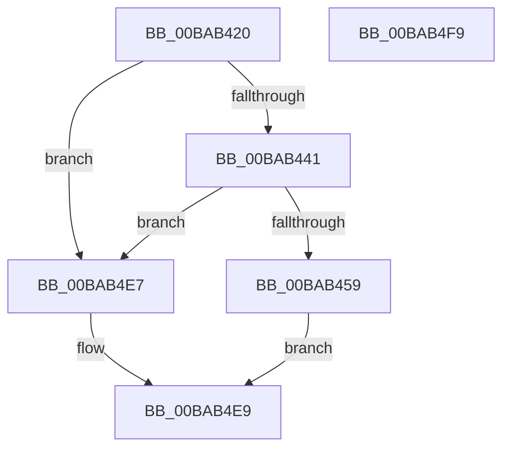

# VfPacketCreateAndLock

- RVA: `0x00BAB420`–`0x00BAB4FA` (길이 `218` bytes)
- VA: `0x0000000140BAB420`
- 실행 섹션: `PAGEVRFY`
- PDB 이름 있음: `예`; PDB Function 태그: `아니요`
- unwind 정보 RVA: `0x00060BC4`
- 디코드: `50`개 명령, `218/218` bytes 표시
- 미해석 바이트: `0` (있으면 어셈블리에 `.byte`로 보존)

> 이 문서는 커널 이미지의 기계어와 PDB 기호를 분석해 생성했습니다. 4번과 5번은 함수 원형과 자료형을 바이너리 사용 방식에서 추정한 C 해석이며 원본 소스 복구 결과는 아닙니다.

## 1. Dependencies

- 직접 호출 지점: **3**; 고유 호출 대상: **3**
- 직접 호출자로 확인된 함수: **3**
- RIP 상대 이미지 참조: **3**

### Outgoing calls
- `0x00BAB432` → [IovIsDisabledWithoutReboot](../../text/5A/IovIsDisabledWithoutReboot_function_005A3FFC.md) (function, `0x005A3FFC`)
- `0x00BAB448` → [ExAllocateFromNPagedLookasideList](../../text/38/ExAllocateFromNPagedLookasideList_function_0038E6C0.md) (function, `0x0038E6C0`)
- `0x00BAB4DD` → [VfIrpDatabaseEntryInsertAndLock](../BB/VfIrpDatabaseEntryInsertAndLock_function_00BB3F00.md) (function, `0x00BB3F00`)

### Direct callers
- [IovpCallDriver1](../B9/IovpCallDriver1_function_00B9CCA4.md) at `0x00B9CD23`
- [VfIoAllocateIrp2](../B9/VfIoAllocateIrp2_function_00B9DE0C.md) at `0x00B9DE26`
- [ViIrpAllocateLockedPacket](../B9/ViIrpAllocateLockedPacket_function_00B9E0AC.md) at `0x00B9E195`

### Static image references
- `0x00BAB441` → RVA `0x00FFF580` (`PAGEVRFD`; read)
- `0x00BAB459` → RVA `0x00F03FFC` (`.data`; read/write)
- `0x00BAB4D1` → RVA `0x00F04A20` (`.data`; read)

## 2. Other-region calls and transfers

- 다른 실행 섹션으로 향하는 call: **2**
  - `0x00BAB432` → [IovIsDisabledWithoutReboot](../../text/5A/IovIsDisabledWithoutReboot_function_005A3FFC.md) (`PAGEVRFY` → `.text`)
  - `0x00BAB448` → [ExAllocateFromNPagedLookasideList](../../text/38/ExAllocateFromNPagedLookasideList_function_0038E6C0.md) (`PAGEVRFY` → `.text`)
- 별도 외부 분기/꼬리 이동을 확인하지 못했습니다.

## 3. Assembly (complete function range)

```asm
00BAB420  48 89 5C 24 08                  mov qword ptr [rsp + 8], rbx
00BAB425  48 89 74 24 10                  mov qword ptr [rsp + 0x10], rsi
00BAB42A  57                              push rdi
00BAB42B  48 83 EC 20                     sub rsp, 0x20
00BAB42F  48 8B F9                        mov rdi, rcx
00BAB432  E8 C5 8B 9F FF                  call 0x1405a3ffc
00BAB437  33 F6                           xor esi, esi
00BAB439  84 C0                           test al, al
00BAB43B  0F 85 A6 00 00 00               jne 0x140bab4e7
00BAB441  48 8D 0D 38 41 45 00            lea rcx, [rip + 0x454138]
00BAB448  E8 73 32 7E FF                  call 0x14038e6c0
00BAB44D  48 8B D8                        mov rbx, rax
00BAB450  48 85 C0                        test rax, rax
00BAB453  0F 84 8E 00 00 00               je 0x140bab4e7
00BAB459  F0 FF 05 9C 8B 35 00            lock inc dword ptr [rip + 0x358b9c]
00BAB460  48 8D 48 40                     lea rcx, [rax + 0x40]
00BAB464  89 70 38                        mov dword ptr [rax + 0x38], esi
00BAB467  48 89 49 08                     mov qword ptr [rcx + 8], rcx
00BAB46B  4C 8B C3                        mov r8, rbx
00BAB46E  48 89 09                        mov qword ptr [rcx], rcx
00BAB471  8A 4F 42                        mov cl, byte ptr [rdi + 0x42]
00BAB474  88 48 50                        mov byte ptr [rax + 0x50], cl
00BAB477  48 8B CF                        mov rcx, rdi
00BAB47A  48 89 70 60                     mov qword ptr [rax + 0x60], rsi
00BAB47E  40 88 70 68                     mov byte ptr [rax + 0x68], sil
00BAB482  48 89 70 70                     mov qword ptr [rax + 0x70], rsi
00BAB486  66 89 B0 B8 00 00 00            mov word ptr [rax + 0xb8], si
00BAB48D  40 88 B0 BA 00 00 00            mov byte ptr [rax + 0xba], sil
00BAB494  89 B0 BC 00 00 00               mov dword ptr [rax + 0xbc], esi
00BAB49A  48 89 B0 F0 00 00 00            mov qword ptr [rax + 0xf0], rsi
00BAB4A1  89 70 54                        mov dword ptr [rax + 0x54], esi
00BAB4A4  48 89 70 58                     mov qword ptr [rax + 0x58], rsi
00BAB4A8  48 89 B0 C0 00 00 00            mov qword ptr [rax + 0xc0], rsi
00BAB4AF  48 89 B0 C8 00 00 00            mov qword ptr [rax + 0xc8], rsi
00BAB4B6  89 B0 D0 00 00 00               mov dword ptr [rax + 0xd0], esi
00BAB4BC  48 89 B0 D8 00 00 00            mov qword ptr [rax + 0xd8], rsi
00BAB4C3  48 89 B0 F8 00 00 00            mov qword ptr [rax + 0xf8], rsi
00BAB4CA  48 89 B0 E0 00 00 00            mov qword ptr [rax + 0xe0], rsi
00BAB4D1  8B 05 49 95 35 00               mov eax, dword ptr [rip + 0x359549]
00BAB4D7  89 83 E8 00 00 00               mov dword ptr [rbx + 0xe8], eax
00BAB4DD  E8 1E 8A 00 00                  call 0x140bb3f00
00BAB4E2  48 8B C3                        mov rax, rbx
00BAB4E5  EB 02                           jmp 0x140bab4e9
00BAB4E7  33 C0                           xor eax, eax
00BAB4E9  48 8B 5C 24 30                  mov rbx, qword ptr [rsp + 0x30]
00BAB4EE  48 8B 74 24 38                  mov rsi, qword ptr [rsp + 0x38]
00BAB4F3  48 83 C4 20                     add rsp, 0x20
00BAB4F7  5F                              pop rdi
00BAB4F8  C3                              ret
00BAB4F9  CC                              int3
```

## 4. C-style interpretation (structured pseudocode)

```c
__int64 __fastcall VfPacketCreateAndLock(__int64 a1)
{
    __int64 result;
    __int64 v_rsi;
    __int64 v_rsp;
    unsigned __int64 v_stack_p10;
    unsigned __int64 v_stack_p8;

    v_stack_p8 = v_rbx;
    v_stack_p10 = v_rsi;
    v_rsp = (v_rsp) - (32);
    result = IovIsDisabledWithoutReboot(a1, a2, a3, a4);
    v_rsi = 0;
    if ((unsigned __int8)(result) != 0) goto loc_00BAB4E7;
    result = ExAllocateFromNPagedLookasideList(v_rip + 4538680, a2, a3, a4);
    if (result == 0) goto loc_00BAB4E7;
    *(unsigned int *)(result + 56) = 0;
    *(unsigned __int64 *)(result + 64 + 8) = result + 64;
    *(unsigned __int64 *)(result + 64) = result + 64;
    *(unsigned __int8 *)(result + 80) = (unsigned __int8)(*(unsigned __int8 *)(a1 + 66));
    *(unsigned __int64 *)(result + 96) = 0;
    *(unsigned __int8 *)(result + 104) = 0;
    *(unsigned __int64 *)(result + 112) = 0;
    *(unsigned __int16 *)(result + 184) = 0;
    *(unsigned __int8 *)(result + 186) = 0;
    *(unsigned int *)(result + 188) = 0;
    *(unsigned __int64 *)(result + 240) = 0;
    *(unsigned int *)(result + 84) = 0;
    *(unsigned __int64 *)(result + 88) = 0;
    *(unsigned __int64 *)(result + 192) = 0;
    *(unsigned __int64 *)(result + 200) = 0;
    *(unsigned int *)(result + 208) = 0;
    *(unsigned __int64 *)(result + 216) = 0;
    *(unsigned __int64 *)(result + 248) = 0;
    *(unsigned __int64 *)(result + 224) = 0;
    *(unsigned int *)(result + 232) = (unsigned int)((unsigned int)(*(unsigned int *)(v_rip + 3511625)));
    result = VfIrpDatabaseEntryInsertAndLock(a1, a2, result, a4);
    goto loc_00BAB4E9;
loc_00BAB4E7:
    result = 0;
loc_00BAB4E9:
    v_rsp = (v_rsp) + (32);
    return result;
}
```

## 5. (Beta) C Style

```c
int64_t VfPacketCreateAndLock(void *Arg1)
{
    uint8_t *arg1 = (uint8_t *)Arg1;

    int64_t result;
    int64_t local_rsi;
    int64_t local_rsp;
    uint64_t v_stack_p10;
    uint64_t v_stack_p8;

    v_stack_p8 = local_rbx;
    v_stack_p10 = local_rsi;
    local_rsp = (local_rsp) - (32);
    result = IovIsDisabledWithoutReboot(Arg1, a2, a3, a4);
    local_rsi = 0;
    if ((uint8_t)(result) != 0) goto loc_00BAB4E7;
    result = ExAllocateFromNPagedLookasideList(v_rip + 4538680, a2, a3, a4);
    if (result == 0) goto loc_00BAB4E7;
    *(uint32_t *)(result + 0x38) = 0;
    *(uint64_t *)(result + 0x40 + 0x8) = result + 64;
    *(uint64_t *)(result + 0x40) = result + 64;
    *(uint8_t *)(result + 0x50) = (uint8_t)(*(uint8_t *)(arg1 + 0x42));
    *(uint64_t *)(result + 0x60) = 0;
    *(uint8_t *)(result + 0x68) = 0;
    *(uint64_t *)(result + 0x70) = 0;
    *(uint16_t *)(result + 0xB8) = 0;
    *(uint8_t *)(result + 0xBA) = 0;
    *(uint32_t *)(result + 0xBC) = 0;
    *(uint64_t *)(result + 0xF0) = 0;
    *(uint32_t *)(result + 0x54) = 0;
    *(uint64_t *)(result + 0x58) = 0;
    *(uint64_t *)(result + 0xC0) = 0;
    *(uint64_t *)(result + 0xC8) = 0;
    *(uint32_t *)(result + 0xD0) = 0;
    *(uint64_t *)(result + 0xD8) = 0;
    *(uint64_t *)(result + 0xF8) = 0;
    *(uint64_t *)(result + 0xE0) = 0;
    *(uint32_t *)(result + 0xE8) = (uint32_t)((uint32_t)(*(uint32_t *)(v_rip + 0x359549)));
    result = VfIrpDatabaseEntryInsertAndLock(Arg1, a2, result, a4);
    goto loc_00BAB4E9;
loc_00BAB4E7:
    result = 0;
loc_00BAB4E9:
    local_rsp = (local_rsp) + (32);
    return result;
}
```

### 관측된 메모리 오프셋

구조체 형식이 확인되지 않은 접근은 인자 기준의 오프셋으로만 기록했습니다.

| 기준 인자 | 오프셋 표현 | 폭 (bit) | 접근 |
|---|---:|---:|---|
| `Arg1` | `+ 0x42` | `8` | `R` |

## 6. Execution-region graph

[열기: 2D/3D 그래프와 함수 탐색 컨트롤 패널](../../../control-panel.html?section=pagevrfy&rva=0x00BAB420&view=graph)

- 2D 그래프는 위에서 아래로 흐르고, 3D 그래프는 빈 공간을 드래그해 회전합니다. Shift+드래그는 이동, 휠은 확대·축소, 함수 노드 선택은 대상 보고서 이동입니다.

### Static fallback


