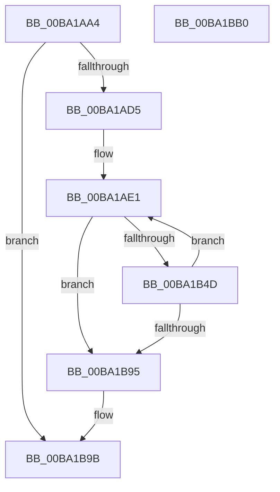

# VfPendingInitPhase1

- RVA: `0x00BA1AA4`–`0x00BA1BB1` (길이 `269` bytes)
- VA: `0x0000000140BA1AA4`
- 실행 섹션: `PAGEVRFY`
- PDB 이름 있음: `예`; PDB Function 태그: `아니요`
- unwind 정보 RVA: `0x000D2514`
- 디코드: `69`개 명령, `269/269` bytes 표시
- 미해석 바이트: `0` (있으면 어셈블리에 `.byte`로 보존)

> 이 문서는 커널 이미지의 기계어와 PDB 기호를 분석해 생성했습니다. 4번과 5번은 함수 원형과 자료형을 바이너리 사용 방식에서 추정한 C 해석이며 원본 소스 복구 결과는 아닙니다.

## 1. Dependencies

- 직접 호출 지점: **4**; 고유 호출 대상: **4**
- 직접 호출자로 확인된 함수: **3**
- RIP 상대 이미지 참조: **5**

### Outgoing calls
- `0x00BA1AF7` → [KeInitializeEvent](../../text/40/KeInitializeEvent_function_0040DD10.md) (function, `0x0040DD10`)
- `0x00BA1B44` → [PsCreateSystemThread](../../page/9E/PsCreateSystemThread_function_009ED0D0.md) (function, `0x009ED0D0`)
- `0x00BA1B71` → [ObReferenceObjectByHandle](../../page/86/ObReferenceObjectByHandle_function_00868DB0.md) (function, `0x00868DB0`)
- `0x00BA1B81` → [ZwClose](../../text/6A/ZwClose_function_006AD2B0.md) (function, `0x006AD2B0`)

### Direct callers
- [VfIoPendingEntry](../../text/61/VfIoPendingEntry_function_00614340.md) at `0x006143F9`
- [VfInitSystemNoRebootNeeded](../B9/VfInitSystemNoRebootNeeded_function_00B93970.md) at `0x00B93A79`
- [VerifierInitSystem](../../init/C4/VerifierInitSystem_function_00C4BC84.md) at `0x00C4BCC5`

### Static image references
- `0x00BA1AC9` → RVA `0x00F04208` (`.data`; read)
- `0x00BA1AD5` → RVA `0x00F04080` (`.data`; read)
- `0x00BA1B17` → RVA `0x00BA20D0` (`ViPendingWorkerThread`; read)
- `0x00BA1B57` → RVA `0x00FC6AC8` (`ALMOSTRO`; read)
- `0x00BA1B95` → RVA `0x00F04208` (`.data`; read/write)

## 2. Other-region calls and transfers

- 다른 실행 섹션으로 향하는 call: **4**
  - `0x00BA1AF7` → [KeInitializeEvent](../../text/40/KeInitializeEvent_function_0040DD10.md) (`PAGEVRFY` → `.text`)
  - `0x00BA1B44` → [PsCreateSystemThread](../../page/9E/PsCreateSystemThread_function_009ED0D0.md) (`PAGEVRFY` → `PAGE`)
  - `0x00BA1B71` → [ObReferenceObjectByHandle](../../page/86/ObReferenceObjectByHandle_function_00868DB0.md) (`PAGEVRFY` → `PAGE`)
  - `0x00BA1B81` → [ZwClose](../../text/6A/ZwClose_function_006AD2B0.md) (`PAGEVRFY` → `.text`)
- 별도 외부 분기/꼬리 이동을 확인하지 못했습니다.

## 3. Assembly (complete function range)

```asm
00BA1AA4  48 89 5C 24 18                  mov qword ptr [rsp + 0x18], rbx
00BA1AA9  48 89 74 24 20                  mov qword ptr [rsp + 0x20], rsi
00BA1AAE  55                              push rbp
00BA1AAF  57                              push rdi
00BA1AB0  41 57                           push r15
00BA1AB2  48 8B EC                        mov rbp, rsp
00BA1AB5  48 83 EC 70                     sub rsp, 0x70
00BA1AB9  48 83 65 20 00                  and qword ptr [rbp + 0x20], 0
00BA1ABE  33 C0                           xor eax, eax
00BA1AC0  21 45 EC                        and dword ptr [rbp - 0x14], eax
00BA1AC3  89 45 D4                        mov dword ptr [rbp - 0x2c], eax
00BA1AC6  21 45 D4                        and dword ptr [rbp - 0x2c], eax
00BA1AC9  39 05 39 27 36 00               cmp dword ptr [rip + 0x362739], eax
00BA1ACF  0F 87 C6 00 00 00               ja 0x140ba1b9b
00BA1AD5  4C 8D 3D A4 25 36 00            lea r15, [rip + 0x3625a4]
00BA1ADC  33 FF                           xor edi, edi
00BA1ADE  49 8B F7                        mov rsi, r15
00BA1AE1  45 33 C0                        xor r8d, r8d
00BA1AE4  48 8D 1C 7F                     lea rbx, [rdi + rdi*2]
00BA1AE8  48 C1 E3 04                     shl rbx, 4
00BA1AEC  49 8D 4F 10                     lea rcx, [r15 + 0x10]
00BA1AF0  48 03 CB                        add rcx, rbx
00BA1AF3  41 8D 50 01                     lea edx, [r8 + 1]
00BA1AF7  E8 14 C2 86 FF                  call 0x14040dd10
00BA1AFC  48 83 65 D8 00                  and qword ptr [rbp - 0x28], 0
00BA1B01  4A 8D 04 3B                     lea rax, [rbx + r15]
00BA1B05  48 83 65 E0 00                  and qword ptr [rbp - 0x20], 0
00BA1B0A  4C 8D 45 D0                     lea r8, [rbp - 0x30]
00BA1B0E  48 89 44 24 30                  mov qword ptr [rsp + 0x30], rax
00BA1B13  48 8D 4D 20                     lea rcx, [rbp + 0x20]
00BA1B17  48 8D 05 B2 05 00 00            lea rax, [rip + 0x5b2]
00BA1B1E  C7 45 D0 30 00 00 00            mov dword ptr [rbp - 0x30], 0x30
00BA1B25  0F 57 C0                        xorps xmm0, xmm0
00BA1B28  48 89 44 24 28                  mov qword ptr [rsp + 0x28], rax
00BA1B2D  48 83 64 24 20 00               and qword ptr [rsp + 0x20], 0
00BA1B33  45 33 C9                        xor r9d, r9d
00BA1B36  33 D2                           xor edx, edx
00BA1B38  C7 45 E8 00 02 00 00            mov dword ptr [rbp - 0x18], 0x200
00BA1B3F  F3 0F 7F 45 F0                  movdqu xmmword ptr [rbp - 0x10], xmm0
00BA1B44  E8 87 B5 E4 FF                  call 0x1409ed0d0
00BA1B49  85 C0                           test eax, eax
00BA1B4B  78 48                           js 0x140ba1b95
00BA1B4D  48 83 64 24 28 00               and qword ptr [rsp + 0x28], 0
00BA1B53  48 8D 45 28                     lea rax, [rbp + 0x28]
00BA1B57  4C 8B 05 6A 4F 42 00            mov r8, qword ptr [rip + 0x424f6a]
00BA1B5E  45 33 C9                        xor r9d, r9d
00BA1B61  48 8B 4D 20                     mov rcx, qword ptr [rbp + 0x20]
00BA1B65  33 D2                           xor edx, edx
00BA1B67  48 83 65 28 00                  and qword ptr [rbp + 0x28], 0
00BA1B6C  48 89 44 24 20                  mov qword ptr [rsp + 0x20], rax
00BA1B71  E8 3A 72 CC FF                  call 0x140868db0
00BA1B76  48 8B 45 28                     mov rax, qword ptr [rbp + 0x28]
00BA1B7A  48 8B 4D 20                     mov rcx, qword ptr [rbp + 0x20]
00BA1B7E  48 89 06                        mov qword ptr [rsi], rax
00BA1B81  E8 2A B7 B0 FF                  call 0x1406ad2b0
00BA1B86  FF C7                           inc edi
00BA1B88  48 83 C6 30                     add rsi, 0x30
00BA1B8C  83 FF 08                        cmp edi, 8
00BA1B8F  0F 82 4C FF FF FF               jb 0x140ba1ae1
00BA1B95  87 3D 6D 26 36 00               xchg dword ptr [rip + 0x36266d], edi
00BA1B9B  4C 8D 5C 24 70                  lea r11, [rsp + 0x70]
00BA1BA0  49 8B 5B 30                     mov rbx, qword ptr [r11 + 0x30]
00BA1BA4  49 8B 73 38                     mov rsi, qword ptr [r11 + 0x38]
00BA1BA8  49 8B E3                        mov rsp, r11
00BA1BAB  41 5F                           pop r15
00BA1BAD  5F                              pop rdi
00BA1BAE  5D                              pop rbp
00BA1BAF  C3                              ret
00BA1BB0  CC                              int3
```

## 4. C-style interpretation (structured pseudocode)

```c
__int64 __fastcall VfPendingInitPhase1(__int64 a1, __int64 a2, int a3, int a4)
{
    __int64 result;
    __int64 v_rbx;
    __int64 v_rdi;
    __int64 v_rsi;
    __int64 v_rsp;
    unsigned __int64 v_stack_m18;
    unsigned __int64 v_stack_m28;
    unsigned int v_stack_m2C;
    unsigned int v_stack_m30;
    unsigned __int64 v_stack_m38;
    unsigned __int64 v_stack_m40;
    unsigned int v_stack_m44;
    unsigned __int64 v_stack_m48;
    unsigned __int64 v_stack_m58;
    unsigned __int64 v_stack_m60;
    unsigned __int64 v_stack_m68;
    unsigned __int64 v_stack_p10;
    unsigned __int64 v_stack_p18;
    unsigned __int64 v_stack_p20;
    unsigned __int64 v_stack_p8;

    v_stack_p18 = v_rbx;
    v_stack_p20 = v_rsi;
    v_rsp = (v_rsp) - (112);
    result = 0;
    v_stack_m44 = 0;
    if ((*(unsigned int *)(v_rip + 3548985)) > 0) goto loc_00BA1B9B;
    v_rdi = 0;
loc_00BA1AE1:
    a3 = 0;
    v_rbx = (v_rdi + v_rdi * 2) << (4);
    a1 = (v_rip + 3548580 + 16) + (v_rbx);
    result = KeInitializeEvent(a1, a3 + 1, a3, a4);
    v_stack_m58 = v_rbx + v_rip + 3548580 * 1;
    v_stack_m48 = 48;
    v_stack_m60 = v_rip + 1458;
    a4 = 0;
    a2 = 0;
    v_stack_m30 = 512;
    v_stack_m28 = v_xmm0;
    result = PsCreateSystemThread(v_stack_p8, a2, v_stack_m48, a4);
    if (sign_flag) goto loc_00BA1B95;
    a4 = 0;
    a2 = 0;
    v_stack_m68 = v_stack_p10;
    result = ObReferenceObjectByHandle(v_stack_p8, a2, *(unsigned __int64 *)(v_rip + 4345706), a4);
    *(unsigned __int64 *)(v_rip + 3548580) = v_stack_p10;
    result = ZwClose(v_stack_p8, a2, *(unsigned __int64 *)(v_rip + 4345706), a4);
    v_rdi = (unsigned int)((v_rdi) + 1);
    v_rsi = (v_rip + 3548580) + (48);
    if (((unsigned int)(v_rdi)) < 8) goto loc_00BA1AE1;
loc_00BA1B95:
loc_00BA1B9B:
    return result;
}
```

## 5. (Beta) C Style

```c
int64_t VfPendingInitPhase1(int64_t Arg1, int64_t Arg2, int32_t Arg3, int32_t Arg4)
{
    int64_t result;
    int64_t local_rbx;
    int64_t local_rdi;
    int64_t local_rsi;
    int64_t local_rsp;
    uint64_t v_stack_m18;
    uint64_t v_stack_m28;
    uint32_t v_stack_m2C;
    uint32_t v_stack_m30;
    uint64_t v_stack_m38;
    uint64_t v_stack_m40;
    uint32_t v_stack_m44;
    uint64_t v_stack_m48;
    uint64_t v_stack_m58;
    uint64_t v_stack_m60;
    uint64_t v_stack_m68;
    uint64_t v_stack_p10;
    uint64_t v_stack_p18;
    uint64_t v_stack_p20;
    uint64_t v_stack_p8;

    v_stack_p18 = local_rbx;
    v_stack_p20 = local_rsi;
    local_rsp = (local_rsp) - (112);
    result = 0;
    v_stack_m44 = 0;
    if ((*(uint32_t *)(v_rip + 0x362739)) > 0) goto loc_00BA1B9B;
    local_rdi = 0;
loc_00BA1AE1:
    Arg3 = 0;
    local_rbx = (local_rdi + local_rdi * 2) << (4);
    Arg1 = (v_rip + 3548580 + 16) + (local_rbx);
    result = KeInitializeEvent(Arg1, Arg3 + 1, Arg3, Arg4);
    v_stack_m58 = local_rbx + v_rip + 3548580 * 1;
    v_stack_m48 = 48;
    v_stack_m60 = v_rip + 1458;
    Arg4 = 0;
    Arg2 = 0;
    v_stack_m30 = 512;
    v_stack_m28 = v_xmm0;
    result = PsCreateSystemThread(v_stack_p8, Arg2, v_stack_m48, Arg4);
    if (sign_flag) goto loc_00BA1B95;
    Arg4 = 0;
    Arg2 = 0;
    v_stack_m68 = v_stack_p10;
    result = ObReferenceObjectByHandle(v_stack_p8, Arg2, *(uint64_t *)(v_rip + 0x424F6A), Arg4);
    *(uint64_t *)(v_rip + 0x3625A4) = v_stack_p10;
    result = ZwClose(v_stack_p8, Arg2, *(uint64_t *)(v_rip + 0x424F6A), Arg4);
    local_rdi = (uint32_t)((local_rdi) + 1);
    local_rsi = (v_rip + 3548580) + (48);
    if (((uint32_t)(local_rdi)) < 8) goto loc_00BA1AE1;
loc_00BA1B95:
loc_00BA1B9B:
    return result;
}
```

## 6. Execution-region graph

[열기: 2D/3D 그래프와 함수 탐색 컨트롤 패널](../../../control-panel.html?section=pagevrfy&rva=0x00BA1AA4&view=graph)

- 2D 그래프는 위에서 아래로 흐르고, 3D 그래프는 빈 공간을 드래그해 회전합니다. Shift+드래그는 이동, 휠은 확대·축소, 함수 노드 선택은 대상 보고서 이동입니다.

### Static fallback


