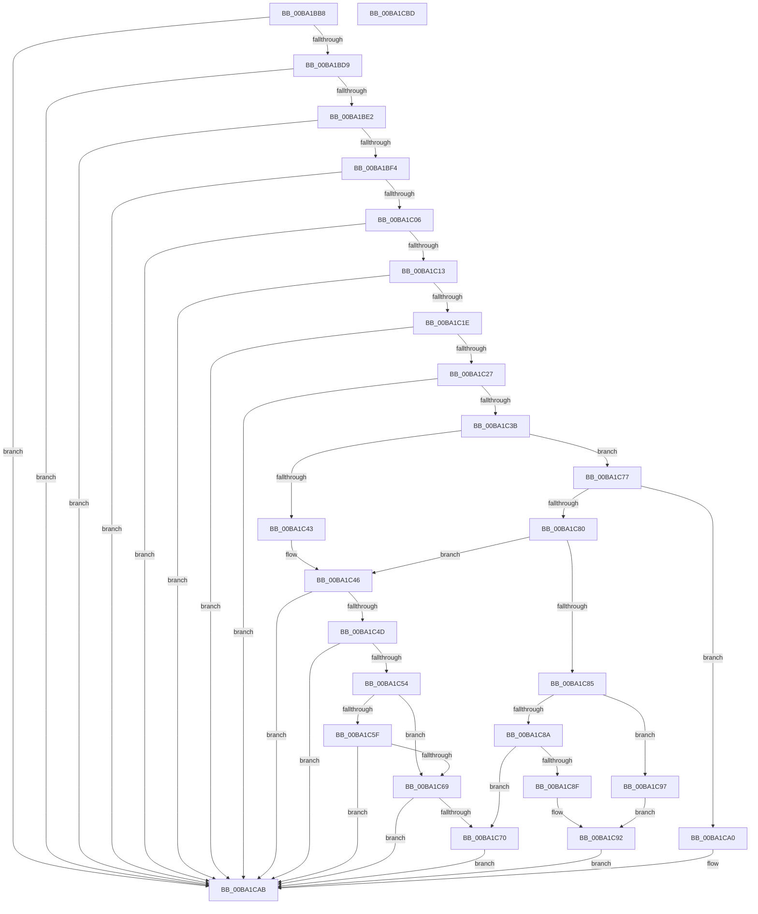

# VfPendingShouldForce

- RVA: `0x00BA1BB8`–`0x00BA1CBE` (길이 `262` bytes)
- VA: `0x0000000140BA1BB8`
- 실행 섹션: `PAGEVRFY`
- PDB 이름 있음: `예`; PDB Function 태그: `아니요`
- unwind 정보 RVA: `0x00060BC4`
- 디코드: `75`개 명령, `262/262` bytes 표시
- 미해석 바이트: `0` (있으면 어셈블리에 `.byte`로 보존)

> 이 문서는 커널 이미지의 기계어와 PDB 기호를 분석해 생성했습니다. 4번과 5번은 함수 원형과 자료형을 바이너리 사용 방식에서 추정한 C 해석이며 원본 소스 복구 결과는 아닙니다.

## 1. Dependencies

- 직접 호출 지점: **3**; 고유 호출 대상: **3**
- 직접 호출자로 확인된 함수: **1**
- RIP 상대 이미지 참조: **1**

### Outgoing calls
- `0x00BA1BF9` → [VfDriverIsKernelImageAddress](../BB/VfDriverIsKernelImageAddress_function_00BB7EBC.md) (function, `0x00BB7EBC`)
- `0x00BA1C06` → [VfTargetDriversIsEnabled](../BB/VfTargetDriversIsEnabled_function_00BB7F20.md) (function, `0x00BB7F20`)
- `0x00BA1C2C` → [VfRandomGetNumber](../B9/VfRandomGetNumber_function_00B930CC.md) (function, `0x00B930CC`)

### Direct callers
- [IovpCallDriver1](../B9/IovpCallDriver1_function_00B9CCA4.md) at `0x00B9CD7B`

### Static image references
- `0x00BA1C31` → RVA `0x00E0EA10` (`.data`; read)

## 2. Other-region calls and transfers

- 다른 실행 섹션으로 향하는 call: **0**
- 별도 외부 분기/꼬리 이동을 확인하지 못했습니다.

## 3. Assembly (complete function range)

```asm
00BA1BB8  48 89 5C 24 08                  mov qword ptr [rsp + 8], rbx
00BA1BBD  48 89 74 24 10                  mov qword ptr [rsp + 0x10], rsi
00BA1BC2  57                              push rdi
00BA1BC3  48 83 EC 20                     sub rsp, 0x20
00BA1BC7  33 DB                           xor ebx, ebx
00BA1BC9  49 8B F9                        mov rdi, r9
00BA1BCC  49 8B F0                        mov rsi, r8
00BA1BCF  0F BA E1 09                     bt ecx, 9
00BA1BD3  0F 83 D2 00 00 00               jae 0x140ba1cab
00BA1BD9  80 FA 02                        cmp dl, 2
00BA1BDC  0F 83 C9 00 00 00               jae 0x140ba1cab
00BA1BE2  48 8B 44 24 50                  mov rax, qword ptr [rsp + 0x50]
00BA1BE7  48 39 98 D8 00 00 00            cmp qword ptr [rax + 0xd8], rbx
00BA1BEE  0F 85 B7 00 00 00               jne 0x140ba1cab
00BA1BF4  48 8B 4C 24 58                  mov rcx, qword ptr [rsp + 0x58]
00BA1BF9  E8 BE 62 01 00                  call 0x140bb7ebc
00BA1BFE  85 C0                           test eax, eax
00BA1C00  0F 85 A5 00 00 00               jne 0x140ba1cab
00BA1C06  E8 15 63 01 00                  call 0x140bb7f20
00BA1C0B  85 C0                           test eax, eax
00BA1C0D  0F 84 98 00 00 00               je 0x140ba1cab
00BA1C13  8B 46 10                        mov eax, dword ptr [rsi + 0x10]
00BA1C16  A8 C0                           test al, 0xc0
00BA1C18  0F 85 8D 00 00 00               jne 0x140ba1cab
00BA1C1E  38 5E 41                        cmp byte ptr [rsi + 0x41], bl
00BA1C21  0F 85 84 00 00 00               jne 0x140ba1cab
00BA1C27  8D 53 64                        lea edx, [rbx + 0x64]
00BA1C2A  33 C9                           xor ecx, ecx
00BA1C2C  E8 9B 14 FF FF                  call 0x140b930cc
00BA1C31  8B 0D D9 CD 26 00               mov ecx, dword ptr [rip + 0x26cdd9]
00BA1C37  3B C1                           cmp eax, ecx
00BA1C39  73 70                           jae 0x140ba1cab
00BA1C3B  0F B6 0F                        movzx ecx, byte ptr [rdi]
00BA1C3E  83 F9 0D                        cmp ecx, 0xd
00BA1C41  75 34                           jne 0x140ba1c77
00BA1C43  8B 47 18                        mov eax, dword ptr [rdi + 0x18]
00BA1C46  3D 5C 00 09 00                  cmp eax, 0x9005c
00BA1C4B  74 5E                           je 0x140ba1cab
00BA1C4D  3D 50 00 09 00                  cmp eax, 0x90050
00BA1C52  74 57                           je 0x140ba1cab
00BA1C54  8D 88 00 00 F7 FF               lea ecx, [rax - 0x90000]
00BA1C5A  83 F9 14                        cmp ecx, 0x14
00BA1C5D  77 0A                           ja 0x140ba1c69
00BA1C5F  BA 11 11 11 00                  mov edx, 0x111111
00BA1C64  0F A3 CA                        bt edx, ecx
00BA1C67  72 42                           jb 0x140ba1cab
00BA1C69  3D 40 02 09 00                  cmp eax, 0x90240
00BA1C6E  74 3B                           je 0x140ba1cab
00BA1C70  BB 01 00 00 00                  mov ebx, 1
00BA1C75  EB 34                           jmp 0x140ba1cab
00BA1C77  0F B6 47 01                     movzx eax, byte ptr [rdi + 1]
00BA1C7B  83 E9 0C                        sub ecx, 0xc
00BA1C7E  74 20                           je 0x140ba1ca0
00BA1C80  83 E9 01                        sub ecx, 1
00BA1C83  74 C1                           je 0x140ba1c46
00BA1C85  83 E9 04                        sub ecx, 4
00BA1C88  74 0D                           je 0x140ba1c97
00BA1C8A  83 F9 0A                        cmp ecx, 0xa
00BA1C8D  75 E1                           jne 0x140ba1c70
00BA1C8F  83 F8 02                        cmp eax, 2
00BA1C92  0F 95 C3                        setne bl
00BA1C95  EB 14                           jmp 0x140ba1cab
00BA1C97  B9 01 00 00 00                  mov ecx, 1
00BA1C9C  3B C1                           cmp eax, ecx
00BA1C9E  EB F2                           jmp 0x140ba1c92
00BA1CA0  83 F8 02                        cmp eax, 2
00BA1CA3  B9 01 00 00 00                  mov ecx, 1
00BA1CA8  0F 45 D9                        cmovne ebx, ecx
00BA1CAB  48 8B 74 24 38                  mov rsi, qword ptr [rsp + 0x38]
00BA1CB0  8B C3                           mov eax, ebx
00BA1CB2  48 8B 5C 24 30                  mov rbx, qword ptr [rsp + 0x30]
00BA1CB7  48 83 C4 20                     add rsp, 0x20
00BA1CBB  5F                              pop rdi
00BA1CBC  C3                              ret
00BA1CBD  CC                              int3
```

## 4. C-style interpretation (structured pseudocode)

```c
__int64 __fastcall VfPendingShouldForce(int a1, unsigned __int8 a2, __int64 a3, __int64 a4, __int64 a5, __int64 a6)
{
    __int64 result;
    __int64 v_rbx;
    __int64 v_rsp;
    unsigned __int64 v_stack_p10;
    unsigned __int64 v_stack_p8;

    v_stack_p8 = v_rbx;
    v_stack_p10 = v_rsi;
    v_rsp = (v_rsp) - (32);
    v_rbx = 0;
    if (condition_is_above_or_equal) goto loc_00BA1CAB;
    if (a2 >= 2) goto loc_00BA1CAB;
    if ((*(unsigned __int64 *)(a5 + 216)) != 0) goto loc_00BA1CAB;
    result = VfDriverIsKernelImageAddress(a6, a2, a3, a4);
    if ((unsigned int)(result) != 0) goto loc_00BA1CAB;
    result = VfTargetDriversIsEnabled(a6, a2, a3, a4);
    if ((unsigned int)(result) == 0) goto loc_00BA1CAB;
    if ((((unsigned __int8)((unsigned int)(*(unsigned int *)(a3 + 16)))) & (192)) != 0) goto loc_00BA1CAB;
    if ((*(unsigned __int8 *)(a3 + 65)) != 0) goto loc_00BA1CAB;
    a1 = 0;
    result = VfRandomGetNumber(a1, v_rbx + 100, a3, a4);
    if (((unsigned int)(result)) >= ((unsigned int)((unsigned int)(*(unsigned int *)(v_rip + 2543065))))) goto loc_00BA1CAB;
    if (((unsigned int)(*(unsigned __int8 *)(a4))) != 13) goto loc_00BA1C77;
loc_00BA1C46:
    if (((unsigned int)((unsigned int)(*(unsigned int *)(a4 + 24)))) == 0x9005CULL) goto loc_00BA1CAB;
    if (((unsigned int)((unsigned int)(*(unsigned int *)(a4 + 24)))) == 0x90050ULL) goto loc_00BA1CAB;
    if (((unsigned int)((unsigned int)(*(unsigned int *)(a4 + 24)) - 589824)) > 20) goto loc_00BA1C69;
    if (((unsigned int)((unsigned int)(*(unsigned int *)(a4 + 24)) - 589824)) < 20) goto loc_00BA1CAB;
loc_00BA1C69:
    if (((unsigned int)((unsigned int)(*(unsigned int *)(a4 + 24)))) == 0x90240ULL) goto loc_00BA1CAB;
loc_00BA1C70:
    goto loc_00BA1CAB;
loc_00BA1C77:
    a1 = (unsigned int)(((unsigned int)(*(unsigned int *)(a4 + 24)) - 589824) - (12));
    if (condition_is_equal) goto loc_00BA1CA0;
    a1 = (unsigned int)((a1) - (1));
    if (condition_is_equal) goto loc_00BA1C46;
    a1 = (unsigned int)((a1) - (4));
    if (condition_is_equal) goto loc_00BA1C97;
    if (a1 != 10) goto loc_00BA1C70;
loc_00BA1C92:
    v_rbx = (((unsigned int)(*(unsigned __int8 *)(a4 + 1))) != 2) ? 1 : 0;
    goto loc_00BA1CAB;
loc_00BA1C97:
    goto loc_00BA1C92;
loc_00BA1CA0:
    if (((unsigned int)(*(unsigned __int8 *)(a4 + 1))) != 2) { v_rbx = 1; }
loc_00BA1CAB:
    v_rsp = (v_rsp) + (32);
    return (unsigned int)((unsigned int)(v_rbx));
}
```

## 5. (Beta) C Style

```c
int64_t VfPendingShouldForce(int32_t Arg1, uint8_t Arg2, void *Arg3, void *Arg4, void *Arg5, int64_t Arg6)
{
    uint8_t *arg3 = (uint8_t *)Arg3;
    uint8_t *arg4 = (uint8_t *)Arg4;
    uint8_t *arg5 = (uint8_t *)Arg5;

    int64_t result;
    int64_t local_rbx;
    int64_t local_rsp;
    uint64_t v_stack_p10;
    uint64_t v_stack_p8;

    v_stack_p8 = local_rbx;
    v_stack_p10 = local_rsi;
    local_rsp = (local_rsp) - (32);
    local_rbx = 0;
    if (condition_is_above_or_equal) goto loc_00BA1CAB;
    if (Arg2 >= 2) goto loc_00BA1CAB;
    if ((*(uint64_t *)(arg5 + 0xD8)) != 0) goto loc_00BA1CAB;
    result = VfDriverIsKernelImageAddress(Arg6, Arg2, Arg3, Arg4);
    if ((uint32_t)(result) != 0) goto loc_00BA1CAB;
    result = VfTargetDriversIsEnabled(Arg6, Arg2, Arg3, Arg4);
    if ((uint32_t)(result) == 0) goto loc_00BA1CAB;
    if ((((uint8_t)((uint32_t)(*(uint32_t *)(arg3 + 0x10)))) & (192)) != 0) goto loc_00BA1CAB;
    if ((*(uint8_t *)(arg3 + 0x41)) != 0) goto loc_00BA1CAB;
    Arg1 = 0;
    result = VfRandomGetNumber(Arg1, local_rbx + 100, Arg3, Arg4);
    if (((uint32_t)(result)) >= ((uint32_t)((uint32_t)(*(uint32_t *)(v_rip + 0x26CDD9))))) goto loc_00BA1CAB;
    if (((uint32_t)(*(uint8_t *)(arg4))) != 13) goto loc_00BA1C77;
loc_00BA1C46:
    if (((uint32_t)((uint32_t)(*(uint32_t *)(arg4 + 0x18)))) == 0x9005CULL) goto loc_00BA1CAB;
    if (((uint32_t)((uint32_t)(*(uint32_t *)(arg4 + 0x18)))) == 0x90050ULL) goto loc_00BA1CAB;
    if (((uint32_t)((uint32_t)(*(uint32_t *)(arg4 + 0x18)) - 589824)) > 20) goto loc_00BA1C69;
    if (((uint32_t)((uint32_t)(*(uint32_t *)(arg4 + 0x18)) - 589824)) < 20) goto loc_00BA1CAB;
loc_00BA1C69:
    if (((uint32_t)((uint32_t)(*(uint32_t *)(arg4 + 0x18)))) == 0x90240ULL) goto loc_00BA1CAB;
loc_00BA1C70:
    goto loc_00BA1CAB;
loc_00BA1C77:
    Arg1 = (uint32_t)(((uint32_t)(*(uint32_t *)(arg4 + 0x18)) - 589824) - (12));
    if (condition_is_equal) goto loc_00BA1CA0;
    Arg1 = (uint32_t)((Arg1) - (1));
    if (condition_is_equal) goto loc_00BA1C46;
    Arg1 = (uint32_t)((Arg1) - (4));
    if (condition_is_equal) goto loc_00BA1C97;
    if (Arg1 != 10) goto loc_00BA1C70;
loc_00BA1C92:
    local_rbx = (((uint32_t)(*(uint8_t *)(arg4 + 0x1))) != 2) ? 1 : 0;
    goto loc_00BA1CAB;
loc_00BA1C97:
    goto loc_00BA1C92;
loc_00BA1CA0:
    if (((uint32_t)(*(uint8_t *)(arg4 + 0x1))) != 2) { local_rbx = 1; }
loc_00BA1CAB:
    local_rsp = (local_rsp) + (32);
    return (uint32_t)((uint32_t)(local_rbx));
}
```

### 관측된 메모리 오프셋

구조체 형식이 확인되지 않은 접근은 인자 기준의 오프셋으로만 기록했습니다.

| 기준 인자 | 오프셋 표현 | 폭 (bit) | 접근 |
|---|---:|---:|---|
| `Arg3` | `+ 0x10` | `32` | `R` |
| `Arg3` | `+ 0x41` | `8` | `R` |
| `Arg4` | `+ 0x0` | `8` | `R` |
| `Arg4` | `+ 0x1` | `8` | `R` |
| `Arg4` | `+ 0x18` | `32` | `R` |
| `Arg5` | `+ 0xD8` | `64` | `R` |

## 6. Execution-region graph

[열기: 2D/3D 그래프와 함수 탐색 컨트롤 패널](../../../control-panel.html?section=pagevrfy&rva=0x00BA1BB8&view=graph)

- 2D 그래프는 위에서 아래로 흐르고, 3D 그래프는 빈 공간을 드래그해 회전합니다. Shift+드래그는 이동, 휠은 확대·축소, 함수 노드 선택은 대상 보고서 이동입니다.

### Static fallback


