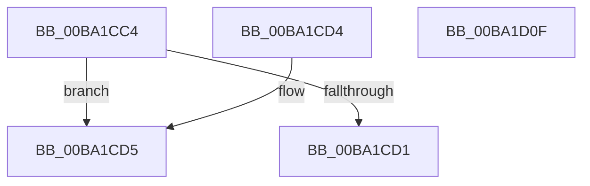

# VfPendingStartLogging

- RVA: `0x00BA1CC4`–`0x00BA1D10` (길이 `76` bytes)
- VA: `0x0000000140BA1CC4`
- 실행 섹션: `PAGEVRFY`
- PDB 이름 있음: `예`; PDB Function 태그: `아니요`
- unwind 정보 RVA: `0x000DB714`
- 디코드: `20`개 명령, `76/76` bytes 표시
- 미해석 바이트: `0` (있으면 어셈블리에 `.byte`로 보존)

> 이 문서는 커널 이미지의 기계어와 PDB 기호를 분석해 생성했습니다. 4번과 5번은 함수 원형과 자료형을 바이너리 사용 방식에서 추정한 C 해석이며 원본 소스 복구 결과는 아닙니다.

## 1. Dependencies

- 직접 호출 지점: **0**; 고유 호출 대상: **0**
- 직접 호출자로 확인된 함수: **2**
- RIP 상대 이미지 참조: **3**

### Outgoing calls
- 직접 디코드된 call 명령이 없습니다.

### Direct callers
- [IovpCallDriver1](../B9/IovpCallDriver1_function_00B9CCA4.md) at `0x00B9CF0E`
- [sub_00BBBCB2](../BB/Unknown_function_00BBBCB2.md) at `0x00BBBCE2`

### Static image references
- `0x00BA1CC4` → RVA `0x00F04200` (`.data`; read)
- `0x00BA1CDA` → RVA `0x00F0420C` (`.data`; read/write)
- `0x00BA1CE2` → RVA `0x00E0EA0C` (`.data`; read)

## 2. Other-region calls and transfers

- 다른 실행 섹션으로 향하는 call: **0**
- 별도 외부 분기/꼬리 이동을 확인하지 못했습니다.

## 3. Assembly (complete function range)

```asm
00BA1CC4  48 83 3D 34 25 36 00 00         cmp qword ptr [rip + 0x362534], 0
00BA1CCC  48 8B D1                        mov rdx, rcx
00BA1CCF  75 04                           jne 0x140ba1cd5
00BA1CD1  33 C0                           xor eax, eax
00BA1CD3  C3                              ret
00BA1CD4  CC                              int3
00BA1CD5  B9 01 00 00 00                  mov ecx, 1
00BA1CDA  F0 0F C1 0D 2A 25 36 00         lock xadd dword ptr [rip + 0x36252a], ecx
00BA1CE2  8B 05 24 CD 26 00               mov eax, dword ptr [rip + 0x26cd24]
00BA1CE8  FF C1                           inc ecx
00BA1CEA  FF C8                           dec eax
00BA1CEC  23 C1                           and eax, ecx
00BA1CEE  48 C1 E0 09                     shl rax, 9
00BA1CF2  48 03 05 07 25 36 00            add rax, qword ptr [rip + 0x362507]
00BA1CF9  48 89 10                        mov qword ptr [rax], rdx
00BA1CFC  65 48 8B 0C 25 88 01 00 00      mov rcx, qword ptr gs:[0x188]
00BA1D05  48 83 60 10 00                  and qword ptr [rax + 0x10], 0
00BA1D0A  48 89 48 08                     mov qword ptr [rax + 8], rcx
00BA1D0E  C3                              ret
00BA1D0F  CC                              int3
```

## 4. C-style interpretation (structured pseudocode)

```c
__int64 __fastcall VfPendingStartLogging(__int64 a1)
{
    __int64 result;

    if ((*(unsigned __int64 *)(v_rip + 3548468)) != 0) goto loc_00BA1CD5;
    result = 0;
    return result;
loc_00BA1CD5:
    a1 = (unsigned int)((1) + 1);
    result = (unsigned int)(((unsigned int)(*(unsigned int *)(v_rip + 2542884))) - 1);
    result = (unsigned int)((result) & ((unsigned int)(a1)));
    result = (result) << (9);
    result = (result) + (*(unsigned __int64 *)(v_rip + 3548423));
    *(unsigned __int64 *)(result) = a1;
    *(unsigned __int64 *)(result + 8) = *(unsigned __int64 *)(gs_base + (0 + 392));
    return result;
}
```

## 5. (Beta) C Style

```c
int64_t VfPendingStartLogging(int64_t Arg1)
{
    int64_t result;

    if ((*(uint64_t *)(v_rip + 0x362534)) != 0) goto loc_00BA1CD5;
    result = 0;
    return result;
loc_00BA1CD5:
    Arg1 = (uint32_t)((1) + 1);
    result = (uint32_t)(((uint32_t)(*(uint32_t *)(v_rip + 0x26CD24))) - 1);
    result = (uint32_t)((result) & ((uint32_t)(Arg1)));
    result = (result) << (9);
    result = (result) + (*(uint64_t *)(v_rip + 0x362507));
    *(uint64_t *)(result) = Arg1;
    *(uint64_t *)(result + 0x8) = *(uint64_t *)(gs_base + (0 + 0x188));
    return result;
}
```

## 6. Execution-region graph

[열기: 2D/3D 그래프와 함수 탐색 컨트롤 패널](../../../control-panel.html?section=pagevrfy&rva=0x00BA1CC4&view=graph)

- 2D 그래프는 위에서 아래로 흐르고, 3D 그래프는 빈 공간을 드래그해 회전합니다. Shift+드래그는 이동, 휠은 확대·축소, 함수 노드 선택은 대상 보고서 이동입니다.

### Static fallback


