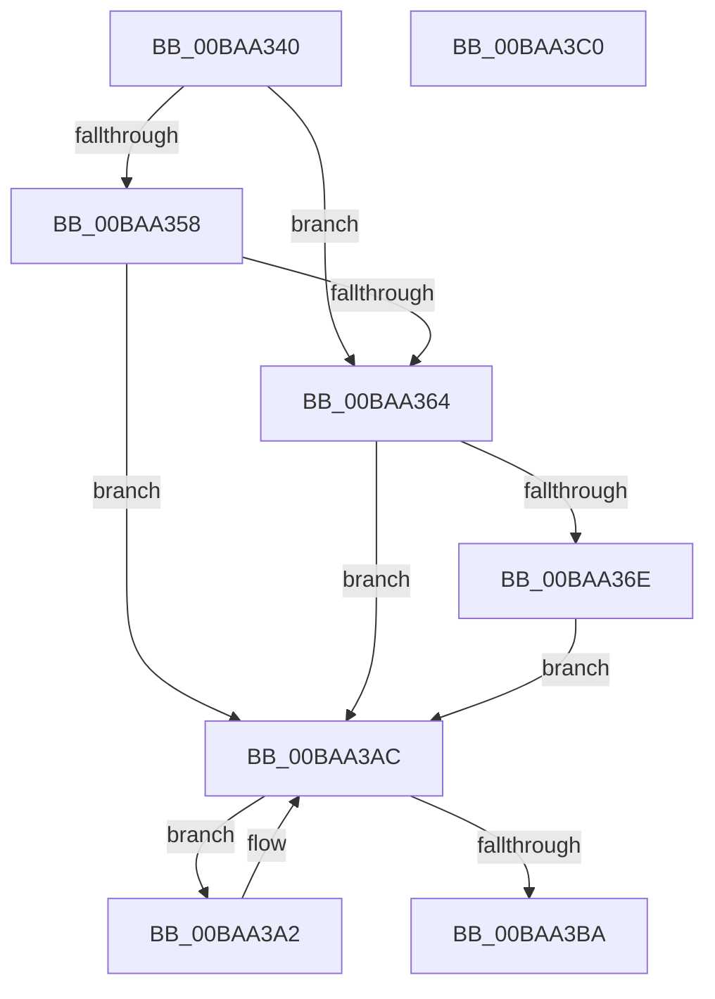

# VfPoolCheckForLeaks

- RVA: `0x00BAA340`–`0x00BAA3C1` (길이 `129` bytes)
- VA: `0x0000000140BAA340`
- 실행 섹션: `PAGEVRFY`
- PDB 이름 있음: `예`; PDB Function 태그: `아니요`
- unwind 정보 RVA: `0x000697A4`
- 디코드: `37`개 명령, `129/129` bytes 표시
- 미해석 바이트: `0` (있으면 어셈블리에 `.byte`로 보존)

> 이 문서는 커널 이미지의 기계어와 PDB 기호를 분석해 생성했습니다. 4번과 5번은 함수 원형과 자료형을 바이너리 사용 방식에서 추정한 C 해석이며 원본 소스 복구 결과는 아닙니다.

## 1. Dependencies

- 직접 호출 지점: **3**; 고유 호출 대상: **3**
- 직접 호출자로 확인된 함수: **1**
- RIP 상대 이미지 참조: **1**

### Outgoing calls
- `0x00BAA39B` → [CarReportRuleViolationFromNt](../B9/CarReportRuleViolationFromNt_function_00B9D904.md) (function, `0x00B9D904`)
- `0x00BAA3A7` → [ExFreePoolWithTag](../../poolcode/B8/ExFreePoolWithTag_function_00B82870.md) (function, `0x00B82870`)
- `0x00BAA3B0` → [ExpInterlockedPopEntrySList](../../text/6B/ExpInterlockedPopEntrySList_function_006BA570.md) (function, `0x006BA570`)

### Direct callers
- [VfTargetDriversRemove](../../text/3E/VfTargetDriversRemove_function_003EEF9C.md) at `0x003EF144`

### Static image references
- `0x00BAA364` → RVA `0x00F04A20` (`.data`; read)

## 2. Other-region calls and transfers

- 다른 실행 섹션으로 향하는 call: **2**
  - `0x00BAA3A7` → [ExFreePoolWithTag](../../poolcode/B8/ExFreePoolWithTag_function_00B82870.md) (`PAGEVRFY` → `POOLCODE`)
  - `0x00BAA3B0` → [ExpInterlockedPopEntrySList](../../text/6B/ExpInterlockedPopEntrySList_function_006BA570.md) (`PAGEVRFY` → `.text`)
- 별도 외부 분기/꼬리 이동을 확인하지 못했습니다.

## 3. Assembly (complete function range)

```asm
00BAA340  40 53                           push rbx
00BAA342  48 83 EC 40                     sub rsp, 0x40
00BAA346  48 8B 81 80 00 00 00            mov rax, qword ptr [rcx + 0x80]
00BAA34D  4C 8B C2                        mov r8, rdx
00BAA350  48 8B D9                        mov rbx, rcx
00BAA353  48 85 C0                        test rax, rax
00BAA356  75 0C                           jne 0x140baa364
00BAA358  48 8B 81 88 00 00 00            mov rax, qword ptr [rcx + 0x88]
00BAA35F  48 85 C0                        test rax, rax
00BAA362  74 48                           je 0x140baa3ac
00BAA364  8B 05 B6 A6 35 00               mov eax, dword ptr [rip + 0x35a6b6]
00BAA36A  A8 08                           test al, 8
00BAA36C  74 3E                           je 0x140baa3ac
00BAA36E  8B 51 74                        mov edx, dword ptr [rcx + 0x74]
00BAA371  4C 8B CB                        mov r9, rbx
00BAA374  8B 41 70                        mov eax, dword ptr [rcx + 0x70]
00BAA377  03 D0                           add edx, eax
00BAA379  49 8B 40 30                     mov rax, qword ptr [r8 + 0x30]
00BAA37D  4D 8B 40 60                     mov r8, qword ptr [r8 + 0x60]
00BAA381  48 89 44 24 30                  mov qword ptr [rsp + 0x30], rax
00BAA386  C7 44 24 28 03 00 00 00         mov dword ptr [rsp + 0x28], 3
00BAA38E  48 89 54 24 20                  mov qword ptr [rsp + 0x20], rdx
00BAA393  BA 62 00 00 00                  mov edx, 0x62
00BAA398  8D 4A 62                        lea ecx, [rdx + 0x62]
00BAA39B  E8 64 35 FF FF                  call 0x140b9d904
00BAA3A0  EB 0A                           jmp 0x140baa3ac
00BAA3A2  33 D2                           xor edx, edx
00BAA3A4  48 8B C8                        mov rcx, rax
00BAA3A7  E8 C4 84 FD FF                  call 0x140b82870
00BAA3AC  48 8D 4B 40                     lea rcx, [rbx + 0x40]
00BAA3B0  E8 BB 01 B1 FF                  call 0x1406ba570
00BAA3B5  48 85 C0                        test rax, rax
00BAA3B8  75 E8                           jne 0x140baa3a2
00BAA3BA  48 83 C4 40                     add rsp, 0x40
00BAA3BE  5B                              pop rbx
00BAA3BF  C3                              ret
00BAA3C0  CC                              int3
```

## 4. C-style interpretation (structured pseudocode)

```c
__int64 __fastcall VfPoolCheckForLeaks(__int64 a1, __int64 a2)
{
    __int64 result;
    __int64 v_rsp;
    unsigned __int64 v_stack_m18;
    unsigned int v_stack_m20;
    unsigned __int64 v_stack_m28;

    v_rsp = (v_rsp) - (64);
    if (*(unsigned __int64 *)(a1 + 128) != 0) goto loc_00BAA364;
    if (*(unsigned __int64 *)(a1 + 136) == 0) goto loc_00BAA3AC;
loc_00BAA364:
    if ((((unsigned __int8)((unsigned int)(*(unsigned int *)(v_rip + 3516086)))) & (8)) == 0) goto loc_00BAA3AC;
    a2 = (unsigned int)(((unsigned int)(*(unsigned int *)(a1 + 116))) + ((unsigned int)((unsigned int)(*(unsigned int *)(a1 + 112)))));
    v_stack_m18 = *(unsigned __int64 *)(a2 + 48);
    v_stack_m20 = 3;
    v_stack_m28 = a2;
    result = CarReportRuleViolationFromNt(98 + 98, 98, *(unsigned __int64 *)(a2 + 96), a1);
    goto loc_00BAA3AC;
loc_00BAA3A2:
    a2 = 0;
    result = ExFreePoolWithTag(result, a2, *(unsigned __int64 *)(a2 + 96), a1);
loc_00BAA3AC:
    result = ExpInterlockedPopEntrySList(a1 + 64, a2, *(unsigned __int64 *)(a2 + 96), a1);
    if (result != 0) goto loc_00BAA3A2;
    v_rsp = (v_rsp) + (64);
    return result;
}
```

## 5. (Beta) C Style

```c
int64_t VfPoolCheckForLeaks(void *Arg1, void *Arg2)
{
    uint8_t *arg1 = (uint8_t *)Arg1;
    uint8_t *arg2 = (uint8_t *)Arg2;

    int64_t result;
    int64_t local_rsp;
    uint64_t v_stack_m18;
    uint32_t v_stack_m20;
    uint64_t v_stack_m28;

    local_rsp = (local_rsp) - (64);
    if (*(uint64_t *)(arg1 + 0x80) != 0) goto loc_00BAA364;
    if (*(uint64_t *)(arg1 + 0x88) == 0) goto loc_00BAA3AC;
loc_00BAA364:
    if ((((uint8_t)((uint32_t)(*(uint32_t *)(v_rip + 0x35A6B6)))) & (8)) == 0) goto loc_00BAA3AC;
    Arg2 = (uint32_t)(((uint32_t)(*(uint32_t *)(arg1 + 0x74))) + ((uint32_t)((uint32_t)(*(uint32_t *)(arg1 + 0x70)))));
    v_stack_m18 = *(uint64_t *)(arg2 + 0x30);
    v_stack_m20 = 3;
    v_stack_m28 = Arg2;
    result = CarReportRuleViolationFromNt(98 + 98, 98, *(uint64_t *)(arg2 + 0x60), Arg1);
    goto loc_00BAA3AC;
loc_00BAA3A2:
    Arg2 = 0;
    result = ExFreePoolWithTag(result, Arg2, *(uint64_t *)(arg2 + 0x60), Arg1);
loc_00BAA3AC:
    result = ExpInterlockedPopEntrySList(Arg1 + 64, Arg2, *(uint64_t *)(arg2 + 0x60), Arg1);
    if (result != 0) goto loc_00BAA3A2;
    local_rsp = (local_rsp) + (64);
    return result;
}
```

### 관측된 메모리 오프셋

구조체 형식이 확인되지 않은 접근은 인자 기준의 오프셋으로만 기록했습니다.

| 기준 인자 | 오프셋 표현 | 폭 (bit) | 접근 |
|---|---:|---:|---|
| `Arg1` | `+ 0x40` | `64` | `R` |
| `Arg1` | `+ 0x70` | `32` | `R` |
| `Arg1` | `+ 0x74` | `32` | `R` |
| `Arg1` | `+ 0x80` | `64` | `R` |
| `Arg1` | `+ 0x88` | `64` | `R` |
| `Arg2` | `+ 0x30` | `64` | `R` |
| `Arg2` | `+ 0x60` | `64` | `R` |

## 6. Execution-region graph

[열기: 2D/3D 그래프와 함수 탐색 컨트롤 패널](../../../control-panel.html?section=pagevrfy&rva=0x00BAA340&view=graph)

- 2D 그래프는 위에서 아래로 흐르고, 3D 그래프는 빈 공간을 드래그해 회전합니다. Shift+드래그는 이동, 휠은 확대·축소, 함수 노드 선택은 대상 보고서 이동입니다.

### Static fallback


