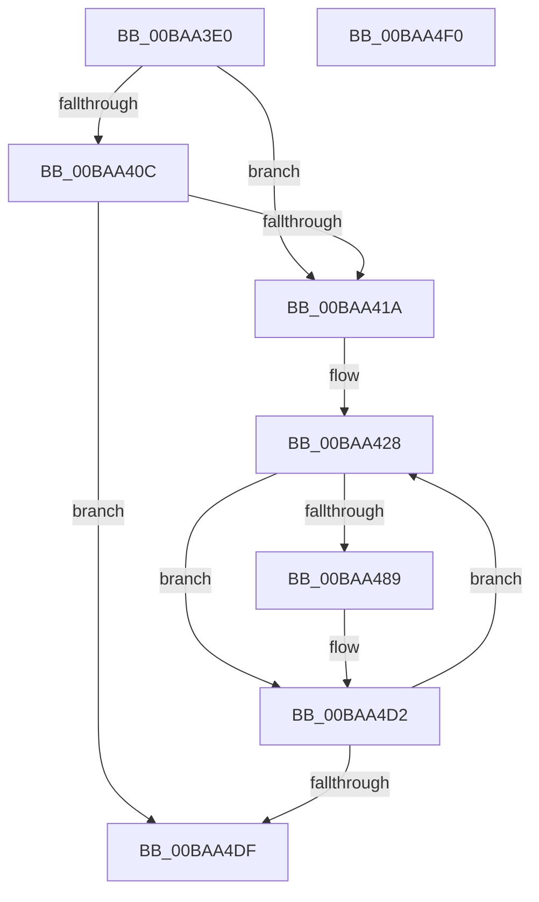

# VfPoolInitPhase1

- RVA: `0x00BAA3E0`–`0x00BAA4F1` (길이 `273` bytes)
- VA: `0x0000000140BAA3E0`
- 실행 섹션: `PAGEVRFY`
- PDB 이름 있음: `예`; PDB Function 태그: `아니요`
- unwind 정보 RVA: `0x000D26A0`
- 디코드: `67`개 명령, `273/273` bytes 표시
- 미해석 바이트: `0` (있으면 어셈블리에 `.byte`로 보존)

> 이 문서는 커널 이미지의 기계어와 PDB 기호를 분석해 생성했습니다. 4번과 5번은 함수 원형과 자료형을 바이너리 사용 방식에서 추정한 C 해석이며 원본 소스 복구 결과는 아닙니다.

## 1. Dependencies

- 직접 호출 지점: **5**; 고유 호출 대상: **5**
- 직접 호출자로 확인된 함수: **2**
- RIP 상대 이미지 참조: **6**

### Outgoing calls
- `0x00BAA433` → [KeInitializeEvent](../../text/40/KeInitializeEvent_function_0040DD10.md) (function, `0x0040DD10`)
- `0x00BAA480` → [PsCreateSystemThread](../../page/9E/PsCreateSystemThread_function_009ED0D0.md) (function, `0x009ED0D0`)
- `0x00BAA4AD` → [ObReferenceObjectByHandle](../../page/86/ObReferenceObjectByHandle_function_00868DB0.md) (function, `0x00868DB0`)
- `0x00BAA4BD` → [ZwClose](../../text/6A/ZwClose_function_006AD2B0.md) (function, `0x006AD2B0`)
- `0x00BAA4C5` → [InitializeSListHead](../../text/46/InitializeSListHead_function_00468A90.md) (function, `0x00468A90`)

### Direct callers
- [VfInitSystemNoRebootNeeded](../B9/VfInitSystemNoRebootNeeded_function_00B93970.md) at `0x00B93A6F`
- [VerifierInitSystem](../../init/C4/VerifierInitSystem_function_00C4BC84.md) at `0x00C4BCBB`

### Static image references
- `0x00BAA400` → RVA `0x00E681A0` (`.data`; read)
- `0x00BAA40C` → RVA `0x00F04A20` (`.data`; read)
- `0x00BAA41A` → RVA `0x00E28978` (`.data`; read)
- `0x00BAA421` → RVA `0x00E289F8` (`.data`; read)
- `0x00BAA43D` → RVA `0x00BAA500` (`ViPoolDelayFreeTrimThreadRoutine`; read)
- `0x00BAA493` → RVA `0x00FC6AC8` (`ALMOSTRO`; read)

## 2. Other-region calls and transfers

- 다른 실행 섹션으로 향하는 call: **5**
  - `0x00BAA433` → [KeInitializeEvent](../../text/40/KeInitializeEvent_function_0040DD10.md) (`PAGEVRFY` → `.text`)
  - `0x00BAA480` → [PsCreateSystemThread](../../page/9E/PsCreateSystemThread_function_009ED0D0.md) (`PAGEVRFY` → `PAGE`)
  - `0x00BAA4AD` → [ObReferenceObjectByHandle](../../page/86/ObReferenceObjectByHandle_function_00868DB0.md) (`PAGEVRFY` → `PAGE`)
  - `0x00BAA4BD` → [ZwClose](../../text/6A/ZwClose_function_006AD2B0.md) (`PAGEVRFY` → `.text`)
  - `0x00BAA4C5` → [InitializeSListHead](../../text/46/InitializeSListHead_function_00468A90.md) (`PAGEVRFY` → `.text`)
- 별도 외부 분기/꼬리 이동을 확인하지 못했습니다.

## 3. Assembly (complete function range)

```asm
00BAA3E0  48 89 5C 24 18                  mov qword ptr [rsp + 0x18], rbx
00BAA3E5  55                              push rbp
00BAA3E6  57                              push rdi
00BAA3E7  41 57                           push r15
00BAA3E9  48 8B EC                        mov rbp, rsp
00BAA3EC  48 83 EC 70                     sub rsp, 0x70
00BAA3F0  48 83 65 20 00                  and qword ptr [rbp + 0x20], 0
00BAA3F5  33 C0                           xor eax, eax
00BAA3F7  21 45 EC                        and dword ptr [rbp - 0x14], eax
00BAA3FA  89 45 D4                        mov dword ptr [rbp - 0x2c], eax
00BAA3FD  21 45 D4                        and dword ptr [rbp - 0x2c], eax
00BAA400  F7 05 96 DD 2B 00 00 00 40 00   test dword ptr [rip + 0x2bdd96], 0x400000
00BAA40A  74 0E                           je 0x140baa41a
00BAA40C  8B 05 0E A6 35 00               mov eax, dword ptr [rip + 0x35a60e]
00BAA412  A8 01                           test al, 1
00BAA414  0F 84 C5 00 00 00               je 0x140baa4df
00BAA41A  48 8D 1D 57 E5 27 00            lea rbx, [rip + 0x27e557]
00BAA421  4C 8D 3D D0 E5 27 00            lea r15, [rip + 0x27e5d0]
00BAA428  45 33 C0                        xor r8d, r8d
00BAA42B  48 8D 4B E8                     lea rcx, [rbx - 0x18]
00BAA42F  41 8D 50 01                     lea edx, [r8 + 1]
00BAA433  E8 D8 38 86 FF                  call 0x14040dd10
00BAA438  48 83 65 D8 00                  and qword ptr [rbp - 0x28], 0
00BAA43D  48 8D 05 BC 00 00 00            lea rax, [rip + 0xbc]
00BAA444  48 83 65 E0 00                  and qword ptr [rbp - 0x20], 0
00BAA449  48 8D 7B D8                     lea rdi, [rbx - 0x28]
00BAA44D  48 89 7C 24 30                  mov qword ptr [rsp + 0x30], rdi
00BAA452  4C 8D 45 D0                     lea r8, [rbp - 0x30]
00BAA456  0F 57 C0                        xorps xmm0, xmm0
00BAA459  48 89 44 24 28                  mov qword ptr [rsp + 0x28], rax
00BAA45E  48 83 64 24 20 00               and qword ptr [rsp + 0x20], 0
00BAA464  48 8D 4D 20                     lea rcx, [rbp + 0x20]
00BAA468  45 33 C9                        xor r9d, r9d
00BAA46B  C7 45 D0 30 00 00 00            mov dword ptr [rbp - 0x30], 0x30
00BAA472  33 D2                           xor edx, edx
00BAA474  C7 45 E8 00 02 00 00            mov dword ptr [rbp - 0x18], 0x200
00BAA47B  F3 0F 7F 45 F0                  movdqu xmmword ptr [rbp - 0x10], xmm0
00BAA480  E8 4B 2C E4 FF                  call 0x1409ed0d0
00BAA485  85 C0                           test eax, eax
00BAA487  78 49                           js 0x140baa4d2
00BAA489  48 83 64 24 28 00               and qword ptr [rsp + 0x28], 0
00BAA48F  48 8D 45 28                     lea rax, [rbp + 0x28]
00BAA493  4C 8B 05 2E C6 41 00            mov r8, qword ptr [rip + 0x41c62e]
00BAA49A  45 33 C9                        xor r9d, r9d
00BAA49D  48 8B 4D 20                     mov rcx, qword ptr [rbp + 0x20]
00BAA4A1  33 D2                           xor edx, edx
00BAA4A3  48 83 65 28 00                  and qword ptr [rbp + 0x28], 0
00BAA4A8  48 89 44 24 20                  mov qword ptr [rsp + 0x20], rax
00BAA4AD  E8 FE E8 CB FF                  call 0x140868db0
00BAA4B2  48 8B 45 28                     mov rax, qword ptr [rbp + 0x28]
00BAA4B6  48 8B 4D 20                     mov rcx, qword ptr [rbp + 0x20]
00BAA4BA  48 89 03                        mov qword ptr [rbx], rax
00BAA4BD  E8 EE 2D B0 FF                  call 0x1406ad2b0
00BAA4C2  48 8B CF                        mov rcx, rdi
00BAA4C5  E8 C6 E5 8B FF                  call 0x140468a90
00BAA4CA  B8 01 00 00 00                  mov eax, 1
00BAA4CF  87 43 08                        xchg dword ptr [rbx + 8], eax
00BAA4D2  48 83 C3 40                     add rbx, 0x40
00BAA4D6  49 3B DF                        cmp rbx, r15
00BAA4D9  0F 8C 49 FF FF FF               jl 0x140baa428
00BAA4DF  48 8B 9C 24 A0 00 00 00         mov rbx, qword ptr [rsp + 0xa0]
00BAA4E7  48 83 C4 70                     add rsp, 0x70
00BAA4EB  41 5F                           pop r15
00BAA4ED  5F                              pop rdi
00BAA4EE  5D                              pop rbp
00BAA4EF  C3                              ret
00BAA4F0  CC                              int3
```

## 4. C-style interpretation (structured pseudocode)

```c
__int64 __fastcall VfPoolInitPhase1(__int64 a1, __int64 a2, int a3, int a4)
{
    __int64 result;
    __int64 v_rbx;
    __int64 v_rsp;
    unsigned __int64 v_stack_m28;
    unsigned int v_stack_m2C;
    unsigned int v_stack_m30;
    unsigned __int64 v_stack_m38;
    unsigned __int64 v_stack_m40;
    unsigned int v_stack_m44;
    unsigned __int64 v_stack_m48;
    unsigned __int64 v_stack_m58;
    unsigned __int64 v_stack_m60;
    unsigned __int64 v_stack_m68;
    unsigned __int64 v_stack_p10;
    unsigned __int64 v_stack_p18;
    unsigned __int64 v_stack_p8;

    v_stack_p18 = v_rbx;
    v_rsp = (v_rsp) - (112);
    result = 0;
    v_stack_m44 = 0;
    if (((*(unsigned int *)(v_rip + 2874774)) & (0x400000ULL)) == 0) goto loc_00BAA41A;
    if ((((unsigned __int8)((unsigned int)(*(unsigned int *)(v_rip + 3515918)))) & (1)) == 0) goto loc_00BAA4DF;
loc_00BAA41A:
loc_00BAA428:
    a3 = 0;
    result = KeInitializeEvent(v_rip + 2614615 - 24, a3 + 1, a3, a4);
    v_stack_m58 = v_rip + 2614615 - 40;
    v_stack_m60 = v_rip + 188;
    a4 = 0;
    v_stack_m48 = 48;
    a2 = 0;
    v_stack_m30 = 512;
    v_stack_m28 = v_xmm0;
    result = PsCreateSystemThread(v_stack_p8, a2, v_stack_m48, a4);
    if (!(sign_flag)) {
        result = v_stack_p10;
        a3 = *(unsigned __int64 *)(v_rip + 4310574);
        a4 = 0;
        a1 = v_stack_p8;
        a2 = 0;
        v_stack_m68 = result;
        result = ObReferenceObjectByHandle(a1, a2, a3, a4);
        result = v_stack_p10;
        a1 = v_stack_p8;
        *(unsigned __int64 *)(v_rip + 2614615) = result;
        result = ZwClose(a1, a2, a3, a4);
        a1 = v_rip + 2614615 - 40;
        result = InitializeSListHead(a1, a2, a3, a4);
        result = 1;
    }
    v_rbx = (v_rip + 2614615) + (64);
    if (v_rbx < (v_rip + 2614736)) goto loc_00BAA428;
loc_00BAA4DF:
    v_rsp = (v_rsp) + (112);
    return result;
}
```

## 5. (Beta) C Style

```c
int64_t VfPoolInitPhase1(int64_t Arg1, int64_t Arg2, int32_t Arg3, int32_t Arg4)
{
    int64_t result;
    int64_t local_rbx;
    int64_t local_rsp;
    uint64_t v_stack_m28;
    uint32_t v_stack_m2C;
    uint32_t v_stack_m30;
    uint64_t v_stack_m38;
    uint64_t v_stack_m40;
    uint32_t v_stack_m44;
    uint64_t v_stack_m48;
    uint64_t v_stack_m58;
    uint64_t v_stack_m60;
    uint64_t v_stack_m68;
    uint64_t v_stack_p10;
    uint64_t v_stack_p18;
    uint64_t v_stack_p8;

    v_stack_p18 = local_rbx;
    local_rsp = (local_rsp) - (112);
    result = 0;
    v_stack_m44 = 0;
    if (((*(uint32_t *)(v_rip + 0x2BDD96)) & (0x400000ULL)) == 0) goto loc_00BAA41A;
    if ((((uint8_t)((uint32_t)(*(uint32_t *)(v_rip + 0x35A60E)))) & (1)) == 0) goto loc_00BAA4DF;
loc_00BAA41A:
loc_00BAA428:
    Arg3 = 0;
    result = KeInitializeEvent(v_rip + 2614615 - 24, Arg3 + 1, Arg3, Arg4);
    v_stack_m58 = v_rip + 2614615 - 40;
    v_stack_m60 = v_rip + 188;
    Arg4 = 0;
    v_stack_m48 = 48;
    Arg2 = 0;
    v_stack_m30 = 512;
    v_stack_m28 = v_xmm0;
    result = PsCreateSystemThread(v_stack_p8, Arg2, v_stack_m48, Arg4);
    if (!(sign_flag)) {
        result = v_stack_p10;
        Arg3 = *(uint64_t *)(v_rip + 0x41C62E);
        Arg4 = 0;
        Arg1 = v_stack_p8;
        Arg2 = 0;
        v_stack_m68 = result;
        result = ObReferenceObjectByHandle(Arg1, Arg2, Arg3, Arg4);
        result = v_stack_p10;
        Arg1 = v_stack_p8;
        *(uint64_t *)(v_rip + 0x27E557) = result;
        result = ZwClose(Arg1, Arg2, Arg3, Arg4);
        Arg1 = v_rip + 2614615 - 40;
        result = InitializeSListHead(Arg1, Arg2, Arg3, Arg4);
        result = 1;
    }
    local_rbx = (v_rip + 2614615) + (64);
    if (local_rbx < (v_rip + 2614736)) goto loc_00BAA428;
loc_00BAA4DF:
    local_rsp = (local_rsp) + (112);
    return result;
}
```

## 6. Execution-region graph

[열기: 2D/3D 그래프와 함수 탐색 컨트롤 패널](../../../control-panel.html?section=pagevrfy&rva=0x00BAA3E0&view=graph)

- 2D 그래프는 위에서 아래로 흐르고, 3D 그래프는 빈 공간을 드래그해 회전합니다. Shift+드래그는 이동, 휠은 확대·축소, 함수 노드 선택은 대상 보고서 이동입니다.

### Static fallback


