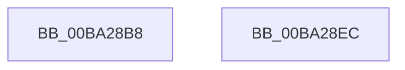

# VfRemLockReportBadReleaseTag

- RVA: `0x00BA28B8`–`0x00BA28ED` (길이 `53` bytes)
- VA: `0x0000000140BA28B8`
- 실행 섹션: `PAGEVRFY`
- PDB 이름 있음: `예`; PDB Function 태그: `아니요`
- unwind 정보 RVA: `0x00063458`
- 디코드: `13`개 명령, `53/53` bytes 표시
- 미해석 바이트: `0` (있으면 어셈블리에 `.byte`로 보존)

> 이 문서는 커널 이미지의 기계어와 PDB 기호를 분석해 생성했습니다. 4번과 5번은 함수 원형과 자료형을 바이너리 사용 방식에서 추정한 C 해석이며 원본 소스 복구 결과는 아닙니다.

## 1. Dependencies

- 직접 호출 지점: **1**; 고유 호출 대상: **1**
- 직접 호출자로 확인된 함수: **1**
- RIP 상대 이미지 참조: **0**

### Outgoing calls
- `0x00BA28DD` → [CarReportRuleViolationFromNt](../B9/CarReportRuleViolationFromNt_function_00B9D904.md) (function, `0x00B9D904`)

### Direct callers
- [sub_0033D427](../../text/33/Unknown_function_0033D427.md) at `0x0033D452`

### Static image references
- 디코드된 RIP-relative 메모리 참조가 없습니다.

## 2. Other-region calls and transfers

- 다른 실행 섹션으로 향하는 call: **0**
- 별도 외부 분기/꼬리 이동을 확인하지 못했습니다.

## 3. Assembly (complete function range)

```asm
00BA28B8  48 83 EC 48                     sub rsp, 0x48
00BA28BC  4C 89 44 24 30                  mov qword ptr [rsp + 0x30], r8
00BA28C1  4C 8B CA                        mov r9, rdx
00BA28C4  BA D5 00 00 00                  mov edx, 0xd5
00BA28C9  C7 44 24 28 0B 00 00 00         mov dword ptr [rsp + 0x28], 0xb
00BA28D1  48 83 64 24 20 00               and qword ptr [rsp + 0x20], 0
00BA28D7  4C 8B C1                        mov r8, rcx
00BA28DA  8D 4A EF                        lea ecx, [rdx - 0x11]
00BA28DD  E8 22 B0 FF FF                  call 0x140b9d904
00BA28E2  B8 01 00 00 00                  mov eax, 1
00BA28E7  48 83 C4 48                     add rsp, 0x48
00BA28EB  C3                              ret
00BA28EC  CC                              int3
```

## 4. C-style interpretation (structured pseudocode)

```c
__int64 __fastcall VfRemLockReportBadReleaseTag(__int64 a1, __int64 a2, __int64 a3)
{
    __int64 result;
    __int64 v_rsp;
    unsigned __int64 v_stack_m18;
    unsigned int v_stack_m20;
    unsigned __int64 v_stack_m28;

    v_rsp = (v_rsp) - (72);
    v_stack_m18 = a3;
    v_stack_m20 = 11;
    result = CarReportRuleViolationFromNt(213 - 17, 213, a1, a2);
    v_rsp = (v_rsp) + (72);
    return 1;
}
```

## 5. (Beta) C Style

```c
int64_t VfRemLockReportBadReleaseTag(int64_t Arg1, int64_t Arg2, int64_t Arg3)
{
    int64_t result;
    int64_t local_rsp;
    uint64_t v_stack_m18;
    uint32_t v_stack_m20;
    uint64_t v_stack_m28;

    local_rsp = (local_rsp) - (72);
    v_stack_m18 = Arg3;
    v_stack_m20 = 11;
    result = CarReportRuleViolationFromNt(213 - 17, 213, Arg1, Arg2);
    local_rsp = (local_rsp) + (72);
    return 1;
}
```

## 6. Execution-region graph

[열기: 2D/3D 그래프와 함수 탐색 컨트롤 패널](../../../control-panel.html?section=pagevrfy&rva=0x00BA28B8&view=graph)

- 2D 그래프는 위에서 아래로 흐르고, 3D 그래프는 빈 공간을 드래그해 회전합니다. Shift+드래그는 이동, 휠은 확대·축소, 함수 노드 선택은 대상 보고서 이동입니다.

### Static fallback


