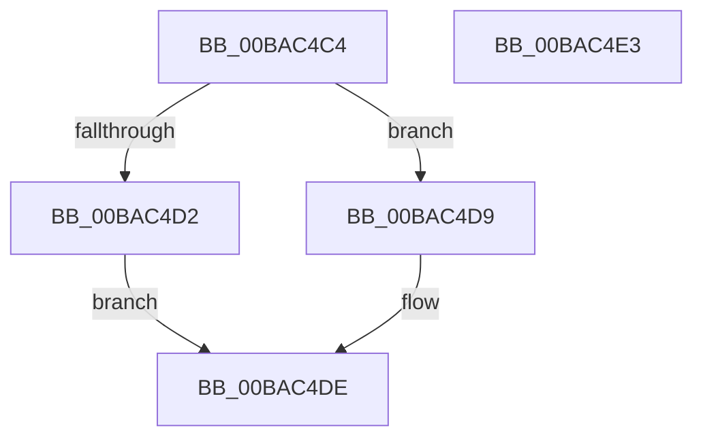

# VfRemoveVerifierEntry

- RVA: `0x00BAC4C4`–`0x00BAC4E4` (길이 `32` bytes)
- VA: `0x0000000140BAC4C4`
- 실행 섹션: `PAGEVRFY`
- PDB 이름 있음: `예`; PDB Function 태그: `아니요`
- unwind 정보 RVA: `0x0005C788`
- 디코드: `9`개 명령, `32/32` bytes 표시
- 미해석 바이트: `0` (있으면 어셈블리에 `.byte`로 보존)

> 이 문서는 커널 이미지의 기계어와 PDB 기호를 분석해 생성했습니다. 4번과 5번은 함수 원형과 자료형을 바이너리 사용 방식에서 추정한 C 해석이며 원본 소스 복구 결과는 아닙니다.

## 1. Dependencies

- 직접 호출 지점: **1**; 고유 호출 대상: **1**
- 직접 호출자로 확인된 함수: **1**
- RIP 상대 이미지 참조: **1**

### Outgoing calls
- `0x00BAC4D9` → [VfSuspectDriversRemove](VfSuspectDriversRemove_function_00BAAE94.md) (function, `0x00BAAE94`)

### Direct callers
- [NtSetSystemInformation](../../page/AF/NtSetSystemInformation_function_00AF4A60.md) at `0x00AF52B3`

### Static image references
- `0x00BAC4C8` → RVA `0x00F04890` (`.data`; read)

## 2. Other-region calls and transfers

- 다른 실행 섹션으로 향하는 call: **0**
- 별도 외부 분기/꼬리 이동을 확인하지 못했습니다.

## 3. Assembly (complete function range)

```asm
00BAC4C4  48 83 EC 28                     sub rsp, 0x28
00BAC4C8  48 83 3D C0 83 35 00 00         cmp qword ptr [rip + 0x3583c0], 0
00BAC4D0  75 07                           jne 0x140bac4d9
00BAC4D2  B8 BB 00 00 C0                  mov eax, 0xc00000bb
00BAC4D7  EB 05                           jmp 0x140bac4de
00BAC4D9  E8 B6 E9 FF FF                  call 0x140baae94
00BAC4DE  48 83 C4 28                     add rsp, 0x28
00BAC4E2  C3                              ret
00BAC4E3  CC                              int3
```

## 4. C-style interpretation (structured pseudocode)

```c
__int64 __fastcall VfRemoveVerifierEntry(void)
{
    __int64 result;
    __int64 v_rsp;

    v_rsp = (v_rsp) - (40);
    if ((*(unsigned __int64 *)(v_rip + 3507136)) != 0) goto loc_00BAC4D9;
    goto loc_00BAC4DE;
loc_00BAC4D9:
    result = VfSuspectDriversRemove(a1, a2, a3, a4);
loc_00BAC4DE:
    v_rsp = (v_rsp) + (40);
    return result;
}
```

## 5. (Beta) C Style

```c
void VfRemoveVerifierEntry(void)
{
    int64_t result;
    int64_t local_rsp;

    local_rsp = (local_rsp) - (40);
    if ((*(uint64_t *)(v_rip + 0x3583C0)) != 0) goto loc_00BAC4D9;
    goto loc_00BAC4DE;
loc_00BAC4D9:
    result = VfSuspectDriversRemove(a1, a2, a3, a4);
loc_00BAC4DE:
    local_rsp = (local_rsp) + (40);
    return result;
}
```

## 6. Execution-region graph

[열기: 2D/3D 그래프와 함수 탐색 컨트롤 패널](../../../control-panel.html?section=pagevrfy&rva=0x00BAC4C4&view=graph)

- 2D 그래프는 위에서 아래로 흐르고, 3D 그래프는 빈 공간을 드래그해 회전합니다. Shift+드래그는 이동, 휠은 확대·축소, 함수 노드 선택은 대상 보고서 이동입니다.

### Static fallback


