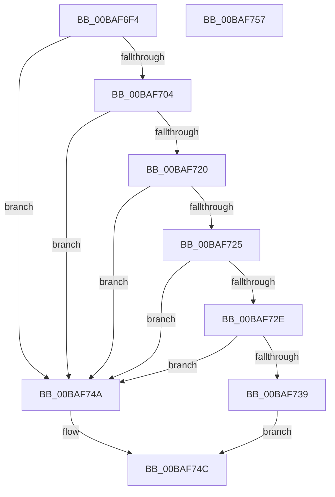

# VfRlrsKeInjectStatusAlerted

- RVA: `0x00BAF6F4`–`0x00BAF758` (길이 `100` bytes)
- VA: `0x0000000140BAF6F4`
- 실행 섹션: `PAGEVRFY`
- PDB 이름 있음: `예`; PDB Function 태그: `아니요`
- unwind 정보 RVA: `0x0005CAAC`
- 디코드: `31`개 명령, `100/100` bytes 표시
- 미해석 바이트: `0` (있으면 어셈블리에 `.byte`로 보존)

> 이 문서는 커널 이미지의 기계어와 PDB 기호를 분석해 생성했습니다. 4번과 5번은 함수 원형과 자료형을 바이너리 사용 방식에서 추정한 C 해석이며 원본 소스 복구 결과는 아닙니다.

## 1. Dependencies

- 직접 호출 지점: **2**; 고유 호출 대상: **2**
- 직접 호출자로 확인된 함수: **3**
- RIP 상대 이미지 참조: **2**

### Outgoing calls
- `0x00BAF730` → [VfFaultsInjectResourceFailure](VfFaultsInjectResourceFailure_function_00BA6558.md) (function, `0x00BA6558`)
- `0x00BAF73C` → [VfUtilIsLocalSystem](../B9/VfUtilIsLocalSystem_function_00B933F4.md) (function, `0x00B933F4`)

### Direct callers
- [VerifierKeDelayExecutionThread](VerifierKeDelayExecutionThread_function_00BA54A0.md) at `0x00BA54C3`
- [VerifierKeWaitForMultipleObjects](VerifierKeWaitForMultipleObjects_function_00BA5D30.md) at `0x00BA5D68`
- [VerifierKeWaitForSingleObject](VerifierKeWaitForSingleObject_function_00BA5DE0.md) at `0x00BA5E0B`

### Static image references
- `0x00BAF714` → RVA `0x00FC6AB0` (`ALMOSTRO`; read)
- `0x00BAF725` → RVA `0x00FC6B70` (`ALMOSTRO`; read)

## 2. Other-region calls and transfers

- 다른 실행 섹션으로 향하는 call: **0**
- 별도 외부 분기/꼬리 이동을 확인하지 못했습니다.

## 3. Assembly (complete function range)

```asm
00BAF6F4  48 89 5C 24 08                  mov qword ptr [rsp + 8], rbx
00BAF6F9  57                              push rdi
00BAF6FA  48 83 EC 20                     sub rsp, 0x20
00BAF6FE  33 DB                           xor ebx, ebx
00BAF700  84 C9                           test cl, cl
00BAF702  74 46                           je 0x140baf74a
00BAF704  65 48 8B 04 25 88 01 00 00      mov rax, qword ptr gs:[0x188]
00BAF70D  48 8B B8 B8 00 00 00            mov rdi, qword ptr [rax + 0xb8]
00BAF714  48 8B 05 95 73 41 00            mov rax, qword ptr [rip + 0x417395]
00BAF71B  48 85 C0                        test rax, rax
00BAF71E  74 2A                           je 0x140baf74a
00BAF720  48 3B F8                        cmp rdi, rax
00BAF723  74 25                           je 0x140baf74a
00BAF725  48 3B 3D 44 74 41 00            cmp rdi, qword ptr [rip + 0x417444]
00BAF72C  74 1C                           je 0x140baf74a
00BAF72E  33 C9                           xor ecx, ecx
00BAF730  E8 23 6E FF FF                  call 0x140ba6558
00BAF735  85 C0                           test eax, eax
00BAF737  74 11                           je 0x140baf74a
00BAF739  48 8B CF                        mov rcx, rdi
00BAF73C  E8 B3 3C FE FF                  call 0x140b933f4
00BAF741  85 C0                           test eax, eax
00BAF743  0F 94 C3                        sete bl
00BAF746  8B C3                           mov eax, ebx
00BAF748  EB 02                           jmp 0x140baf74c
00BAF74A  33 C0                           xor eax, eax
00BAF74C  48 8B 5C 24 30                  mov rbx, qword ptr [rsp + 0x30]
00BAF751  48 83 C4 20                     add rsp, 0x20
00BAF755  5F                              pop rdi
00BAF756  C3                              ret
00BAF757  CC                              int3
```

## 4. C-style interpretation (structured pseudocode)

```c
__int64 __fastcall VfRlrsKeInjectStatusAlerted(int a1)
{
    __int64 result;
    __int64 v_rbx;
    __int64 v_rsp;
    unsigned __int64 v_stack_p8;

    v_stack_p8 = v_rbx;
    v_rsp = (v_rsp) - (32);
    v_rbx = 0;
    if ((unsigned __int8)(a1) == 0) goto loc_00BAF74A;
    if (*(unsigned __int64 *)(v_rip + 4289429) == 0) goto loc_00BAF74A;
    if ((*(unsigned __int64 *)(*(unsigned __int64 *)(gs_base + (0 + 392)) + 184)) == (*(unsigned __int64 *)(v_rip + 4289429))) goto loc_00BAF74A;
    if ((*(unsigned __int64 *)(*(unsigned __int64 *)(gs_base + (0 + 392)) + 184)) == (*(unsigned __int64 *)(v_rip + 4289604))) goto loc_00BAF74A;
    a1 = 0;
    result = VfFaultsInjectResourceFailure(a1, a2, a3, a4);
    if ((unsigned int)(result) == 0) goto loc_00BAF74A;
    result = VfUtilIsLocalSystem(*(unsigned __int64 *)(*(unsigned __int64 *)(gs_base + (0 + 392)) + 184), a2, a3, a4);
    v_rbx = ((unsigned int)(result) == 0) ? 1 : 0;
    goto loc_00BAF74C;
loc_00BAF74A:
    result = 0;
loc_00BAF74C:
    v_rsp = (v_rsp) + (32);
    return result;
}
```

## 5. (Beta) C Style

```c
int64_t VfRlrsKeInjectStatusAlerted(int32_t Arg1)
{
    int64_t result;
    int64_t local_rbx;
    int64_t local_rsp;
    uint64_t v_stack_p8;

    v_stack_p8 = local_rbx;
    local_rsp = (local_rsp) - (32);
    local_rbx = 0;
    if ((uint8_t)(Arg1) == 0) goto loc_00BAF74A;
    if (*(uint64_t *)(v_rip + 0x417395) == 0) goto loc_00BAF74A;
    if ((*(uint64_t *)(*(uint64_t *)(gs_base + (0 + 0x188)) + 0xB8)) == (*(uint64_t *)(v_rip + 0x417395))) goto loc_00BAF74A;
    if ((*(uint64_t *)(*(uint64_t *)(gs_base + (0 + 0x188)) + 0xB8)) == (*(uint64_t *)(v_rip + 0x417444))) goto loc_00BAF74A;
    Arg1 = 0;
    result = VfFaultsInjectResourceFailure(Arg1, a2, a3, a4);
    if ((uint32_t)(result) == 0) goto loc_00BAF74A;
    result = VfUtilIsLocalSystem(*(uint64_t *)(*(uint64_t *)(gs_base + (0 + 0x188)) + 0xB8), a2, a3, a4);
    local_rbx = ((uint32_t)(result) == 0) ? 1 : 0;
    goto loc_00BAF74C;
loc_00BAF74A:
    result = 0;
loc_00BAF74C:
    local_rsp = (local_rsp) + (32);
    return result;
}
```

## 6. Execution-region graph

[열기: 2D/3D 그래프와 함수 탐색 컨트롤 패널](../../../control-panel.html?section=pagevrfy&rva=0x00BAF6F4&view=graph)

- 2D 그래프는 위에서 아래로 흐르고, 3D 그래프는 빈 공간을 드래그해 회전합니다. Shift+드래그는 이동, 휠은 확대·축소, 함수 노드 선택은 대상 보고서 이동입니다.

### Static fallback


