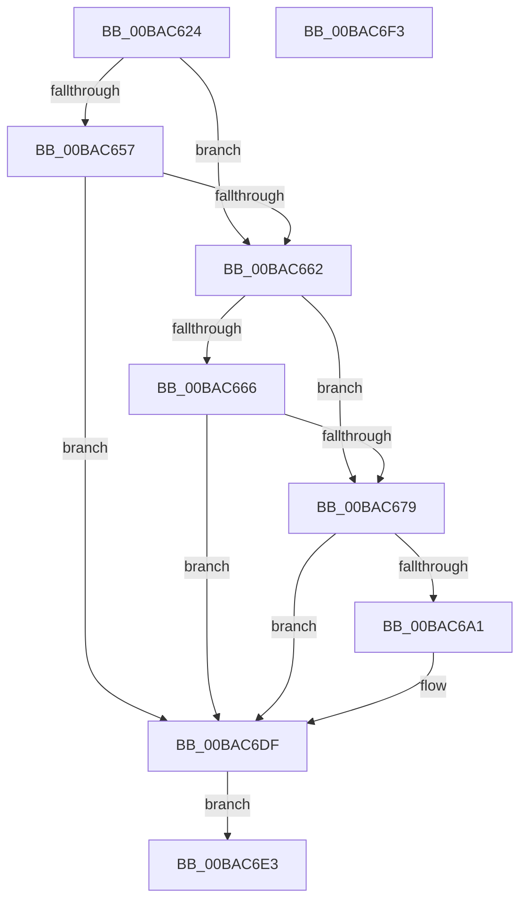

# VfSetVerifierInformationEx

- RVA: `0x00BAC624`–`0x00BAC6F4` (길이 `208` bytes)
- VA: `0x0000000140BAC624`
- 실행 섹션: `PAGEVRFY`
- PDB 이름 있음: `예`; PDB Function 태그: `아니요`
- unwind 정보 RVA: `0x000D2730`
- 디코드: `58`개 명령, `208/208` bytes 표시
- 미해석 바이트: `0` (있으면 어셈블리에 `.byte`로 보존)

> 이 문서는 커널 이미지의 기계어와 PDB 기호를 분석해 생성했습니다. 4번과 5번은 함수 원형과 자료형을 바이너리 사용 방식에서 추정한 C 해석이며 원본 소스 복구 결과는 아닙니다.

## 1. Dependencies

- 직접 호출 지점: **6**; 고유 호출 대상: **6**
- 직접 호출자로 확인된 함수: **1**
- RIP 상대 이미지 참조: **6**

### Outgoing calls
- `0x00BAC657` → [VfSetVerifierRunningMode](VfSetVerifierRunningMode_function_00BAB1E8.md) (function, `0x00BAB1E8`)
- `0x00BAC66E` → [VfWdSetCancelTimeout](VfWdSetCancelTimeout_function_00BAC9A8.md) (function, `0x00BAC9A8`)
- `0x00BAC696` → [VfProbeAndCaptureUnicodeString](../B9/VfProbeAndCaptureUnicodeString_function_00B92FBC.md) (function, `0x00B92FBC`)
- `0x00BAC6A1` → [VfDriverLock](../B9/VfDriverLock_function_00B9A4A4.md) (function, `0x00B9A4A4`)
- `0x00BAC6D0` → [KeReleaseMutex](../../text/39/KeReleaseMutex_function_00396810.md) (function, `0x00396810`)
- `0x00BAC6DA` → [VfFreeCapturedUnicodeString](../B9/VfFreeCapturedUnicodeString_function_00B92E54.md) (function, `0x00B92E54`)

### Direct callers
- [NtSetSystemInformation](../../page/AF/NtSetSystemInformation_function_00AF4A60.md) at `0x00AF5874`

### Static image references
- `0x00BAC679` → RVA `0x00F04AA0` (`.data`; read)
- `0x00BAC681` → RVA `0x00F04AA0` (`.data`; write)
- `0x00BAC6A6` → RVA `0x00F04AA8` (`.data`; read)
- `0x00BAC6B8` → RVA `0x00F04AA8` (`.data`; write)
- `0x00BAC6C0` → RVA `0x00F04938` (`.data`; write)
- `0x00BAC6C9` → RVA `0x00F04900` (`.data`; read)

## 2. Other-region calls and transfers

- 다른 실행 섹션으로 향하는 call: **1**
  - `0x00BAC6D0` → [KeReleaseMutex](../../text/39/KeReleaseMutex_function_00396810.md) (`PAGEVRFY` → `.text`)
- 별도 외부 분기/꼬리 이동을 확인하지 못했습니다.

## 3. Assembly (complete function range)

```asm
00BAC624  48 89 5C 24 08                  mov qword ptr [rsp + 8], rbx
00BAC629  48 89 74 24 10                  mov qword ptr [rsp + 0x10], rsi
00BAC62E  57                              push rdi
00BAC62F  48 83 EC 50                     sub rsp, 0x50
00BAC633  48 8B F9                        mov rdi, rcx
00BAC636  0F 57 C0                        xorps xmm0, xmm0
00BAC639  0F 11 44 24 28                  movups xmmword ptr [rsp + 0x28], xmm0
00BAC63E  8B 01                           mov eax, dword ptr [rcx]
00BAC640  89 44 24 24                     mov dword ptr [rsp + 0x24], eax
00BAC644  8B 41 18                        mov eax, dword ptr [rcx + 0x18]
00BAC647  89 44 24 20                     mov dword ptr [rsp + 0x20], eax
00BAC64B  8B D0                           mov edx, eax
00BAC64D  8B 4C 24 24                     mov ecx, dword ptr [rsp + 0x24]
00BAC651  33 F6                           xor esi, esi
00BAC653  85 C9                           test ecx, ecx
00BAC655  74 0B                           je 0x140bac662
00BAC657  E8 8C EB FF FF                  call 0x140bab1e8
00BAC65C  8B D8                           mov ebx, eax
00BAC65E  85 C0                           test eax, eax
00BAC660  78 7D                           js 0x140bac6df
00BAC662  85 D2                           test edx, edx
00BAC664  74 13                           je 0x140bac679
00BAC666  83 FA FF                        cmp edx, -1
00BAC669  0F 44 D6                        cmove edx, esi
00BAC66C  8B CA                           mov ecx, edx
00BAC66E  E8 35 03 00 00                  call 0x140bac9a8
00BAC673  8B D8                           mov ebx, eax
00BAC675  85 C0                           test eax, eax
00BAC677  78 66                           js 0x140bac6df
00BAC679  8B 05 21 84 35 00               mov eax, dword ptr [rip + 0x358421]
00BAC67F  FF C0                           inc eax
00BAC681  89 05 19 84 35 00               mov dword ptr [rip + 0x358419], eax
00BAC687  48 8D 57 08                     lea rdx, [rdi + 8]
00BAC68B  41 B8 40 00 00 00               mov r8d, 0x40
00BAC691  48 8D 4C 24 28                  lea rcx, [rsp + 0x28]
00BAC696  E8 21 69 FE FF                  call 0x140b92fbc
00BAC69B  8B D8                           mov ebx, eax
00BAC69D  85 C0                           test eax, eax
00BAC69F  78 3E                           js 0x140bac6df
00BAC6A1  E8 FE DD FE FF                  call 0x140b9a4a4
00BAC6A6  0F 10 05 FB 83 35 00            movups xmm0, xmmword ptr [rip + 0x3583fb]
00BAC6AD  F3 0F 7F 44 24 38               movdqu xmmword ptr [rsp + 0x38], xmm0
00BAC6B3  0F 10 4C 24 28                  movups xmm1, xmmword ptr [rsp + 0x28]
00BAC6B8  F3 0F 7F 0D E8 83 35 00         movdqu xmmword ptr [rip + 0x3583e8], xmm1
00BAC6C0  48 89 35 71 82 35 00            mov qword ptr [rip + 0x358271], rsi
00BAC6C7  33 D2                           xor edx, edx
00BAC6C9  48 8D 0D 30 82 35 00            lea rcx, [rip + 0x358230]
00BAC6D0  E8 3B A1 7E FF                  call 0x140396810
00BAC6D5  48 8D 4C 24 38                  lea rcx, [rsp + 0x38]
00BAC6DA  E8 75 67 FE FF                  call 0x140b92e54
00BAC6DF  8B C3                           mov eax, ebx
00BAC6E1  EB 00                           jmp 0x140bac6e3
00BAC6E3  48 8B 5C 24 60                  mov rbx, qword ptr [rsp + 0x60]
00BAC6E8  48 8B 74 24 68                  mov rsi, qword ptr [rsp + 0x68]
00BAC6ED  48 83 C4 50                     add rsp, 0x50
00BAC6F1  5F                              pop rdi
00BAC6F2  C3                              ret
00BAC6F3  CC                              int3
```

## 4. C-style interpretation (structured pseudocode)

```c
__int64 __fastcall VfSetVerifierInformationEx(__int64 a1)
{
    __int64 result;
    __int64 v_rsi;
    __int64 v_rsp;
    unsigned __int64 v_stack_m20;
    unsigned __int64 v_stack_m30;
    unsigned int v_stack_m34;
    unsigned int v_stack_m38;
    unsigned __int64 v_stack_p10;
    unsigned __int64 v_stack_p8;

    v_stack_p8 = v_rbx;
    v_stack_p10 = v_rsi;
    v_rsp = (v_rsp) - (80);
    v_stack_m30 = v_xmm0;
    v_stack_m34 = (unsigned int)((unsigned int)(*(unsigned int *)(a1)));
    v_stack_m38 = (unsigned int)((unsigned int)(*(unsigned int *)(a1 + 24)));
    v_rsi = 0;
    if ((unsigned int)((unsigned int)(v_stack_m34)) == 0) goto loc_00BAC662;
    result = VfSetVerifierRunningMode((unsigned int)(v_stack_m34), (unsigned int)((unsigned int)((unsigned int)(*(unsigned int *)(a1 + 24)))), a3, a4);
    if (sign_flag) goto loc_00BAC6DF;
loc_00BAC662:
    if ((unsigned int)((unsigned int)((unsigned int)((unsigned int)(*(unsigned int *)(a1 + 24))))) == 0) goto loc_00BAC679;
    a2 = (unsigned int)((unsigned int)((unsigned int)(*(unsigned int *)(a1 + 24))));
    if (((unsigned int)((unsigned int)((unsigned int)((unsigned int)(*(unsigned int *)(a1 + 24)))))) == -1) { a2 = 0; }
    result = VfWdSetCancelTimeout((unsigned int)((unsigned int)(a2)), a2, a3, a4);
    if (sign_flag) goto loc_00BAC6DF;
loc_00BAC679:
    result = (unsigned int)(((unsigned int)(*(unsigned int *)(v_rip + 3507233))) + 1);
    *(unsigned int *)(v_rip + 3507225) = (unsigned int)(result);
    result = VfProbeAndCaptureUnicodeString(v_stack_m30, a1 + 8, 64, a4);
    if (!(sign_flag)) {
        result = VfDriverLock(v_stack_m30, a1 + 8, 64, a4);
        v_stack_m20 = v_xmm0;
        *(unsigned __int64 *)(v_rip + 3507176) = v_xmm1;
        *(unsigned __int64 *)(v_rip + 3506801) = 0;
        a2 = 0;
        a1 = v_rip + 3506736;
        result = KeReleaseMutex(a1, a2, 64, a4);
        a1 = v_stack_m20;
        result = VfFreeCapturedUnicodeString(a1, a2, 64, a4);
    }
    goto loc_00BAC6E3;
loc_00BAC6E3:
    v_rsp = (v_rsp) + (80);
    return (unsigned int)((unsigned int)((unsigned int)((unsigned int)(result))));
}
```

## 5. (Beta) C Style

```c
int64_t VfSetVerifierInformationEx(void *Arg1)
{
    uint8_t *arg1 = (uint8_t *)Arg1;

    int64_t result;
    int64_t local_rsi;
    int64_t local_rsp;
    uint64_t v_stack_m20;
    uint64_t v_stack_m30;
    uint32_t v_stack_m34;
    uint32_t v_stack_m38;
    uint64_t v_stack_p10;
    uint64_t v_stack_p8;

    v_stack_p8 = local_rbx;
    v_stack_p10 = local_rsi;
    local_rsp = (local_rsp) - (80);
    v_stack_m30 = v_xmm0;
    v_stack_m34 = (uint32_t)((uint32_t)(*(uint32_t *)(arg1)));
    v_stack_m38 = (uint32_t)((uint32_t)(*(uint32_t *)(arg1 + 0x18)));
    local_rsi = 0;
    if ((uint32_t)((uint32_t)(v_stack_m34)) == 0) goto loc_00BAC662;
    result = VfSetVerifierRunningMode((uint32_t)(v_stack_m34), (uint32_t)((uint32_t)((uint32_t)(*(uint32_t *)(arg1 + 0x18)))), a3, a4);
    if (sign_flag) goto loc_00BAC6DF;
loc_00BAC662:
    if ((uint32_t)((uint32_t)((uint32_t)((uint32_t)(*(uint32_t *)(arg1 + 0x18))))) == 0) goto loc_00BAC679;
    a2 = (uint32_t)((uint32_t)((uint32_t)(*(uint32_t *)(arg1 + 0x18))));
    if (((uint32_t)((uint32_t)((uint32_t)((uint32_t)(*(uint32_t *)(arg1 + 0x18)))))) == -1) { a2 = 0; }
    result = VfWdSetCancelTimeout((uint32_t)((uint32_t)(a2)), a2, a3, a4);
    if (sign_flag) goto loc_00BAC6DF;
loc_00BAC679:
    result = (uint32_t)(((uint32_t)(*(uint32_t *)(v_rip + 0x358421))) + 1);
    *(uint32_t *)(v_rip + 0x358419) = (uint32_t)(result);
    result = VfProbeAndCaptureUnicodeString(v_stack_m30, Arg1 + 8, 64, a4);
    if (!(sign_flag)) {
        result = VfDriverLock(v_stack_m30, Arg1 + 8, 64, a4);
        v_stack_m20 = v_xmm0;
        *(uint64_t *)(v_rip + 0x3583E8) = v_xmm1;
        *(uint64_t *)(v_rip + 0x358271) = 0;
        a2 = 0;
        Arg1 = v_rip + 3506736;
        result = KeReleaseMutex(Arg1, a2, 64, a4);
        Arg1 = v_stack_m20;
        result = VfFreeCapturedUnicodeString(Arg1, a2, 64, a4);
    }
    goto loc_00BAC6E3;
loc_00BAC6E3:
    local_rsp = (local_rsp) + (80);
    return (uint32_t)((uint32_t)((uint32_t)((uint32_t)(result))));
}
```

### 관측된 메모리 오프셋

구조체 형식이 확인되지 않은 접근은 인자 기준의 오프셋으로만 기록했습니다.

| 기준 인자 | 오프셋 표현 | 폭 (bit) | 접근 |
|---|---:|---:|---|
| `Arg1` | `+ 0x0` | `32` | `R` |
| `Arg1` | `+ 0x8` | `64` | `R` |
| `Arg1` | `+ 0x18` | `32` | `R` |

## 6. Execution-region graph

[열기: 2D/3D 그래프와 함수 탐색 컨트롤 패널](../../../control-panel.html?section=pagevrfy&rva=0x00BAC624&view=graph)

- 2D 그래프는 위에서 아래로 흐르고, 3D 그래프는 빈 공간을 드래그해 회전합니다. Shift+드래그는 이동, 휠은 확대·축소, 함수 노드 선택은 대상 보고서 이동입니다.

### Static fallback


