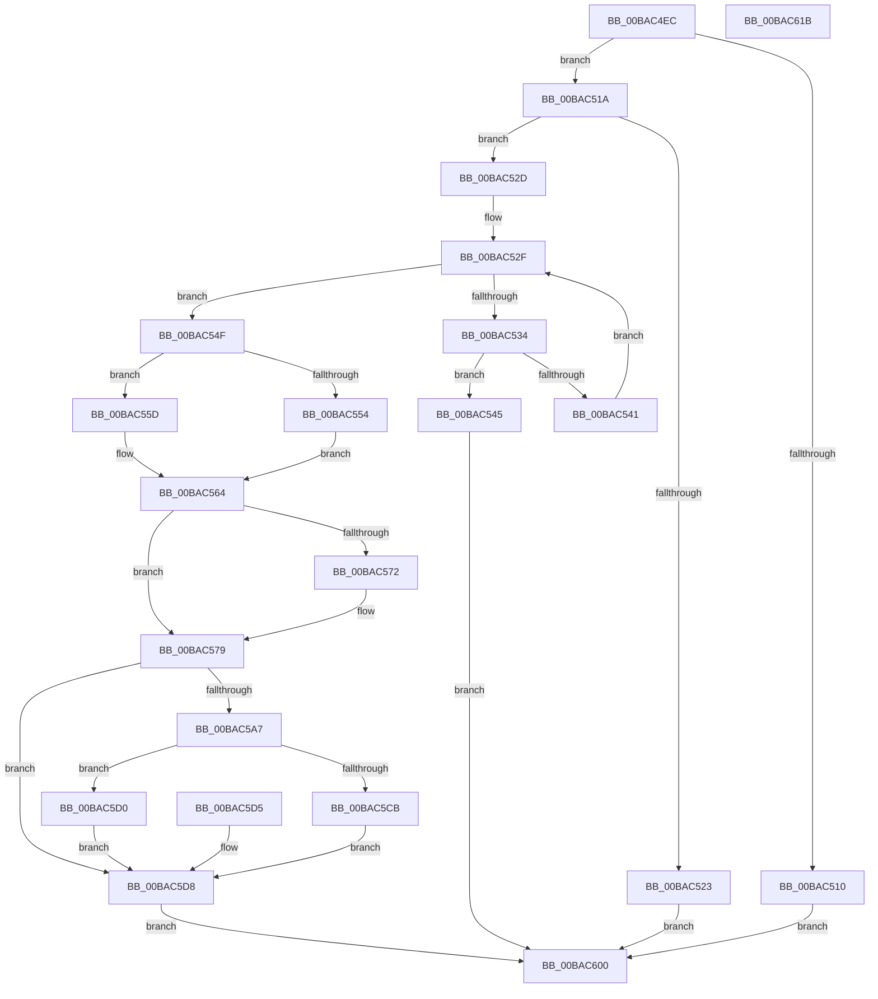

# VfSetVerifierInformation

- RVA: `0x00BAC4EC`–`0x00BAC61C` (길이 `304` bytes)
- VA: `0x0000000140BAC4EC`
- 실행 섹션: `PAGEVRFY`
- PDB 이름 있음: `예`; PDB Function 태그: `아니요`
- unwind 정보 RVA: `0x000D27DC`
- 디코드: `82`개 명령, `304/304` bytes 표시
- 미해석 바이트: `0` (있으면 어셈블리에 `.byte`로 보존)

> 이 문서는 커널 이미지의 기계어와 PDB 기호를 분석해 생성했습니다. 4번과 5번은 함수 원형과 자료형을 바이너리 사용 방식에서 추정한 C 해석이며 원본 소스 복구 결과는 아닙니다.

## 1. Dependencies

- 직접 호출 지점: **4**; 고유 호출 대상: **4**
- 직접 호출자로 확인된 함수: **2**
- RIP 상대 이미지 참조: **11**

### Outgoing calls
- `0x00BAC564` → [VfDriverLock](../B9/VfDriverLock_function_00B9A4A4.md) (function, `0x00B9A4A4`)
- `0x00BAC57B` → [VfInitSystemNoRebootNeeded](../B9/VfInitSystemNoRebootNeeded_function_00B93970.md) (function, `0x00B93970`)
- `0x00BAC5AD` → [VfSettingsCheckForChanges](VfSettingsCheckForChanges_function_00BAB250.md) (function, `0x00BAB250`)
- `0x00BAC5F6` → [KeReleaseMutex](../../text/39/KeReleaseMutex_function_00396810.md) (function, `0x00396810`)

### Direct callers
- [NtSetSystemInformation](../../page/AF/NtSetSystemInformation_function_00AF4A60.md) at `0x00AF52EA`
- [VfFaultsSetParameters](VfFaultsSetParameters_function_00BA67E4.md) at `0x00BA680F`

### Static image references
- `0x00BAC51A` → RVA `0x00FC41C4` (`.data`; read)
- `0x00BAC534` → RVA `0x00E681A0` (`.data`; read)
- `0x00BAC569` → RVA `0x00F04A20` (`.data`; read)
- `0x00BAC572` → RVA `0x00E0E950` (`.data`; read/write)
- `0x00BAC580` → RVA `0x00F04384` (`.data`; read)
- `0x00BAC5B2` → RVA `0x00F04AA0` (`.data`; read)
- `0x00BAC5BA` → RVA `0x00F04AA0` (`.data`; write)
- `0x00BAC5C0` → RVA `0x00F04A20` (`.data`; write)
- `0x00BAC5D8` → RVA `0x00F04380` (`.data`; write)
- `0x00BAC5E2` → RVA `0x00F04938` (`.data`; write)
- `0x00BAC5EF` → RVA `0x00F04900` (`.data`; read)

## 2. Other-region calls and transfers

- 다른 실행 섹션으로 향하는 call: **1**
  - `0x00BAC5F6` → [KeReleaseMutex](../../text/39/KeReleaseMutex_function_00396810.md) (`PAGEVRFY` → `.text`)
- 별도 외부 분기/꼬리 이동을 확인하지 못했습니다.

## 3. Assembly (complete function range)

```asm
00BAC4EC  48 8B C4                        mov rax, rsp
00BAC4EF  48 89 70 08                     mov qword ptr [rax + 8], rsi
00BAC4F3  48 89 78 10                     mov qword ptr [rax + 0x10], rdi
00BAC4F7  4C 89 60 18                     mov qword ptr [rax + 0x18], r12
00BAC4FB  4C 89 70 20                     mov qword ptr [rax + 0x20], r14
00BAC4FF  41 57                           push r15
00BAC501  48 83 EC 30                     sub rsp, 0x30
00BAC505  45 8A E0                        mov r12b, r8b
00BAC508  4C 8B F1                        mov r14, rcx
00BAC50B  83 FA 04                        cmp edx, 4
00BAC50E  73 0A                           jae 0x140bac51a
00BAC510  B8 04 00 00 C0                  mov eax, 0xc0000004
00BAC515  E9 E6 00 00 00                  jmp 0x140bac600
00BAC51A  83 3D A3 7C 41 00 00            cmp dword ptr [rip + 0x417ca3], 0
00BAC521  74 0A                           je 0x140bac52d
00BAC523  B8 5F 03 00 C0                  mov eax, 0xc000035f
00BAC528  E9 D3 00 00 00                  jmp 0x140bac600
00BAC52D  33 C9                           xor ecx, ecx
00BAC52F  83 F9 02                        cmp ecx, 2
00BAC532  73 1B                           jae 0x140bac54f
00BAC534  48 8D 15 65 BC 2B 00            lea rdx, [rip + 0x2bbc65]
00BAC53B  83 3C 8A 00                     cmp dword ptr [rdx + rcx*4], 0
00BAC53F  75 04                           jne 0x140bac545
00BAC541  FF C1                           inc ecx
00BAC543  EB EA                           jmp 0x140bac52f
00BAC545  B8 0F 0C 00 C0                  mov eax, 0xc0000c0f
00BAC54A  E9 B1 00 00 00                  jmp 0x140bac600
00BAC54F  45 84 E4                        test r12b, r12b
00BAC552  74 09                           je 0x140bac55d
00BAC554  41 8B 3E                        mov edi, dword ptr [r14]
00BAC557  89 7C 24 20                     mov dword ptr [rsp + 0x20], edi
00BAC55B  EB 07                           jmp 0x140bac564
00BAC55D  41 8B 3E                        mov edi, dword ptr [r14]
00BAC560  89 7C 24 20                     mov dword ptr [rsp + 0x20], edi
00BAC564  E8 3B DF FE FF                  call 0x140b9a4a4
00BAC569  83 3D B0 84 35 00 00            cmp dword ptr [rip + 0x3584b0], 0
00BAC570  75 07                           jne 0x140bac579
00BAC572  83 25 D7 23 26 00 00            and dword ptr [rip + 0x2623d7], 0
00BAC579  33 D2                           xor edx, edx
00BAC57B  E8 F0 73 FE FF                  call 0x140b93970
00BAC580  8B 15 FE 7D 35 00               mov edx, dword ptr [rip + 0x357dfe]
00BAC586  23 D7                           and edx, edi
00BAC588  F7 D7                           not edi
00BAC58A  23 3D F4 7D 35 00               and edi, dword ptr [rip + 0x357df4]
00BAC590  8B F2                           mov esi, edx
00BAC592  8B 0D 88 84 35 00               mov ecx, dword ptr [rip + 0x358488]
00BAC598  0B F1                           or esi, ecx
00BAC59A  8B C7                           mov eax, edi
00BAC59C  F7 D0                           not eax
00BAC59E  23 F0                           and esi, eax
00BAC5A0  45 33 FF                        xor r15d, r15d
00BAC5A3  3B F1                           cmp esi, ecx
00BAC5A5  74 31                           je 0x140bac5d8
00BAC5A7  44 8B CE                        mov r9d, esi
00BAC5AA  44 8B C7                        mov r8d, edi
00BAC5AD  E8 9E EC FF FF                  call 0x140bab250
00BAC5B2  8B 05 E8 84 35 00               mov eax, dword ptr [rip + 0x3584e8]
00BAC5B8  FF C0                           inc eax
00BAC5BA  89 05 E0 84 35 00               mov dword ptr [rip + 0x3584e0], eax
00BAC5C0  89 35 5A 84 35 00               mov dword ptr [rip + 0x35845a], esi
00BAC5C6  45 84 E4                        test r12b, r12b
00BAC5C9  74 05                           je 0x140bac5d0
00BAC5CB  41 89 36                        mov dword ptr [r14], esi
00BAC5CE  EB 08                           jmp 0x140bac5d8
00BAC5D0  41 89 36                        mov dword ptr [r14], esi
00BAC5D3  EB 03                           jmp 0x140bac5d8
00BAC5D5  44 8B F8                        mov r15d, eax
00BAC5D8  C7 05 9E 7D 35 00 01 00 00 00   mov dword ptr [rip + 0x357d9e], 1
00BAC5E2  48 C7 05 4B 83 35 00 00 00 00 00  mov qword ptr [rip + 0x35834b], 0
00BAC5ED  33 D2                           xor edx, edx
00BAC5EF  48 8D 0D 0A 83 35 00            lea rcx, [rip + 0x35830a]
00BAC5F6  E8 15 A2 7E FF                  call 0x140396810
00BAC5FB  41 8B C7                        mov eax, r15d
00BAC5FE  EB 00                           jmp 0x140bac600
00BAC600  48 8B 74 24 40                  mov rsi, qword ptr [rsp + 0x40]
00BAC605  48 8B 7C 24 48                  mov rdi, qword ptr [rsp + 0x48]
00BAC60A  4C 8B 64 24 50                  mov r12, qword ptr [rsp + 0x50]
00BAC60F  4C 8B 74 24 58                  mov r14, qword ptr [rsp + 0x58]
00BAC614  48 83 C4 30                     add rsp, 0x30
00BAC618  41 5F                           pop r15
00BAC61A  C3                              ret
00BAC61B  CC                              int3
```

## 4. C-style interpretation (structured pseudocode)

```c
__int64 __fastcall VfSetVerifierInformation(__int64 a1, int a2, unsigned __int8 a3)
{
    __int64 result;
    __int64 v_r15;
    __int64 v_rdi;
    __int64 v_rsi;
    __int64 v_rsp;
    unsigned int v_stack_m18;
    unsigned __int64 v_stack_p10;
    unsigned __int64 v_stack_p18;
    unsigned __int64 v_stack_p20;
    unsigned __int64 v_stack_p8;

    *(unsigned __int64 *)(v_rsp + 8) = v_rsi;
    *(unsigned __int64 *)(v_rsp + 16) = v_rdi;
    *(unsigned __int64 *)(v_rsp + 24) = v_r12;
    *(unsigned __int64 *)(v_rsp + 32) = v_r14;
    v_rsp = (v_rsp) - (48);
    if (a2 >= 4) goto loc_00BAC51A;
    goto loc_00BAC600;
loc_00BAC51A:
    if ((*(unsigned int *)(v_rip + 4291747)) == 0) goto loc_00BAC52D;
    goto loc_00BAC600;
loc_00BAC52D:
    a1 = 0;
loc_00BAC52F:
    if (0 >= 2) goto loc_00BAC54F;
    if ((*(unsigned int *)(v_rip + 2866277 + a1 * 4)) != 0) goto loc_00BAC545;
    a1 = (unsigned int)((a1) + 1);
    goto loc_00BAC52F;
loc_00BAC545:
    goto loc_00BAC600;
loc_00BAC54F:
    if (a3 == 0) goto loc_00BAC55D;
    v_stack_m18 = (unsigned int)((unsigned int)(*(unsigned int *)(a1)));
    goto loc_00BAC564;
loc_00BAC55D:
    v_stack_m18 = (unsigned int)((unsigned int)(*(unsigned int *)(a1)));
loc_00BAC564:
    result = VfDriverLock(a1, v_rip + 2866277, a3, a4);
    if ((*(unsigned int *)(v_rip + 3507376)) == 0) {
    }
    a2 = 0;
    result = VfInitSystemNoRebootNeeded(a1, a2, a3, a4);
    a2 = (unsigned int)(((unsigned int)(*(unsigned int *)(v_rip + 3505662))) & ((unsigned int)((unsigned int)(*(unsigned int *)(a1)))));
    v_rdi = (unsigned int)(~((unsigned int)(*(unsigned int *)(a1))));
    v_rdi = (unsigned int)((v_rdi) & (*(unsigned int *)(v_rip + 3505652)));
    v_rsi = (unsigned int)(((unsigned int)(a2)) | ((unsigned int)((unsigned int)(*(unsigned int *)(v_rip + 3507336)))));
    result = (unsigned int)(~((unsigned int)((unsigned int)(v_rdi))));
    v_rsi = (unsigned int)((v_rsi) & ((unsigned int)(result)));
    v_r15 = 0;
    if (((unsigned int)(v_rsi)) == ((unsigned int)((unsigned int)(*(unsigned int *)(v_rip + 3507336))))) goto loc_00BAC5D8;
    result = VfSettingsCheckForChanges((unsigned int)(*(unsigned int *)(v_rip + 3507336)), a2, (unsigned int)((unsigned int)(v_rdi)), (unsigned int)((unsigned int)(v_rsi)));
    result = (unsigned int)(((unsigned int)(*(unsigned int *)(v_rip + 3507432))) + 1);
    *(unsigned int *)(v_rip + 3507424) = (unsigned int)(result);
    *(unsigned int *)(v_rip + 3507290) = (unsigned int)(v_rsi);
    if (a3 == 0) goto loc_00BAC5D0;
    *(unsigned int *)(a1) = (unsigned int)(v_rsi);
    goto loc_00BAC5D8;
loc_00BAC5D0:
    *(unsigned int *)(a1) = (unsigned int)(v_rsi);
    goto loc_00BAC5D8;
loc_00BAC5D8:
    *(unsigned int *)(v_rip + 3505566) = 1;
    *(unsigned __int64 *)(v_rip + 3507019) = 0;
    a2 = 0;
    result = KeReleaseMutex(v_rip + 3506954, a2, (unsigned int)((unsigned int)(v_rdi)), (unsigned int)((unsigned int)(v_rsi)));
    goto loc_00BAC600;
loc_00BAC600:
    v_rsp = (v_rsp) + (48);
    return 0;
}
```

## 5. (Beta) C Style

```c
int64_t VfSetVerifierInformation(void *Arg1, int32_t Arg2, uint8_t Arg3)
{
    uint8_t *arg1 = (uint8_t *)Arg1;

    int64_t result;
    int64_t local_r15;
    int64_t local_rdi;
    int64_t local_rsi;
    int64_t local_rsp;
    uint32_t v_stack_m18;
    uint64_t v_stack_p10;
    uint64_t v_stack_p18;
    uint64_t v_stack_p20;
    uint64_t v_stack_p8;

    *(uint64_t *)(local_rsp + 0x8) = local_rsi;
    *(uint64_t *)(local_rsp + 0x10) = local_rdi;
    *(uint64_t *)(local_rsp + 0x18) = local_r12;
    *(uint64_t *)(local_rsp + 0x20) = local_r14;
    local_rsp = (local_rsp) - (48);
    if (Arg2 >= 4) goto loc_00BAC51A;
    goto loc_00BAC600;
loc_00BAC51A:
    if ((*(uint32_t *)(v_rip + 0x417CA3)) == 0) goto loc_00BAC52D;
    goto loc_00BAC600;
loc_00BAC52D:
    Arg1 = 0;
loc_00BAC52F:
    if (0 >= 2) goto loc_00BAC54F;
    if ((*(uint32_t *)(v_rip + 0x2BBC65 + arg1 * 4)) != 0) goto loc_00BAC545;
    Arg1 = (uint32_t)((Arg1) + 1);
    goto loc_00BAC52F;
loc_00BAC545:
    goto loc_00BAC600;
loc_00BAC54F:
    if (Arg3 == 0) goto loc_00BAC55D;
    v_stack_m18 = (uint32_t)((uint32_t)(*(uint32_t *)(arg1)));
    goto loc_00BAC564;
loc_00BAC55D:
    v_stack_m18 = (uint32_t)((uint32_t)(*(uint32_t *)(arg1)));
loc_00BAC564:
    result = VfDriverLock(Arg1, v_rip + 2866277, Arg3, a4);
    if ((*(uint32_t *)(v_rip + 0x3584B0)) == 0) {
    }
    Arg2 = 0;
    result = VfInitSystemNoRebootNeeded(Arg1, Arg2, Arg3, a4);
    Arg2 = (uint32_t)(((uint32_t)(*(uint32_t *)(v_rip + 0x357DFE))) & ((uint32_t)((uint32_t)(*(uint32_t *)(arg1)))));
    local_rdi = (uint32_t)(~((uint32_t)(*(uint32_t *)(arg1))));
    local_rdi = (uint32_t)((local_rdi) & (*(uint32_t *)(v_rip + 0x357DF4)));
    local_rsi = (uint32_t)(((uint32_t)(Arg2)) | ((uint32_t)((uint32_t)(*(uint32_t *)(v_rip + 0x358488)))));
    result = (uint32_t)(~((uint32_t)((uint32_t)(local_rdi))));
    local_rsi = (uint32_t)((local_rsi) & ((uint32_t)(result)));
    local_r15 = 0;
    if (((uint32_t)(local_rsi)) == ((uint32_t)((uint32_t)(*(uint32_t *)(v_rip + 0x358488))))) goto loc_00BAC5D8;
    result = VfSettingsCheckForChanges((uint32_t)(*(uint32_t *)(v_rip + 0x358488)), Arg2, (uint32_t)((uint32_t)(local_rdi)), (uint32_t)((uint32_t)(local_rsi)));
    result = (uint32_t)(((uint32_t)(*(uint32_t *)(v_rip + 0x3584E8))) + 1);
    *(uint32_t *)(v_rip + 0x3584E0) = (uint32_t)(result);
    *(uint32_t *)(v_rip + 0x35845A) = (uint32_t)(local_rsi);
    if (Arg3 == 0) goto loc_00BAC5D0;
    *(uint32_t *)(arg1) = (uint32_t)(local_rsi);
    goto loc_00BAC5D8;
loc_00BAC5D0:
    *(uint32_t *)(arg1) = (uint32_t)(local_rsi);
    goto loc_00BAC5D8;
loc_00BAC5D8:
    *(uint32_t *)(v_rip + 0x357D9E) = 1;
    *(uint64_t *)(v_rip + 0x35834B) = 0;
    Arg2 = 0;
    result = KeReleaseMutex(v_rip + 3506954, Arg2, (uint32_t)((uint32_t)(local_rdi)), (uint32_t)((uint32_t)(local_rsi)));
    goto loc_00BAC600;
loc_00BAC600:
    local_rsp = (local_rsp) + (48);
    return 0;
}
```

### 관측된 메모리 오프셋

구조체 형식이 확인되지 않은 접근은 인자 기준의 오프셋으로만 기록했습니다.

| 기준 인자 | 오프셋 표현 | 폭 (bit) | 접근 |
|---|---:|---:|---|
| `Arg1` | `+ 0x0` | `32` | `R` |
| `Arg1` | `+ 0x0` | `32` | `W` |

## 6. Execution-region graph

[열기: 2D/3D 그래프와 함수 탐색 컨트롤 패널](../../../control-panel.html?section=pagevrfy&rva=0x00BAC4EC&view=graph)

- 2D 그래프는 위에서 아래로 흐르고, 3D 그래프는 빈 공간을 드래그해 회전합니다. Shift+드래그는 이동, 휠은 확대·축소, 함수 노드 선택은 대상 보고서 이동입니다.

### Static fallback


