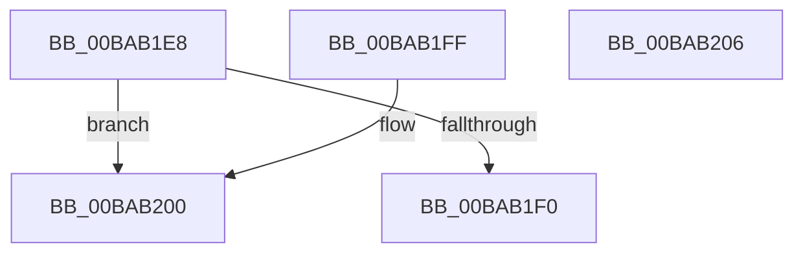

# VfSetVerifierRunningMode

- RVA: `0x00BAB1E8`–`0x00BAB207` (길이 `31` bytes)
- VA: `0x0000000140BAB1E8`
- 실행 섹션: `PAGEVRFY`
- PDB 이름 있음: `예`; PDB Function 태그: `아니요`
- unwind 정보 RVA: `0x000DB714`
- 디코드: `11`개 명령, `31/31` bytes 표시
- 미해석 바이트: `0` (있으면 어셈블리에 `.byte`로 보존)

> 이 문서는 커널 이미지의 기계어와 PDB 기호를 분석해 생성했습니다. 4번과 5번은 함수 원형과 자료형을 바이너리 사용 방식에서 추정한 C 해석이며 원본 소스 복구 결과는 아닙니다.

## 1. Dependencies

- 직접 호출 지점: **0**; 고유 호출 대상: **0**
- 직접 호출자로 확인된 함수: **2**
- RIP 상대 이미지 참조: **2**

### Outgoing calls
- 직접 디코드된 call 명령이 없습니다.

### Direct callers
- [VfSetVerifierInformationEx](VfSetVerifierInformationEx_function_00BAC624.md) at `0x00BAC657`
- [ViInitSystemPhase0](../../init/C4/ViInitSystemPhase0_function_00C4C1B0.md) at `0x00C4C517`

### Static image references
- `0x00BAB1F0` → RVA `0x00E0E944` (`.data`; write)
- `0x00BAB1F8` → RVA `0x00F04AA4` (`.data`; write)

## 2. Other-region calls and transfers

- 다른 실행 섹션으로 향하는 call: **0**
- 별도 외부 분기/꼬리 이동을 확인하지 못했습니다.

## 3. Assembly (complete function range)

```asm
00BAB1E8  8D 41 FF                        lea eax, [rcx - 1]
00BAB1EB  83 F8 03                        cmp eax, 3
00BAB1EE  77 10                           ja 0x140bab200
00BAB1F0  89 0D 4E 37 26 00               mov dword ptr [rip + 0x26374e], ecx
00BAB1F6  33 C0                           xor eax, eax
00BAB1F8  89 0D A6 98 35 00               mov dword ptr [rip + 0x3598a6], ecx
00BAB1FE  C3                              ret
00BAB1FF  CC                              int3
00BAB200  B8 0D 00 00 C0                  mov eax, 0xc000000d
00BAB205  C3                              ret
00BAB206  CC                              int3
```

## 4. C-style interpretation (structured pseudocode)

```c
__int64 __fastcall VfSetVerifierRunningMode(__int64 a1)
{
    __int64 result;

    if (((unsigned int)(a1 - 1)) > 3) goto loc_00BAB200;
    *(unsigned int *)(v_rip + 2504526) = (unsigned int)(a1);
    result = 0;
    *(unsigned int *)(v_rip + 3512486) = (unsigned int)(a1);
    return result;
loc_00BAB200:
    return (unsigned int)(0xC000000DULL);
}
```

## 5. (Beta) C Style

```c
int64_t VfSetVerifierRunningMode(void *Arg1)
{
    uint8_t *arg1 = (uint8_t *)Arg1;

    int64_t result;

    if (((uint32_t)(Arg1 - 1)) > 3) goto loc_00BAB200;
    *(uint32_t *)(v_rip + 0x26374E) = (uint32_t)(Arg1);
    result = 0;
    *(uint32_t *)(v_rip + 0x3598A6) = (uint32_t)(Arg1);
    return result;
loc_00BAB200:
    return (uint32_t)(0xC000000DULL);
}
```

### 관측된 메모리 오프셋

구조체 형식이 확인되지 않은 접근은 인자 기준의 오프셋으로만 기록했습니다.

| 기준 인자 | 오프셋 표현 | 폭 (bit) | 접근 |
|---|---:|---:|---|
| `Arg1` | `- 0x1` | `32` | `R` |

## 6. Execution-region graph

[열기: 2D/3D 그래프와 함수 탐색 컨트롤 패널](../../../control-panel.html?section=pagevrfy&rva=0x00BAB1E8&view=graph)

- 2D 그래프는 위에서 아래로 흐르고, 3D 그래프는 빈 공간을 드래그해 회전합니다. Shift+드래그는 이동, 휠은 확대·축소, 함수 노드 선택은 대상 보고서 이동입니다.

### Static fallback


