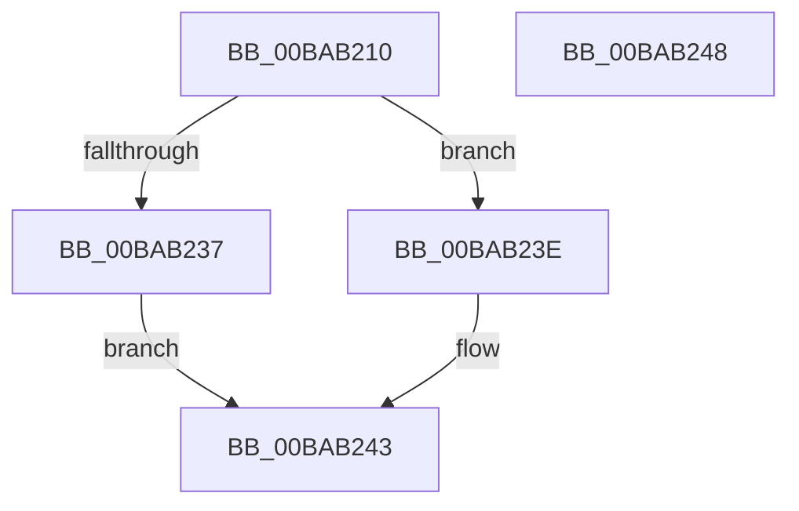

# VfSettingsApplyMiscellaneousChecks

- RVA: `0x00BAB210`–`0x00BAB249` (길이 `57` bytes)
- VA: `0x0000000140BAB210`
- 실행 섹션: `PAGEVRFY`
- PDB 이름 있음: `예`; PDB Function 태그: `아니요`
- unwind 정보 RVA: `0x0005C788`
- 디코드: `15`개 명령, `57/57` bytes 표시
- 미해석 바이트: `0` (있으면 어셈블리에 `.byte`로 보존)

> 이 문서는 커널 이미지의 기계어와 PDB 기호를 분석해 생성했습니다. 4번과 5번은 함수 원형과 자료형을 바이너리 사용 방식에서 추정한 C 해석이며 원본 소스 복구 결과는 아닙니다.

## 1. Dependencies

- 직접 호출 지점: **2**; 고유 호출 대상: **2**
- 직접 호출자로 확인된 함수: **2**
- RIP 상대 이미지 참조: **2**

### Outgoing calls
- `0x00BAB237` → [ExSetPoolFlags](../../text/65/ExSetPoolFlags_function_006567C4.md) (function, `0x006567C4`)
- `0x00BAB23E` → [ExClearPoolFlags](../../text/65/ExClearPoolFlags_function_00655E60.md) (function, `0x00655E60`)

### Direct callers
- [VfSettingsCheckForChanges](VfSettingsCheckForChanges_function_00BAB250.md) at `0x00BAB302`
- [VfMiscPluginEntry](VfMiscPluginEntry_function_00BAE660.md) at `0x00BAF2FA`

### Static image references
- `0x00BAB214` → RVA `0x00E681A0` (`.data`; read)
- `0x00BAB22B` → RVA `0x00F04A20` (`.data`; read)

## 2. Other-region calls and transfers

- 다른 실행 섹션으로 향하는 call: **2**
  - `0x00BAB237` → [ExSetPoolFlags](../../text/65/ExSetPoolFlags_function_006567C4.md) (`PAGEVRFY` → `.text`)
  - `0x00BAB23E` → [ExClearPoolFlags](../../text/65/ExClearPoolFlags_function_00655E60.md) (`PAGEVRFY` → `.text`)
- 별도 외부 분기/꼬리 이동을 확인하지 못했습니다.

## 3. Assembly (complete function range)

```asm
00BAB210  48 83 EC 28                     sub rsp, 0x28
00BAB214  8B 05 86 CF 2B 00               mov eax, dword ptr [rip + 0x2bcf86]
00BAB21A  25 00 00 40 00                  and eax, 0x400000
00BAB21F  F7 D8                           neg eax
00BAB221  1B C9                           sbb ecx, ecx
00BAB223  F7 D1                           not ecx
00BAB225  81 E1 06 02 00 00               and ecx, 0x206
00BAB22B  F7 05 EB 97 35 00 00 08 00 00   test dword ptr [rip + 0x3597eb], 0x800
00BAB235  74 07                           je 0x140bab23e
00BAB237  E8 88 B5 AA FF                  call 0x1406567c4
00BAB23C  EB 05                           jmp 0x140bab243
00BAB23E  E8 1D AC AA FF                  call 0x140655e60
00BAB243  48 83 C4 28                     add rsp, 0x28
00BAB247  C3                              ret
00BAB248  CC                              int3
```

## 4. C-style interpretation (structured pseudocode)

```c
__int64 __fastcall VfSettingsApplyMiscellaneousChecks(int a1)
{
    __int64 result;
    __int64 v_rsp;

    v_rsp = (v_rsp) - (40);
    result = (unsigned int)(((unsigned int)(*(unsigned int *)(v_rip + 2871174))) & (0x400000ULL));
    result = (unsigned int)(-(result));
    a1 = (unsigned int)(~(a1));
    a1 = (unsigned int)((a1) & (518));
    if (((*(unsigned int *)(v_rip + 3512299)) & (0x800ULL)) == 0) goto loc_00BAB23E;
    result = ExSetPoolFlags(a1, a2, a3, a4);
    goto loc_00BAB243;
loc_00BAB23E:
    result = ExClearPoolFlags(a1, a2, a3, a4);
loc_00BAB243:
    v_rsp = (v_rsp) + (40);
    return result;
}
```

## 5. (Beta) C Style

```c
int64_t VfSettingsApplyMiscellaneousChecks(int32_t Arg1)
{
    int64_t result;
    int64_t local_rsp;

    local_rsp = (local_rsp) - (40);
    result = (uint32_t)(((uint32_t)(*(uint32_t *)(v_rip + 0x2BCF86))) & (0x400000ULL));
    result = (uint32_t)(-(result));
    Arg1 = (uint32_t)(~(Arg1));
    Arg1 = (uint32_t)((Arg1) & (518));
    if (((*(uint32_t *)(v_rip + 0x3597EB)) & (0x800ULL)) == 0) goto loc_00BAB23E;
    result = ExSetPoolFlags(Arg1, a2, a3, a4);
    goto loc_00BAB243;
loc_00BAB23E:
    result = ExClearPoolFlags(Arg1, a2, a3, a4);
loc_00BAB243:
    local_rsp = (local_rsp) + (40);
    return result;
}
```

## 6. Execution-region graph

[열기: 2D/3D 그래프와 함수 탐색 컨트롤 패널](../../../control-panel.html?section=pagevrfy&rva=0x00BAB210&view=graph)

- 2D 그래프는 위에서 아래로 흐르고, 3D 그래프는 빈 공간을 드래그해 회전합니다. Shift+드래그는 이동, 휠은 확대·축소, 함수 노드 선택은 대상 보고서 이동입니다.

### Static fallback


