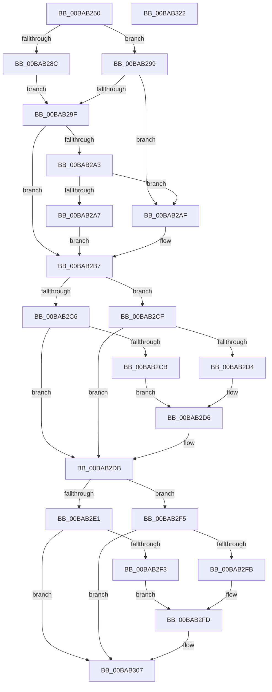

# VfSettingsCheckForChanges

- RVA: `0x00BAB250`–`0x00BAB323` (길이 `211` bytes)
- VA: `0x0000000140BAB250`
- 실행 섹션: `PAGEVRFY`
- PDB 이름 있음: `예`; PDB Function 태그: `아니요`
- unwind 정보 RVA: `0x0005E6B4`
- 디코드: `69`개 명령, `211/211` bytes 표시
- 미해석 바이트: `0` (있으면 어셈블리에 `.byte`로 보존)

> 이 문서는 커널 이미지의 기계어와 PDB 기호를 분석해 생성했습니다. 4번과 5번은 함수 원형과 자료형을 바이너리 사용 방식에서 추정한 C 해석이며 원본 소스 복구 결과는 아닙니다.

## 1. Dependencies

- 직접 호출 지점: **5**; 고유 호출 대상: **5**
- 직접 호출자로 확인된 함수: **1**
- RIP 상대 이미지 참조: **2**

### Outgoing calls
- `0x00BAB276` → [VfKeCheckForChanges](VfKeCheckForChanges_function_00BA5FEC.md) (function, `0x00BA5FEC`)
- `0x00BAB2BA` → [ViSettingsIoCheckForChanges](ViSettingsIoCheckForChanges_function_00BAB3BC.md) (function, `0x00BAB3BC`)
- `0x00BAB2D6` → [ViDeadlockDetectionApplySettings](ViDeadlockDetectionApplySettings_function_00BA9178.md) (function, `0x00BA9178`)
- `0x00BAB2FD` → [ViSettingsEnableKernelHandleChecking](ViSettingsEnableKernelHandleChecking_function_00BAB360.md) (function, `0x00BAB360`)
- `0x00BAB302` → [VfSettingsApplyMiscellaneousChecks](VfSettingsApplyMiscellaneousChecks_function_00BAB210.md) (function, `0x00BAB210`)

### Direct callers
- [VfSetVerifierInformation](VfSetVerifierInformation_function_00BAC4EC.md) at `0x00BAC5AD`

### Static image references
- `0x00BAB2A7` → RVA `0x00FC6BBC` (`ALMOSTRO`; write)
- `0x00BAB2AF` → RVA `0x00FC6BBC` (`ALMOSTRO`; read/write)

## 2. Other-region calls and transfers

- 다른 실행 섹션으로 향하는 call: **0**
- 별도 외부 분기/꼬리 이동을 확인하지 못했습니다.

## 3. Assembly (complete function range)

```asm
00BAB250  48 8B C4                        mov rax, rsp
00BAB253  48 89 58 08                     mov qword ptr [rax + 8], rbx
00BAB257  48 89 68 10                     mov qword ptr [rax + 0x10], rbp
00BAB25B  48 89 70 18                     mov qword ptr [rax + 0x18], rsi
00BAB25F  48 89 78 20                     mov qword ptr [rax + 0x20], rdi
00BAB263  41 56                           push r14
00BAB265  48 83 EC 20                     sub rsp, 0x20
00BAB269  8B F1                           mov esi, ecx
00BAB26B  45 8B F1                        mov r14d, r9d
00BAB26E  41 8B C9                        mov ecx, r9d
00BAB271  41 8B D8                        mov ebx, r8d
00BAB274  8B EA                           mov ebp, edx
00BAB276  E8 71 AD FF FF                  call 0x140ba5fec
00BAB27B  33 C0                           xor eax, eax
00BAB27D  8B FE                           mov edi, esi
00BAB27F  23 FB                           and edi, ebx
00BAB281  33 D2                           xor edx, edx
00BAB283  8D 58 01                        lea ebx, [rax + 1]
00BAB286  40 F6 C5 08                     test bpl, 8
00BAB28A  74 0D                           je 0x140bab299
00BAB28C  8B C6                           mov eax, esi
00BAB28E  C1 E8 03                        shr eax, 3
00BAB291  F7 D0                           not eax
00BAB293  23 C3                           and eax, ebx
00BAB295  8B D0                           mov edx, eax
00BAB297  EB 06                           jmp 0x140bab29f
00BAB299  40 F6 C7 08                     test dil, 8
00BAB29D  75 10                           jne 0x140bab2af
00BAB29F  85 D2                           test edx, edx
00BAB2A1  74 14                           je 0x140bab2b7
00BAB2A3  85 C0                           test eax, eax
00BAB2A5  74 08                           je 0x140bab2af
00BAB2A7  89 1D 0F B9 41 00               mov dword ptr [rip + 0x41b90f], ebx
00BAB2AD  EB 08                           jmp 0x140bab2b7
00BAB2AF  0F BA 2D 05 B9 41 00 1C         bts dword ptr [rip + 0x41b905], 0x1c
00BAB2B7  41 8B CE                        mov ecx, r14d
00BAB2BA  E8 FD 00 00 00                  call 0x140bab3bc
00BAB2BF  B0 20                           mov al, 0x20
00BAB2C1  40 84 E8                        test al, bpl
00BAB2C4  74 09                           je 0x140bab2cf
00BAB2C6  40 84 F0                        test al, sil
00BAB2C9  75 10                           jne 0x140bab2db
00BAB2CB  8B CB                           mov ecx, ebx
00BAB2CD  EB 07                           jmp 0x140bab2d6
00BAB2CF  40 84 F8                        test al, dil
00BAB2D2  74 07                           je 0x140bab2db
00BAB2D4  33 C9                           xor ecx, ecx
00BAB2D6  E8 9D DE FF FF                  call 0x140ba9178
00BAB2DB  0F BA E5 0B                     bt ebp, 0xb
00BAB2DF  73 14                           jae 0x140bab2f5
00BAB2E1  0F BA E6 0B                     bt esi, 0xb
00BAB2E5  B9 00 00 00 00                  mov ecx, 0
00BAB2EA  0F 93 C1                        setae cl
00BAB2ED  0F BA E6 0B                     bt esi, 0xb
00BAB2F1  72 14                           jb 0x140bab307
00BAB2F3  EB 08                           jmp 0x140bab2fd
00BAB2F5  0F BA E7 0B                     bt edi, 0xb
00BAB2F9  73 0C                           jae 0x140bab307
00BAB2FB  33 C9                           xor ecx, ecx
00BAB2FD  E8 5E 00 00 00                  call 0x140bab360
00BAB302  E8 09 FF FF FF                  call 0x140bab210
00BAB307  48 8B 5C 24 30                  mov rbx, qword ptr [rsp + 0x30]
00BAB30C  48 8B 6C 24 38                  mov rbp, qword ptr [rsp + 0x38]
00BAB311  48 8B 74 24 40                  mov rsi, qword ptr [rsp + 0x40]
00BAB316  48 8B 7C 24 48                  mov rdi, qword ptr [rsp + 0x48]
00BAB31B  48 83 C4 20                     add rsp, 0x20
00BAB31F  41 5E                           pop r14
00BAB321  C3                              ret
00BAB322  CC                              int3
```

## 4. C-style interpretation (structured pseudocode)

```c
__int64 __fastcall VfSettingsCheckForChanges(int a1, int a2, int a3, int a4)
{
    __int64 result;
    __int64 v_rdi;
    __int64 v_rsp;
    unsigned __int64 v_stack_p10;
    unsigned __int64 v_stack_p18;
    unsigned __int64 v_stack_p20;
    unsigned __int64 v_stack_p8;

    *(unsigned __int64 *)(v_rsp + 8) = v_rbx;
    *(unsigned __int64 *)(v_rsp + 16) = v_rbp;
    *(unsigned __int64 *)(v_rsp + 24) = v_rsi;
    *(unsigned __int64 *)(v_rsp + 32) = v_rdi;
    v_rsp = (v_rsp) - (32);
    result = VfKeCheckForChanges((unsigned int)(a4), a2, a3, a4);
    result = 0;
    v_rdi = (unsigned int)(((unsigned int)((unsigned int)((unsigned int)(a1)))) & ((unsigned int)((unsigned int)(a3))));
    a2 = 0;
    if ((((unsigned __int8)((unsigned int)(a2))) & (8)) == 0) goto loc_00BAB299;
    result = (unsigned int)(((unsigned int)((unsigned int)((unsigned int)(a1)))) >> (3));
    result = (unsigned int)(~(result));
    result = (unsigned int)((result) & ((unsigned int)(result + 1)));
    goto loc_00BAB29F;
loc_00BAB299:
    if ((((unsigned __int8)(v_rdi)) & (8)) != 0) goto loc_00BAB2AF;
loc_00BAB29F:
    if ((unsigned int)((unsigned int)((unsigned int)(result))) == 0) goto loc_00BAB2B7;
    if ((unsigned int)(result) == 0) goto loc_00BAB2AF;
    *(unsigned int *)(v_rip + 4307215) = (unsigned int)(result + 1);
    goto loc_00BAB2B7;
loc_00BAB2AF:
loc_00BAB2B7:
    result = ViSettingsIoCheckForChanges((unsigned int)((unsigned int)((unsigned int)(a4))), (unsigned int)((unsigned int)(result)), a3, a4);
    if (((32) & ((unsigned __int8)((unsigned int)(a2)))) == 0) goto loc_00BAB2CF;
    if (((32) & ((unsigned __int8)((unsigned int)(a1)))) != 0) goto loc_00BAB2DB;
    goto loc_00BAB2D6;
loc_00BAB2CF:
    if (((32) & ((unsigned __int8)(v_rdi))) == 0) goto loc_00BAB2DB;
    a1 = 0;
loc_00BAB2D6:
    result = ViDeadlockDetectionApplySettings(a1, (unsigned int)((unsigned int)(result)), a3, a4);
loc_00BAB2DB:
    if (condition_is_above_or_equal) goto loc_00BAB2F5;
    a1 = (condition_is_above_or_equal) ? 1 : 0;
    if (condition_is_below) goto loc_00BAB307;
    goto loc_00BAB2FD;
loc_00BAB2F5:
    if (condition_is_above_or_equal) goto loc_00BAB307;
    a1 = 0;
loc_00BAB2FD:
    result = ViSettingsEnableKernelHandleChecking(a1, (unsigned int)((unsigned int)(result)), a3, a4);
    result = VfSettingsApplyMiscellaneousChecks(a1, (unsigned int)((unsigned int)(result)), a3, a4);
loc_00BAB307:
    v_rsp = (v_rsp) + (32);
    return result;
}
```

## 5. (Beta) C Style

```c
int64_t VfSettingsCheckForChanges(int32_t Arg1, int32_t Arg2, int32_t Arg3, int32_t Arg4)
{
    int64_t result;
    int64_t local_rdi;
    int64_t local_rsp;
    uint64_t v_stack_p10;
    uint64_t v_stack_p18;
    uint64_t v_stack_p20;
    uint64_t v_stack_p8;

    *(uint64_t *)(local_rsp + 0x8) = local_rbx;
    *(uint64_t *)(local_rsp + 0x10) = local_rbp;
    *(uint64_t *)(local_rsp + 0x18) = local_rsi;
    *(uint64_t *)(local_rsp + 0x20) = local_rdi;
    local_rsp = (local_rsp) - (32);
    result = VfKeCheckForChanges((uint32_t)(Arg4), Arg2, Arg3, Arg4);
    result = 0;
    local_rdi = (uint32_t)(((uint32_t)((uint32_t)((uint32_t)(Arg1)))) & ((uint32_t)((uint32_t)(Arg3))));
    Arg2 = 0;
    if ((((uint8_t)((uint32_t)(Arg2))) & (8)) == 0) goto loc_00BAB299;
    result = (uint32_t)(((uint32_t)((uint32_t)((uint32_t)(Arg1)))) >> (3));
    result = (uint32_t)(~(result));
    result = (uint32_t)((result) & ((uint32_t)(result + 1)));
    goto loc_00BAB29F;
loc_00BAB299:
    if ((((uint8_t)(local_rdi)) & (8)) != 0) goto loc_00BAB2AF;
loc_00BAB29F:
    if ((uint32_t)((uint32_t)((uint32_t)(result))) == 0) goto loc_00BAB2B7;
    if ((uint32_t)(result) == 0) goto loc_00BAB2AF;
    *(uint32_t *)(v_rip + 0x41B90F) = (uint32_t)(result + 1);
    goto loc_00BAB2B7;
loc_00BAB2AF:
loc_00BAB2B7:
    result = ViSettingsIoCheckForChanges((uint32_t)((uint32_t)((uint32_t)(Arg4))), (uint32_t)((uint32_t)(result)), Arg3, Arg4);
    if (((32) & ((uint8_t)((uint32_t)(Arg2)))) == 0) goto loc_00BAB2CF;
    if (((32) & ((uint8_t)((uint32_t)(Arg1)))) != 0) goto loc_00BAB2DB;
    goto loc_00BAB2D6;
loc_00BAB2CF:
    if (((32) & ((uint8_t)(local_rdi))) == 0) goto loc_00BAB2DB;
    Arg1 = 0;
loc_00BAB2D6:
    result = ViDeadlockDetectionApplySettings(Arg1, (uint32_t)((uint32_t)(result)), Arg3, Arg4);
loc_00BAB2DB:
    if (condition_is_above_or_equal) goto loc_00BAB2F5;
    Arg1 = (condition_is_above_or_equal) ? 1 : 0;
    if (condition_is_below) goto loc_00BAB307;
    goto loc_00BAB2FD;
loc_00BAB2F5:
    if (condition_is_above_or_equal) goto loc_00BAB307;
    Arg1 = 0;
loc_00BAB2FD:
    result = ViSettingsEnableKernelHandleChecking(Arg1, (uint32_t)((uint32_t)(result)), Arg3, Arg4);
    result = VfSettingsApplyMiscellaneousChecks(Arg1, (uint32_t)((uint32_t)(result)), Arg3, Arg4);
loc_00BAB307:
    local_rsp = (local_rsp) + (32);
    return result;
}
```

## 6. Execution-region graph

[열기: 2D/3D 그래프와 함수 탐색 컨트롤 패널](../../../control-panel.html?section=pagevrfy&rva=0x00BAB250&view=graph)

- 2D 그래프는 위에서 아래로 흐르고, 3D 그래프는 빈 공간을 드래그해 회전합니다. Shift+드래그는 이동, 휠은 확대·축소, 함수 노드 선택은 대상 보고서 이동입니다.

### Static fallback


