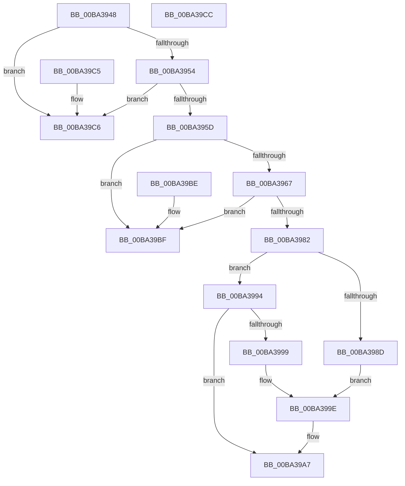

# VfStartBranchTracing

- RVA: `0x00BA3948`–`0x00BA39CD` (길이 `133` bytes)
- VA: `0x0000000140BA3948`
- 실행 섹션: `PAGEVRFY`
- PDB 이름 있음: `예`; PDB Function 태그: `아니요`
- unwind 정보 RVA: `0x000DB714`
- 디코드: `36`개 명령, `133/133` bytes 표시
- 미해석 바이트: `0` (있으면 어셈블리에 `.byte`로 보존)

> 이 문서는 커널 이미지의 기계어와 PDB 기호를 분석해 생성했습니다. 4번과 5번은 함수 원형과 자료형을 바이너리 사용 방식에서 추정한 C 해석이며 원본 소스 복구 결과는 아닙니다.

## 1. Dependencies

- 직접 호출 지점: **0**; 고유 호출 대상: **0**
- 직접 호출자로 확인된 함수: **2**
- RIP 상대 이미지 참조: **5**

### Outgoing calls
- 직접 디코드된 call 명령이 없습니다.

### Direct callers
- [KiFreezeTargetExecution](../../text/5C/KiFreezeTargetExecution_function_005C30A0.md) at `0x005C332F`
- [VfNotifyVerifierOfEvent](../B9/VfNotifyVerifierOfEvent_function_00B92E90.md) at `0x00B92ECC`
- [VfNotifyVerifierOfEvent](../B9/VfNotifyVerifierOfEvent_function_00B92E90.md) at `0x00B92F2B`

### Static image references
- `0x00BA3948` → RVA `0x00F04A20` (`.data`; read)
- `0x00BA3954` → RVA `0x00FFDAE8` (`PAGEVRFD`; read)
- `0x00BA395D` → RVA `0x00FFDAA4` (`PAGEVRFD`; read)
- `0x00BA3970` → RVA `0x01005C50` (`PAGEVRFD`; read)
- `0x00BA3982` → RVA `0x00FF402C` (`PAGEVRFD`; read)

## 2. Other-region calls and transfers

- 다른 실행 섹션으로 향하는 call: **0**
- 별도 외부 분기/꼬리 이동을 확인하지 못했습니다.

## 3. Assembly (complete function range)

```asm
00BA3948  F7 05 CE 10 36 00 00 00 00 08   test dword ptr [rip + 0x3610ce], 0x8000000
00BA3952  74 72                           je 0x140ba39c6
00BA3954  83 3D 8D A1 45 00 00            cmp dword ptr [rip + 0x45a18d], 0
00BA395B  74 69                           je 0x140ba39c6
00BA395D  8B 05 41 A1 45 00               mov eax, dword ptr [rip + 0x45a141]
00BA3963  85 C0                           test eax, eax
00BA3965  74 58                           je 0x140ba39bf
00BA3967  65 48 8B 04 25 20 00 00 00      mov rax, qword ptr gs:[0x20]
00BA3970  4C 8D 05 D9 22 46 00            lea r8, [rip + 0x4622d9]
00BA3977  8B 40 24                        mov eax, dword ptr [rax + 0x24]
00BA397A  41 8B 04 80                     mov eax, dword ptr [r8 + rax*4]
00BA397E  85 C0                           test eax, eax
00BA3980  75 3D                           jne 0x140ba39bf
00BA3982  8B 05 A4 06 45 00               mov eax, dword ptr [rip + 0x4506a4]
00BA3988  83 F8 0F                        cmp eax, 0xf
00BA398B  75 07                           jne 0x140ba3994
00BA398D  B8 0C 00 00 00                  mov eax, 0xc
00BA3992  EB 0A                           jmp 0x140ba399e
00BA3994  83 F8 06                        cmp eax, 6
00BA3997  75 0E                           jne 0x140ba39a7
00BA3999  B8 C0 00 00 00                  mov eax, 0xc0
00BA399E  33 D2                           xor edx, edx
00BA39A0  B9 D9 01 00 00                  mov ecx, 0x1d9
00BA39A5  0F 30                           wrmsr
00BA39A7  65 48 8B 04 25 20 00 00 00      mov rax, qword ptr gs:[0x20]
00BA39B0  8B 48 24                        mov ecx, dword ptr [rax + 0x24]
00BA39B3  33 C0                           xor eax, eax
00BA39B5  41 C7 04 88 01 00 00 00         mov dword ptr [r8 + rcx*4], 1
00BA39BD  C3                              ret
00BA39BE  CC                              int3
00BA39BF  B8 2A 04 00 C0                  mov eax, 0xc000042a
00BA39C4  C3                              ret
00BA39C5  CC                              int3
00BA39C6  B8 02 00 00 C0                  mov eax, 0xc0000002
00BA39CB  C3                              ret
00BA39CC  CC                              int3
```

## 4. C-style interpretation (structured pseudocode)

```c
__int64 __fastcall VfStartBranchTracing(__int64 a1, int a2)
{
    __int64 result;

    if (((*(unsigned int *)(v_rip + 3543246)) & (0x8000000ULL)) == 0) goto loc_00BA39C6;
    if ((*(unsigned int *)(v_rip + 4563341)) == 0) goto loc_00BA39C6;
    if ((unsigned int)((unsigned int)(*(unsigned int *)(v_rip + 4563265))) == 0) goto loc_00BA39BF;
    if ((unsigned int)((unsigned int)(*(unsigned int *)(v_rip + 4596441 + (unsigned int)(*(unsigned int *)(*(unsigned __int64 *)(gs_base + (0 + 32)) + 36)) * 4))) != 0) goto loc_00BA39BF;
    if (((unsigned int)((unsigned int)(*(unsigned int *)(v_rip + 4523684)))) != 15) goto loc_00BA3994;
    goto loc_00BA399E;
loc_00BA3994:
    if (12 != 6) goto loc_00BA39A7;
loc_00BA399E:
    a2 = 0;
loc_00BA39A7:
    result = 0;
    *(unsigned int *)(v_rip + 4596441 + (unsigned int)(*(unsigned int *)(*(unsigned __int64 *)(gs_base + (0 + 32)) + 36)) * 4) = 1;
    return result;
loc_00BA39BF:
    return (unsigned int)(0xC000042AULL);
loc_00BA39C6:
    return (unsigned int)(0xC0000002ULL);
}
```

## 5. (Beta) C Style

```c
int64_t VfStartBranchTracing(int64_t Arg1, int32_t Arg2)
{
    int64_t result;

    if (((*(uint32_t *)(v_rip + 0x3610CE)) & (0x8000000ULL)) == 0) goto loc_00BA39C6;
    if ((*(uint32_t *)(v_rip + 0x45A18D)) == 0) goto loc_00BA39C6;
    if ((uint32_t)((uint32_t)(*(uint32_t *)(v_rip + 0x45A141))) == 0) goto loc_00BA39BF;
    if ((uint32_t)((uint32_t)(*(uint32_t *)(v_rip + 0x4622D9 + (uint32_t)(*(uint32_t *)(*(uint64_t *)(gs_base + (0 + 0x20)) + 0x24)) * 4))) != 0) goto loc_00BA39BF;
    if (((uint32_t)((uint32_t)(*(uint32_t *)(v_rip + 0x4506A4)))) != 15) goto loc_00BA3994;
    goto loc_00BA399E;
loc_00BA3994:
    if (12 != 6) goto loc_00BA39A7;
loc_00BA399E:
    Arg2 = 0;
loc_00BA39A7:
    result = 0;
    *(uint32_t *)(v_rip + 0x4622D9 + (uint32_t)(*(uint32_t *)(*(uint64_t *)(gs_base + (0 + 0x20)) + 0x24)) * 4) = 1;
    return result;
loc_00BA39BF:
    return (uint32_t)(0xC000042AULL);
loc_00BA39C6:
    return (uint32_t)(0xC0000002ULL);
}
```

## 6. Execution-region graph

[열기: 2D/3D 그래프와 함수 탐색 컨트롤 패널](../../../control-panel.html?section=pagevrfy&rva=0x00BA3948&view=graph)

- 2D 그래프는 위에서 아래로 흐르고, 3D 그래프는 빈 공간을 드래그해 회전합니다. Shift+드래그는 이동, 휠은 확대·축소, 함수 노드 선택은 대상 보고서 이동입니다.

### Static fallback


